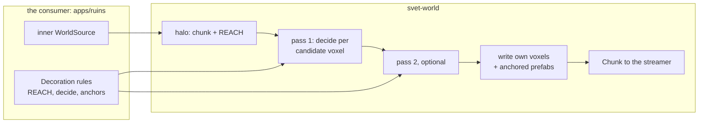

# 0113: Overgrowth by shape: a seeded decoration pass over generated chunks, rules the consumer supplies

> **Status:** draft (2026-11-28), awaits the owner's approval
> **Drafted on Opus 2026-11-28 (Fable exhausted for the week); a Fable second pass reviews and
> fixes this draft after the weekly reset (owner).**
> **Created:** 2026-11-28
> **Milestone:** M10: Outdoors in [`docs/roadmap.md`](../roadmap.md), the target look
> **Related ADRs:** [ADR-0090](../adrs/0090-every-look-feature-has-a-floor-form-and-a-rich-form-and-a-rich-profile-holds-its-own-budget-on-a-named-card.md)
> (rule 1: a generation pass has no profile),
> [ADR-0066](../adrs/0066-a-large-prefab-is-stored-as-bricks-and-its-stamp-is-a-placement-the-world-finishes-as-chunks-arrive.md)
> (placements across chunks, the larger objects' path). An ADR for this pass's shape (the
> pull rule and the bounded reach, with the alternatives below) is owed at the Fable pass.
> **Source:** the owner, 2026-11-28 (the target look: moss on tops and ledges, foliage spilling
> over edges, damp staining down stone); the backlog's "The target look" entry, which named
> this "a placement rule over the world's geometry, offered as a general generation pass whose
> rules the game supplies".
> **Starts after:** nothing on the look track: it is headless and runs on the world lane,
> beside the look track, after Plan 0033's world briefs and Plan 0114's Phases 1 and 2 (whose
> scene it is judged in). Its window is Plan 0114's.

## TL;DR

`svet-world` gains `DecoratedSource<S, R>`, a source wrapper like `StampedSource` that runs a
consumer's `Decoration` rules over each chunk the inner source generates. A rule reads the
inner voxels in a bounded neighbourhood around a voxel (its reach, at most 16 voxels) and
decides that voxel's material: stone with sky above becomes moss, air beside a ledge's lip
becomes a hanging spill, stone under a ledge within a few voxels becomes stained. The pass is
**pull-style**: each chunk computes only its own voxels from the inner source's voxels, never
from the pass's output in another chunk, so the result is the same in any generation order,
on any thread and on both platforms. Objects larger than the reach (clumps, long vines, trees)
are emitted as anchors whose prefabs are placed by the same pull rule within the reach, or as
source-level placements (ADR-0066) beyond it. The engine owns the mechanism and its
neighbourhood helpers; the consumer (Plan 0114's demo world here) owns the rules and the
materials. The first thing seen is a CPU test: a stone slab under open sky gains a one-voxel
moss top in every chunk order.

## Context & problem

- The target look's strongest trait is overgrowth that follows shape. Our sources write
  terrain and placements, but nothing places material by the geometry already generated, and
  a consumer that writes it inside its own source must solve the chunk edges (a ledge's lip is
  in one chunk, its spill in the next) and the order independence itself.
- `svet-world` is headless and deterministic (CLAUDE.md): integer math, explicit seeds, the
  same bytes on Linux and Windows.
- Touches `docs/nfr.md` section 5 (streaming: a chunk's generation time) and section 3 (more
  mixed bricks in RAM and in the mirror).

## Decision

A `Decoration` trait with a declared `REACH` (voxels, at most 16) and one method,
`decide(&self, n: &Neighbourhood, v: VoxelCoord) -> MaterialId`, called for each voxel of a
candidate brick; `Neighbourhood` reads the inner source's materials within the reach and offers
integer helpers (`exposed(face)`, `sky_above(max)`, `lip(dir)`, `below_solid(within)`,
`hash(seed, v)`, `noise(cell, v)`). The wrapper generates the inner chunk plus a halo of
`REACH` voxels on every side, skips bricks whose halo'd neighbourhood is all one material (no
surface to decorate), calls `decide` on the rest, and writes only the chunk's own voxels. Up to
two passes run in sequence; pass 2 reads pass 1's output, so the halo is the sum of both
reaches (at most 16). An anchor rule (`anchors(&self, n, v) -> Option<(PrefabId, rotation)>`)
places a small prefab at a voxel; a chunk writes every anchored prefab whose box meets it,
found by searching anchors within the prefab table's largest extent, which must be at most the
reach. The halo comes from a new optional method on `WorldSource`, `halo(coord, margin, out)`,
whose default generates the neighbouring chunks (correct, slow), and which a per-voxel source
(`FnSource`, the demo's sources) implements directly.

We rejected: **colouring by shape in the renderer** (a shader tints faces by normal and
occlusion: cheap, but not in the world, so digging reveals nothing, spills need geometry, and
audio and collision see bare stone; Plan 0112's colour layers already take the render-side
part); **decoration as logged edits after a chunk loads** (the op log would grow with
exploration, edits would depend on residency order, and each load would spend the edit budget);
**leaving it to each consumer's source** (every consumer re-solves the halo and the order
independence; the engine gives it once).

## Architecture diagram



## Implementation phases

### Phase 1: The wrapper, one pass, moss on an open top (walking skeleton)
- **Owner skill:** dev
- **What:** `Decoration`, `Neighbourhood` with `exposed` and `hash`, `DecoratedSource` with one
  pass, the default `halo` and `FnSource`'s direct one.
- **Files touched:** new `crates/svet-world/src/decorate.rs` (and `decorate/tests.rs`),
  `crates/svet-world/src/source.rs`, `crates/svet-world/src/lib.rs`.
- **Done when:**
  1. `a_slab_under_sky_gains_a_moss_top` (CPU, under 1 s): over a 3 x 3 x 2 chunk extent of
     stone below `z = 40` and air above, a rule "stone with air above becomes moss" turns
     exactly the 192 x 192 voxels at `z = 39` to moss (36 864) and nothing else.
  2. `decoration_is_the_same_in_any_chunk_order` (CPU, about 2 s): a seeded noise terrain over
     4 x 4 x 2 chunks decorated in ascending order, in descending order and on 4 threads gives
     equal `voxel_hash` per chunk; and each chunk equals the matching region of a brute-force
     pass over the whole extent held in one array (the oracle).
  3. `the_default_halo_agrees_with_the_direct_one` (CPU, under 2 s): `FnSource` with its
     direct halo and the same function behind the default halo decorate to equal hashes.

### Phase 2: The helpers, the second pass and the skip
- **Owner skill:** dev
- **What:** `sky_above`, `lip`, `below_solid`, `noise`; two passes; the uniform-brick skip.
- **Files touched:** `decorate.rs`, `decorate/tests.rs`.
- **Done when:**
  1. Each helper has a test on a hand-built neighbourhood stating its value at named voxels
     (for example `lip(+x)` is true at the last stone voxel of a ledge whose `+x` neighbour and
     the voxel below that are air, and false one voxel back).
  2. `a_stain_runs_down_from_a_ledge` (CPU, under 1 s): pass 1 mosses the open top, pass 2
     turns to `stain` each stone voxel with an air face toward `+x` that lies at most 6
     voxels below a moss voxel of the same column; on a straight 10-voxel cliff face 20
     voxels wide the stain is exactly 6 voxels deep in every column (120 voxels) and the 4
     voxels below stay stone.
  3. A reading: chunk generation time with and without the pass at reach 8 and 16 on Plan
     0114's canyon source, the RTX host, 64 chunks, median; and the share of bricks skipped.

### Phase 3: Anchors and small prefabs within the reach
- **Owner skill:** dev
- **What:** `anchors`, a prefab table with each prefab's extent checked against the reach at
  construction (an error, not a panic), anchored prefabs written pull-style.
- **Files touched:** `decorate.rs`, `decorate/tests.rs`, `crates/svet-world/src/prefab.rs` if
  the extent needs a helper.
- **Done when:**
  1. `an_anchored_prefab_crosses_a_chunk_edge_whole` (CPU, under 1 s): a 5 x 5 x 5 prefab
     anchored two voxels from a chunk edge is written whole across both chunks in either order.
  2. A prefab larger than the reach is refused with `DecorateError::ExtentOverReach`.
  3. `decoration_is_the_same_in_any_chunk_order` holds with anchors.

### Phase 4: Cross-platform vectors and the budget readings
- **Owner skill:** dev
- **What:** a fixed vector (seed, rules, extent, expected per-chunk hashes) asserted on both CI
  arms; the RAM and mirror figures on the demo world.
- **Files touched:** `crates/svet-world/tests/decorate_vectors.rs`, `docs/nfr/` readings.
- **Done when:** the vector test passes on Linux and Windows CI (under 3 s); the readings log
  records generation time, mixed-brick count and mirror bytes with and without the pass on
  Plan 0114's world at its default residency, RTX host.

Plan 0114's Phase 4 writes the demo's rules and its window judges them; this plan has no
window of its own.

## Data shapes

```rust
// illustrative
pub trait Decoration: Sync {
    const REACH: u8;                       // voxels, <= 16
    fn decide(&self, n: &Neighbourhood, v: VoxelCoord) -> MaterialId;
    fn anchors(&self, _n: &Neighbourhood, _v: VoxelCoord) -> Option<(PrefabId, Rotation)> { None }
}
pub struct DecoratedSource<S, R, R2 = ()> { /* inner, pass 1, optional pass 2, prefabs, seed */ }
```

Halo arithmetic for a 64-voxel chunk: reach 8 reads 80^3 = 512 000 voxels, 249 856 (0.95x the
chunk) more than the chunk; reach 16 reads 96^3 = 884 736, 622 592 (2.4x) more. The uniform
skip is what keeps the pass near the chunk's own cost; Phase 2 reads it.

## Budgets

| `nfr.md` figure | projection (a guess) | how the close measures it |
|---|---|---|
| Section 5, a chunk's generation on the stream workers | at most 2x the inner source at reach 8 with the skip | Phase 2 reading, 64 chunks, median |
| Section 3, RAM and mirror | mixed bricks rise where tops and cliffs are decorated; the count is read, not projected | Phase 4 reading |
| Section 2, frame | none on any profile (ADR-0090 rule 1) | unchanged |

## Risks & open questions

- **Determinism:** `decide` is consumer code. The trait's doc requires a pure function of the
  neighbourhood, the seed and the voxel; the order test catches order dependence in the
  engine, not in a consumer's rule. Plan 0114's rules get the same test.
- **The default halo is 27 chunk generations** for a source without a direct halo; its doc says
  so, and the demo's sources implement it.
- **Edits and persistence:** an edited chunk is saved and restored as is; an unedited one is
  regenerated identically. A dig next to a decorated voxel does not re-decorate (a decoration
  is generation, not simulation). Regrowth over time is not this plan.

## What this plan does NOT do

- No rules or materials of any game; the demo's are Plan 0114's.
- No growth over time, no spreading simulation (the backlog's "Noita-style dynamics").
- No profile: the world is the same under every profile.
- No prefabs larger than the reach through anchors: trees and large clumps stay placements.

## Implementation log

> Written by `dev`: one row per phase as its commit lands, then the close block. Readings,
> attempts and resume notes go to `docs/plans/logs/0113.md`.

| phase | owner | state | commit |
|---|---|---|---|
| 1: the wrapper, one pass, moss on an open top | dev | not started | |
| 2: the helpers, the second pass and the skip | dev | not started | |
| 3: anchors and small prefabs | dev | not started | |
| 4: cross-platform vectors and the readings | dev | not started | |

### Notes

### Close triggers

## Followups
