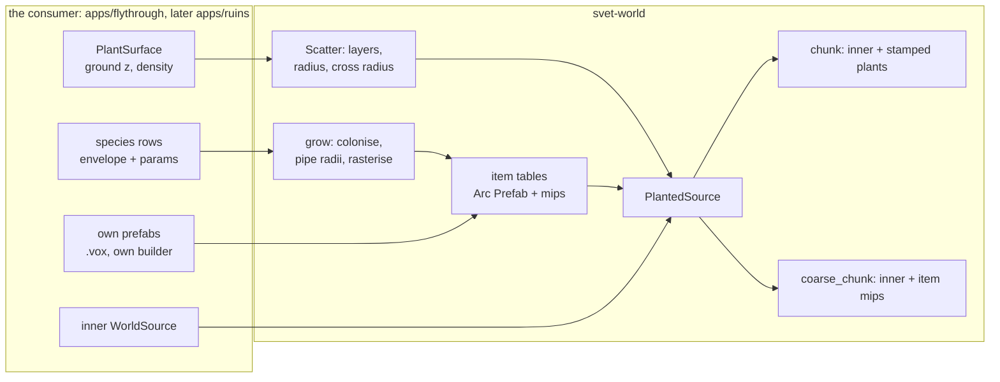

# 0116: Planted content: a spaced scatter of any prefab, grown trees with roots and fallen logs, and their far copies

> **Status:** draft (2026-11-28), awaits the owner's approval
> **Drafted on Opus 2026-11-28 (Fable exhausted for the week); a Fable second pass reviews and
> fixes this draft after the weekly reset, with Plans 0112 to 0115 (owner).**
> **Created:** 2026-11-28
> **Milestone:** M10: Outdoors in [`docs/roadmap.md`](../roadmap.md), the target look
> **Related ADRs:** [ADR-0091](../adrs/0091-planted-content-is-a-pull-safe-scatter-over-a-table-of-prefabs-with-far-copies-from-each-prefabs-own-mips.md)
> (proposed with this plan: the scatter, `PlantedSource`, far copies from prefab mips, the
> grower as one supplier),
> [ADR-0028](../adrs/0028-far-field-as-a-clipmap-of-source-generated-coarse-chunks.md)
> (the source's coarse path the far copies answer),
> [ADR-0066](../adrs/0066-a-large-prefab-is-stored-as-bricks-and-its-stamp-is-a-placement-the-world-finishes-as-chunks-arrive.md)
> (prefabs as bricks; the stamp's write path),
> [ADR-0090](../adrs/0090-every-look-feature-has-a-floor-form-and-a-rich-form-and-a-rich-profile-holds-its-own-budget-on-a-named-card.md)
> (rule 1: a generation pass has no profile)
> **Source:** the owner, 2026-11-28, answering
> [the terrain and vegetation reading](../references/procedural-terrain-and-vegetation.md):
> trees by space colonisation as their own plan after Plan 0115; the far field shows
> vegetation; scope "trees + scatter"; the grower generic in the engine; forms broadleaf,
> conifer, shrub and bare **plus roots and fallen logs**; far trees as shrunk copies; and
> "consumers should be able to provide trees themselves". The backlog's "Trees by space
> colonisation, leaf masses at the tips" and "Sunlit tree crowns sparkle in motion".
> **Starts after:** Plan 0115's Phase 1 (its blob builder, which the grower calls at the tips)
> on the world lane; Phase 4 after Plan 0033's world briefs 1a and 2a (`ClipCoord`,
> `MipRule`, `coarse_chunk`). The smooth gradient noise and the erosion filter (the reading's
> gaps 2 and 3) are **not** here: they go to a terrain plan for Plan 0114's canyon.
> **Exploration (lane rules 2b):** Phases 3 and 5 are exploration; the owner's window in
> Phase 6 is their gate. Every phase lands its CPU tests of data, determinism and API.

## TL;DR

`svet-world` gains a **scatter** (candidates on a lattice, a hashed priority, a radius per
layer and a cross radius between layers, a density the consumer supplies; pull-safe and
integer), **`PlantedSource`**, a source wrapper that stamps any prefab the scatter (or the
consumer's own `Planting`) puts down, across chunk edges in any order, and answers the far
field with each prefab's own mips, and a **grower**: space colonisation in fixed point inside
an envelope, branch radii by the pipe model, Plan 0115's dense blobs at the tips, rasterised
to a prefab. The grower is one supplier. A `.vox` tree or a consumer-built prefab goes through
the same table and gets the same spacing and far copies. The fly-through's hills grow
broadleaf, conifer, shrub and bare trees with surface roots, and fallen logs between them,
beside today's trees under `--tree-form classic|grown`. The first thing seen is a CPU test: a
scatter decides the same survivors in any chunk order, and no two survivors of a layer are
closer than its radius. Then the hills, with the classic trees spaced by it.

## Context & problem

- **Where:** `trees.rs` keeps a tree per 48-voxel cell by a hash. Trees clump and gap at
  random, and there is no way to keep shrubs off trunks or logs out of crowns. The placement
  is written inside `OutdoorSource`, so Plan 0114's demo and the first consumer would each
  rewrite it.
- **What:** the classic crown is a sphere whose voxels are kept by a hash (`--leaf-fill` 64,
  a quarter), a sparse volume that sparkles under jitter and FSR 2 (the backlog). The target
  look's crowns are layered masses with gaps between them.
- **How far:** ADR-0028's far field asks the source for coarse chunks. Plan 0033 answers the
  classic trees with a special canopy-envelope rule at levels 2 and 3 (its owner answer 2).
  Nothing answers a consumer's own trees.
- **Who:** the owner wants consumers to provide trees themselves (2026-11-28). The engine must
  not assume it built the prefab.
- Touches `docs/nfr.md` section 5 (a chunk's generation, near and coarse), section 3 (denser
  crowns: mixed bricks in RAM and in the mirror, near and far) and the start-up readings
  (the grower runs at load).

## Decision

ADR-0091. In brief:

- **Scatter.** One candidate per lattice cell per layer, jittered by `hash3(seed, layer,
  cell)`. The consumer's `PlantSurface::sample(layer, xy) -> Option<(z, density u16)>` gives
  each candidate its ground and its density (slope, sky, moisture, a painted mask: the
  consumer's call), and the candidate passes when a second hash is under the density. A
  passing candidate survives when no passing candidate of its layer within `radius` has a
  higher priority (ties to the lower cell), and no survivor of an earlier layer lies within
  the cross radius. The rule is not recursive, so the bound is fixed: the cells within
  `radius` (and, for the cross rule, the earlier layers' cells within the cross radius, each
  with its own radius).
- **`Planting` and `PlantedSource<S, P: Planting>`.** `Planting::plants_near(xy_box, out)`
  lists the plants (item, position, `Rot` about z with an optional mirror) whose footprint
  meets a column box. The scatter implements it with per-layer item tables (`Arc<Prefab>`,
  anchor, weight, picked by hash), and a consumer may implement it directly. `PlantedSource`
  writes the plants' voxels into each chunk over the inner source through the stamp's masked
  write. Its `coarse_chunk` writes each item's mip at the plant's position snapped to the
  level's cell, over the inner coarse answer.
- **Grower.** `grow::colonise(seed, &dyn Envelope, Params) -> Skeleton`, in 1/256-voxel fixed
  point (`fixed.rs`'s unit). Attraction points are hashed inside the envelope. Each round,
  every point pulls its nearest node within the influence radius, found through a uniform
  grid with ties to the lower node index. A node grows one step along the normalised sum of
  its pulls, using the integer root. Points within the kill radius go. Then
  `Skeleton::radii(pipe)` (a parent's area is the sum of its children's) and
  `rasterise(&Skeleton, wood, Option<TipBlobs>) -> Prefab`, with tips from Plan 0115's
  `prefab::blob`. The envelopes are `Ellipsoid`, `Cone`, `Disc` (roots: flattened, opening
  downward) and `Capsule`; `Envelope` is a public trait. A log is a skeleton grown in a
  `Capsule` lying along x, with no tip blobs, and it is placed by its own layer.
- **Species in `apps/`.** Broadleaf, conifer, shrub and bare are parameter rows in
  `apps/flythrough/src/trees.rs`. Roots are a second colonisation from the trunk's base
  node, joined into one skeleton before rasterising, on broadleaf and bare. Logs are a layer
  whose density is 0 where the consumer's slope is over its line.

We rejected (ADR-0091): placements as ADR-0066's list (an unbounded world cannot be listed),
trees as Plan 0113 anchors (a reach of 100 voxels reads about 70 times a chunk), a
canopy-density far field (the owner's pick), and L-systems as the engine's grower (no
competition for space; a consumer can still hand in L-system prefabs).

## Architecture diagram



## Implementation phases

### Phase 1: The scatter and `PlantedSource`, the classic trees spaced (walking skeleton)
- **Owner skill:** dev
- **What:** `scatter.rs` (layers, radius, cross radius, `PlantSurface`, the survival rule),
  `Planting`, `PlantedSource::chunk` over item tables; the fly-through's outdoor source moves
  its classic trees onto it (one layer, the same 16 variants), keeping `--trees
  none|sparse|forest` as densities.
- **Files touched:** new `crates/svet-world/src/scatter.rs`, `crates/svet-world/src/plant.rs`
  (and their `tests.rs`), `crates/svet-world/src/lib.rs`, `apps/flythrough/src/trees.rs`,
  `apps/flythrough/src/outdoor.rs`, the fly-through's source tests.
- **Done when:**
  1. `survivors_are_spaced` (CPU, under 1 s): over a 1024 × 1024-voxel square at full
     density, radius 60 and cell 32, no two survivors of the layer are closer than 60
     voxels, and every passing candidate that did not survive has a passing candidate of
     higher priority within 60 (the rule, checked against a brute-force pass over all
     candidates).
  2. `the_cross_radius_keeps_layers_apart` (CPU, under 1 s): with a tree layer and a shrub
     layer at cross radius 20, no shrub survivor lies within 20 voxels of a tree survivor.
  3. `planting_is_the_same_in_any_chunk_order` (CPU, about 2 s): the hills with classic
     trees at `forest` over 4 × 4 × 2 chunks, built ascending, descending and on 4 threads,
     give equal `voxel_hash` per chunk, and each chunk equals a brute-force stamp of every
     survivor into one array.
  4. Density 0 everywhere gives the inner source's bytes exactly.
  5. The fly-through opens `--source outdoor --trees forest` with the spaced classic trees.
     The banner names the placement (`scatter`).

### Phase 2: The grower
- **Owner skill:** dev
- **What:** `grow.rs`: `Envelope` and its four shapes, `colonise`, `Skeleton::radii`,
  `rasterise` with tip blobs, roots as a second colonisation joined at the base node.
- **Files touched:** new `crates/svet-world/src/grow.rs` (and `grow/tests.rs`),
  `crates/svet-world/src/lib.rs`; `prefab.rs` only if `rasterise` needs a builder helper.
- **Done when:**
  1. `a_grown_tree_is_one_piece` (CPU, under 2 s): for 32 seeds of an ellipsoid crown, the
     rasterised prefab (wood and tip blobs) is 6-connected and touches its base voxel.
  2. `every_tip_carries_a_mass` (CPU, under 1 s): every skeleton leaf node lies inside a tip
     blob, and every blob voxel inside the blob shrunk by 2 voxels is solid (Plan 0115's
     density by construction).
  3. `pipe_radii_hold` (CPU, under 1 s): at every branching node, the squared radius in
     fixed point is within one unit of the sum of its children's squared radii, before the
     floor of one voxel.
  4. `growth_is_pure` (CPU): equal seeds and params give equal prefab ids. A fixed vector of
     ids (one per envelope, plus roots) is asserted on both CI arms.
  5. `growth_ends` (CPU): `colonise` stops by the round cap or when no point is in reach,
     and a run that hits the cap is reported in the skeleton, not looped.
  6. A reading: build time per variant (median of 16 seeds per envelope, the RTX host, one
     thread) and prefab bytes.

### Phase 3: The forms on the hills, consumer trees beside them (exploration)
- **Owner skill:** dev
- **What:** the species rows (broadleaf, conifer, shrub, bare; roots on broadleaf and bare),
  the log layer, three layers on the hills (trees, shrubs, logs) with cross radii, built at
  load on the worker threads behind the loading screen; `--tree-form classic|grown` (the
  classic trees stay as a setting, owner 2026-11-12) shown in the banner; **a consumer tree
  from `.vox`**: a test fixture `.vox` tree (a small model made for this repo, under
  `apps/flythrough/assets/`) through `svet-assets` into the same item
  table.
- **Files touched:** `apps/flythrough/src/trees.rs`, `apps/flythrough/src/outdoor.rs`, the
  fly-through's flag table and `docs/flythrough.md`, a new fixture under
  `apps/flythrough/assets/plants/`, its tests, `docs/plans/logs/0116.md`.
- **Done when:**
  1. `a_vox_tree_plants_like_a_grown_one` (CPU, under 2 s): the fixture loads to a prefab,
     joins a layer's table, and `planting_is_the_same_in_any_chunk_order` holds with it.
  2. The order test holds for `grown` with all three layers.
  3. `logs_lie_where_the_ground_is_flat` (CPU, under 1 s): no log survives where the hills'
     slope (the consumer's column-height difference over 8 voxels) is over its line.
  4. Readings: load time of all variants on 1 and 4 threads, chunk generation time (median of
     64 chunks) for classic and grown, mixed bricks and mirror bytes at the default
     residency, all on the RTX host.

### Phase 4: Far copies
- **Owner skill:** dev
- **What:** item mips at levels 1 to 3 under the residency's `MipRule`, built at
  registration; `PlantedSource::coarse_chunk` over the inner coarse answer; the outdoor
  source's `grown` form takes it (the classic form keeps Plan 0033's envelope rule).
- **Files touched:** `crates/svet-world/src/plant.rs`, its tests, `prefab.rs` (a prefab mip
  helper), `apps/flythrough/src/outdoor.rs`.
- **Done when:**
  1. `far_copies_sit_within_a_cell_of_the_downsample` (CPU, about 5 s): for the hills with
     grown trees over 2 × 2 level-1 clip chunks and one level-3 clip chunk, every cell of
     `coarse_chunk` equals the `MipRule` downsample of the full-detail chunks, or differs
     only within one cell of a plant's box (the snap).
  2. `a_consumer_prefab_has_far_copies` (CPU, under 1 s): the `.vox` fixture's mips are
     built at registration and appear in a level-2 clip chunk at the snapped position.
  3. Readings: coarse generation per clip chunk at each level, with and without plants, and
     the far field's VRAM with grown trees at 0033's default levels, against its 0.5 GB
     line.

### Phase 5: Stillness and cost against the classic trees (exploration)
- **Owner skill:** dev
- **What:** readings only: pixels changing per frame on a slow pan over the hills' forest,
  classic against grown, on Plan 0115 Phase 3's rig, near and across the first far-level
  switch; the hit pass's time on both adapters.
- **Files touched:** `docs/plans/logs/0116.md`, the reading's `mod reading`.
- **Done when:** the readings log holds the table for both adapters, by form.

### Phase 6: The owner's window
- **Owner skill:** human
- **What:** the owner flies the hills (and Plan 0114's ruins if merged) with `classic` and
  `grown`. He picks the default form and the per-species rows (crown size, tip blob size,
  roots, log density), and judges the far trees at the level switches.
- **Done when:** the picks are in the readings log.

### Phase 7: The picks as defaults and tests
- **Owner skill:** dev
- **What:** the picked rows as defaults; a fixed cross-platform vector (seed, layers, the
  species rows, expected per-chunk hashes over 2 × 2 × 1 chunks) on both CI arms; the golden
  `planted_hills.png` on lavapipe (SSIM floor 0.98); the readings into `docs/nfr/`.
- **Files touched:** `crates/svet-world/tests/plant_vectors.rs`, `apps/flythrough/tests/`
  (the golden's `gpu_*` binary, named at the phase's start), `docs/nfr/03-memory.md`,
  `docs/nfr.md` section 5.
- **Done when:** the vector passes on Linux and Windows CI (under 3 s); the golden passes
  (under 10 s on lavapipe); the nfr readings name machine and commit.

## Data shapes

```rust
// illustrative
pub trait PlantSurface: Sync {
    /// Ground z and density (0..=65535) for `layer` at column `xy`, or None: no candidate.
    fn sample(&self, layer: u8, xy: [i32; 2]) -> Option<(i32, u16)>;
}
pub struct Layer { pub cell_log2: u8, pub radius: u16, pub cross: Vec<(u8, u16)>, pub items: Vec<Item> }
pub struct Item { pub prefab: Arc<Prefab>, pub anchor: [i32; 3], pub weight: u16 /* + mips, built at registration */ }
pub struct Plant { pub item: u32, pub at: VoxelCoord, pub rot: Rot }
pub trait Planting: Sync { fn plants_near(&self, xy_min: [i32; 2], xy_max: [i32; 2], out: &mut Vec<Plant>); }
pub trait Envelope: Sync { fn bounds(&self) -> ([i32; 3], [i32; 3]); fn contains(&self, p: Fixed3) -> bool; }
```

**The scatter's neighbourhood, worked.** A chunk is 64 voxels across. With the largest
item's footprint radius `F` (a broadleaf crown up to 40 voxels), the plants whose footprint
meets a chunk have their positions in the chunk's xy box widened by `F`, which is 144 voxels.
Each of those candidates checks its layer's candidates within `radius` (60 voxels). With a
32-voxel cell the box is about 5 × 5 cells, and each candidate checks about 5 × 5 cells
around itself, so about 625 hash-and-sample calls per layer per chunk column. A coarse
level-3 chunk covers 512 voxels, so about 19 × 19 candidate cells and about 9 000 calls (more
with the cross-layer checks). The
consumer's `sample` dominates, which is why it is a callback the consumer can cache per column.

## Budgets

| `nfr.md` figure | projection (a guess) | how the close measures it |
|---|---|---|
| Section 5, a chunk's generation | grown planting within 1.5x the inner source on the hills | Phase 3 reading, 64 chunks, median, RTX host |
| Section 5, coarse generation | read, per level; no projection before 0033's own reading | Phase 4 reading |
| Section 3, RAM and mirror | denser crowns (blobs at fill 0.85 or more against 0.25) add mixed bricks; read | Phases 3 and 4 readings |
| Section 3, far field VRAM | inside 0033's 0.5 GB forest line, or the plan reports it | Phase 4 reading |
| Start-up | the grower at load: under 1 s for all variants on 4 threads (a guess) | Phase 3 reading; over it, fewer variants per form |
| Section 2, frame | none on any profile (ADR-0090 rule 1); the march over denser crowns is read | Phase 5 reading |

## Risks & open questions

- **Determinism:** colonisation is iterative, and the nearest-node search and the step's
  normalisation are where float would creep in. Everything is integer, ties go to the lower
  index, and the fixed vector on both CI arms is the guard. `PlantSurface::sample` is
  consumer code, and the order test catches only the engine's order dependence.
- **Roots float on slopes** on the downhill side. The root disc opens downward and sinks by
  the trunk's sink; the window judges what is left. A ground-aware root (reading the inner
  source) would break the prefab's independence and is not planned.
- **Far copies jump at the switch** by up to half a cell. Plan 0033's band hides it, and
  Phase 5 reads it.
- **Crowns still shimmer at the silhouette** if the tip blobs are small against the pixel at
  the switch distance. The blob size is the lever, and Phase 5 measures it before the window.
- **Plan 0115's blob builder** is a dependency. If 0115 changes its builder at its window,
  Phase 2's tips follow it.

## What this plan does NOT do

- No smooth gradient noise and no erosion filter (the reading's gaps 2 and 3): a terrain plan
  for Plan 0114's canyon, the erosion as a clean reimplementation or skipped (owner).
- No plant names in `crates/`: the engine has envelopes, skeletons and layers.
- No growth over time, no wind sway of trunks or branches (Plan 0081's and Plan 0036's wind
  stays on the detail layer), no felling physics (a cut tree is a dug voxel; ADR-0008's
  collapse applies as to any voxel).
- No ground-following roots, no stacked-ledge candidates beyond one surface per layer.
- No rich form of its own: Plan 0115's `Leaf` elements apply to the tip blobs' rows.
- No Plan 0114 wiring: its Phase 5 takes the scatter for the ruins when both have merged.

## Implementation log

> Written by `dev`: one row per phase as its commit lands, then the close block. Readings,
> attempts and resume notes go to `docs/plans/logs/0116.md`.

| phase | owner | state | commit |
|---|---|---|---|
| 1: the scatter and `PlantedSource` | dev | not started | |
| 2: the grower | dev | not started | |
| 3: the forms on the hills, consumer trees | dev | not started | |
| 4: far copies | dev | not started | |
| 5: stillness and cost | dev | not started | |
| 6: the owner's window | human | not started | |
| 7: the picks as defaults and tests | dev | not started | |

### Notes

### Close triggers

## Followups
