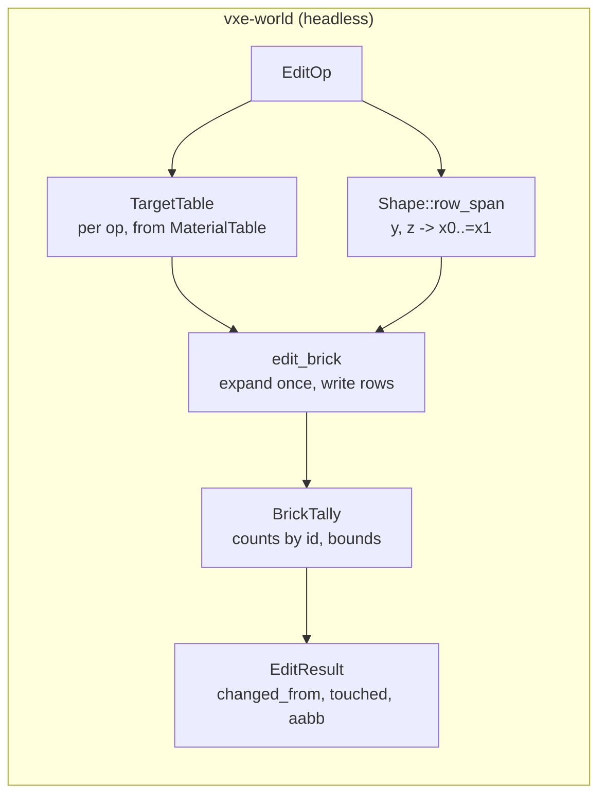

# 0003: Edit cost under 2 ms: row spans, a per-op target table and per-brick tallies

> **Status:** done (closed 2026-10-17, v0.4.1). Verdict: every phase landed with the results
> and both pinned hashes unchanged; `worst` reads 3.56 ms on a quiet box against the 2 ms
> figure, which the owner keeps, and the miss carries to Plan 0014 (see "Close").
> **Created:** 2026-10-16
> **Milestone:** M1 follow-up in `docs/roadmap.md` (the `nfr.md` §4 miss recorded by Plan 0001)
> **Related ADRs:** [ADR-0002](../../adrs/0002-brick-map-layout-and-per-chunk-locked-access.md) (layout and access model, unchanged by this plan). No new ADR: the choices here are implementation choices with no architecture-level alternative worth a record, and the rejected ones are named under "Decision".
> **Prerequisite:** Plan 0002 closed, as the Plan 0001 close decided (`nfr.md` §4: "the edit cost gets its own plan after Plan 0002"). Nothing here depends on Plan 0002's readings; the sequencing avoids a merge in `edit.rs`, which Plan 0002 Phases 1 and 3 also change.

## TL;DR

Plan 0001's edit bench reads 4.92 ms for 100 radius-10 carves on a fresh solid world against
the 2 ms figure in `nfr.md` §4. We rewrite the inner loop of `World::apply` without changing one
result: each brick row is written as a span of voxels computed from the shape (analytically for
sphere and box, by a convexity scan for the capsule), the per-voxel material-table lookup
becomes a per-op lookup table, and counts and bounds accumulate per brick instead of per voxel.
The first thing a reader sees is the oracle test: 200 seeded ops of every shape and mode produce
the same voxels and the same results from the new path as from a brute-force reference kept in
test support, and the determinism constant `0x2b6b_6a0d_1f9b_8d75` does not move. The close reads
the bench under 2 ms on the dev box, or records the breakdown that says why not.

## Context & problem

`nfr.md` §4 asks for 100 sphere carves of radius 1 m (4169 voxels each) in 2 ms of CPU, results
and dirty marking included. Plan 0001 Phase 4 measured 4.92 ms (confidence interval 4.87 to
4.98 ms, AMD Ryzen 9 5900HS, release bench profile) on the worst case: every carve expands
`Uniform` bricks. That is 49 µs per carve; the budget is 20 µs. The fly-through's `B` key,
carving into an already dug cave, read 3.07 to 4.63 ms over about 20 runs (Plan 0001 close),
so the realistic case misses too. The owner kept the figure at the Plan 0001 close and asked
for this plan.

Reading `crates/vxe-world/src/edit.rs` at the Plan 0001 tip, one radius-10 carve does the
following work. The figures are counts from the geometry, not measurements; Phase 1 takes the
measurement.

- The bounding box holds 9261 voxel centres (21³); 4169 lie inside. The sphere enters 32
  bricks, and its bounding box reaches up to 64, each tested for coverage.
- For every candidate centre in a `Partial` brick: `Shape::contains` (an `i64` squared distance
  for the sphere; an `i128` segment distance for the capsule), then `Mode::target`, which calls
  `MaterialTable::get` and reads the flags, then `brick.expand()` (a `match` on every call),
  then `Tally::add`, which searches `counts` linearly and updates six bounds.
- `Brick::collapse` scans all 512 voxels of every changed brick.
- Per op: a `Vec` of `(coord, bounds, Arc)` for the chunks, the `touched` `Vec`, and the result.

The consumer requirement is `project-context.md` "The first consumer", Edits: many small edits
per frame at interactive cost. The `nfr.md` figure touched is §4 (cost). §6 (determinism) is
the gate: this plan may not move a hash.

## Decision

We keep ADR-0002's layout, the public API, and every observable result, and change only how
`apply` walks a brick:

1. **A per-op target table.** `Mode` resolves once per op against the material table into a
   table indexed by old material: for `Carve`, a bit per material row saying whether it carves
   (non-air and not indestructible); for `Fill(m)`, "air becomes `m`"; for `Replace`, the pair.
   The inner loop reads one bit or one compare instead of calling into the table.
2. **Row spans.** Within a brick, for every row (fixed `y`, `z`), the shape gives the inclusive
   range of voxel indices whose centres lie inside. The sphere solves `dx² <= r² - dy² - dz²`
   with an integer square root; the box clips; the capsule, being convex, scans the row from
   both ends with `contains` and stops at the first inside voxel on each side. The row is then
   written as a contiguous slice, x fastest, reading each old value once.
3. **Per-brick tallies.** Counts go into an array indexed by material id (sized to the table,
   zeroed once per op) plus a list of ids seen; bounds come from the span extents, not from
   every voxel. The result is assembled once at the end in ascending material order, as now.
4. **One expansion per brick** before its rows are written, and `collapse` only on bricks that
   changed.

We rejected explicit SIMD (platform-specific code in the deterministic crate; the scalar loop
has to reach the figure first, and the compiler vectorises contiguous `u16` loops). We rejected
threading a single op across bricks (a 1 m carve is at most 64 bricks; thread hand-off costs
more than the work, and `apply` is called from a game tick that may already be parallel). We
rejected changing the brick representation (a bitmask-plus-palette brick is an ADR-0002
supersession and a renderer change; nothing in the breakdown says the `u16` array is the cost).

## Architecture diagram



## Implementation phases

Each phase ships as its own commit. `dev` implements all phases in one session with no review
between phases. The architect reviews once at the end, in a fresh session. Phase 1 is the
walking skeleton: the oracle that every later phase is checked against.

Shared conventions for every phase:

- Plan 0001's conventions hold: coordinates, fixed point at 1/256 voxel, integer shape tests,
  the "solid material-3 world" from `UniformSource(3)` over chunks `[-2, 2)³`, the test table
  with rows 0 (air), 1 to 5, and 4 flagged indestructible, FNV-1a 64 hashes.
- **Every phase ends with the same three assertions green and unchanged:** the oracle test of
  Phase 1, `apps/flythrough/tests/determinism.rs` with its constant `0x2b6b_6a0d_1f9b_8d75`, and
  `raycast_hit_list_is_pinned` with `0xa0f2_c477_8892_c8fb`. A phase that moves either constant
  has a defect; the constant is not re-blessed.
- **The edit path keeps Plan 0002's side effects** (amended at Plan 0002's close): `apply`
  holds the store map's read lock for the whole op, marks the store's dirty-chunk set and
  sets `Chunk::is_edited` on every chunk it changes. `crates/vxe-world/tests/stream.rs` and
  `crates/vxe-world/tests/persist.rs` stay green and unchanged in every phase.
- No `f32` or `f64` enters `edit.rs` or `shape.rs`. `i64::isqrt` (stable since Rust 1.84) is
  the square root.
- The bench is run with `cargo bench -p vxe-world --bench edits` on the dev box; every reading
  in the log names the case, the mean, the confidence interval, the machine and the commit.

### Phase 1: The breakdown and the oracle
- **Owner skill:** dev
- **What:** two more bench cases next to the existing worst case, a measured breakdown of
  where the 49 µs go, and a brute-force reference implementation in test support that every
  later phase is checked against.
- **Files touched:** `crates/vxe-world/benches/edits.rs`, `crates/vxe-world/tests/edits.rs`,
  `crates/vxe-world/tests/support/mod.rs`.
- **Done when:**
  - The bench has three cases: `worst` (the Plan 0001 case: 100 radius-10 carves at seeded
    centres on a fresh solid world), `mixed` (the same 100 carves on a world from the closure
    source `material = if ((x >> 4) + (y >> 4) + (z >> 4)).rem_euclid(3) != 0 { 1 } else { 0 }`,
    so two thirds of the volume is rock in 1.6 m cubes and the carves meet `Full`, uniform-air
    and uniform-rock bricks), and `tool` (100 capsule carves of radius 5 voxels and length 30
    voxels at seeded centres and seeded directions on the fresh solid world). All three read on
    the dev box at the Plan 0001 tip and the log records them.
  - The log records a breakdown of the `worst` case at the Plan 0001 tip: the top five symbols
    by self time from `perf record` on the bench binary (or an equivalent sampling profiler),
    with their percentages. The instrumentation is not committed.
  - `tests/support/mod.rs` has `reference_apply(&World, &EditOp) -> Expected`, a brute-force
    model that walks every voxel centre of the shape's voxel bounds, tests `Shape::contains`,
    applies the mode by a direct `MaterialTable` lookup, and produces the expected
    `changed_from`, `touched`, `aabb`, the expected error, and the expected material of every
    voxel in the bounds after the op. It never calls `World::apply`.
  - `tests/edits.rs::apply_matches_the_reference_over_seeded_ops`: on a world over `[-2, 2)³`
    from the closure source `material = hash(v) % 6` (a SplitMix64-seeded integer hash of the
    coordinate, so bricks are `Full` and all six materials occur), 200 ops seeded by
    `SplitMix64(0x0003_0001)` cycle through sphere, box and capsule and through `Carve`,
    `Fill(m)` and `Replace { from, to }`, with radii from 1 to 12 voxels and centres within
    ±100 voxels of the origin; at least five ops are placed so they reach a non-resident chunk.
    For every op, `World::apply` returns exactly the reference's result or error, and every
    voxel in the op's bounds reads the reference's material afterwards. The test prints how
    many ops changed something; it is at least 150.

### Phase 2: The per-op target table
- **Owner skill:** dev
- **What:** `Mode` resolves once per `apply` into a `TargetTable`; the inner loop consults it
  instead of `MaterialTable`.
- **Files touched:** `crates/vxe-world/src/{edit.rs, material.rs}`,
  `crates/vxe-world/tests/edits.rs`.
- **Done when:**
  - `TargetTable::carve(&MaterialTable)` holds one bit per table row; row `m` is set when
    `m != AIR` and `m` is not indestructible. A unit test on the test table asserts bits 1, 2,
    3 and 5 set and 0 and 4 clear, and that a material id beyond the table's rows reads clear.
  - `Mode::target` is no longer called per voxel; `edit_brick` takes `&TargetTable`. A `Uniform`
    brick whose material has no target is skipped before any coverage test on its voxels, and a
    `Full` brick with `Inside` coverage whose 512 voxels all have no target (an all-indestructible
    brick under `Carve`) is left untouched with no write.
  - The three shared assertions hold. The bench reads on the dev box and the log records them.

### Phase 3: Row spans
- **Owner skill:** dev
- **What:** `Shape::row_span` and a row-wise `edit_brick` that writes contiguous `x` runs.
- **Files touched:** `crates/vxe-world/src/{shape.rs, edit.rs}`,
  `crates/vxe-world/tests/{edits.rs, shapes.rs}`.
- **Done when:**
  - `Shape::row_span(y, z, x_lo, x_hi) -> Option<(i64, i64)>` returns the inclusive range of
    voxel `x` indices within `x_lo..=x_hi` whose centres `(256 x + 128, 256 y + 128,
    256 z + 128)` lie inside, or `None`. For the sphere: `rem = r² - dy² - dz²`; `None` when
    `rem < 0`; otherwise `h = isqrt(rem)` and the range is the voxels with
    `|256 x + 128 - cx| <= h`, computed with `div_euclid` and no float. For the box, the clip
    of the half-open fixed range to voxel indices. For the capsule, a scan inward from both ends
    of `x_lo..=x_hi` using `contains`, which is exact because the capsule is convex.
  - `tests/shapes.rs::row_span_equals_the_set_of_contained_centres`: for 1000 SplitMix64-seeded
    `(shape, y, z)` triples over all three shapes (radii 1 to 40 voxels, random centres and
    segment ends within ±64 voxels), the span equals the exact set `{x in x_lo..=x_hi :
    contains(centre(x, y, z))}`: both `None` when the set is empty, and otherwise the set is
    exactly the range (no gaps, no extras). The boundary case `|256 x + 128 - cx| == h` is
    inside.
  - `edit_brick` iterates rows, takes the span, expands the brick once if any row has a span and
    a target, and writes each span as a slice. The per-voxel work is: read old, look up the
    target, write new, count old.
  - The three shared assertions hold. The bench reads on the dev box and the log records them.

### Phase 4: Per-brick tallies and one collapse
- **Owner skill:** dev
- **What:** counts and bounds accumulate per brick into fixed storage; `collapse` runs once per
  changed brick; nothing in the loop allocates.
- **Files touched:** `crates/vxe-world/src/{edit.rs, brick.rs}`, `crates/vxe-world/tests/edits.rs`.
- **Done when:**
  - `Tally` holds `counts: Vec<u32>` sized to `table.len()` (allocated once per op) and `seen:
    Vec<MaterialId>`; `EditResult::changed_from` is built from `seen` sorted ascending, with the
    counts, and equals what Plan 0001 produced (the oracle and the determinism constant say so).
  - Bounds come from span extents: per row, the span's first and last voxel; per brick, the
    rows written. A brick that changed nothing contributes nothing.
  - `Brick::collapse` is called once per changed brick, and `Brick::expand` once per brick that
    gets a write.
  - The three shared assertions hold. The bench reads on the dev box and the log records all
    three cases with the before and after for this phase.

### Phase 5: Readings against the figure
- **Owner skill:** dev
- **What:** the final readings, the in-frame figure from the fly-through, and `nfr.md` §4.
- **Files touched:** `docs/nfr.md`, `apps/flythrough/src/main.rs` (only if the `B` key's line
  needs the upload bytes split out; otherwise untouched).
- **Done when:**
  - `cargo bench -p vxe-world --bench edits` on the dev box reads `worst` under 2.0 ms (the
    `nfr.md` §4 figure), and the log records `worst`, `mixed` and `tool` with confidence
    intervals, machine and commit. If `worst` reads 2.0 ms or more, the log records the
    Phase 1 breakdown repeated at the tip and the plan stops here without widening the figure:
    the close decides between a follow-up and an `nfr.md` revision with the reading.
  - `cargo run --release -p flythrough -- --level --seed 1`, key `B` or the `--bench` flag
    (100 radius-10 carves within 10 m of the spawn, on the bounded level so the figures compare
    with Plans 0001 and 0002; amended at Plan 0002's close, since the fly-through now streams
    by default): the log records the `bench:` line's edit CPU time and sync bytes on the dev
    box, before and after this plan.
  - `nfr.md` §4 carries the `worst` reading as a dev-reference reading under the figure, with
    machine and commit, replacing nothing (the figure stays 2 ms).

## Data shapes

```rust
// illustrative: vxe-world, all private to edit.rs and shape.rs
enum TargetTable {
    Carve { carves: Vec<u64> },             // bit m set: material m becomes AIR
    Fill(MaterialId),                        // AIR becomes m
    Replace { from: MaterialId, to: MaterialId },
}
impl TargetTable {
    fn target(&self, old: MaterialId) -> Option<MaterialId>;   // None: unchanged
}

impl Shape {
    fn row_span(&self, y: i64, z: i64, x_lo: i64, x_hi: i64) -> Option<(i64, i64)>;
}

struct Tally { counts: Vec<u32>, seen: Vec<MaterialId>, lo: [i64; 3], hi: [i64; 3], any: bool }
```

No public type changes. No new dependency.

## Budgets

| `nfr.md` figure | Expected effect | How the close measures it |
|---|---|---|
| §4 edit cost (2 ms per 100 radius-1 m carves) | From 4.92 ms toward under 2 ms on the `worst` case. The estimate behind the target: per carve, 64 coverage tests at about 20 ns, 32 expansions at about 100 ns each (allocation and a 1 KiB fill), 441 row solves at about 10 ns, 4169 voxel writes at 1 to 2 ns, about 15 µs; this is a guess, and Phase 1's breakdown replaces it | `cargo bench -p vxe-world --bench edits`, three cases, dev box, before and after each phase; the fly-through's `B` key |
| §6 determinism | Unchanged, asserted | the determinism vector and the pinned raycast hash on both CI arms; the oracle test |
| §2 streaming line (upload volume of 100 carves) | Unchanged: the same bricks go dirty | not re-measured; the `B` line's sync bytes are recorded for the record |

The baseline CPU (`nfr.md` §1, 4 cores) is not on hand; the readings are dev reference and say
so. The figure is a per-frame CPU cost on one thread, so the dev box's single-thread speed is
the relevant comparison and is roughly 1.5 to 2 times the baseline's; a 1.5 ms reading on the
dev box projects to about 3 ms there. That projection is a guess until the baseline is measured.

## Risks & open questions

- **The figure may not be reachable with the `u16` array brick.** If Phase 4 lands above
  2 ms, the breakdown says whether the time is in the writes (then the representation is the
  cost and a follow-up ADR considers palette bricks) or in the shape math (then the span solve
  needs work). The plan does not widen the figure; the close decides.
- **Boundary exactness of the span.** `isqrt` floors; the inclusive test `|dx| <= h` must agree
  with `dx² <= rem` for every integer `dx`, which holds because `dx² <= rem` iff `|dx| <=
  isqrt(rem)` for non-negative integers. The Phase 3 property test over 1000 rows is the
  check, and the oracle test is the second.
- **Overflow.** `r² - dy² - dz²` is `i64`; with `r` up to 2³¹ fixed units (8 million voxels) the
  squares fit. The capsule keeps its `i128` path.
- **Determinism.** Integer only, same iteration order (bricks ascending within a chunk, chunks
  ascending), same result assembly. The two pinned constants are the gate.
- **The bench measures allocation too.** `iter_batched` builds a fresh world per iteration
  outside the timed region; the timed region still allocates 32 bricks per carve, which is
  real cost the figure includes.

## What this plan does NOT do

- **An allocation-free `EditResult`** (a caller-provided scratch): follow-up if the frame path
  shows it.
- **`reaches` for non-resident chunks**: it runs only on the failure path.
- **The upload cost of edits** (Plan 0002 Phase 3 batches writes).
- **Parallel ops, SIMD, a new brick representation**: named rejected above.
- **The baseline reading**: `nfr.md` §1, M2 close.

## Implementation log

> Written by `dev`: one row per phase as its commit lands, then the close block. **The phases
> above are the contract. This section records what happened.** Observations, never conclusions:
> no pass list, no self-assessment. Deviations and unmet done-whens are **always** disclosed.
> Keep it shorter than `## Implementation phases`.

| phase | owner | state | commit |
|---|---|---|---|
| 1: The breakdown and the oracle | dev | done | `55abca6` |
| 2: The per-op target table | dev | done | `81fce28` |
| 3: Row spans | dev | done | `d399ee8` |
| 4: Per-brick tallies and one collapse | dev | done | `96afb82` |
| 5: Readings against the figure | dev | done; `worst` reads 2.0 ms or more, plan stops at the figure | committed with this row |

### Notes

- Phase 1: `Shape::voxel_bounds` and `Shape::contains` went from `pub(crate)` to `pub` so the
  test-support reference can call them; `crates/vxe-world/src/shape.rs` is outside Phase 1's
  Files touched.
- Phase 1: the profile is from `eu-stack -i` sampling the bench (`--profile-time 25`, release
  bench profile with debuginfo, built in a scratch target dir); `perf` and `samply` are not
  installed. 235 main-thread samples, 187 inside `World::apply`.
- Phase 2: `TargetTable::target` under `Carve` turns an id with no table row into air, as
  `Mode::target` did (no row, no flags); the carve bit for such an id reads clear, as the
  done-when states, and the unit test asserts both. `material.rs` is unchanged; the unit tests
  live in `edit.rs`.
- Phase 3: `Shape::row_span` is `pub` (the integration test in `tests/shapes.rs` calls it).
- Phase 3: spans are solved once per voxel row of a brick row (fixed `by`, `bz` within a
  chunk), over the x window of that brick row's `Partial` bricks, and clipped per brick
  (`RowCache` in `edit.rs`); `Inside` bricks take the full row without a solve. A first draft
  that solved every row per brick read slower than Phase 2 (`worst` 4.574, `mixed` 3.143,
  `tool` 12.238 ms, uncommitted tree); its sampled profile (gdb, SIGINT every 30 ms, 270
  samples inside `apply` per case) put 50% of `tool` in `Shape::contains` /
  `segment_dist2` called from the capsule's row scan and 18% of `worst` in
  `Shape::row_span` (`isqrt` about half of it).
- Phase 3: the capsule's row scan uses `CapsuleRow` in `shape.rs`, the `contains` capsule
  test with the row's `y`, `z` terms summed once, not `Shape::contains` itself; the 1000-row
  property test compares it against `Shape::contains`.
- Phase 4: counts accumulate per run of equal old values within a brick (one `Tally::count`
  per run, not per voxel). Bounds per row come from the first and last *changed* voxel of the
  span, not the span's ends, so a span holding unchanged voxels (indestructible, or no target)
  does not widen `aabb`. An id beyond the table's rows grows `counts` (the only allocation
  after `Tally::new`, besides `seen` past 16 ids); `tests/edits.rs` gains
  `ids_beyond_the_table_are_counted_like_the_reference` for that path. `brick.rs` is
  unchanged.
- From Phase 4 on the dev box carried load outside the perf lock (a `gdb` and a `game.exe`
  of another session at about 90% of one core each, load average about 5), so absolute
  readings moved by up to 30% between runs of the same binary; phase-to-phase comparisons
  are paired runs of both binaries alternated under one exclusive lock.
- Phase 5, unmet done-when: `worst` reads 3.656 ms at the tip, not under 2.0 ms. Per the
  done-when the breakdown at the tip is recorded below and the figure is not widened.
- Phase 5: `tool` at the tip reads the same as the Plan 0001 path in the paired run (8.266 /
  8.204 against 8.255 / 8.229 ms); the Phase 3 tree's quiet-box run read 6.455 ms. A capsule
  row with no inside centre still scans its whole window with the capsule test.
- Phase 5: with `GLIBC_TUNABLES=glibc.malloc.trim_threshold=4000000000:glibc.malloc.top_pad=268435456`
  (heap never returned to the kernel between iterations) the tip's `worst` reads 3.639 / 3.631
  ms against 3.693 / 3.769 ms without, run alternately; diagnostic only, not a reading.
- Phase 5: `apps/flythrough/src/main.rs` is unchanged (the `B` line already prints edit CPU
  and sync bytes).

### Close triggers

_(Facts for the architect. No recommendations, and no suggested version bump.)_

- **What shipped:** `TargetTable` (per-op target lookup), `Shape::row_span` with row spans
  solved once per brick row (`RowCache`) and written as slices, `CapsuleRow`, a per-op
  `Tally` indexed by material id with per-run counts and per-brick bounds; the oracle test
  `apply_matches_the_reference_over_seeded_ops`, `ids_beyond_the_table_are_counted_like_the_reference`,
  `tests/shapes.rs` (1000-row span property test, sphere boundary test), the `worst`, `mixed`
  and `tool` bench cases; the `nfr.md` §4 Plan 0003 reading.
- **Public API changed:** `Shape::voxel_bounds` and `Shape::contains` from `pub(crate)` to
  `pub` (Phase 1); new `pub fn Shape::row_span` (Phase 3). No other public type changed.
- **Budget readings:** (all `cargo bench -p vxe-world --bench edits`, AMD Ryzen 9 5900HS dev
  box, release bench profile, taken under the exclusive perf lock; mean, CI in brackets)
  - Phase 1, edit path of `486ea9c` (the Plan 0001 path as amended by Plan 0002): `worst`
    4.613 ms [4.568, 4.667]; `mixed` 3.103 ms [3.090, 3.116]; `tool` 8.287 ms [8.254, 8.324].
  - Phase 1 breakdown of `worst` at `486ea9c`, self time over the 187 samples inside
    `World::apply` (inlined frames attributed to the inlined function): libc, all under
    `System::alloc`, 20.3%; `RangeInclusive<i64>::next` (the voxel loops) 12.3%;
    `edit_brick` 9.6%; `Mode::target` 9.1% plus `bool::then_some` 9.1%; `Tally::add` 7.0%;
    `i64::lt` 7.0%; `Shape::contains` 4.3%.
  - Phase 2, the Phase 2 commit's tree: `worst` 4.475 ms [4.436, 4.521]; `mixed` 2.998 ms
    [2.972, 3.028]; `tool` 8.324 ms [8.269, 8.394].
  - Phase 3, the Phase 3 commit's tree: `worst` 3.120 ms [3.104, 3.137]; `mixed` 2.232 ms
    [2.224, 2.241]; `tool` 6.455 ms [6.436, 6.476]. A repeat run read `worst` 3.131, `mixed`
    2.328, `tool` 6.807 ms with load average 5.5 from other sessions; an earlier run of the
    same code read 3.634 / 2.583 / 7.060 ms.
  - Phase 4, paired with Phase 3 (`d399ee8`), alternated twice, 5 s measurement each, round
    1 / round 2: Phase 3 `worst` 4.131 [4.121, 4.141] / 4.176 [4.166, 4.188], `mixed` 2.950 /
    2.950, `tool` 8.532 / 8.617 ms; Phase 4 tree `worst` 3.585 [3.580, 3.590] / 3.641 [3.628,
    3.660], `mixed` 2.618 / 2.658, `tool` 8.176 / 8.243 ms. Load average 5 during the runs.
  - Phase 5, tip (`96afb82` tree), `cargo bench -p vxe-world --bench edits`: `worst` 3.656 ms
    [3.641, 3.672]; `mixed` 2.670 ms [2.661, 2.680]; `tool` 8.265 ms [8.235, 8.309]; load
    average 10 to 14 from other sessions.
  - Phase 5, tip paired with the Plan 0001 edit path (`55abca6` tree), alternated twice,
    round 1 / round 2: Plan 0001 path `worst` 4.641 [4.621, 4.664] / 4.548 [4.531, 4.567],
    `mixed` 3.121 / 3.102, `tool` 8.255 / 8.229 ms; tip `worst` 3.778 [3.767, 3.789] / 3.774
    [3.765, 3.784], `mixed` 2.652 / 2.656, `tool` 8.266 / 8.204 ms. Load average 8 to 10.
  - Phase 5 breakdown of `worst` at the tip, the Phase 1 method (gdb sampling, SIGINT every
    30 ms, release bench profile with debuginfo), 260 samples inside `World::apply`, first
    `vxe_world` frame: `Brick::expand` 36.5% (35.0% in libc under `Box::new`, the allocation);
    `write_rows` 22.3% plus `CarveBits::target` 6.9%; `Shape::row_span` 15.4% (`isqrt`
    about 10%); `edit_brick` 8.1% (the span pre-pass); `RowCache::span` 3.8%; `World::apply`
    2.7%; `Brick::collapse` 1.2%.
  - Fly-through `B` bench, `flythrough --level --seed 1 --headless --bench 1 --frames 1`,
    release, NVIDIA GeForce RTX 3080 Laptop GPU (`nvidia-smi -L`), three runs each,
    alternated: Plan 0001 edit path (`55abca6` tree) edits 4.43 / 4.42 / 4.46 ms CPU; tip edits
    3.33 / 3.41 / 3.34 ms CPU. Both: `carved: rock 340502, ore 126 (39 chunks)`, sync uploaded
    1165320 B (2049 bricks, 39 chunks, 656 writes), sync 8.55 to 8.72 ms (one tip run
    14.56 ms).
  - Every reading above was taken under the exclusive perf lock; load outside the lock is as
    stated per reading.
- **Gate at the tip** (tree of the Phase 5 commit, `CARGO_BUILD_JOBS=3`): `cargo build
  --workspace --all-targets` exit 0; `cargo clippy --workspace --all-targets -- -D warnings`
  exit 0; `cargo fmt --all --check` exit 0; `cargo test --workspace --doc` exit 0 (1
  doctest); `cargo nextest run --workspace` exit 0, 101 passed, 0 skipped (exclusive lock,
  RTX 3080 Laptop GPU), including `apply_matches_the_reference_over_seeded_ops`,
  `determinism_vector` (`0x2b6b_6a0d_1f9b_8d75`) and `raycast_hit_list_is_pinned`
  (`0xa0f2_c477_8892_c8fb`), both constants unchanged; `cargo deny check` exit 0 (advisories,
  bans, licenses, sources ok); `node scripts/check-doc-links.mjs` exit 0, 45 links.
- **Outstanding `human` phases:** none. The `nfr.md` §4 figure (2 ms) is missed at the tip;
  the plan stops there for the close to decide.

## Close

Closed 2026-10-17 at v0.4.1 after a fresh-session review (verdict: ready to close, no blocker
or major; the one unmet done-when is Phase 5's "under 2.0 ms", which the plan routes to the
close). Owner's calls, given 2026-10-16:

- **The 2 ms figure in `nfr.md` §4 stays.** The miss carries to Plan 0014 (approved), which
  measures the allocation with `perf` on a quiet box and then cuts `Brick::expand`'s
  allocation, the sphere's per-row `isqrt` and the capsule's row scan.
- **Patch bump** (v0.4.1): a performance plan with no behaviour change; the public API only
  grows.
- **The three newly public `Shape` methods stay public** (`Shape::voxel_bounds`,
  `Shape::contains`, `Shape::row_span`) and the CHANGELOG lists them.

**Quiet-box readings at the close** (AMD Ryzen 9 5900HS laptop dev box, `a958ec1`: the merge
of `main` into this branch, whose `vxe-world` tree equals `96afb82`; release bench profile;
exclusive perf lock; 1-minute load 2.7 to 3.5 at the start of each run, falling from another
lane's job that ended before the lock was granted, about 0.1 to 0.5 before it). Two runs of
`cargo bench -p vxe-world --bench edits`, run 1 / run 2, mean [CI]:

- `worst` 3.566 [3.561, 3.572] / 3.556 [3.552, 3.561] ms;
- `mixed` 2.596 [2.592, 2.599] / 2.586 [2.583, 2.589] ms;
- `tool` 8.119 [8.112, 8.129] / 8.120 [8.114, 8.126] ms.

Fly-through `B` bench (`flythrough --level --seed 1 --headless --bench 1 --frames 1`, release,
NVIDIA GeForce RTX 3080 Laptop GPU), three runs: edits 3.34 / 3.30 / 3.33 ms CPU; `carved:
rock 340502, ore 126 (39 chunks)`; sync uploaded 1165320 B (2049 bricks, 39 chunks, 656
writes) in 8.87 to 8.97 ms. The quiet readings agree with the loaded ones in the log to within
about 3 %, so the log's figures stand.

Gate at the close, on `a958ec1` (`CARGO_BUILD_JOBS=3`): build, `cargo nextest run
--workspace` under the exclusive lock (125 run, 125 passed, 1 skipped; RTX 3080 Laptop GPU),
doctests, clippy `-D warnings`, fmt, `cargo deny`, the hook bite tests and the doc-link
checker all pass; `determinism_vector` and `raycast_hit_list_is_pinned` hold their constants.

## Followups

Plan 0014 cites these by number (Plan 0003 follow-up N).

1. **The §4 miss** (`worst` 3.56 ms against 2 ms): Plan 0014, approved, which takes the
   allocation in `Brick::expand`, the sphere span's `isqrt` and an analytic capsule row.
2. **`tool` did not improve** (8.12 ms against 8.23 to 8.29 ms on the Plan 0001 path): a
   capsule row with no inside centre still scans its whole window with the capsule test.
   Plan 0014's analytic capsule row.
3. **No oracle run over `Uniform` bricks.** The oracle world is all `Full` bricks, so the
   `Uniform` expand path is checked only by the determinism vector and the bench's results.
   Plan 0014 adds it.
4. **Allocation-free result path** (a caller-provided scratch for `EditResult` and `Tally`),
   if the frame-path rule bites.
5. **Baseline reading.** Every figure here is the dev box; the 4-core baseline CPU of `nfr.md`
   §1 is read at M2's close.
