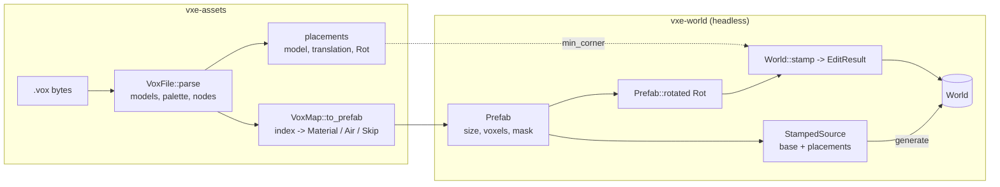

# 0008: MagicaVoxel import with a material map, and prefab stamping with 24 rotations at generation time and at runtime

> **Status:** done (2026-10-17, v0.6.0): `.vox` import and prefab stamping shipped as planned and amended; the fix pass closed every review finding. Two windowed checks await the owner.
> **Created:** 2026-10-16
> **Milestone:** the headless halves of M6 (`.vox` import) and M7 (prefab stamping) in `docs/roadmap.md`, brought forward because neither needs the renderer
> **Related ADRs:** ADR-0002 (layout, access model), ADR-0001 (stack); none new, the decisions here have no alternative worth a record beyond the ones named under "Decision"
> **Prerequisite:** Plan 0001 closed. Independent of Plans 0002 to 0007. Plan 0007 reserves op kind 2 for the stamp; wiring the stamp through `Server` is a follow-up once both close.
> **Amended 2026-10-17**, during implementation (orchestrator-applied under the owner's
> standing "go with your recommendations"; the owner can overturn it): Phase 4 binds the
> aim-point stamp to `P`, since `V` already toggles procedural detail, and Phase 1's box count
> is restated for `count_in_box`'s inclusive bounds. See "Amendment 2026-10-17" below.
> **Amended again 2026-10-17**, after the close review (same standing, same overturnability):
> Phase 2 caps a model axis at 256 and adds caps on placements and translations for hostile
> input. See "Amendment 2026-10-17, close review" below.

## TL;DR

A new crate, `vxe-assets`, parses `.vox` files (models, palette, scene-graph placements) and
maps palette indices to material rows. `vxe-world` gains `Prefab`, a dense voxel volume with
a write mask; `Rot`, the 24 axis-aligned rotations; `World::stamp`, which writes a rotated
prefab and returns an `EditResult`; and `StampedSource`, a `WorldSource` wrapper that blits
placements into chunks at generation time. The first thing a reader sees is a headless test: a
16³ vault with a one-voxel shell stamped into solid rock changes exactly 4096 voxels and leaves
1352 shell and 2744 air voxels, and the same vault placed through `StampedSource` generates a
world hash-equal to the runtime stamp. The first thing the user sees is `--vault` in the
fly-through: a room with an indestructible shell ten meters ahead of the spawn.

## Context & problem

The consumer's World P1 (`project-context.md`) wants hand-built vaults stamped into generated
levels with rotation and a mask that marks the indestructible shell; Tooling P1 wants import
from MagicaVoxel with a material mapping. Today the only way to build structure is a
`WorldSource` written in Rust. Nothing in `nfr.md` covers this; the plan proposes a stamp
cost and a prefab memory figure under "Budgets".

The shell mask needs no mechanism of its own: the roadmap's storage shape already says a voxel
that differs from its neighbours is a second material row, so "shell" is a palette index mapped
to an indestructible material. What the engine owes is the mapping, the rotation and the stamp.

## Decision

A `Prefab` is a dense `u16` volume plus one write bit per voxel. A `Rot` is one of the 24
signed axis permutations with determinant +1; rotating a prefab materialises a new prefab
re-anchored at its minimum corner, so a stamp's `origin` is always the rotated volume's
minimum corner. `World::stamp` writes every masked voxel regardless of material flags: it is an
authoring operation, and a vault's shell must be able to replace anything. The `.vox` parser
is ours and reads `SIZE`, `XYZI`, `RGBA`, `PACK`, `nTRN`, `nGRP` and `nSHP`, skipping every
other chunk by its declared size. Mapping is explicit per palette index: a material, air, or
skip.

We rejected a brick-sparse prefab (prefabs are small and a dense 64³ is 512 KiB), a `dot_vox`
dependency (the format is a handful of chunk types and the mapping is the real work),
rotating at stamp time by index arithmetic (the generation path blits one placement into up to
eight chunks, and a materialised prefab is cheaper there), and any float in the transform
(all of this is integer).

## Amendment 2026-10-17

Made during implementation, after `dev` stopped at Phase 4 on branch `plan-0008` (tip
`8e541f4`; the details are in the Implementation log's Notes there). Applied by the
orchestrator under the owner's standing "go with your recommendations" while the owner was
away; it is a recommendation the owner can overturn, and overturning it changes only the
done-whens below, not the code already written.

### 1. The aim-point stamp is `P`, not `V`

**The problem.** Phase 4 bound the vault stamp to `V`, but `V` toggles procedural detail in the
fly-through since Plan 0005 (`handle_input` in `apps/flythrough/src/main.rs`, and its key
header). The plan did not choose between the two.

**Decision.** The stamp takes `P` ("place"). `V` keeps detail, so the owner's habit from the
surface look checks holds. `P` is unbound in `apps/flythrough` on `plan-0008` and on every
open plan branch, and no open plan claims it: the claimed keys are `W A S D C Space Shift`
(flight and walk), `Escape`, `B`, `F1`, `G`, `K` (Plan 0004), `L`, `N`, `V` (Plan 0013 and
earlier), `F2` (Plan 0010), `H`, `J` (Plan 0006) and `R` (Plan 0009).

**Rejected.** (b) Moving detail off `V` and giving `V` to the stamp: it breaks a binding the
owner has used across the look checks, and Plan 0013's text names `V` for detail, so it
would also amend that plan. (c) Dropping the runtime stamp from the fly-through: the
headless tests already prove `World::stamp`, but the testbed's job is to let the owner place
one and read its result line, as a dig does. `T` was the other free candidate; `P` is the
mnemonic.

### 2. Phase 1's box count, restated for inclusive bounds

**The problem.** `count_in_box(lo, hi)` takes inclusive bounds (`query.rs`), so
`count_in_box([8, 8, 8], [24, 24, 24])` covers 17³ = 4913 voxels: the vault's 4096 plus 817
rock voxels on its three high faces (17³ − 16³). The plan's `[(0, 2744), (4, 1352)]` was the
vault's own 16³ box, which is `[8, 8, 8]..=[23, 23, 23]`.

**Decision.** The done-when asserts both: the vault's box `count_in_box([8, 8, 8], [23, 23,
23]) == [(0, 2744), (4, 1352)]`, and the one-voxel-larger box `count_in_box([8, 8, 8], [24,
24, 24]) == [(0, 2744), (3, 817), (4, 1352)]`, which pins that the stamp wrote nothing past
its aabb. 2744 + 817 + 1352 = 4913. This is what the dev's test already asserts.

### 3. The deviations in the Notes

Each deviation in the Implementation log's Notes on `plan-0008`, ruled:

- **Accepted:** `Prefab::new` stores a masked-out voxel as `AIR` and clears mask bits past the
  last voxel, so `id()` depends only on what a stamp writes; it panics on a voxel count or mask
  length that does not match the size (a caller bug, and the plan's signature returns no
  `Result`).
- **Accepted:** the public API beyond the data shapes on `Rot` and `Prefab`, and `Rot::all()`'s
  order (axis permutations lexicographic, then sign bits ascending). The plan asked only for
  one fixed order.
- **Accepted:** `stamp.rs` keeping its own counts-and-bounds tally instead of sharing
  `edit.rs`'s private one. The review checks that its `changed_from`, `touched` and `aabb`
  agree with the edit path's on the Phase 1 vectors.
- **Accepted:** the default palette generated from its pattern, pinned by an FNV-1a 64 hash of
  the spec's listing plus seven sampled entries. The hash is the check; the generator is how.
- **Accepted:** the extra `VoxError` variants. `Rotation(u8)` refusing a mirrored `_r` byte
  follows from `Rot` holding only determinant +1; a consumer that flips a model in MagicaVoxel
  gets an error, not a wrong stamp.
- **Accepted:** the scene graph checked in `parse`, so `placements()` cannot fail; depth-first
  order in child order from node 0, frame 0 only; a shared subtree placed once per reference.
- **Accepted:** the `vxe-assets` public API beyond the data shapes, `to_prefab` as a method on
  `VoxMap`, and index 0 counted as used when the model has an empty cell (`VoxMap::new` maps it
  to `Air`, so only a caller that unsets it sees it reported).
- **Accepted:** `Cargo.lock` touched; it is the new crate's entry.
- **Accepted:** the one-chunk generation compared by the hash of chunk `[0, 0, 0]`, with the
  whole-world `voxel_hash` compared over `test_extent()` as well. That is stronger than the
  done-when.
- **Accepted:** `StampedSource` in `source.rs`, sharing the brick writer with `World::stamp`;
  it never sets a chunk's edited flag (generation-time content regenerates from the seed and
  placements). The open question on clipping is settled as the dev built it: a placement
  reaching past the extent is clipped by the chunks generated.
- **Accepted:** the thread-count test's five placements over `cave_like_source`, and its extra
  runtime-equals-generation check.
- **Accepted:** `--vault` on the streaming cave as well as the level, clamped only on the
  level; the vault's placement in `cave.rs` with its unit test; `apps/flythrough/src/lib.rs`
  untouched; the start line `vault: 16^3 shell room at [x, y, z]`.
- **Accepted:** the bench's third case, `prefab64_uniform`, beside the two the plan named.
- **Accepted:** the `cave.rs` comment reading "160 cm" so the float-literal scan stays green.

## Amendment 2026-10-17, close review

Made after the close review of `plan-0008`, which found that the planned model-size cap does
not bound memory. Applied by the orchestrator under the owner's standing "go with your
recommendations" while the owner was away. Each item below is the reviewer's recommendation,
orchestrator-applied, and the owner can overturn any of them; overturning one changes only
the Phase 2 done-whens it names.

### 4. A model axis is capped at 256, not 1024

**The problem.** A `SIZE` chunk of 1024³ followed by an `XYZI` with zero voxels passes
`MAX_MODEL_EDGE = 1024`, and `VoxMap::to_prefab` then allocates for every cell of the model:
a `u8` index per voxel, a `u16` material per voxel and one mask bit per voxel, 3.125 bytes a
voxel. At 1024³ = 2³⁰ voxels that is 3.125 GiB, from a file of about 70 bytes. `XYZI`
coordinates are `u8`, so no voxel can sit past index 255 on any axis; cells past 255 can only
ever be empty.

**Decision.** `MAX_MODEL_EDGE = 256`, and Phase 2's `TooLarge` done-when reads 256. The
largest model `to_prefab` accepts is 256³ = 2²⁴ = 16,777,216 voxels, and 2²⁴ × 3.125 B =
52,428,800 B = 50 MiB (16 MiB of index, 32 MiB of material, 2 MiB of mask). That is still a
lot for a hostile file, but it is bounded, and it is the largest model the format can fill.

**Rejected.** Keeping 1024 and sizing from the voxels' bounding box: it changes the model's
centre, which `Placement::min_corner` depends on. Lazy allocation in `to_prefab`: the dense
`Prefab` is the plan's data shape.

### 5. Caps on placements and translations

**The problem.** A shared subtree is placed once per reference (item 3), so a scene graph in
which each `nGRP` lists the same child twice doubles the placement count per level: a small
file can ask for billions of placements. And an `nTRN` `_t` component is parsed as `i32`;
`i32::MIN` under a rotation that negates that axis overflows when the rotation is applied.

**Decision.** Two engine constants in `vxe-assets`:

- `MAX_PLACEMENTS = 65_536`. A scene graph whose placement count exceeds it is refused as
  `VoxError::Malformed`, during the walk, before the count is reached in memory.
- `MAX_TRANSLATION = 1 << 20`. An `nTRN` `_t` component whose magnitude exceeds it is refused
  as `VoxError::Malformed`, so negating one under a rotation cannot overflow.

Both land in Phase 2's done-whens. A composed translation could still leave `i32` only
through a chain of more than 2^31 / 2^20 = 2048 nested `nTRN` nodes; that is listed under
item 6, not decided here.

### 6. Follow-ups, not done-whens

- **The rotated even-sized model's pivot.** `min_corner` subtracts `rotated_size / 2`; for an
  even edge under a 180-degree turn, MagicaVoxel may pivot one voxel off from that. A test
  against a model exported from MagicaVoxel with an even size, turned 180 degrees, settles it;
  if the stamp is off by one, `min_corner` takes the rotation as well as the rotated size.
- **A possible rename of `Prefab::vault`.** The helper's name reads as gameplay vocabulary in
  `vxe-world`; a neutral name (a shelled box) is a candidate. The owner's call.
- **Composed translations.** Whether the walk composes `_t` with checked arithmetic, so a
  deep `nTRN` chain refuses as `Malformed` rather than overflowing (see item 5).

## Architecture diagram



## Implementation phases

### Phase 1: Prefab, rotations, runtime stamp
- **Owner skill:** dev
- **What:** `Prefab`, `Rot`, `Prefab::rotated`, `World::stamp` returning an `EditResult`.
- **Files touched:** `crates/vxe-world/src/{lib.rs, prefab.rs, stamp.rs}`,
  `crates/vxe-world/tests/stamp.rs`.
- **Done when:**
  - `Prefab::new(size: [u32; 3], voxels: Vec<MaterialId>, mask: Option<Vec<u64>>)` (x
    fastest; a `None` mask writes every voxel); `get(local) -> Option<MaterialId>` is `None`
    where the mask is clear. `Prefab::id() -> u64` is FNV-1a 64 over size, voxels and mask as
    little-endian bytes; two prefabs with the same contents have the same id.
  - `Rot`: `Rot::IDENTITY`, `Rot::Z90` (x, y, z → −y, x, z), `Rot::all()` yielding 24
    distinct values in one fixed order, `inverse()`, `then(other)`, `apply([i32; 3])`. For
    every `r` in `all()`, `r.then(r.inverse()) == IDENTITY`; every matrix has determinant +1;
    the set is closed under `then` (24 × 24 products all in the set).
  - The test prefab `T` is the tripod: material 5 at (0,0,0), (1,0,0), (2,0,0), (0,1,0),
    (0,0,1), (0,0,2), (0,0,3), masked to those seven voxels, size (3, 2, 4). Its symmetry
    group is trivial, so `T.rotated(r).id()` over the 24 rotations gives 24 distinct ids.
    `T.rotated(Z90)` has size (2, 3, 4) and solid voxels at (0,0,0), (1,0,0), (1,1,0),
    (1,2,0), (1,0,1), (1,0,2), (1,0,3): the rotation maps (0,1,0) to (−1,0,0), and
    re-anchoring shifts x by +1. `T.rotated(IDENTITY)` equals `T`.
  - `Prefab::vault(edge: u32, shell: MaterialId)` test helper: every voxel on the surface of
    the cube is `shell`, the interior is `AIR`, all written. At edge 16 that is 16³ − 14³ =
    4096 − 2744 = 1352 shell voxels and 2744 air.
  - `World::stamp(&self, prefab: &Prefab, origin: VoxelCoord, rot: Rot) -> Result<EditResult,
    EditError>` writes `prefab.rotated(rot)` with its minimum corner at `origin`; checks
    residency of every chunk holding a masked voxel first and fails with the first missing
    chunk ascending before writing anything; counts by old material only the voxels whose
    material changed; `touched` and `aabb` as for edits; bricks that become uniform collapse.
  - On `solid3_world()`: `stamp(&vault16, [8, 8, 8], IDENTITY)` returns `changed_from ==
    [(3, 4096)]`, `touched == [[0, 0, 0]]`, `aabb == Some(([8, 8, 8], [23, 23, 23]))`;
    with the shell as material 4 and `count_in_box`'s bounds inclusive, the vault's own box
    `count_in_box([8, 8, 8], [23, 23, 23]) == [(0, 2744), (4, 1352)]` and the box one voxel
    larger `count_in_box([8, 8, 8], [24, 24, 24]) == [(0, 2744), (3, 817), (4, 1352)]`;
    `material_at([8, 8, 8]) == 4`, `[15, 15, 15] == 0`, `[23, 23, 23] == 4`, `[24, 8, 8] ==
    3`. The same stamp again returns an empty `changed_from`, empty
    `touched` and `aabb == None`. (Amended 2026-10-17: the box counts, per "Amendment
    2026-10-17" item 2.)
  - `stamp(&T, [100, 100, 100], Z90)` on `solid3_world()`: `changed_from == [(3, 7)]`;
    `material_at([101, 102, 100]) == 5`, `[100, 100, 100] == 5`, `[101, 100, 103] == 5`,
    and `[100, 101, 100] == 3` (unmasked, untouched).
  - A stamp whose masked voxels reach outside `test_extent()` returns
    `Err(NotResident(c))` with `c` the first missing chunk ascending, and the world's hash is
    unchanged.

### Phase 2: `.vox` parsing and the material map
- **Owner skill:** dev
- **What:** the `vxe-assets` crate: parser, default palette, scene-graph placements, `VoxMap`.
- **Files touched:** `Cargo.toml` (workspace member and dependency row),
  `crates/vxe-assets/{Cargo.toml, src/lib.rs, src/vox.rs, src/palette.rs, src/map.rs}`,
  `crates/vxe-assets/tests/{vox.rs, support/mod.rs}` (a test-side `.vox` writer).
- **Done when:**
  - `VoxFile::parse(&[u8]) -> Result<VoxFile, VoxError>`: header `VOX ` plus version 150 or
    200 (others: `VoxError::Version(v)`); `MAIN` with children `PACK`, `SIZE` and `XYZI`
    pairs, `RGBA`, `nTRN`, `nGRP`, `nSHP`; `MATL`, `LAYR`, `rOBJ`, `rCAM`, `NOTE` and `IMAP`
    are skipped by size, and a test file containing each of them parses to the same models
    as one without. A chunk cut short reads as `VoxError::Truncated { chunk: [u8; 4], at }`.
    A model axis over 256 (`MAX_MODEL_EDGE`) reads as `VoxError::TooLarge`: a `SIZE` of
    257 × 1 × 1 is refused, 256 × 256 × 256 with zero voxels parses. (Amended 2026-10-17
    from 1024; see "Amendment 2026-10-17, close review" item 4.)
  - Hostile scene graphs and transforms are refused without a panic. (Added 2026-10-17; see
    "Amendment 2026-10-17, close review" item 5.) A graph of 16 nested `nGRP` levels, each
    listing the same child twice, yields exactly 65_536 placements (`MAX_PLACEMENTS`); the
    same graph at depth 17 (131_072) reads as `VoxError::Malformed`. An `nTRN` with `_t`
    of `-2147483648 0 0` under a parent whose `_r` is 52 (a 180-degree turn about z, which
    negates x) reads as `VoxError::Malformed`, since the component's magnitude exceeds
    `MAX_TRANSLATION = 1 << 20`.
  - `VoxModel { size: [u32; 3], voxels: Vec<[u8; 4]> }` as `(x, y, z, index)` in file order;
    `palette: [[u8; 4]; 256]` with MagicaVoxel's default palette when `RGBA` is absent, and
    the documented offset: `RGBA` entry `k` is the colour of index `k + 1`; index 0 is empty.
  - `support::vox_bytes(models, palette, nodes)` builds a file in the test. A 3 × 2 × 1 model
    with voxels (0,0,0,1) and (2,0,0,2) parses to size [3, 2, 1] and those two voxels; the
    palette's index 1 equals the first `RGBA` entry written.
  - `VoxFile::placements() -> Vec<Placement { model: usize, translation: [i32; 3], rot: Rot
    }>` walks `nTRN` → `nGRP` → `nSHP` from node 0, composing integer translations and
    rotations. The `_r` byte decodes by the spec's rule (bits 0 to 1: index of the non-zero
    entry of row 1; bits 2 to 3: of row 2; bits 4 to 6: the signs of rows 1 to 3): byte 4
    decodes to `IDENTITY`; byte 17 decodes to rows (0, −1, 0), (1, 0, 0), (0, 0, 1), which is
    `Z90`. A file without a scene graph yields one placement per model at translation 0 and
    `IDENTITY`. A two-model file whose second node carries `_t` of `0 0 16` yields
    `placements[1].translation == [0, 0, 16]`.
  - MagicaVoxel's translation refers to the model's centre at `size / 2` (integer division).
    `Placement::min_corner(&self, rotated_size)` returns `translation − rotated_size / 2`, so
    a stamp at `min_corner` reproduces the editor's layout: the 16³ vault at translation
    (8, 8, 8) has `min_corner == [0, 0, 0]`.
  - `VoxMap`: 256 slots of `Slot::{Air, Material(MaterialId), Skip, Unset}`; `new()` sets
    index 0 to `Air` and the rest `Unset`; `set(index, slot)`; `to_prefab(&VoxModel, &VoxMap)
    -> Result<Prefab, Unmapped(Vec<u8>)>` lists every `Unset` index present in the model,
    sorted and deduplicated. A model with indices {1, 2} and a map setting only 1 returns
    `Err(Unmapped(vec![2]))`. `Skip` clears the mask bit; `Air` writes air.
  - Round trip: the vault written as a `.vox` (shell index 1, interior empty) with `{1 →
    Material(4)}` and index 0 as `Air` produces a prefab whose `id()` equals
    `Prefab::vault(16, 4).id()`.

### Phase 3: Generation-time placement
- **Owner skill:** dev
- **What:** `StampedSource`, a `WorldSource` that blits placements after its base source.
- **Files touched:** `crates/vxe-world/src/{stamp.rs, source.rs, lib.rs}`,
  `crates/vxe-world/tests/stamp.rs`.
- **Done when:**
  - `StampedSource::new(base: S, placements: Vec<(Arc<Prefab>, VoxelCoord, Rot)>)` rotates
    each prefab once at construction and keeps its world aabb; `chunk(coord, out)` calls
    `base.chunk` then blits every placement whose aabb meets the chunk, in placement order
    (later placements win on overlap), allocating nothing per chunk beyond what the base does.
  - `World::generate` over a one-chunk extent with `StampedSource(UniformSource(3),
    [(vault16, [8, 8, 8], IDENTITY)])` has the same voxel hash as `solid3_world()` after
    `stamp(&vault16, [8, 8, 8], IDENTITY)`.
  - A straddling placement: extent `[0, 0, 0]..[2, 1, 1]`, vault at `[56, 8, 8]` (x 56 to 71
    across both chunks): the generated hash equals the runtime stamp's hash on a two-chunk
    solid world, and the runtime stamp's `touched == [[0, 0, 0], [1, 0, 0]]`.
  - `generate_with_threads(.., 1)` and `(.., 7)` give the same hash.
  - Overlap order: `T` (material 5) then a one-voxel prefab of material 6 at `T`'s origin
    leaves that voxel as 6; the reverse order leaves it as 5.

### Phase 4: The fly-through's vault, and the bench
- **Owner skill:** dev
- **What:** `--vault` and the `P` key in the testbed, and the stamp bench. (Amended
  2026-10-17: `P`, not `V`; see "Amendment 2026-10-17" item 1.)
- **Files touched:** `apps/flythrough/src/{cave.rs, main.rs, lib.rs}`,
  `crates/vxe-world/benches/stamp.rs`, `crates/vxe-world/Cargo.toml`.
- **Done when:**
  - `--vault` wraps the cave in a `StampedSource` with one 16³ vault whose shell is the cave's
    `SHELL` material, placed with its minimum corner 100 voxels ahead of the spawn along +x
    (clamped inside the extent). Without the flag the cave is unchanged, so Plan 0001's
    determinism constants and golden image hold; the test in `determinism.rs` stays green.
  - `P` stamps the vault at the aim point (the dig ray's hit, minimum corner at the hit
    voxel) through `World::stamp` with `Rot::IDENTITY` and prints the result line like a dig
    does (`stamped: ...` through `edit_line`, or `stamped: refused, <error>` on
    `NotResident`, or a no-hit line); a successful stamp goes through the same post-edit path
    as a dig, so the mirror and, on the level, the coarse grid see it. `V` still toggles
    detail. The key header in `main.rs` lists `P`. Once Plan 0007 lands, this goes through
    `Server` as op kind 2: follow-up. (Amended 2026-10-17: `P`, not `V`.)
  - `cargo bench -p vxe-world --bench stamp`: the 16³ vault into solid rock at `[8, 8, 8]`
    (eight uniform bricks expanded) and a 64³ all-written prefab at `[0, 0, 0]` (512
    bricks), each as microseconds per stamp. Proposals: under 100 µs and under 5 ms. The
    log records both with the machine.

## Data shapes

```rust
// illustrative
pub struct Prefab { size: [u32; 3], voxels: Vec<MaterialId>, mask: Vec<u64> }   // x fastest
#[derive(Clone, Copy, PartialEq, Eq, Hash)]
pub struct Rot { axis: [u8; 3], neg: [bool; 3] }   // row k of the matrix is ±e[axis[k]]
pub struct Placement { pub model: usize, pub translation: [i32; 3], pub rot: Rot }
pub enum Slot { Unset, Air, Material(MaterialId), Skip }
pub struct VoxMap([Slot; 256]);
pub struct StampedSource<S> { base: S, placed: Vec<(Prefab, VoxelCoord, (VoxelCoord, VoxelCoord))> }
```

Prefab memory: 2 bytes plus one bit per voxel. A 16³ prefab is 8 KiB + 512 B; a 64³ prefab is
512 KiB + 32 KiB. `StampedSource` holds one rotated copy per placement.

## Budgets

| Figure | Expected effect | Close measures by |
|---|---|---|
| `nfr.md` §4 edits (new line) | A 16³ vault stamp under 100 µs, a 64³ prefab under 5 ms (proposals) | `cargo bench -p vxe-world --bench stamp`, dev box, commit named |
| §3 RAM | Prefab bytes as above; placements held once per `StampedSource` | Arithmetic; no reading needed |
| §6 determinism | Generation with placements is thread-count independent | Phase 3 test |

## Risks & open questions

- **Format quirks.** The `_r` byte's row convention and the centre-based translation are the
  two places the spec is easy to misread. Both are pinned by hand-built bytes in tests, and
  the parser cites the spec section in a comment.
- **Version 200 files** add chunk types we skip. A file that relies on them for placement
  (`IMAP` remaps palette indices) would map wrongly; `IMAP` presence is reported as a warning
  field on `VoxFile` so a caller can refuse.
- **Write-everything semantics** let one stamp delete another's shell. By design; the game
  orders placements. Carve and fill still respect `INDESTRUCTIBLE`; only `stamp` does not.
- **Settled 2026-10-17:** `StampedSource` clips a placement that reaches outside the extent
  (it blits what falls inside each generated chunk, the natural clip).

## What this plan does NOT do

- **An in-engine editor** or `.vox` export.
- **Stamps as log entries**: op kind 2 is reserved in Plan 0007; the wiring follows both.
- **`MATL` properties to material rows**: the map is manual.
- **Animation frames** (`PACK` is read for the model count only).
- **Rendering of prefabs as entities**: M6's render half, after Plan 0005.
- **Debug views** of shell versus fill: M7.

## Implementation log

| Phase | Owner | Status | Notes |
|---|---|---|---|
| 1: Prefab, rotations, runtime stamp | dev | done | 0fe5fd1 |
| 2: `.vox` parsing and the material map | dev | done | 897531e |
| 3: Generation-time placement | dev | done | 83ab811 |
| 4: The fly-through's vault, and the bench | dev | done | bf0bbd0, b01fbfb |

### Notes

- Phase 1, done-when not satisfiable as stated: `count_in_box([8, 8, 8], [24, 24, 24])` takes inclusive bounds (`query.rs`), so that box is 17³ and returns `[(0, 2744), (3, 817), (4, 1352)]` after the vault stamp. The test asserts that literal call with the 817 rock voxels, and asserts `count_in_box([8, 8, 8], [23, 23, 23]) == [(0, 2744), (4, 1352)]` (the vault's own 16³ box).
- Phase 1: `Prefab::new` stores a masked-out voxel as `AIR` and clears mask bits past the last voxel, so `id()` depends only on what a stamp writes. It panics on a voxel count or mask length that does not match the size.
- Phase 1: public API beyond the data shapes: `Rot::{from_rows, row, determinant, apply_size}`, `Prefab::{size, len, is_empty, written_count}`. `Rot::all()` order: axis permutations lexicographic, then sign bits ascending, determinant +1 kept.
- Phase 1: `stamp.rs` keeps its own counts-and-bounds tally rather than sharing the private one in `edit.rs` (not in Files touched). A `Uniform` brick is expanded only when a written voxel differs from it.
- Phase 2: the default palette is generated from its pattern (6³ cube without black, blue fastest, then four ten-step ramps) rather than transcribed; the test pins FNV-1a 64 `0xfd04_e720_d946_8c0c` over its 1024 bytes, computed from the spec's `default_palette` listing (ephtracy/voxel-model, `MagicaVoxel-file-format-vox.txt`), plus seven sampled entries.
- Phase 2: `VoxError` variants beyond the plan's: `Magic([u8; 4])`, `Rotation(u8)` (a `_r` byte with a repeated axis or a reflection; `Rot` holds only determinant +1, so mirrored transforms are refused), `Malformed { chunk, what }` (negative counts or sizes, a voxel outside its model, `SIZE` without `XYZI`, a duplicate node id, a bad `_t`), `SceneGraph { node, what }` (missing node 0, a missing child or model, a cycle). `TooLarge` carries `{ size }`. `Truncated.at` is the file offset of the first missing byte (the end of the chunk's, or its parent's, available bytes).
- Phase 2: the scene graph is checked in `parse`, so `placements()` returns `Vec<Placement>` without an error. Placements are listed depth first in child order from node 0; frame 0 only. A node reached twice (a shared subtree) is placed twice.
- Phase 2: public API beyond the data shapes: `VoxFile { version, models, palette, nodes: BTreeMap<u32, Node>, imap_present }`, `Node`, `decode_rotation`, `DEFAULT_PALETTE`, `MAX_MODEL_EDGE`, `VoxMap::get`, `Default` for `VoxMap` and `Slot`, `Unmapped` as a tuple struct implementing `Error`. `VoxMap::to_prefab(&self, &VoxModel)`. Index 0 (an unlisted cell) counts as used by `to_prefab` when the model has an empty cell.
- Phase 2: `Cargo.lock` is touched (the new crate); not in Files touched. The test-side writer has `vox_bytes_with` (version and extra chunks), `file`, `chunk`, `dict`, `string`, `size_chunk`, `xyzi_chunk`, `node_chunk`, `vault_model` besides `vox_bytes`.
- Phase 3: the one-chunk generation is compared with `solid3_world()` after the stamp by the hash of chunk `[0, 0, 0]` (the support `chunks_hash`), since the two worlds hold 1 and 64 chunks; the same `StampedSource` over `test_extent()` is also compared by the whole-world `voxel_hash`.
- Phase 3: `StampedSource` lives in `source.rs` and shares the brick writer with `World::stamp` (`stamp.rs`). Per chunk it allocates nothing besides the boxed voxels of a `Uniform` brick that a placement turns mixed (the chunk's own storage). It never sets the chunk's edited flag. A placement reaching past the extent is clipped (the plan's open question left as written).
- Phase 3: the thread-count test uses five placements (two rotated, one crossing chunk corners, one clipped by the extent) over the support's `cave_like_source`, and also checks the four unclipped placements generate the same hash as stamping them in order at runtime. Public API beyond the data shapes: `StampedSource::{base, boxes}`.
- Phase 4: stopped at 8e541f4 on the `V` key (it toggles detail); resolved by the 2026-10-17 amendment (365d374, merged into `plan-0008` at 6c74b7a): the stamp is on `P`.
- Phase 4 (b01fbfb): `P` calls `stamp_at_aim` (raycast within `REACH`, then `World::stamp(&vault(), hit.voxel, Rot::IDENTITY)`) and prints `stamp_line`: `edit_line("stamped", ...)`, `stamped: refused, <error>`, or `stamped: no surface within 10 m`. A successful stamp calls `Run::edited` as a dig does. The vault prefab is built per key press. The module header lists `P`; `V` still toggles detail.
- Phase 4: headless test `tests::p_stamps_the_vault_at_the_aim_point` in `apps/flythrough/src/main.rs` (a test the plan did not name): solid rock over chunks `[-1, -1, -1]..[1, 1, 1]`, a box carved from `[-8; 3]` to `[8; 3]`, the ray from the centre of voxel `[0, 0, 0]` along +x. Asserts `changed_from == [(ROCK, 4096)]`, `touched == [[0, 0, 0]]`, `count_in_box([8, 0, 0], [23, 15, 15]) == [(0, 2744), (SHELL, 1352)]`, `count_in_box([8, 0, 0], [24, 16, 16]) == [(0, 2744), (ROCK, 817), (SHELL, 1352)]`, the line `stamped: rock 4096 (1 chunks, 0.50 ms)`; from inside rock at x = 51 the line `stamped: refused, chunk [1, 0, 0] is not resident` with the world's counts unchanged; from x = 200 a miss and `stamped: no surface within 10 m`. The windowed key press and the mirror's view of the stamp are not covered headless.
- Phase 4: `--vault` works on both the level and the streaming cave (the streamer takes the `StampedSource` as its source); on the level the corner is clamped inside the extent, on the unbounded cave it is not clamped. The vault and its placement live in `cave.rs` (`VAULT_EDGE`, `VAULT_AHEAD`, `vault()`, `CaveSource::{vault_origin, with_vault}`) with the unit test `cave::tests::the_vault_sits_ahead_of_the_spawn_inside_the_extent`. `apps/flythrough/src/lib.rs` is not touched. The fly-through prints `vault: 16^3 shell room at [x, y, z]` at start.
- Phase 4: headless runs on the dev box (NVIDIA GeForce RTX 3080 Laptop GPU), exclusive lock: `flythrough --level --vault --headless --frames 30` printed `vault: 16^3 shell room at [740, 640, 256]`, `generated seed 1 over [20, 20, 8] chunks in 469 ms: 383620 full bricks`, first frame after 2534 ms; `flythrough --vault --headless --frames 30` printed `vault: 16^3 shell room at [132, 32, 32]`, first frame after 396 ms. Without `--vault`, `determinism_vector` and the golden tests pass unchanged.
- Phase 4: the bench has a third case, `prefab64_uniform` (all material 2, every brick expands and collapses back), beside `vault16` and `prefab64_mixed` (air, rock or material 2 by a voxel hash; every brick stays `Full`). The vault's shell is material 2 of a two-row table, on a one-chunk solid world generated outside the timed region.
- Phase 4: a comment reading "1.6 m" in `cave.rs` failed `generation_sources_contain_no_floating_point` (it scans for float literals); it reads "160 cm".
- Phase 4, awaits the owner (windowed): `cargo run --release -p flythrough -- --level --vault`; turn to face +x from the spawn (the start yaw) and fly 10 m: judge that a dark 1.6 m cube sits ahead, that digging into it with the left mouse button carves rock around it but not its shell (the `carved` line counts no `shell`). The shell cannot be dug, so the hollow inside is not reachable in the fly-through.
- Phase 4, awaits the owner (windowed): `cargo run --release -p flythrough -- --level`; aim at a rock wall within 10 m and press `P`: judge that a dark 1.6 m cube appears with one corner at the aimed voxel, extending toward +x, +y and +z from it, and that the printed line reads `stamped: <material counts> (<n> chunks, <ms> ms)`; press `K` and see `last edit changed <m> cells`. Aim at open air (nothing within 10 m) and press `P`: `stamped: no surface within 10 m`. Press `V`: the look line toggles detail as before. In the streaming cave (`cargo run --release -p flythrough`), aim so the cube would reach past the resident chunks to read `stamped: refused, chunk [x, y, z] is not resident` (only if reachable within 10 m of the residency edge).
- Fix pass, review finding 1 (53cfc65): `check_graph` gives each node a saturating `u64` placement count in post-order and refuses a node over `MAX_PLACEMENTS = 65_536` as `VoxError::Malformed { chunk: <the node's chunk id>, what: "places more models than MAX_PLACEMENTS" }` (the amendment's `Malformed`, not `SceneGraph` or a new variant). Tests: the doubling chain at depth 16 yields 65,536 placements; depth 17 is `Malformed { chunk: *b"nGRP", .. }`; depth 40 is refused. Beyond the finding: the placement walk skips subtrees that place nothing (a depth-40 doubling chain ending in an empty shape parses and yields no placements, test `a_subtree_that_places_nothing_is_not_walked`); `placements()` runs the same checked walk and stays infallible, returning the placements found before a fault for a graph edited after parsing. `MAX_PLACEMENTS` is exported.
- Fix pass, review finding 2 (87e4d89, 53cfc65): `frame()` refuses a `_t` component of magnitude over `MAX_TRANSLATION = 1 << 20` as `Malformed { chunk: *b"nTRN", what: "_t out of range" }`; `Rot::apply` uses `wrapping_neg`, `Placement::min_corner` uses `wrapping_sub`. Tests: `_r` 52 over `_t "-2147483648 0 0"` is refused; `1048576 0 -1048576` parses, `-1048577`, `1048577` and `i32::MAX` components do not; `Rot::all()` over `[i32::MIN, i32::MAX, 0]` (`stamp.rs`) and `min_corner` at `i32::MIN` do not panic. `MAX_TRANSLATION` is exported.
- Fix pass, the amendment's composed-translation follow-up, resolved (53cfc65): nested `nTRN` translations compose with `checked_add` and a sum that leaves `i32` is `Malformed { chunk: *b"nTRN", what: "composed _t overflows i32" }`, replacing `wrapping_add`. Test: a chain of 2047 transforms of `_t (2^20, 0, 0)` parses to `2047 << 20`; 2048 is refused.
- Fix pass, review finding 3 (53cfc65): `MAX_MODEL_EDGE = 256`; the test is renamed `a_model_axis_over_256_is_too_large`: `SIZE 257 1 1` is `TooLarge`, `256 256 256` with zero voxels and `256 1 256` with a voxel at `(255, 0, 255)` parse.
- Fix pass, review finding 4 (committed with this row): `stamp_tally_agrees_with_apply_on_random_boxes`, `the_vault_stamp_equals_a_carve_then_a_replace` and `a_rotated_stamp_equals_the_identity_stamp_of_the_rotated_prefab` are in `crates/vxe-world/tests/stamp.rs` (not a new file), with helpers `edit_target` and `vaulted_cave`. The random-box test takes about 26 s in the dev profile.
- Fix pass, review finding 5 (committed with this row): `generation_with_placements_does_not_depend_on_the_thread_count` asserts `voxel_hash() == 0x7ee7_eeb7_0956_d069`, blessed on Linux (dev box).
- Fix pass, review finding 6 (87e4d89): `Prefab::new` takes the size product with `checked_mul` and panics with "prefab voxel count does not match its size: the size overflows usize"; the `# Panics` doc names the overflow. The brief listed this nit; it was done though the request named items 1 to 5 and 7 (there is no item 7).

### Close triggers

_(Facts for the architect. No recommendations, and no suggested version bump.)_

- **All dev phases done.** Phase 1's `count_in_box` assertion matches the amended done-when (amendment item 2). Phase 4's `P` is on b01fbfb.
- **What shipped:** `vxe-world`: `Prefab`, `Rot`, `World::stamp`, `StampedSource`, bench `stamp`. New crate `vxe-assets`: `VoxFile`, `VoxModel`, `Node`, `Placement`, `VoxError`, `VoxMap`, `Slot`, `Unmapped`, `DEFAULT_PALETTE`, `decode_rotation`, `MAX_MODEL_EDGE`. Fly-through: `--vault`, `P` (runtime vault stamp at the aim point).
- **Budget readings:** dev box AMD Ryzen 9 5900HS (Linux), working tree of 83ab811 with the Phase 4 bench (the stamp code is unchanged in bf0bbd0), `cargo bench -p vxe-world --bench stamp`, criterion median (low, high), exclusive lock, load average 2.9 falling to 2.1 over the run. `vault16` 22.782 us (22.745, 22.821) against the 100 us proposal; `prefab64_mixed` 2.0175 ms (2.0158, 2.0191) and `prefab64_uniform` 1.4551 ms (1.4536, 1.4568) against the 5 ms proposal. Prefab RAM is the plan's arithmetic (2 bytes plus one bit per voxel); `StampedSource` holds one rotated copy per placement.
- **Gate at bf0bbd0 (working tree before commit):** `cargo build --workspace` 0; `cargo nextest run --workspace` 196 passed, 1 skipped, exit 0 (exclusive lock, NVIDIA GeForce RTX 3080 Laptop GPU present); `cargo test --workspace --doc` 0 (3 doctests); `cargo clippy --workspace --all-targets -- -D warnings` 0; `cargo fmt --all --check` 0; `cargo deny check` advisories, bans, licenses, sources ok; `node scripts/check-doc-links.mjs` 76 links resolve; `node --test .claude/hooks/*.test.mjs` 59 pass. CARGO_BUILD_JOBS=3.
- **Gate at b01fbfb:** `cargo build --workspace` 0; `cargo nextest run --workspace` 197 passed, 1 skipped, exit 0 (exclusive lock, NVIDIA GeForce RTX 3080 Laptop GPU present per `nvidia-smi -L`); `cargo test --workspace --doc` 0 (3 doctests); `cargo clippy --workspace --all-targets -- -D warnings` 0; `cargo fmt --all --check` 0; `cargo deny check` advisories, bans, licenses, sources ok; `node scripts/check-doc-links.mjs` 89 links resolve; `node scripts/check-comment-hygiene.mjs` OK (77 sources); `node scripts/check-index-rows.mjs` OK; `node scripts/check-index-rows.mjs --self-test` 9/9; `node --test .claude/hooks/*.test.mjs` 59 pass. CARGO_BUILD_JOBS=3.
- **Fix pass (87e4d89, 53cfc65, and the commit with this line), gate at the working tree before this commit:** `cargo build --workspace` 0; `cargo nextest run --workspace` 206 passed, 1 skipped, exit 0 (exclusive lock, NVIDIA GeForce RTX 3080 Laptop GPU present per `nvidia-smi -L`); `cargo test --workspace --doc` 0 (3 doctests); `cargo clippy --workspace --all-targets -- -D warnings` 0; `cargo fmt --all --check` 0; `cargo deny check` advisories, bans, licenses, sources ok; `node scripts/check-doc-links.mjs` 89 links resolve; `node scripts/check-comment-hygiene.mjs` OK (77 sources); `node scripts/check-index-rows.mjs` OK; `node scripts/check-index-rows.mjs --self-test` 9/9; `node --test .claude/hooks/*.test.mjs` 59 pass. CARGO_BUILD_JOBS=3. The same gate ran green before 87e4d89 (198 passed) and 53cfc65 (203 passed).
- **Outstanding `human` phases:** none. Phase 4's `--vault` look and the `P` stamp await the owner (Notes, two windowed checks).

## Close

**Verdict (2026-10-17, fresh-session recheck of the fix pass 87e4d89, 53cfc65, f5c19d3):**
closed. Every phase is done, every done-when holds as amended, and every finding of the close
review is fixed with a test that asserts the claim:

- **Placements capped:** `check_graph` counts placements per node in post-order (saturating),
  refuses a node over `MAX_PLACEMENTS` as `Malformed`; the doubling graph yields exactly 65,536
  at depth 16 and is refused at 17 and 40. The walk skips subtrees that place nothing, so its
  cost is bounded by placements times depth.
- **`_t` capped, composition checked:** a component over `MAX_TRANSLATION` is `Malformed`
  (`_r` 52 over `i32::MIN` is refused); nested translations compose with `checked_add`, a
  chain of 2047 transforms of 2^20 parses and 2048 is refused.
- **`MAX_MODEL_EDGE` 256:** 257 refused, 256³ empty and a voxel at (255, 0, 255) parse.
- **`Rot::apply` total** (`wrapping_neg`) and `Placement::min_corner` (`wrapping_sub`), with
  tests at the `i32` extremes; **`Prefab::new`** takes the size with `checked_mul`.
- **Cross-checks:** 120 seeded boxes compare a box edit with an equivalent masked stamp on
  `EditResult`, `voxel_hash` and stats; the vault stamp equals a carve then a replace
  (2744 + 1352 = 4096, the planned box arithmetic); a rotated stamp equals the identity stamp
  of the rotated prefab over all 24 rotations.
- **Pinned hash:** the thread-count generation test asserts `0x7ee7_eeb7_0956_d069`.

**Deviations judged:** all accepted. The fix pass went beyond the findings in two places
(the walk prunes empty subtrees; `placements()` stays infallible over a post-parse edit) and
both are improvements with tests. `stamp_tally_agrees_with_apply_on_random_boxes` takes about
26 s in the dev profile, roughly doubling workspace nextest time; it is accepted, not a CI
problem (no nextest timeout is configured, and `vxe-world` already builds at `opt-level = 2`
in dev, so the time is the 240 cave generations, not unoptimized code). Recorded as a
follow-up below.

**Orchestrator-applied calls (overturnable by the owner):** both 2026-10-17 amendments (the
`P` key and the box count; the hostile-input caps), the minor bump to v0.6.0, the stamp
proposals of 100 µs and 5 ms kept as the `docs/nfr.md` §4 budgets on the readings, and the
acceptance of the slow cross-check.

**Readings:** `docs/nfr.md` §4 (stamp cost), §3 (prefab RAM, arithmetic), §6 (pinned stamped
hash). Bench readings were taken under the exclusive perf lock.

**Awaits the owner (windowed, Notes above):**

- `cargo run --release -p flythrough -- --level --vault`: the shelled box sits 10 m ahead
  along +x and its shell does not dig.
- `cargo run --release -p flythrough -- --level`, aim at rock and press `P`: a 1.6 m box
  appears with a corner at the aimed voxel, the `stamped:` line prints, `K` reports the change.

### Followups

- **The rotated even-size pivot.** Check `min_corner` against a MagicaVoxel export of an
  even-sized model turned 180 degrees; if off by one, `min_corner` takes the rotation.
- **Rename `Prefab::vault`.** The name reads as gameplay vocabulary in `vxe-world`; a neutral
  name (a shelled box) is the candidate. The owner's call.
- **Server op kind 2.** Once Plan 0007 closes, the runtime stamp goes through `Server` as op
  kind 2 (reserved there), and the fly-through's `P` uses it.
- **The slow debug cross-check.** Build the vaulted cave once per test and restore it between
  cases (or generate a smaller extent), or run fewer cases outside release, so the test drops
  well under 26 s without losing the 120-case coverage in some profile.
