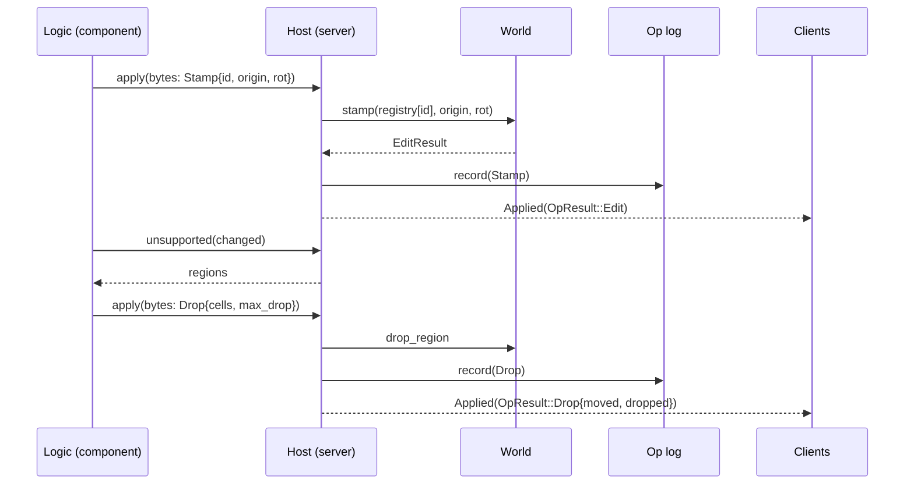

# 0018: Stamp, drop and remove as op kinds 2 to 4 through the server, the log and the logic host

> **Status:** done (closed 2026-10-20, v0.15.0: a clean fresh-session review on c1ea275; every phase shipped and the gate is green at the tip. Stamp, drop and remove are logged ops end to end, and a saved session with a `P` stamp and a falling slab replays to its pinned hash. The hashes are blessed on Linux and the Windows arm waits for a push. The tick-overhead readings are noisy and need a quiet-box re-read. The owner's windowed check is still owed.)
> **Created:** 2026-10-17
> **Milestone:** M5 (the simulation split, completed for every op) and M8 (collapse through the log) in `docs/roadmap.md`
> **Related ADRs:** [ADR-0014](../../adrs/0014-prefab-identity-in-the-op-log.md) (proposed; how a
> stamp names its prefab), [ADR-0007](../../adrs/0007-server-op-log-byte-channel-shared-and-owned-clients.md)
> (the log and the clients), [ADR-0008](../../adrs/0008-collapse-as-capped-support-flood-and-rigid-vertical-drop.md)
> (collapse ops "replicate through the op log like any edit"), [ADR-0010](../../adrs/0010-game-logic-as-a-component-behind-a-logic-trait.md)
> (ops cross the boundary as bytes; a support query import was anticipated).
> **Prerequisite:** none; Plan 0016's restart change touches the same `vxe-net` report type,
> so the second to merge resolves it.
> **Source:** `docs/decisions-pending.md` (answered and deleted; read it with `git show 880982c:docs/decisions-pending.md`) D7 item 1; Plan 0008's followup (stamp as kind 2);
> Plan 0009's followup (drop and remove as kinds 3 and 4); Plan 0007's gating of `--vault`,
> `P` and collapse under `--save`.

## TL;DR

Only shape edits go through the server today; the fly-through's `P` stamp and its collapse
write to the world directly, which is why they are refused under `--save` and `--replay`.
This plan gives stamp, drop and remove their wire kinds, routes them through `submit`, the
op log, `Host::apply` and the clients' desync check, moves the coarse grid into the server
so a logic can ask which regions an edit left unsupported, and moves the fly-through's
stamp and collapse policy into its dig logic. The first thing a reader sees is a saved
session with a `P` stamp and a falling slab replaying to the same hash on both CI arms.

## Context & problem

`Op` has one variant and derives `Copy` (`crates/vxe-world/src/log.rs:34-48`);
`decode_op` refuses kinds 2 to 4 (`wire.rs:242-246`) and a log test pins that
(`tests/log.rs:338-357`). `World::stamp(prefab, origin, rot)` (`stamp.rs:236-307`),
`drop_region(cells, max_drop)` and `remove_region(cells, rubble, fraction, max_depth)`
(`collapse.rs:434`, `:546`) exist with their own result types, whose `dropped` and
`placed` fields are lost in `edit_result()`. `Host::apply` takes an `EditOp`
(`crates/vxe-net/src/logic.rs:63-73`); the WIT `apply` takes wire bytes, so a new kind
needs no WIT change, but a wider answer does. `find_unsupported` needs a `CoarseGrid`,
which the fly-through owns (`main.rs:640+`), not the server. The fly-through stamps in
`stamp_at_aim` straight on the server's `Arc<World>` (`main.rs:371-378`) and collapses in
`Coarse::collapse` and `Coarse::fall` the same way (`:686-769`), eight voxels per frame.
`Message::Applied` carries an `EditResult` only; the owned client's `check` compares
`EditResult`s (`client.rs:162-174`).

Budgets touched: `nfr.md` §4 logs (new entry sizes), §4 tick overhead (the grid update in
the server tick), §8 coarse grid update (now on the server's path).

## Decision

Kinds 2, 3 and 4 get wire encodings; `Op` becomes `Edit | Stamp | Drop | Remove` and
`Clone`; results become `OpResult::{Edit, Drop, Remove}` end to end (messages, the WIT
answer, the owned client's check). A stamp names its prefab by content id against a
registry on the server (ADR-0014), and the save header carries the prefabs it names
(`LOG_FORMAT` 2). The server owns a `CoarseGrid` kept current from every applied result,
and `Host` gains `unsupported(changed cells) -> Vec<Region>` so the logic decides what
falls. The fly-through's `P` becomes a `Stamp` input its dig logic turns into a stamp op,
and the dig logic runs the support query after its carves and issues drop or remove ops
per tick; the `--save` and `--replay` gates go. We rejected keeping collapse in the
application with a direct world write under a "not logged" flag (the owner's D7 asked for
the log), and a separate region log beside the op log (two streams to keep in order).

## Architecture diagram



## Implementation phases

### Phase 1: Wire kinds 2 to 4 and the save header's prefab table
- **Owner skill:** dev
- **What:** `Op::{Stamp, Drop, Remove}` with their encodings (sizes below), `u32` counts
  for cell lists, `LOG_FORMAT` 2 with the prefab table, `LogEntry` and `Op` as `Clone`,
  `resimulate` over references.
- **Files touched:** `crates/vxe-world/src/{log.rs, wire.rs, prefab.rs}`,
  `crates/vxe-world/tests/log.rs`, `crates/vxe-net/src/server.rs` (`resimulate`),
  `apps/flythrough/tests/{determinism.rs, replay.rs}` (header length).
- **Done when:**
  - Entry sizes, asserted: a stamp 34 bytes (12 + kind 1 + id 8 + origin 12 + rotation 1);
    a drop `21 + 12n` (12 + kind 1 + max_drop 4 + count 4 + cells); a remove `31 + 12n`
    (12 + kind 1 + rubble 2 + fraction 8 + max_depth 4 + count 4 + cells); the kind-1 sizes
    (47, 65, 75) and the boundary (13) are unchanged.
  - `OP_LOG_HASH` `0x5ac8_737d_db0f_ccec` is unchanged (kind-1 bytes identical).
  - A save with one vault stamp has a header of `60 + 4 + 8 + 8 716` bytes and decodes;
    the same file with one byte of the vault's content flipped is refused with
    `PrefabMismatch { id }`; a format-1 file still decodes (no table).
  - `every_tag_round_trips` covers the three new kinds, including a drop with 4 096 cells
    and a rotation index of 23; an unknown kind 5 is still `UnknownKind`.

### Phase 2: The server applies every kind, with full results
- **Owner skill:** dev
- **What:** `PrefabRegistry` on the server (`Server::register_prefab(Arc<Prefab>)`, refusing
  a duplicate id with different content), `OpResult`, `submit(Op)`, `TickHost` applying all
  kinds, `Message::Applied(OpResult)`, the owned client checking `OpResult` equality, the
  shared client passing it through; the server's `CoarseGrid` updated from each result's
  touched region.
- **Files touched:** `crates/vxe-net/src/{server.rs, client.rs, message.rs, logic.rs}`,
  `crates/vxe-net/tests/*.rs`, `crates/vxe-world/src/collapse.rs` (results keep their
  fields), `crates/vxe-world/src/coarse.rs` (an update-from-aabb entry point if missing).
- **Done when:**
  - A session that submits a vault stamp at `(32, 32, 32)` rotation 0, then a carve of the
    pillar under a 3 x 3 slab, then `drop_region` of the slab by 8 four times and
    `remove_region` of a second slab with rubble 1/4: the owned client's world hash equals
    the server's after every tick; the log replays from seed to the same hash; the test
    pins the hash (blessed on Linux, the Windows arm confirms).
  - `Applied(OpResult::Drop { dropped: 8, .. })` reaches a shared client for each of the
    four drops and `Remove { placed, .. }` for the removal, with the counts the direct
    `World` calls return.
  - A stamp of an unregistered id is `Refused(EditError::UnknownPrefab(id))`, logged as a
    refusal (not an op), and the owned client reports no desync.
  - The server's coarse grid after the session equals a grid built fresh from the world
    (`CoarseGrid::build == server.coarse()`).

### Phase 3: The host and the component: every kind through `apply`, and `unsupported`
- **Owner skill:** dev
- **What:** `Host::apply(Op) -> Result<OpResult, EditError>`; the WIT answer tag 0 carries an
  `OpResult` encoding (kind byte, then the result); a new import `unsupported(changed:
  list<cell>) -> list<region>` with `SupportParams` and `Anchors` configured on the server;
  the guest crate's helpers.
- **Files touched:** `crates/vxe-script-wasm/wit/logic.wit`, `src/{host.rs, guest.rs, lib.rs}`,
  `crates/vxe-net/src/logic.rs`, `crates/vxe-script-wasm/guests/echo` (echoes every kind),
  `crates/vxe-script-wasm/tests/equality.rs`.
- **Done when:**
  - The echo logic hosted as a component and linked natively give byte-equal op logs and
    equal world hashes on an input script that stamps, drops and removes; `ECHO_HASH`
    stays `0x8f7d_4016_15d9_5c4d` on the old script and a second pinned hash covers the
    new one.
  - `unsupported` from the component after a carve under the test slab returns one region
    with the slab's 9 cells and its material counts, equal to the native call.
  - A component asking to stamp an unknown id receives answer tag 1 with
    `UnknownPrefab(id)` and is not trapped.

### Phase 4: The fly-through: `P` and collapse through the logic, the gates gone
- **Owner skill:** dev
- **What:** `P` sends a `Stamp` input; the dig logic turns it into `Op::Stamp` with the
  vault's id (registered at startup on server and client); after each carve the logic calls
  `unsupported` and queues regions: `fall` mode issues `Drop { max_drop: 8 }` per tick until
  `dropped == 0`, `crumble` mode issues `Remove`; `R` becomes an input that flips the mode;
  the `--vault`, `P` and collapse gates under `--save`/`--replay` are removed; the module
  docs at `main.rs:36-43` say what is logged now (everything).
- **Files touched:** `apps/flythrough/logic/src/lib.rs`, `apps/flythrough/src/{main.rs,
  lib.rs, cave.rs}`, `apps/flythrough/tests/{replay.rs, determinism.rs}`, `README.md`.
- **Done when:**
  - `flythrough --level --seed 1 --headless --save s.vxl` driven by a scripted input list
    (a `P` stamp, a dig under a ledge, 20 ticks of falling, `R`, a second dig, 5 ticks)
    writes a file whose replay with `--replay s.vxl` prints the same world hash; the hash
    is pinned in `tests/replay.rs` and the Windows arm confirms it.
  - The same session with `--logic wasm` gives the same file bytes and hash as native.
  - `--level --vault --save` is accepted (the vault placement at generation is not an op;
    the save records the generation extent and seed as before).
  - The interactive `P`, `R` and collapse behave as before by eye (a windowed check for the
    owner, listed in the log, not a phase).

### Phase 5: Readings
- **Owner skill:** dev
- **What:** `nfr.md` §4 logs (the new entry sizes), §4 tick overhead with the grid update
  (`cargo bench -p vxe-net --bench tick` beside the Plan 0007 reading of 84.7 µs per 100
  inputs), §8 coarse update on the server path.
- **Files touched:** `docs/nfr.md`, `crates/vxe-net/benches/tick.rs`.
- **Done when:** the three readings are in `nfr.md` with machine, commit and load; the tick
  overhead with the grid stays under the 100 µs line or the miss is recorded.

## Data shapes

```rust
// illustrative
pub enum Op {
    Edit(EditOp),
    Stamp { prefab: u64, origin: VoxelCoord, rot: u8 }, // rot indexes Rot::all()
    Drop { cells: Vec<CellCoord>, max_drop: i32 },
    Remove { cells: Vec<CellCoord>, rubble: MaterialId, fraction: (u32, u32), max_depth: i32 },
}
pub enum OpResult { Edit(EditResult), Drop(DropResult), Remove(RemoveResult) }
pub enum EditError { NotResident(ChunkCoord), UnknownPrefab(u64), /* Plan 0019 adds OutOfRange */ }
// save header, LOG_FORMAT 2: the 60 fixed bytes, then prefab count u32, then per prefab
// id u64, size 3 x u32, voxels u16 x n, mask u64 x ceil(n / 64)
```

## Budgets

- **§4 logs:** a stamp 34 B; a drop `21 + 12n`; a remove `31 + 12n`; a 4 096-cell region
  49 173 B per op; a falling slab re-sends its cells each tick (about 9 cells in the test,
  129 B per tick).
- **§4 tick overhead:** the coarse update (13.5 µs per radius-1 m carve, §8) joins the
  server tick; the bench's 100 carves per tick add about 1.35 ms by that reading, which is
  the edit work, not overhead; the overhead line (100 µs per 100 inputs) is re-read.
- **§4 saves:** plus the prefab table, once per prefab.

## Risks & open questions

- **Determinism:** every new op is integer and already deterministic as a `World` call;
  the ordering risk is the grid update, which runs on the server thread in op order. The
  pinned hashes gain two vectors (Phase 2 and Phase 4) confirmed on both arms.
- **`Op` loses `Copy`.** `resimulate` and any `*e` pattern on `LogEntry` change; the
  compiler finds them.
- **A region op from a stale query:** the logic may issue a drop for cells an earlier op
  already moved; `drop_region` answers with `dropped == 0` and the logic stops, as the
  fly-through does today.
- **The client's registry.** Both sides register the vault at startup; a game registers its
  assets the same way. A missing id is a desync, by ADR-0014.

## What this plan does NOT do

- Prefab content over the channel, late join, snapshots (M9).
- Range checks on the new ops' fields (Plan 0019 covers shapes; cell lists are capped by
  `max_region` on the server, which refuses a longer list as `OutOfRange` once Plan 0019
  adds the variant).
- The cosmetic rigid-body layer (M8, after M6).

## Implementation log

> Written by `dev`: one row per phase as its commit lands, then the close block. **The phases
> above are the contract. This section records what happened.** Observations, never
> conclusions: no pass list, no self-assessment. Deviations and unmet done-whens are
> **always** disclosed. Keep it shorter than `## Implementation phases`.

| phase | owner | state | commit |
|---|---|---|---|
| 1: Wire kinds 2 to 4 and the prefab table | dev | done | e1b17d3 |
| 2: The server applies every kind | dev | done | 300874f |
| 3: The host and the component | dev | done | 416e99c |
| 4: The fly-through through the logic | dev | done | a9014d0 |
| 5: Readings | dev | done | 3c679ee |

### Notes

- Phase 1: `EditError::UnknownPrefab`, its wire error tag (3; tag 2 left to Plan 0019's
  `OutOfRange`) and `OpResult` with its wire encoding (`encode_op_result`, kind byte 1, 3 or 4)
  landed here, in `crates/vxe-world/src/edit.rs` (not in any phase's Files touched) and `wire.rs`.
- Phase 1: `PrefabRegistry` and `PrefabCollision` live in `vxe-world` (`prefab.rs`), so the
  server, the clients and `LogFile.prefabs` share one type; `Op::apply` and `World::replay`
  take a registry. `Op::Stamp.rot` is a `Rot`, its wire byte the `Rot::all` index.
- Phase 1: compile-only edits outside the phase's Files touched: `vxe-net` `client.rs`,
  `test_logic.rs`, `tests/{logic,shared}.rs`; `vxe-script-wasm` `src/host.rs`,
  `tests/determinism.rs`; `vxe-world` `benches/replay.rs` (header 60 -> 64);
  `apps/flythrough` `src/{lib,main}.rs`, `tests/component.rs` (`LogFile.prefabs`). The
  server and client pass an empty registry until Phase 2; the host and `EchoLogic` treat the
  new kinds as undecodable until Phase 3.
- Phase 2: `Server::with_prefabs(world, prefabs, logic, seed)` registers prefabs before
  `init`; `Server::resimulate` gained a `prefabs` argument (callers in
  `vxe-script-wasm/tests/{equality,determinism}.rs` and `apps/flythrough/src/lib.rs` updated
  outside the phase's Files touched, as are `apps/flythrough/src/main.rs` and
  `tests/replay.rs`, which read `OpResult::edit_result()`); `Event::Desync.ours` is `Option<OpResult>` (`None` when
  the client refused). The coarse grid's new entry point is `CoarseGrid::update_aabb`.
- Phase 2: `Message::Applied` grew by the result's kind byte (96 bytes for the shared test's
  carve, was 95); `tests/owned.rs`' desync assertion now names the client's own empty
  `OpResult::Edit` where it compared against an empty `EditResult`.
- Phase 2: the session test is `crates/vxe-net/tests/kinds.rs` on a 2³-chunk air world with a
  floor and two slabs on pillars; `KINDS_HASH` `0x2077_5c41_d63d_17c5` blessed on Linux x86_64,
  the Windows arm not yet run.
- Phase 3: `Host::unsupported(&[CellCoord]) -> Vec<Region>` builds the query's changes from
  the given cells and the server's grid; `Server::set_support(params, anchors)` configures
  it, starting from `vxe_net::DEFAULT_SUPPORT` (64, 4 096, boundary anchors on). A helper
  `vxe_net::cells_in(aabb)` lists the cells of a result's aabb for a logic that has only that.
- Phase 3: the slab world, the session and its hash moved to `vxe_net::test_logic`
  (`slab_world`, `slab_session`, `SLAB_SESSION_HASH`, the hash `KINDS_HASH` was);
  `EchoLogic` answers an input starting with `ECHO_QUERY` (0x40) with `ECHO_REGIONS` and the
  regions. The second pinned hash of the equality test is `SLAB_SESSION_HASH`.
- Phase 3: the "answer tag 1 with `UnknownPrefab(id)`" done-when is checked through the
  component's `ECHO_REFUSED` outcome, the client's `Refused { UnknownPrefab(id) }`, no logic
  error, and an `encode_answer`/`decode_answer` round trip; the raw answer bytes the guest
  receives are not observed.
- Phase 3: edits outside the phase's Files touched: `vxe-net` `src/server.rs` and `src/lib.rs`
  (the host's `unsupported`, `set_support`, exports), `src/test_logic.rs`, `tests/{logic,kinds}.rs`; `vxe-script-wasm` `benches/boundary.rs`,
  `tests/determinism.rs` (their hosts' `apply(Op)` and an empty `unsupported`);
  `apps/flythrough/logic/src/lib.rs` (`.into()` on its three `apply` calls).
- Phase 4: the scripted session is driven through the library, not the binary: the binary
  has no scripted-input flag, so `tests/replay.rs` runs the inputs through a server set up as
  the fly-through's `Net` (the vault registered, `set_support`) on the seed-1 level, builds the
  `LogFile` its `--save` writes, and replays it with `replay_file` from ops and from inputs;
  `SESSION_HASH` `0x422b_7654_317b_145d` blessed on Linux x86_64, the Windows arm not yet run.
  The `--logic wasm` variant is a `cfg(feature = "wasm")` test in the same file.
- Phase 4: the session needs a ledge the level does not have at the spawn (the ray up from
  the spawn meets no rock within 10 m), so it digs a radius-40 chamber in solid rock at
  `(608, 640, 352)`, hangs a radius-16 fill from its ceiling and cuts it with a radius-22 dig
  from inside the rock; the second dig does the same on the -x wall. 32 ticks: chamber, `P`,
  fill, cut, 20 ticks, `R`, fill, cut, 5 ticks.
- Phase 4: `DigInput::Stamp` carries the prefab id (57 bytes) and `DigInput::Crumble` (1 byte)
  is `R`; the logic holds the collapse mode and the falling regions; a tick runs the falls,
  then the inputs. The support query is asked over `cells_in(aabb)` of the dig, a superset of
  the grid's changed cells the binary used before. The landed line counts ticks
  (`landed after N ticks, fell M voxels`); `F1`'s collapse line gives the region count only
  (the logic has no clock); the region line reaches the client as `region <cells> <m>:<n>` and
  is printed with material names.
- Phase 4: `--replay PATH --vault` regenerates the room (`flythrough::replay_log_on`); a save
  made with `--vault` replays to its world only with it. Binary smoke on the RTX 3080 laptop,
  release, exclusive perf lock, load 29.31: `--level --vault --seed 1 --headless --bench 1
  --frames 20 --save` printed hash `0x26dddbc85e9c5c5c`; `--replay --vault` printed the same;
  `--replay` without `--vault` printed `0x86ca427a47e8908c`.
- Phase 4: the binary's own collapse tests became logic tests through `Net`: the ledge world's
  pillar is cut by a radius-10 dig sphere (a dig cannot remove the whole pillar), so the
  region is 10 cells, rock 5 024, and it falls 8, 8, 2 voxels; removed, it piles 1 256 rubble.
- Phase 4: edits outside the phase's Files touched: `apps/flythrough/tests/component.rs` and
  `crates/vxe-script-wasm/benches/boundary.rs` (`DigLogic::default()`; `DigLogic` is no longer
  a unit struct). `RUBBLE` moved to the logic crate and `flythrough::RUBBLE` re-exports it.
- Phase 5: the tick bench gained an arm, the direct carves each followed by
  `CoarseGrid::update_aabb`; the overhead is read against it, since the server's grid update
  is edit work. The readings were taken with other worktrees building and testing (1-minute
  load 14.46 falling to 6.50), not on a quiet box.
- Owed to the owner (the plan's windowed check, not a phase): `P`, a dig under a ledge, the
  fall, `R` and a crumble by eye in `cargo run --release -p flythrough -- --level`, and
  `--level --vault --save s.vxl` followed by `--level --vault --replay s.vxl` printing the
  same hash.
- Followup noticed: the Windows arm has not yet confirmed `SLAB_SESSION_HASH`
  (`vxe-net` and `vxe-script-wasm` tests) or `SESSION_HASH` (`apps/flythrough/tests/replay.rs`).
- Followup noticed: the server's grid is built once in `Server::with_prefabs` from the chunks
  resident then and is not told of chunks streamed in or out, so on the streamed cave the
  support query sees only unknown (anchored) chunks; the fly-through keeps collapse to the
  level as before. On the level the fly-through now builds two grids (the server's and its
  own for the walkable map).
- Followup noticed: cell lists in drop and remove ops are not capped (Plan 0019's
  `OutOfRange` is the plan's route); `EditError::UnknownPrefab` uses wire error tag 3 so
  Plan 0019's `OutOfRange` keeps tag 2.

### Close triggers

_(Facts for the architect. No recommendations, and no suggested version bump.)_

- **What shipped:** op kinds 2 to 4 (stamp by prefab content id, drop, remove) with wire
  encodings and `u32` cell counts; `LOG_FORMAT` 2 with the prefab table, verified on decode,
  format 1 still read; `OpResult` end to end (messages, owned-client check, the WIT answer);
  `PrefabRegistry` on the server and the clients; the server's coarse grid updated after every
  applied op; `Host::unsupported` and the WIT `unsupported` import; `EchoLogic` over every kind
  and the support query; `DigLogic` with stamp and crumble inputs, the collapse and the falls;
  the fly-through's `P`, `R` and collapse through the logic with the `--save`/`--replay`
  gates removed and `--replay --vault`.
- **Public API changed:** `vxe-world`: `Op` gains `Stamp`, `Drop`, `Remove` and is no longer
  `Copy` (nor is `LogEntry`); `Op::apply(world, prefabs) -> Result<OpResult, EditError>`;
  `OpResult`; `EditError::UnknownPrefab`; `PrefabRegistry`, `PrefabCollision`;
  `Prefab::{encode, decode, encoded_len}`; `Rot::{index, from_index}`; `LogFile.prefabs`,
  `LogFile::header_len`; `LOG_FORMAT` 2; `OpLog::prefab_ids`; `World::replay(log, prefabs)`
  returns `OpResult`s; `CoarseGrid::{update_aabb, update_aabb_with_stats}`;
  `wire::{OP_STAMP, OP_DROP, OP_REMOVE, ERROR_UNKNOWN_PREFAB, encode_op_result,
  decode_op_result}` (the `OP_RESERVED_*` names are gone), `Reader::{entry, remaining}`,
  `WireError::PrefabMismatch`. `vxe-net`: `Host::apply(Op) -> Result<OpResult, EditError>`,
  `Host::unsupported`, `cells_in`, `DEFAULT_SUPPORT`, `Server::{with_prefabs,
  register_prefab, prefabs, coarse, set_support}`, `Server::submit(impl Into<Op>)`,
  `Server::resimulate` takes `prefabs`, `Message::Applied.result` and `Event::Applied.result`
  are `OpResult`, `Event::Desync.ours` is `Option<OpResult>`, `Client::register_prefab`;
  `test_logic` gains the slab fixtures, `ECHO_QUERY`, `ECHO_REGIONS`, `query_bytes`,
  `encode_regions`, `decode_regions`, `op_bytes(impl Into<Op>)`. `vxe-script-wasm`: the WIT
  `cell` and `region` records and the `unsupported` import; `encode_answer`/`decode_answer`
  carry `OpResult`. `flythrough-logic`: `DigInput::{Stamp, Crumble}`, `DigLogic` is a
  `Default` struct with state, `STAMP_VERB`, `DROP_VERB`, `REMOVE_VERB`, `FALL_STEP`,
  `RUBBLE`, `RUBBLE_FRACTION`, `RUBBLE_DEPTH`, `region_line`, `parse_region_line`,
  `landed_line`, `crumble_line`. `flythrough`: `replay_log_on`.
- **Budget readings:** AMD Ryzen 9 5900HS laptop (RTX 3080 laptop), Linux, a9014d0 plus the
  Phase 5 bench arm (3c679ee), `cargo bench -p vxe-net --bench tick`, exclusive perf lock,
  not quiet (other worktrees building and testing; 1-minute load 14.46, 10.80, 8.37, 6.50 at
  the rounds' starts and end), three alternated rounds, criterion medians: tick through
  `EchoLogic` 4.3895 / 3.9923 / 3.8381 ms; direct carves with grid updates 4.3400 / 3.9843 /
  4.0753 ms; direct carves 2.8636 / 2.4967 / 2.8504 ms. Overhead per 100 inputs 49.5 / 8.0 /
  -237.2 µs (line 100 µs). Grid update on the server path 1.4764 / 1.4876 / 1.2249 ms per 100,
  12.2 to 14.9 µs each (line 50 µs). Entry sizes asserted: stamp 34 B, drop `21 + 12n`,
  remove `31 + 12n`, 4 096-cell drop 49 173 B, vault table entry 8 + 8 716 B; kind-1 sizes
  47 / 65 / 75 and boundary 13 unchanged; `OP_LOG_HASH` `0x5ac8_737d_db0f_ccec` unchanged.
  Binary smoke (release, RTX 3080 laptop, headless 320 x 180, exclusive perf lock, load
  29.31): `--level --vault --seed 1 --bench 1 --frames 20 --save` hash `0x26dddbc85e9c5c5c`,
  `--replay --vault` the same.
- **Gate at the tip (3c679ee):** `scripts/build-guests.sh` 0; `cargo build --workspace` 0;
  `cargo nextest run --workspace` (exclusive perf lock, `VXE_REQUIRE_SOFTWARE_ADAPTER=1`) 0,
  394 passed, 4 skipped; `cargo nextest run -p flythrough --features wasm` 0, 96 passed, 3
  skipped; `cargo test --workspace --doc` 0, 7 passed, 1 ignored; `cargo clippy --workspace
  --all-targets -- -D warnings` 0; `cargo clippy -p flythrough --features wasm --all-targets
  -- -D warnings` 0; clippy on the guests and `flythrough-logic --features component` for
  `wasm32-wasip2` 0; `cargo fmt --all --check` 0; hook bite tests 0, 59 passed;
  `check-doc-links` 0 (128 links); `check-comment-hygiene` 0; `check-index-rows` 0;
  `cargo deny check` 0 (advisories, bans, licenses, sources ok).
- **Outstanding `human` phases:** none in the plan; the windowed check in the Notes is owed.

## Followups

- From the close review (2026-10-20): `Server::resimulate` and the save carry no
  `SupportParams` or explicit anchors, so a session whose server ran `set_support` with
  anything but `DEFAULT_SUPPORT` re-simulates its logic's support queries under the default.
  The fly-through is safe only because its `SUPPORT` equals `DEFAULT_SUPPORT` by value (two
  constants). A save that records the support configuration, or a `resimulate` that takes it,
  belongs to the next plan that touches the log format.
- From the close review: a save made with `--vault` does not record the room, and replaying it
  without `--vault` prints a different hash with no error. The generation flags belong in the
  header beside the seed when the format next changes.
- From the close review: the scripted Phase 4 session runs through the library on a server set
  up like `Net::new`, not through the binary, which has no scripted-input flag. The binary's
  `--save`/`--replay` path with `P` and collapse is covered only by the owner's windowed check.
- Carried from the implementation log: the Windows arm for `SLAB_SESSION_HASH` and
  `SESSION_HASH` (needs a push); a quiet-box re-read of the tick overhead; the server's grid is
  not told of streamed chunks, so collapse stays on the level; cell lists are uncapped until
  Plan 0019's `OutOfRange`.
