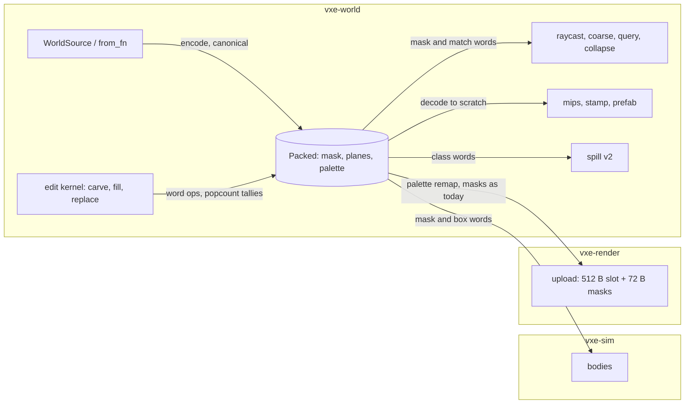

# 0021: The packed CPU brick: a census and kernel bench, then masks, planes and a palette under every reader

> **Status:** done (closed 2026-10-20, v0.18.0): the fresh-session review found no blocker or
> major; every pinned hash and golden is unchanged and the packed format is under every reader.
> Owner decisions (2026-10-20): the 2 ms edit line is held on the dev box and met there; the
> residency p95 stays open, a quiet-box reading owed.
> **Created:** 2026-10-19
> **Milestone:** M2 in `docs/roadmap.md` (the RAM line; ADR-0012's second plan)
> **Related ADRs:** [ADR-0012](../../adrs/0012-mask-first-brick-with-per-brick-palette-planes.md)
> (accepted; this plan is its CPU-format step and supersedes ADR-0002's `Full` clause in
> code), ADR-0002 (chunk, locks and access model, which stand), ADR-0003 (the spill file,
> whose version moves), ADR-0004 (the mirror bytes, which this plan leaves identical).
> **Prerequisite:** [Plan 0015](0015-traversal-hierarchy-chunk-bits-brick-masks-and-translucent-class.md)
> closed (v0.14.0). Touches `gpu_world.rs`, which Plans 0013 and 0017 also touch, and
> `collapse.rs` and `stamp.rs`, which Plan 0018 also touches; whichever merges second resolves
> the conflict. The third ADR-0012 plan (size-classed mirror slots) follows this one.
> **Source:** ADR-0012's Decision and Outcome; `docs/decisions-pending.md` (answered and deleted; read it with `git show 880982c:docs/decisions-pending.md`) D3 and D3a (the
> census and kernel spike this plan's Phase 1 is); the interview of 2026-10-19.

## TL;DR

A `Full` brick stops being 512 raw `u16` and becomes a 512-bit occupancy mask, a palette of
its non-air materials and bit planes that index the palette, in one of five fixed sizes by
material count (72 B for a two-material brick against 1 KiB today), behind the same public
`Brick` enum. Phase 1 builds nothing into `Brick`: it prints a census of materials per brick
over the testbed and a bench of the planar edit kernel against today's row write on the
same brick-edits, and Phase 2 is the owner reading those figures before the format lands.
Then the type, the word-operation edit kernel with popcount tallies, native paths for the
hot readers, collapse as layer shifts and palette remaps, a mirror upload that remaps
palette entries instead of scanning voxels, and a spill file a tenth the size. The first
thing a reader sees is `world_budget --census` printing how many bricks hold one, two, three
to four, five to sixteen or more materials, and the resident bytes that implies. The close
reads resident RAM at the streamed defaults against the 3.24 GB recorded miss, and the edit
bench against the 2 ms line.

## Context & problem

Three recorded facts drive this plan; the decision behind it is ADR-0012's.

- **RAM is the tightest margin.** Resident chunks account for 3.24 GB and the process peaks
  at 3.87 GB against the 4 GB line at the default residency (`nfr.md` section 3). By D3a's
  arithmetic about 2.8 M `Full` bricks and mip-bricks at 1 KiB each are 2.86 GB of that, and
  the testbed's bricks hold two to four materials.
- **The edit cost is bounded by the representation.** The warm worst case reads 3.03 ms
  against the 2 ms line (`nfr.md` section 4), 1.66 ms of it in the per-voxel row write that
  no kernel on `[u16; 512]` brings under about 2.4 ms (D3).
- **The mirror wants the same bytes.** ADR-0012's slot plan replaces the 512-byte pool slot
  by size classes holding the brick's masks, planes and palette. If the CPU brick is already
  those bytes, the upload is a copy and the two formats never diverge.

ADR-0012 fixed the format and ordered the work: a census and a kernel bench first, then the
format, the kernel and every reader. Every figure this plan projects is dev-box only (AMD
Ryzen 9 5900HS); no baseline reading exists for any of them. The consumer requirement is
`project-context.md`'s World row (levels of about 128 x 128 x 48 m at 10 cm, one 16-bit
material id per voxel) and its Edits row (every edit returns voxels removed per material);
neither changes shape here.

## Decision

`Brick` stays `Uniform(MaterialId) | Full(Packed)`, and `Packed` is a private enum of five
fixed-size boxes chosen by the brick's count of non-air materials `n`: a mask alone (`n` 1),
one plane (`n` 2), two planes (`n` 3 to 4), four planes (`n` 5 to 16), and raw `u16` ids above
16. The encoding is canonical by construction: the palette is ascending by material id with
no empty entry, plane bits are zero under a clear mask bit, and every mutator leaves the
brick in that form, so the derived equality of `Brick` is exact voxel equality. Hot readers
(the edit kernel, raycast, the coarse grid, region queries, bodies, collapse) read masks and
planes natively; cold readers (mips, stamp, prefabs) decode into a scratch array. The mirror
upload remaps the palette and leaves every mirror byte as it is today, so the goldens hold.
The spill file moves to version 2 and writes the packed bytes.

We rejected one variable-length block per brick sized to exactly `ceil(log2 n)` planes
because a fat `Box<[u64]>` makes the slot 24 B instead of 16 (about 94 MB more at the
streamed defaults: 11.7 M slots) and a thin pointer needs `unsafe`; the class ladder rounds
the same way the mirror's 64-byte size classes will. We rejected a view type over a
per-chunk arena because its 8-byte slot saves about 94 MB against a hand-written allocator
with compaction, an owned type beside the view for collapse, and a break in every reader's
signature. We rejected shipping D3a's row kernel on `[u16; 512]` as a control in the bench:
ADR-0012 rejected it for RAM, not speed, and the gate here compares the planar kernel with
today's write.

Three wordings of ADR-0012 are met in substance and recorded in its Outcome at the close:
the palette order is ascending id, not first appearance (both make equal voxels equal
bytes; ascending never reorders on a carve); the plane count follows the ladder, not
`ceil(log2 n)` exactly (five to eight materials pay one plane more, 17 to 256 fall to raw
ids); and the per-voxel `set` is a scoped `modify` over a decoded scratch array, because a
canonical per-voxel write would popcount every entry per voxel.

## Architecture diagram



## Implementation phases

Each phase ships as its own commit. `dev` implements the dev-owned phases in order and stops
at Phase 2 until the owner answers; the architect reviews once at the end, in a fresh
session. **Phase 1 is a walking skeleton**: printed figures, nothing wired into `Brick`.

### Phase 1: The census and the kernel bench
- **Owner skill:** dev
- **What:** `World::brick_census` and a `BrickCensus` printed by `world_budget` and by the
  fly-through at exit under `--census`; a synthetic many-material source in `world_budget`;
  `packed.rs` as a standalone `Packed` type with the planar carve, fill and replace kernel,
  not yet referenced by `Brick`; `benches/brick_kernel.rs` replaying the `worst_warm` case's
  brick-edits through today's `write_rows` and the planar kernel.
- **Files touched:** `crates/vxe-world/src/census.rs` (new), `crates/vxe-world/src/packed.rs`
  (new), `crates/vxe-world/src/lib.rs`, `crates/vxe-world/src/edit.rs` (a `#[doc(hidden)]`
  capture of the brick-edits: each touched brick's state before the op and its 64 row spans,
  in op order), `crates/vxe-world/benches/brick_kernel.rs` (new), `crates/vxe-world/Cargo.toml`,
  `crates/vxe-world/tests/census.rs` (new), `apps/flythrough/examples/world_budget.rs`,
  `apps/flythrough/src/main.rs`, `README.md`.
- **Done when:**
  - `BrickCensus` counts, for voxel bricks and for mip-bricks separately: `Uniform` bricks,
    `Full` bricks by `n` in the bins 1, 2, 3 to 4, 5 to 16, 17 to 256 and above 256; bricks
    holding any translucent voxel and bricks whose non-air voxels are all translucent; and
    three payload byte totals for the `Full` bricks: today's (1024 B each), the ladder's
    (72, 136, 200, 352, 1024 B by bin), and exact planes (8 B header + 64 B mask +
    64 B per `ceil(log2 n)` planes + 2 B per entry; 1096 B above 256). A headless test on a
    chunk with slot 0 `Uniform(rock)`, slot 1 `{air, rock}`, slot 2 `{rock, ore}` with no air,
    slot 3 seventeen materials, slot 4 `{rock, glass}` and slot 5 `{air, glass}` (glass
    `TRANSLUCENT`) reads `Uniform` 507; bins 1: 2, 2: 2, 17 to 256: 1, the rest 0;
    translucent any 2, only 1; payload bytes today 5120, ladder 1440, exact 854.
  - `world_budget --chunks 20,20,8 --seed 1 --census` and `--stream 16,24 --seed 1 --census`
    print the census for the level and for the streamed defaults (full chunks' bricks and the
    ring's mip-bricks), each with the three byte totals and the slot bytes beside them;
    `flythrough --level --seed 1 --headless --bench 1 --census` prints it after the `B`
    bench, so the bins before and after 100 carves are both on record.
  - `world_budget --veins N --census` generates a world over the level's extent from a source
    that puts air where a seeded value noise says (about a third of the voxels) and
    otherwise material `1 + hash3(seed, cell) % (N - 1)` per 2^3 cell, and prints the census
    at `N` 8, 16 and 64. By the arithmetic of 64 cells drawing from `N - 1` ids, a solid brick
    holds about 7, 15 and 40 distinct materials, so the majority of `Full` bricks fall in the
    5 to 16 bin at `N` 8 and 16 and in the 17 to 256 bin at `N` 64; the test asserts the
    majority bin, and the counts are readings.
  - `cargo bench -p vxe-world --bench brick_kernel` captures the brick-edits of `worst_warm`
    (100 radius-10 carves on the solid 5^3-chunk world, pooled arrays reserved) once, and
    for every captured brick-edit asserts, before timing, that the planar carve's per-material
    tallies, its changed bounds and its decoded voxels equal today's `write_rows` on the same
    brick and spans; it then reads ns per brick-edit for both, the summed write share of the
    100 carves for both, the same for the spans replayed as `Fill(rock)` on the inverse
    (air) bricks and as `Replace { from: rock, to: ore }`, and separately: `decode` of a
    one-, two- and four-plane brick into a scratch array, 1000 random `get` calls on each,
    expansion of a `Uniform` brick into the mask-only class including its allocation, and a
    class change from one plane to two. Every figure prints with the class it ran on.
  - The bench's planar results carry no `HashMap`, no float and no wall clock in the kernel;
    the standalone type's round trip `decode(encode(v)) == v` and
    `encode(decode(encode(v))) == encode(v)` hold over 256 seeded random bricks at solid
    fractions from 1/256 to 1 and material counts 1 to 300.

### Phase 2: The owner reads the figures
- **Owner skill:** human
- **What:** The owner reads Phase 1's census and bench and says go or stop. The default
  rule, if the owner says nothing beyond "go by the rule": stop if the planar carve's ns per
  brick-edit is above today's `write_rows` on the same brick-edits, or if the ladder's
  projected resident payload plus slots at the streamed defaults is above 2 GB; otherwise go.
- **Files touched:** this plan's Implementation log (the Notes line with the figures and the
  call).
- **Done when:** the log's Notes hold the three figures (projected resident bytes at the
  streamed defaults under the ladder, planar against today's ns per carve brick-edit,
  `decode` µs per brick) and the owner's go or stop. A stop ends the plan at Phase 1 and
  returns it to the architect.

### Phase 3: `Packed` behind `Brick::Full`, and every reader compiling through it
- **Owner skill:** dev
- **What:** `Brick::Full` holds a `Packed`; `from_voxels` encodes canonically; `get`,
  `decode(&mut [MaterialId; 512])` and a scoped `modify(FnOnce(&mut [MaterialId; 512]))`
  are the public reads and the cold write; `solid_bits` is a copy of the mask and
  `occupancy_mask` is derived from it; expand and collapse work on the class boxes; every
  reader in the workspace compiles through the three calls, the edit kernel included (decode,
  today's `write_rows`, encode, for this phase only); the mirror upload decodes to scratch for
  this phase only; the byte accounting counts class sizes.
- **Files touched:** `crates/vxe-world/src/brick.rs`, `packed.rs`, `chunk.rs`, `edit.rs`,
  `store.rs` (the array pool: retired, or per class if Phase 1 read the allocation share
  above 5 % of the warm worst case; `reserve_brick_arrays` and `pool_len` go with it),
  `persist.rs` (`chunk_bytes`), `coarse.rs`, `query.rs`, `raycast.rs`, `mips.rs`, `stamp.rs`,
  `collapse.rs`, `support.rs`, `source.rs`, `hash.rs` (unchanged in behaviour; confirmed),
  `crates/vxe-world/tests/bricks.rs`, `crates/vxe-sim/src/body.rs` (the arm compiles as is;
  touched only if the binding name changes), `crates/vxe-sim/tests/sweep.rs`,
  `crates/vxe-render/src/gpu_world.rs`, `crates/vxe-render/tests/mirror.rs`,
  `apps/flythrough/src/main.rs` (the reserve call), `apps/flythrough/examples/world_budget.rs`.
- **Done when:**
  - `size_of::<Brick>()` is 16, pinned by a test.
  - The canonical oracle: after each of the seeded op sequences of
    `apply_matches_the_reference_over_seeded_ops` and `..._on_uniform_worlds`, every touched
    brick's bytes equal `Brick::from_voxels(decoded)`'s bytes, and `Brick` equality agrees
    with decoded equality on 256 seeded pairs including pairs that differ in one voxel.
  - `determinism_vector`, `raycast_hit_list_is_pinned`, `trace_materials_list_is_pinned`,
    `the_collapse_course_hashes_to_its_pinned_constant`,
    `the_course_hashes_to_the_pinned_constant` and the stamped-world and op-log hashes pass
    with their constants unchanged; the golden images are unchanged byte for byte
    (`VXE_BLESS=1` leaves no diff).
  - `cargo build --workspace --all-targets`, nextest, doctests, clippy and fmt are green on
    both CI arms with the determinism vector's constant unmoved on Windows.

### Phase 4: The edit kernel as word operations
- **Owner skill:** dev
- **What:** Phase 1's kernel wired into `edit_brick` in place of decode-write-encode: the 64
  row spans become eight shape words; carve is `hit = mask & shape & carvable` with a
  popcount per carvable entry, `mask &= !hit`, planes masked; fill is `!mask & shape` with
  the fill entry's index written into the planes; replace is the `from` entry's match word
  set to the `to` index, or an O(1) rename when every `from` voxel lies inside the shape and
  `to` is absent; an entry insert or removal reindexes by a bit-sliced add or subtract of one
  over the voxels at or above the position (three word operations per plane per layer, no
  decode); changed bounds come from the OR-folded hit words; a class change copies the mask
  and planes once. `World::packed_stats` counts class changes and entry removals.
- **Files touched:** `crates/vxe-world/src/edit.rs`, `packed.rs`, `store.rs`,
  `crates/vxe-world/tests/edits.rs`, `crates/vxe-world/benches/edits.rs`.
- **Done when:**
  - The two reference oracles and `ids_beyond_the_table_are_counted_like_the_reference` pass
    unchanged, and a new seeded test runs 2000 ops mixing carve, fill of three materials and
    replace between them on a 2^3-chunk world of the cubes source, asserting after every op
    that every touched brick's bytes are canonical and that `changed_from` and `aabb` equal
    the reference's; the same test is the Windows arm's.
  - A fill of material 7 into a brick holding `{air, 3}` then `{air, 3, 7}` reports
    `changed_from` `[(0, k)]` with `k` the popcount of the fill word, and the brick's palette
    reads `[3, 7]` in the one-plane class; a replace of 3 by 2 over the whole brick leaves
    the palette `[2, 7]` with no plane rewrite (the rename path, asserted by a counter);
    carving every voxel of 7 removes the entry, moves the brick back to the mask-only class
    and `packed_stats` counts one removal and one class change.
  - `cargo bench -p vxe-world --bench edits`: `worst_warm` and `worst` read on the quiet dev
    box, paired with the Phase 1 tip in the same window; the row-write share is the
    difference between the kernel bench's today and planar sums. D3a's arithmetic projects
    `worst_warm` at 1.4 to 1.8 ms (a guess); the reading is recorded whatever it is.

### Phase 5: Native paths for the hot readers
- **Owner skill:** dev
- **What:** raycast and `trace_materials` test a voxel's mask bit and skip a clear 2^3
  block as one cell (the CPU twin of the GPU's block skip); the coarse cell is a popcount
  of the mask and the largest per-entry popcount with the lower id on a tie; region counts
  are per-entry popcounts under a box word; `vxe-sim` bodies iterate the set bits of the mask
  under the box word in word order, which is today's z, y, x order.
- **Files touched:** `crates/vxe-world/src/raycast.rs`, `coarse.rs`, `query.rs`, `packed.rs`,
  `crates/vxe-world/tests/queries.rs`, `coarse.rs`, `crates/vxe-world/benches/coarse.rs`,
  `crates/vxe-sim/src/body.rs`, `crates/vxe-sim/tests/sweep.rs`.
- **Done when:**
  - A counted raycast variant reports cells stepped. In a one-chunk world whose brick at slot
    0 is `Full` with only voxel `(7, 0, 0)` solid and every other brick `Uniform(AIR)`, a ray
    from the centre of voxel `(0, 0, 0)` along +x hits `(7, 0, 0)` at the same `t` as today
    in 5 cells (three clear 2^3 blocks, then voxels 6 and 7) against 8 single-voxel cells.
    The two pinned ray and trace lists are unchanged.
  - `CoarseCell::of` on the Phase 1 census chunk's six bricks equals the cell computed from
    the decoded voxels by today's rule, and over 256 seeded bricks; the coarse grid tests and
    the walkable tests are unchanged.
  - `region_counts` over a box that cuts a brick holding `{air, 3, 7}` equals the decoded
    count, over 256 seeded boxes; `QueryStats::voxel_arrays_read` keeps counting `Full`
    bricks touched.
  - `cargo bench -p vxe-world --bench coarse` and the sweep bench of `vxe-sim` read beside
    Plan 0004's and Plan 0009's figures (readings, no threshold).

### Phase 6: Collapse as layer shifts and palette remaps
- **Owner skill:** dev
- **What:** `place_dropped` moves whole z-layers: the source's mask and plane words land in
  the destination's layer words after the destination's palette takes the source's entries,
  with the destination keeping its own voxels where the source mask is clear; the rubble
  remap carves every entry that maps to air and renames the rest, then re-sorts.
- **Files touched:** `crates/vxe-world/src/collapse.rs`, `packed.rs`,
  `crates/vxe-world/tests/collapse.rs`, `crates/vxe-world/benches/collapse.rs`.
- **Done when:**
  - A seeded oracle runs `drop_region` and `remove_region` on 64 seeded regions of the cubes
    world through the native path and through `modify` over decoded voxels and finds equal
    bricks and equal results; the pinned collapse hash and `vxe-sim`'s course hash are
    unchanged.
  - `cargo bench -p vxe-world --bench collapse` reads beside Plan 0009's figures; the cube
    drop by 64 (6.8 to 6.9 ms there) stays under its 20 ms proposal (a property the adapter
    path would also meet by arithmetic: 4096 bricks at about 2 µs decode and encode each is
    about 8 ms more).

### Phase 7: The mirror upload from planes, and spill version 2
- **Owner skill:** dev
- **What:** `upload_brick` maps the brick's palette entries to chunk-palette indices once and
  writes the 512 index bytes by iterating each entry's match word, builds the opaque mask
  from the opaque entries' match words (the CPU's `u64` per layer is the GPU's two `u32`
  words per layer: the same bits) and the translucent 2^3 words from the translucent
  entries'; a brick above 16 materials takes the raw path as today. `SPILL_VERSION` 2 writes
  per brick a tag byte then the class words little-endian (72, 136, 200, 352 or 1024 B);
  decode checks the canonical rules and reports `Corrupt` otherwise.
- **Files touched:** `crates/vxe-render/src/gpu_world.rs`, `crates/vxe-render/tests/mirror.rs`,
  `crates/vxe-world/src/persist.rs`, `crates/vxe-world/tests/persist.rs`,
  `apps/flythrough/tests/level_mirror.rs`.
- **Done when:**
  - The level mirror reads 232 436 992 B live as at Plan 0015's close, the golden images
    are unchanged byte for byte, and `mirror.rs` asserts, for a chunk of 256 seeded bricks
    including translucent and above-16-material ones, that the staged slot bytes and the
    72-byte masks equal those produced by narrowing the decoded voxels.
  - A chunk of 512 two-material `Full` bricks spills to 37 416 B (32 B header, 512 x 73 B,
    8 B trailer) against 524 840 B under version 1; the persist tests round-trip every class;
    a version-1 file reports `SpillError::Version`; a file with a non-canonical brick (a
    palette out of order, or a plane bit under a clear mask bit) reports `Corrupt`.
  - The fly-through's first sync of the level (`--level --seed 1 --headless --frames 1`) logs
    its CPU time beside the Phase 3 tip's (a reading).

### Phase 8: Readings, budgets and the census after edits
- **Owner skill:** dev
- **What:** the plan's readings, taken serially on the quiet dev box from the tip, and
  `nfr.md` sections 3, 4 and 5 updated with them beside the proposals.
- **Files touched:** `docs/nfr.md`, this plan's Implementation log, `README.md`.
- **Done when:**
  - `flythrough --autopilot --headless --render 1920x1080` (unbounded cave seed 1, the
    defaults r_full 16, r_lod 24): resident chunk bytes at peak and `VmHWM` are recorded
    beside Plan 0002's 3.24 GB and 3.87 GB; residency latency p95 and max, streaming CPU p50
    and p99, and the march p50 are recorded beside Plan 0015's.
  - `world_budget --chunks 20,20,8 --seed 1` and `--stream 16,24` record generation
    voxels per second per thread beside Plan 0001's 1.03e8 and 1.12e8, and the CPU bytes
    beside the section 3 tables; `--census` records the bins at rest.
  - `flythrough --level --seed 1 --headless --bench 1 --census` records the `B` line beside
    Plan 0014's 2.98 to 3.04 ms and the census after the bench with `packed_stats`'s class
    changes and entry removals.
  - The per-chunk mip build through `decode` is timed on the level (a reading, no proposal).
  - Every reading names the machine, the commit and the 1-minute load.

## Data shapes

```rust
// illustrative: the public type keeps its two variants; Packed is private
pub enum Brick {
    Uniform(MaterialId),
    Full(Packed),
}
enum Packed {
    Mask(Box<[u64; 9]>),      // n = 1:      mask[8], palette[1]            72 B
    Plane1(Box<[u64; 17]>),   // n = 2:      mask[8], plane[8], palette[1]  136 B
    Plane2(Box<[u64; 25]>),   // n = 3..=4:  mask[8], planes[16], pal[1]    200 B
    Plane4(Box<[u64; 44]>),   // n = 5..=16: mask[8], planes[32], pal[4]    352 B
    Wide(Box<[MaterialId; 512]>), // n > 16: raw ids, today's layout     1024 B
}
```

```text
// illustrative: word layout of a class (p planes)
words 0..8          mask: word z, bit x + 8 y, set when the voxel is not air (solid_bits)
words 8..8+8p       plane k at 8 + 8k .. 8 + 8k + 8, the same bit layout; a set voxel's
                    palette index is the integer whose bit k is its plane-k bit
words 8+8p..        palette: entry j at bits 16 (j % 4) .. of word 8 + 8p + j / 4,
                    ascending material id, air never, unused entries zero

// canonical form (every mutator leaves it; derived Eq is exact)
1. the class is the function of n above; n is the count of non-zero palette entries
2. the palette is strictly ascending and every entry has at least one voxel
3. mask bit set  <=> voxel non-air;  plane bits are zero under a clear mask bit
4. all 512 voxels equal => Brick::Uniform, as today

// kernel words (8 x u64 each, layer-major)
shape    from the 64 row spans: word z |= ((0xFF >> (7 - (x1 - x0))) << x0) << (8 y)
match_j  AND over k of (plane_k if bit k of j else !plane_k), then & mask
carve    hit = mask & shape & OR(match_j : j carvable); tally_j += popcount(hit & match_j);
         mask &= !hit; plane_k &= mask; drop entries whose match is now empty
fill(m)  f = !mask & shape; tally_air += popcount(f); insert m; mask |= f;
         plane_k |= f for each set bit k of index(m)
replace  h = match_from & shape; tally_from += popcount(h);
         rename if to is absent and h == match_from, else set index(to) over h
reindex  insert at q: c = OR(match_j : j >= q); for k: t = plane_k & c; plane_k ^= c; c = t
         remove at q: c = OR(match_j : j > q);  for k: t = !plane_k & c; plane_k ^= c; c = t
bounds   z from non-zero words; y from non-zero bytes of the OR-folded word; x from the
         OR of its eight bytes
2^3 skip block (cx, cy, cz) is clear when (words 2cz and 2cz + 1) & (0x0303 << (2cx + 16cy)) == 0
```

```rust
// illustrative
pub struct BrickCensus {
    pub uniform: u64,
    pub full_by_materials: [u64; 6],   // n = 1 | 2 | 3..=4 | 5..=16 | 17..=256 | >256
    pub translucent_any: u64,
    pub translucent_only: u64,
    pub payload_today: u64,            // 1024 B per Full brick
    pub payload_ladder: u64,           // 72 | 136 | 200 | 352 | 1024 | 1024 by bin
    pub payload_exact_planes: u64,     // 8 + 64 + 64 ceil(log2 n) + 2 n;  1096 above 256
    pub slots: u64,                    // brick and mip-brick slots, 16 B each
}
pub struct PackedStats { pub class_changes: u64, pub entries_removed: u64 }
```

Spill version 2, per brick slot: tag 0 then a `u16` for `Uniform`; tags 1 to 5 for the five
classes in the order above, then the class words little-endian (`Wide` as 512 `u16`). The
header, world key, coordinate and FNV trailer are version 1's.

## Budgets

- **Section 3, RAM (the plan's target).** Resident chunks 3.24 GB and peak RSS 3.87 GB
  against the 4 GB line at the streamed defaults. Projection by arithmetic: about 2.8 M `Full`
  bricks and mip-bricks (D3a) at the ladder's two-material class are about 0.2 GB, at a mix
  of the first three classes about 0.3 to 0.5 GB, plus 11.7 M slots at 16 B (0.19 GB,
  unchanged): resident chunks about 0.5 to 0.8 GB, a guess until Phase 1 prints the census's
  projection. The close reads Phase 8's autopilot peak and `VmHWM` on the dev box.
- **Section 4, edit cost.** `worst_warm` 3.03 ms against 2 ms. D3a projects 1.4 to 1.8 ms on
  the dev box with the row write at 0.2 to 0.5 ms (guesses). The close records Phase 4's
  paired reading and, as D3 deferred, puts to the owner whether the 2 ms figure is held on the
  dev box or the baseline; this plan does not move the figure.
- **Section 5, streaming.** Generation now encodes each `Full` brick (about 1 to 2 µs each,
  a guess; about 100 `Full` bricks per chunk against about 2.5 ms per chunk today, so under
  10 %); the mip build decodes each `Full` brick (about 512 x 1.5 µs, under 1 ms per chunk,
  a guess). Residency latency p95 is held to the 500 ms proposal (Plan 0015 read 493 ms);
  the close reads Phase 8's autopilot figures and generation throughput.
- **Section 2 and section 3, VRAM.** No change by construction: mirror bytes identical, the
  level's 232 436 992 B pinned by `level_mirror.rs`, goldens unchanged. The first sync's CPU
  time is a reading.
- **Spill files.** No budget; the version 2 size is a reading (14x smaller for a two-material
  brick by arithmetic).
- **The baseline and the portable profile.** No reading: the hardware is not on hand. Every
  figure above is dev-box only, and the plan says so wherever it records one.

## Risks & open questions

- **Determinism.** Every kernel step is integer: popcounts, shifts, masks; the palette sort
  is by id; no `HashMap` feeds a result. The oracle tests and the pinned hashes are the gate
  on both CI arms. The reindex's bit-sliced add is the one novel primitive; the seeded
  2000-op test exercises inserts and removals at every position by construction (three
  materials filled and replaced in every order).
- **The ladder wastes where bricks cluster.** If the census finds most bricks at five to
  eight materials (the consumer's veins), the four-plane class pays 64 B over exact planes
  each. Phase 1 prints both totals; the owner sees the gap at Phase 2.
- **Allocation on the edit path.** Retiring Plan 0014's pool puts each expansion through the
  global allocator at 72 B instead of a pooled 1 KiB. Phase 1's bench reads the share; the
  5 % rule in Phase 3 decides per-class pools. Windows' allocator differs and is not benched.
- **The 2^3 skip and the hit `t`.** The CPU DDA is exact integer arithmetic, so a block exit
  lands on the same voxel boundary as two voxel steps; the pinned lists hold it. If a list
  moves, the skip is wrong, not the list.
- **Mips through `decode` on the workers.** About 1 ms per chunk build is a guess; Phase 8
  times it. A native majority rule over planes is a followup, not a rescue.
- **Plan 0018 overlap.** Both plans edit `collapse.rs` and `stamp.rs`; the second to merge
  rebases its kernel calls on the other's signatures.
- **The human gate.** Phase 2 splits the dev session; the branch waits on the owner.

## What this plan does NOT do

- **Size-classed mirror slots, the contour attribute's move, per-chunk palettes going.**
  ADR-0012's third plan. This plan keeps every mirror byte.
- **An opaque-only bits word in the chunk record.** The census records the translucent
  fractions (zero on the cave, which has no translucent row); the slot plan decides.
- **The baseline or portable reading of anything.**
- **A per-voxel `set` on `Brick`, a thin pointer, an arena, exact `ceil(log2 n)` sizing.**
  Rejected above; recorded in ADR-0012's Outcome at the close.
- **Native paths for mips, stamp and prefabs.** They decode to scratch; Phase 8's timing says
  whether a followup is owed.
- **D3a's row kernel on `[u16; 512]` as a bench control.** Rejected by ADR-0012.
- **Moving the 2 ms figure.** The close puts dev box or baseline to the owner (D3).
- **A compressed spill beyond the packed bytes, chunk snapshots, late-join streaming.**
  Followups of the networking milestone.
- **Mask-word skipping in `trace_materials`'s acoustic probes beyond what raycast shares.**

## Implementation log

> Written by `dev`: one row per phase as its commit lands, then the close block. **The phases
> above are the contract. This section records what happened.** Observations, never
> conclusions: no pass list, no self-assessment. Deviations and unmet done-whens are
> **always** disclosed. Keep it shorter than `## Implementation phases`.

| phase | owner | state | commit |
|---|---|---|---|
| 1: The census and the kernel bench | dev | done | 992fdaa |
| 2: The owner reads the figures | human | done (go, 2026-10-20) | 0a060c4 |
| 3: `Packed` behind `Brick::Full`, every reader compiling | dev | done | 22fcade |
| 4: The edit kernel as word operations | dev | done | 07d70fd |
| 5: Native paths for the hot readers | dev | done | 44ace94 |
| 6: Collapse as layer shifts and palette remaps | dev | done | ce44fa1 |
| 7: The mirror upload from planes, and spill version 2 | dev | done | 8440aa9 |
| 8: Readings, budgets and the census after edits | dev | done | abe0fc3 |

### Notes

- Phase 1: the fly-through command of the done-when never exits; it was run as
  `flythrough --level --seed 1 --headless --bench 1 --frames 1 --census` (Phase 1 commit).
- Phase 1: `--census` prints at exit only; the bins before the 100 carves are
  `world_budget --chunks 20,20,8 --seed 1 --census` on the same seed and extent (Phase 1 commit).
- Phase 1: the `--veins` source is written twice, in `world_budget.rs` and in
  `crates/vxe-world/tests/census.rs`, which asserts the majority bin on 2x2x1 chunks (Phase 1 commit).
- Phase 1: air in `--veins` is value noise of 16-voxel cells below -4600; read 33.50 % on the
  level's extent (Phase 1 commit).
- Phase 1: `brick_kernel` is a hand-rolled harness (median and minimum of 60 runs after 5
  warmups, bricks and pool built untimed), not criterion (Phase 1 commit).
- Phase 1: the bench's table adds an `ore` row (id 2) for the replace; the captured world and
  ops are `worst_warm`'s (Phase 1 commit).
- Phase 1: the capture holds the brick-edits that reach `write_rows`; a `Uniform` brick wholly
  inside a carve takes `edit_brick`'s O(1) path and is neither captured nor timed (Phase 1
  commit).
- Phase 1: "today" times `write_rows` plus the collapse check, expanding into pooled, touched
  arrays; "planar" times the shape words, the kernel and the canonical step, allocations
  included (Phase 1 commit).
- Phase 1: public additions beyond the plan's names: `WorldCensus`; `#[doc(hidden)]`
  `World::apply_capturing`, `CapturedBrickEdit`, `RowWriter`, `PlanarWriter`, `WriterResult`
  and the `packed` module (`Packed`, `PackedBrick`, `PackedClass`, `KernelMode`) (Phase 1
  commit).
- Phase 1: `world_budget --chunks` takes `A,B,C` as well as `AxBxC` (Phase 1 commit).
- Phase 1: every timing was read under the exclusive perf lock while other lanes built: the
  first two kernel runs at a 1-minute load of 13.9 and 19.2, the third (the figures Phase 2
  reads) at 9.7; `worst_warm` read 4.89 ms and 2.60 ms in those windows against 3.03 ms
  recorded quiet.
- Phase 2, 2026-10-20: the owner ruled GO for Phases 3 to 8 on Phase 1's figures at 992fdaa
  (load 9.69): projected resident payload + slots at the streamed defaults under the ladder
  411 071 680 B (0.41 GB; today 3 053 411 776 B); planar 116.8 ns against today's 505.3 ns per
  carve brick-edit (ratio 0.231); `decode` 0.249 / 0.362 / 0.596 us per Plane1 / Plane2 /
  Plane4 brick. Pool: the allocation share is read against the 3.03 ms whole-edit worst case
  (0.9 %), so Phase 3 retires the brick-array pool; Phase 8 rechecks the share against the new
  edit time.
- Phase 3: the pool's retirement reaches files outside the phase's list: `src/stream.rs`
  (eviction drops instead of recycling), `tests/edits.rs` (`a_pooled_expand_allocates_nothing`
  and its counting allocator removed; the canonical oracle added to the seeded-op runner),
  `tests/stream.rs` (`an_evicted_chunk_returns_its_arrays` reduced to its held-elsewhere half),
  `benches/edits.rs` (`*_warm` now build the same world as `worst` and `tool`) (Phase 3 commit).
- Phase 3: `apps/flythrough/src/lib.rs` (`chunk_ram`, `mips_ram`) counts class sizes; it is
  outside the phase's list (Phase 3 commit).
- Phase 3: `RawBrick` (`#[doc(hidden)]`, uniform or 512 raw ids) added: collapse composes in it
  and encodes on commit; the kernel bench's `RowWriter` reference write runs on it (Phase 3
  commit).
- Phase 3: `Packed` is a public opaque struct over a private class enum (a public variant's
  field must be public); `Brick::from_voxels` keeps its `Box` argument (Phase 3 commit).
- Phase 3: `crates/vxe-sim/tests/sweep.rs` builds its all-rock `Full` floor bricks through the
  hidden `Packed::expand_uniform`, a non-canonical box (Phase 3 commit).
- Phase 3: the fly-through's HUD passes 0 spare arrays and its `B` line drops the pool KiB;
  `hud.rs`'s `cpu_bytes_estimate` still counts 1 KiB per `Full` brick (followup, not acted on).
- Phase 3: `hash.rs` and `source.rs` unchanged (read through `get` and `set_brick`).
- Phase 4: `PackedStats` carries a third count, `renames`, which the rename test reads; a class
  change counts a box moving between classes, not a `Uniform` brick expanding or collapsing
  (Phase 4 commit).
- Phase 4: the 2000-op test reads 1047 ops changing voxels and `PackedStats { class_changes:
  1168, entries_removed: 32, renames: 8 }`; its floor is 1000 changing ops (Phase 4 commit).
- Phase 4: `lib.rs` re-exports `PackedStats`; it is outside the phase's list (Phase 4 commit).
- Phase 4: `write_rows` stays in `edit.rs` for the kernel bench's `RowWriter` only (Phase 4
  commit).
- Phase 5: the counted raycast is `World::raycast_counted`; the test's 8-cell walk is a second
  world with a solid voxel off the ray in each of the four 2^3 blocks, hitting at the same `t`
  (1664) (Phase 5 commit).
- Phase 5: `Brick::for_each_solid_in` (public) walks a box's mask bits for `vxe-sim`'s bodies;
  `Packed::mask_word` and `Packed::counts_under` are the coarse and region paths (Phase 5
  commit).
- Phase 6: collapse composes through a trait over two brick forms: the packed `Brick` (native:
  `keep_only` removes refused entries, `overlay_layers` merges palettes and writes layer words)
  and `RawBrick` (decoded ids, the reference); `World::drop_region_decoded` and
  `World::remove_region_decoded` (`#[doc(hidden)]`) run the reference for the oracle (Phase 6
  commit).
- Phase 6: the rubble remap keeps ids (a spared voxel keeps its material), so no entry is
  renamed or re-sorted; a rubble voxel is written by the planar fill of one voxel when it is
  air, else through `modify`; an overlay that would pass 16 materials, or meets a `Wide`
  brick, writes decoded ids (Phase 6 commit).
- Phase 6: the oracle runs on the cubes world dressed by 120 seeded edits (materials 1 to 4, 4
  indestructible), alternating drops and removes over 64 seeded cell boxes; 38 of the 64 ops
  moved or removed voxels (Phase 6 commit).
- Merge of main at 58dc7e1 (Plan 0018, v0.15.0): only the fly-through conflicted. `main.rs`
  takes main's frame loop, whose collapse falls run on the server, without its per-frame
  `reserve_brick_arrays` call (the pool is retired); both import lists take main's names plus
  `Brick` in `lib.rs`. `collapse.rs`, `stamp.rs`, `edit.rs`, `log.rs` and `wire.rs` merged
  without a conflict (main changed only `edit.rs`, `log.rs` and `wire.rs` among them).
- Merge of main at 5ca4151 (Plans 0017, 0019; v0.17.0): `raycast_counted` gave way to 0019's
  `raycast_with_stats`, whose step count now includes clear 2^3 blocks (the skip test reads it);
  `apply`, `drop_region` and `remove_region` check `WorldLimits` before the split into the
  capturing, native and decoded paths; `count_in_box` keeps the popcount body inside 0019's
  `Result`; the store holds `limits` and `packed_stats` and no pool; 0017's wide-palette scan in
  `gpu_world.rs` decodes each `Full` brick; `world_budget --veins` raises the query limits for
  its whole-extent air count as `--chunks` does; the fly-through drops main's per-frame
  `reserve_brick_arrays` and `RESERVE_ARRAYS`.
- Phase 7: `packed.rs` (outside the phase's list) gains `Packed::entry_matches`, `words`,
  `wide_ids`, `from_parts` and `PackedClass::ALL` for the upload and the spill (Phase 7 commit).
- Phase 7: the chunk palette still grows in first-appearance order, now from each entry's first
  set match bit, so every mirror byte is as before; a narrow brick in a wide record and a brick
  above 16 materials take the decoded path (Phase 7 commit).
- Phase 7: spill decode also refuses a `Full` box that re-encodes differently (one material
  over every voxel, which is a `Uniform` brick) (Phase 7 commit).
- Phase 7: `apps/flythrough/tests/level_mirror.rs` is unchanged; the level's 232 436 992 B live
  is read from the fly-through's first-sync line. The first sync is paired with the merge
  ea8d0ad (Phase 3's decode path on 0017's allocator), not the Phase 3 tip, which predates
  0017's upload path (Phase 7 commit).
- Phase 8: `apps/flythrough/src/main.rs` prints `packed_stats` after the exit census and
  `world_budget.rs` times the per-chunk mip build in its bounded run; both are outside the
  phase's list (Phase 8 commit).
- Phase 8: every reading was taken while other lanes built (1-minute load 8.4 to 24.1), with the
  comparison builds (Phase 1 tip, main 5ca4151) alternated in the same window; no quiet-box
  reading was taken.
- Phase 8: the autopilot's residency latency p95 reads 611 and 658 ms, over the 500 ms proposal,
  against main's 1031 ms in the same window.
- Phase 8: the pool-share recheck the owner asked for reads 1.8 % of the 1.516 ms `worst_warm`
  (27.9 us of expansions), under 5 %.
- Followup, not acted on: `hud.rs`'s `cpu_bytes_estimate` still counts 1 KiB per `Full` brick.

### Close triggers

_(Facts for the architect. No recommendations, and no suggested version bump.)_

- **What shipped:** feature
- **Public API changed:** `Brick::Full` holds an opaque `Packed` (was `Box<[u16; 512]>`);
  new `Brick::decode`, `modify`, `class`, `payload_bytes`, `for_each_solid_in`; `Packed`,
  `PackedClass`, `PackedStats` (`World::packed_stats`), `BrickCensus`, `WorldCensus`
  (`World::brick_census`); removed `World::reserve_brick_arrays`, `World::pool_len`,
  `World::BRICK_ARRAY_POOL_CAP`; `SPILL_VERSION` 2 (version-1 files report
  `SpillError::Version`); the fly-through's `--census` and `world_budget --census` / `--veins`;
  `#[doc(hidden)]`: `World::apply_capturing`, `drop_region_decoded`, `remove_region_decoded`,
  `RawBrick`, `RowWriter`, `PlanarWriter`, `CapturedBrickEdit`, `WriterResult`, `Packed`'s
  bench constructors. Shader interfaces and mirror bytes unchanged.
- **Budget readings:** dev box only (Ryzen 9 5900HS, RTX 3080 Laptop GPU); no baseline reading.
  - Phase 1, dev box (AMD Ryzen 9 5900HS, RTX 3080 Laptop), release, Phase 1 commit, exclusive
    perf lock. Census (no timing): `world_budget --chunks 20,20,8 --seed 1 --census`: 383 608
    `Full` bricks, bins 1: 275 466, 2: 107 325, 3-4: 817, rest 0; payload today 392 814 592 B,
    ladder 34 593 152 B, exact 35 578 286 B; slots 26 214 400 B. `--stream 16,24 --seed 1
    --census` (17 077 full, 40 700 LOD-only chunks): bricks 1 640 292 `Full`, bins 1:
    1 408 384, 2: 231 908, rest 0; mip-bricks 1 158 516 `Full`, bins 1: 1 044 719, 2: 113 797,
    rest 0; payload + slots today 3 053 411 776 B, ladder 411 071 680 B, exact 417 360 706 B
    (slots 187 432 384 B). `flythrough --level --seed 1 --headless --bench 1 --frames 1
    --census` after the 100 carves: 385 378 `Full`, bins 1: 277 246, 2: 107 315, 3-4: 817;
    ladder 34 719 952 B. `--veins 8 | 16 | 64 --census` (level extent, air 33.50 %): 5-16 bin
    1 414 342 | 1 432 624 | 145 011 and 17-256 bin 0 | 0 | 1 294 530 of 1 503 724 `Full`;
    ladder payload 511 653 744 | 514 793 248 | 1 385 968 792 B, exact 407 177 148 |
    515 930 566 | 725 643 400 B. No translucent voxel in any of them.
  - Phase 1 `cargo bench -p vxe-world --bench brick_kernel`, load 19.20: 2721 captured
    brick-edits (before: Uniform 2495, Mask 226). Carve today 3.343 ms (min 1.999), 1228.6 ns
    per brick-edit; planar 0.519 ms (min 0.450), 190.6 ns. Fill(rock) on the inverse today
    2.319 ms, 852.1 ns; planar 0.352 ms, 129.3 ns. Replace rock to ore today 3.020 ms,
    1109.8 ns; planar 0.676 ms, 248.3 ns (after: Plane1 2688, Mask 33). Decode Plane1 0.469,
    Plane2 0.633, Plane4 1.090 us per brick (raw copy 0.014 us); 1000 get 5.56, 5.43, 6.25 us
    (raw 1.11 us). Uniform to Mask expansion 23.9 ns with allocation (raw 1 KiB 509.0 ns);
    Plane1 to Plane2 42.9 ns. Allocation share: 2495 x 23.9 ns = 59.5 us, 11.5 % of the
    planar carve sum, 2.0 % of 3.03 ms. An earlier run at load 13.93: carve today 1097.3 ns,
    planar 176.3 ns per brick-edit. `edits` `worst_warm` in the same window: 4.89 ms.
  - Phase 1 `brick_kernel` rerun at 992fdaa, load 9.69 (the reading Phase 2 reads): carve
    today 1.375 ms (min 1.326), 505.3 ns per brick-edit; planar 0.318 ms (min 0.309),
    116.8 ns (ratio 0.231). Fill(rock) on the inverse today 0.934 ms, 343.4 ns; planar
    0.306 ms, 112.5 ns. Replace today 1.153 ms, 423.9 ns; planar 0.428 ms, 157.4 ns. Decode
    Plane1 0.249, Plane2 0.362, Plane4 0.596 us per brick (raw copy 0.008 us); 1000 get
    2.50, 2.85, 3.08 us (raw 0.54 us). Expansion 11.2 ns (raw 1 KiB 295.9 ns); Plane1 to
    Plane2 21.2 ns. Allocation share 28.1 us: 8.8 % of the planar carve sum, 0.9 % of
    3.03 ms. `edits` `worst_warm` in the same window: 2.60 ms (2.55 to 2.64).
  - Phase 4 `cargo bench -p vxe-world --bench edits` (filter `worst`), dev box, exclusive perf
    lock, Phase 1 tip 992fdaa built from `git archive` beside this commit, run alternately:
    load 24.10: Phase 1 `worst` 2.906 ms, `worst_warm` 2.864 ms; Phase 4 `worst` 1.743 ms,
    `worst_warm` 1.485 ms. Load 17.59: Phase 1 `worst` 3.527 ms, `worst_warm` 2.811 ms; Phase 4
    `worst` 1.356 ms, `worst_warm` 1.339 ms (load 13.41 after). At Phase 4 both cases build the
    same pool-less world. Row-write share from Phase 1's kernel bench (load 9.69): today 1.375
    ms less planar 0.318 ms = 1.057 ms.
  - Phase 5, dev box, exclusive perf lock, Phase 4 tip 07d70fd built from `git archive` beside
    this commit, run alternately (load 13.23 then 12.05, 8.27 after). `cargo bench -p
    vxe-world --bench coarse`: 100 grid updates after radius-10 carves, Phase 4 2.787 ms,
    Phase 5 150.4 us; 100 walkable updates 859.7 us, 754.5 us. `cargo bench -p vxe-sim
    --bench controller`: 300 ticks of F6 835.2 us, 425.2 us; 1000 ticks 1.060 ms, 683.8 us;
    60 staircase ticks 288.6 us, 84.3 us; 1000 sweeps of F2 32.27 ms, 21.21 ms (21.2 us per
    sweep, beside Plan 0004's 26.3 us).
  - Phase 6 `cargo bench -p vxe-world --bench collapse`, dev box, exclusive perf lock, Phase 5
    tip 44ace94 built from `git archive` beside this commit, run in turn (load 12.04, then
    6.81, 5.66 after): `find_unsupported` 294.9 / 299.6 us; slab drop by 32 57.8 / 71.3 us, by
    10 53.2 / 46.9 us; slab remove with rubble 102.5 / 121.1 us; 4096-cell cube drop by 64
    5.93 / 5.91 ms (the 20 ms proposal), by 60 7.73 / 6.74 ms, by 8 4.67 / 4.77 ms (Phase 5 /
    Phase 6). A first Phase 6 build wrote rubble through `modify` and read the slab remove at
    1.023 ms (load 6.20).
  - Phase 7 first sync, `flythrough --level --seed 1 --headless --frames 1`, release, dev box,
    exclusive perf lock, alternating with ea8d0ad (loads 10.97, 10.97; 11.69 after): ea8d0ad
    582 and 590 ms, Phase 7 195 and 180 ms; both upload 232 436 992 B (383 608 bricks, 3200
    chunks, 192 writes), 232 436 992 B live, 271 524 864 B allocated.
  - Phase 8 readings are in `docs/nfr.md` sections 3, 4 and 5 with machine, commit and load.
    Census after the `B` bench (`flythrough --level --seed 1 --headless --bench 1 --frames 1
    --census`): 385 378 `Full`, bins 1: 277 246, 2: 107 315, 3-4: 817; `PackedStats {
    class_changes: 8, entries_removed: 49, renames: 0 }`; `B` 1.52 ms (load 11.5).
- **Gate at the tip (abe0fc3):** `cargo build --workspace --all-targets` 0; clippy
  `-D warnings` 0; `cargo fmt --all --check` 0; `scripts/build-guests.sh` 0; `cargo nextest run
  --workspace` under the perf lock (load 9.45) 457 passed, 4 skipped, exit 0; `cargo nextest
  run -p flythrough --features wasm` 101 passed, 3 skipped, exit 0; `cargo test --workspace
  --doc` 7 passed; doc-links, comment hygiene and index rows OK. `cargo deny check` fails
  `advisories` on RUSTSEC-2026-0378 and RUSTSEC-2026-0379 (wasmtime), with `Cargo.lock`
  identical to main at 5ca4151, which fails the same check; bans, licenses and sources OK.
- **Outstanding `human` phases:** none (Phase 2 answered go on 2026-10-20).

## Followups

- A native majority rule for the mip build over planes, if Phase 8's per-chunk timing shows
  the decode on the streaming workers.
- Native stamp writes (a prefab's mask and palette merged by word), if a 64^3 stamp's
  reading moves against Plan 0008's 2.02 to 2.07 ms.

## Close review (architect, 2026-10-20)

Fresh-session review of `main...plan-0021` at 67eda17 (main 5ca4151 merged at ea8d0ad). The gate
re-run at the tip on the dev box: build, clippy `-D warnings`, fmt, `scripts/build-guests.sh`,
`cargo nextest run --workspace` under the exclusive perf lock (load 6.0) 457 passed, 4 skipped;
doctests and the three doc gates green. `cargo deny` fails on RUSTSEC-2026-0378 and
RUSTSEC-2026-0379 (wasmtime) identically on main; out of this plan's scope.

- **No blocker or major.** No pinned constant or golden image moved in the diff. The kernel
  oracle (4000 seeded brick-edits against a per-voxel reference), the 2000-op world oracle with
  the canonical check after every op, the collapse oracle against the decoded path, the coarse
  and region-count oracles and the mirror's staged-bytes test against narrowed voxels assert
  what their done-whens claim. Plan 0017's allocator contract holds: the admit check
  (`turns_wide`) reads the same material set through `first_appearance`, and the slot and mask
  bytes per brick are unchanged.
- **Minor:** the HUD's `cpu_bytes_estimate` still counts 1 KiB per `Full` brick, and
  `WorldSample::pool_arrays` documents the removed `World::pool_len` (disclosed followup).
- **Nits:** `edit_brick`'s doc in `edit.rs` still describes Phase 3's decode-write-encode path;
  in `tests/edits.rs` the seeded-op runner's doc comment sits above `assert_canonical`; the
  `Brick` invariant says a `Full` brick is built only by three calls, while the hidden
  `Packed::expand_uniform` builds a non-canonical one for `vxe-sim`'s sweep test; the collapse
  oracle's dressed world reaches four materials, so the over-16 and `Wide` overlay fallbacks
  are not exercised by it (they write through `modify`, the decoded path).
- **The 2 ms edit line (section 4):** held on the dev box (owner, 2026-10-20) and met there:
  the warm worst case reads 1.34 to 1.52 ms under load. No baseline-GPU reading exists.
- **Residency latency p95 (section 5):** 611 and 658 ms against the 500 ms proposal, read under
  load 8 to 14 (main read 1031 ms in the same window). Open (owner, 2026-10-20): a quiet-box
  re-read is owed once the parallel lanes stop.

