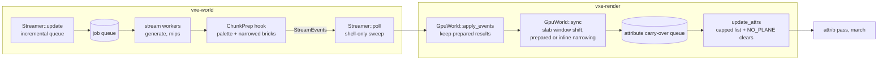

# 0023: The render thread's mirror CPU: profile a chunk crossing, then cut the attribute hitch and the streaming line with targeted fixes

> **Status:** done (closed 2026-10-21, v0.23.0). Verdict: clean close with four recorded misses;
> the hitch is cut (`update_attrs` p99 138 to 180 ms down to 5.5 to 6.0 ms, the default flies
> more frames than plain), the streaming line stays a recorded miss, and Phase 5 was skipped by
> the owner. Approved (owner, 2026-10-20; frame bar credited with the attribute pass's GPU
> time, option (b)).
> **Created:** 2026-10-20
> **Milestone:** M2 in `docs/roadmap.md` (owed before the lighting plan; it is the
> "streaming-CPU plan" the roadmap's M1 notes name, merged with the Plan 0013 attribute-hitch
> followup)
> **Related ADRs:** [ADR-0017](../../adrs/0017-mirror-cpu-work-bounded-in-the-frame-loop-narrowing-on-stream-workers.md) (the frame loop keeps its shape: bounded, incremental, narrowing on the stream workers; proposed with this plan), [ADR-0013](../../adrs/0013-mirror-reserves-its-vram-budget-up-front.md) (the reservation and deferral rules `sync` keeps), [ADR-0011](../../adrs/0011-contour-planes-in-attribute-pages-with-procedural-detail.md) (the attribute pages and "no plane"), [ADR-0003](../../adrs/0003-sphere-residency-with-lod-ring-and-edit-persistence.md) (residency bands), [ADR-0004](../../adrs/0004-palette-narrowed-sharded-brick-pool.md) and [ADR-0012](../../adrs/0012-mask-first-brick-with-per-brick-palette-planes.md) (the narrowing the workers take over)
> **Source:** the owner's interview answers, 2026-10-20 (scope, approach, the 250 ms lag, both
> bars), Plan 0002's Followups (the streaming-CPU plan) and Plan 0013's close (the attribute
> hitch).

## TL;DR

In a 10 m/s flight, the render thread spends p50 4.5 to 5.0 ms per frame in
`update + poll + sync` (the §2 line is 1.0 ms). In the contour look it also spends p99 138 to
180 ms in `update_attrs`, a hitch the eye sees, and the default look flies 35 to 47 % fewer
frames than `--look plain`. This plan starts by measuring before it changes anything. Phase 1
profiles a chunk-crossing frame on the dev box with `perf` and per-stage span timers, factors
the attribute work-list builder out of `GpuWorld`, and commits a headless bench that reproduces
one crossing's work list without a window or a GPU. Phase 1 also tests the working hypothesis.
The hypothesis is that about 2000 LOD chunks evicted on each crossing each drive a 488-brick
shell scan, close to 10^6 hash lookups. If the profile refutes it, the plan stops for a
re-plan. If it holds, the fixes follow and the frame loop keeps its shape:

- The shell pass is narrowed to the bricks of neighbouring full chunks.
- The attribute pass is capped per frame with a carry-over queue. A deferred brick reads
  "no plane", so new rock can show face-mode normals for up to 250 ms.
- The stream queue, the residency sweep and the window shift become incremental.
- Narrowing and staging move to the existing stream workers.

The first thing a reader sees is the Phase 1 bench, which counts today's crossing as 956 968
shell brick visits.

## Context & problem

Two frame costs on the render thread miss their bars. Both are dev-reference readings from
`docs/nfr.md` §2 and §5, quiet box at 2796062:

- **The streaming line** (`nfr.md` §2, "Streaming, upload, light extraction", 1.0 ms) has been a
  recorded miss since Plan 0002. Under `flythrough --autopilot --headless --seed 1` it reads
  p50 4.993 and 4.966 ms (plain) and 4.740 and 4.505 ms (default), and p99 32.6 to 65.3 ms.
- **The attribute work list** (Plan 0013, no `nfr.md` line yet) reads `update_attrs` CPU p50
  4.600 and 4.700 ms, p99 179.598 and 138.104 ms, max 390.376 and 156.825 ms. The work list is
  p50 4773 and 4462 bricks and max 11 477 and 7555. The default flew 2211 and 2695 frames
  against plain's 4123 and 4155.

What the code does today (`crates/vxe-render/src/gpu_world.rs`):

- `GpuWorld::attr_work` takes three change sets every frame. It takes every brick of the chunks
  whose record was written whole (`attr_chunks`, 512 `attr_item` calls each). It runs a
  27-brick neighbourhood around each re-uploaded brick (`attr_bricks`). It also visits a
  one-brick shell of 10^3 - 8^3 = 488 bricks around each chunk in `shell_chunks`, and each
  visit does up to three hash operations: `chunks.contains`, `seen.insert` and the
  `mirrored.get` in `attr_item`.
- `drop_record` inserts **every** dropped chunk into `shell_chunks`, LOD-only ones included.
  So does `upload_record` for every new record and every LOD record.
- `update_attrs` records the pass, and `AttribPass::encode` (`attrib.rs`) re-creates the work
  buffer when the list outgrows it.

The churn of a one-chunk +x focus step, computed for ideal balls at the fly-through's residency
(`r_full` 16, `r_lod` 24, hysteresis 1; `flythrough::RESIDENCY`):

| per crossing | chunks | how |
|---|---|---|
| evicted (left the `r_lod + h` = 25 ball) | 1961 | ball(25) minus its +x shift |
| loaded LOD-only (entered the 24 ball) | 1793 | shifted ball(24) minus ball(24) |
| promoted to full (entered the 16 ball) | 797 | shifted ball(16) minus ball(16) |
| demoted (left the 17 ball) | 901 | ball(17) minus its +x shift |

The evictions alone, at 488 shell bricks each, are 1961 × 488 = 956 968 brick visits in the
frame whose `poll` runs the sweep. That is the "~10^6 lookups" hypothesis. The evictions
cannot need any attribute work. An evicted chunk lies more than 25 chunks from the focus,
every full chunk lies within 17, and a neighbour is at most sqrt(3) ≈ 1.73 chunks away
(25 - 1.73 = 23.27 > 17). At 10 m/s a 6.4 m chunk is crossed every 0.64 s, about every 44
frames at plain's 68.7 fps (4123 frames in 60 s). That puts 2.3 % of the frames on a crossing,
so the p99 lands on crossing frames. **This is still a hypothesis.** The profile may instead
show the cost in `release_page`'s `free.retain`, in `select`'s scan, or in the 512
`attr_item` calls of each of the 797 promotions.

`crates/vxe-world/src/stream.rs` adds its own crossing cost. On a focus-chunk change,
`Streamer::update` rebuilds the queue: it enumerates 49^3 = 117 649 offsets, keeps the
57 777 inside ball(24), sorts them and checks each with `needs_job`. The next `poll` sweeps
every resident chunk, about ball(25) = 65 267. `GpuWorld::reconcile_window` filters every
mirrored and pending key to find the chunks leaving the window, while a one-chunk shift only
moves a slab of 51 × 51 = 2601 coordinates. The per-frame (p50) cost is the sync itself.
`select` reads each pending chunk under its lock. `upload_record` scans palettes, and
`upload_brick` narrows each `Full` brick and stages it, up to the fly-through's 2 MiB budget:
2 097 152 / (512 + 72) = 3591 brick slots and their masks per frame.

Consumer requirement served: the first consumer's first-person delve at walking and running
speed with no visible hitch (`references/project-context.md`, streaming and frame rate). The
`nfr.md` figures touched are §2 (the streaming line, and the attribute pass, which needs a
line), §5 (residency latency) and §3 (RAM, through the prepared results and the carry-over
queue).

## Decision

Profile first, then make targeted fixes that keep the frame loop's shape (ADR-0017). Phase 1
measures where `update_attrs` and `update + poll + sync` spend a crossing frame, and commits a
headless repro. The fixes come after it, each with an entry condition from the profile:

- narrow the shell pass,
- cap the attribute list with a carry-over queue,
- make the stream queue, the sweep and the window shift incremental,
- move narrowing and staging to the stream workers.

We rejected a dedicated mirror-prep thread (`GpuWorld` split into a CPU model and a GPU
uploader). It splits the one owner of ADR-0013's reservation and deferral rules across two
threads, and adds a frame of edit-to-mirror latency, before a profile shows the bounded
version misses. We rejected moving the work list and the uploads to the GPU (compute expansion
of change bits, a mapped staging ring). The cost being attacked is mostly lookups the list
does not need, and both add a new pass or a new synchronisation surface to every backend.
ADR-0017 records both.

**Stop rule.** Phase 1 ends with a verdict on the hypothesis. If it is refuted, `dev` stops
after Phase 1, writes the profile into the Implementation log and hands back to the architect.
The fixes below are aimed at the hypothesised costs, and applying them to a different cost
would be blind. Phase 5 has its own entry condition, from a profile taken after Phase 4.

## Architecture diagram



## Implementation phases

Each phase ships as its own commit. `dev` implements all phases in one session with no review
between phases, subject to the stop rule above. The architect reviews once at the end, in a
fresh session. Every reading names the machine, the commit, the 1-minute load at each start
and whether the run was quiet. The quiet-box protocol is the one from Plan 0006's close
(exclusive machine lock, 1-minute load under 2 at each start, no other process above 7 % CPU).
The flights are `flythrough --autopilot --headless --seed 1`, alternated with
`--look plain`, and every flight must end with `return: 2 chunks, hash match`.

### Phase 1: Profile a crossing, and a headless repro of its work list
- **Owner skill:** dev
- **What:** The skeleton: the work-list builder becomes a `GpuWorld`-free unit, a criterion
  bench and a counting test reproduce one crossing's list without a window or adapter, and a
  profile of the real flight says where both costs go.
  - **Factor the builder** out of `GpuWorld::attr_work` into `crates/vxe-render/src/attr_work.rs`.
    It is a pure function over a read-only view of the mirror's CPU model: whether a chunk is
    mirrored full, and the entry of a brick slot of a full chunk. The function takes the three
    change sets and returns the items plus counters: chunks taken whole, dirty bricks, shell
    chunks, `visit` calls, hash operations and items. `GpuWorld` implements the view.
    Behaviour does not change.
  - **The bench**, `crates/vxe-render/benches/attr_work.rs` (criterion, workspace pin), builds a
    synthetic view at the fly-through's residency around the origin. Every chunk with
    d2 <= 17^2 is full, with every brick `Full`, which is the worst case. Every other chunk
    with d2 <= 25^2 is LOD-only. The bench times the builder on the crossing frame's
    `shell_chunks` (the 1961 evictions of a +x step) and on a promotion frame (the 797
    promoted chunks as `attr_chunks`).
  - **The profile:** the autopilot report gains per-stage lines for the flight. The streaming
    CPU is split into `update`, `poll`, `apply_events` and `sync`, timed in `stream_step`.
    `update_attrs` is split into the list build and the pass recording. The builder's counters
    are reported as p50, p99 and max over the flight, plus their values on every frame where
    `update_attrs` took over 16 ms. Then `perf record -F 999 -g --call-graph dwarf` runs on
    one default flight of a release build with line tables
    (`CARGO_PROFILE_RELEASE_DEBUG=line-tables-only` set in the environment, no manifest
    change). `perf report --no-children --tid <render thread>` gives the top 15 self-time
    symbols of the render thread, which go into the Implementation log.
- **Files touched:** `crates/vxe-render/src/attr_work.rs` (new), `crates/vxe-render/src/gpu_world.rs`,
  `crates/vxe-render/src/lib.rs`, `crates/vxe-render/benches/attr_work.rs` (new),
  `crates/vxe-render/Cargo.toml` (criterion dev-dependency, `[[bench]]`),
  `apps/flythrough/src/main.rs` (per-stage report lines), this plan's Implementation log.
- **Done when:**
  - A unit test in `attr_work.rs` drives the builder on the bench's synthetic view with the
    1961 evicted chunks as `shell_chunks`. It asserts 1961 × 488 = 956 968 `visit` calls and
    0 items: no evicted chunk neighbours a full one, since 25 - sqrt(3) > 17. A second case
    asserts that the 797 promoted chunks give 797 × 512 = 408 064 `attr_item` calls and
    408 064 items in the all-`Full` view.
  - The `crates/vxe-render/tests/mirror.rs` suite passes unchanged on lavapipe, and a new
    case there asserts that `GpuWorld::update_attrs` returns the same item count before and
    after the factoring on its existing attribute scenes.
  - The bench runs and its two medians are logged (no gate).
  - The log records, for one quiet default flight and one quiet plain flight: the per-stage
    p50, p99 and max; the counters on the frames over 16 ms; the perf top 15; and a
    **verdict**. The hypothesis is confirmed when, on every default frame where `update_attrs`
    exceeds 16 ms, shell `visit` calls are at least half of all `visit` plus `attr_item`
    calls, and perf attributes the largest self-time share inside the builder to the shell
    loop's hash operations. Otherwise it is refuted and the stop rule applies.
  - The log also names the largest p50 share inside `sync`: palette scan, narrowing,
    `stage` copies, `queue.write_buffer`, `select`'s scan, or `release_page`.

### Phase 2: The shell visits only full neighbours' border bricks
- **Owner skill:** dev
- **What:** The shell pass of a chunk `c` looks up each of `c`'s 26 neighbour chunks once.
  Only for a neighbour mirrored full does it visit that neighbour's bricks that border `c`:
  64 for a face neighbour, 8 for an edge neighbour, 1 for a corner neighbour. Those are the
  same bricks the 488-brick shell visits today, filtered by chunk. `drop_record` still records
  the shell, because a demoted chunk next to a full one does change the full chunk's border
  attributes. The cost now falls with the neighbours instead of with the shell's volume.
  `seen` stays the deduplication across the three sources.
- **Files touched:** `crates/vxe-render/src/attr_work.rs`, `crates/vxe-render/src/gpu_world.rs`
  (if `drop_record`'s insert changes shape), `crates/vxe-render/benches/attr_work.rs`.
- **Done when:**
  - The Phase 1 eviction case reads 1961 × 26 = 50 986 neighbour lookups, 0 brick visits and
    0 items.
  - An oracle test keeps the Phase 1 builder as a test-only reference. Over 64 seeded random
    small views (a 6^3-chunk region with a seeded mix of full, LOD-only and absent chunks and
    of `Full` and uniform bricks, and seeded change sets), the new builder's item set equals
    the reference's, compared as sorted sets of `(slot, origin)`.
  - The bench's eviction-frame median is logged beside Phase 1's.

### Phase 3: The attribute pass is capped, with a carry-over queue and "no plane" for deferred bricks
- **Owner skill:** dev
- **What:** `update_attrs` takes at most `attr_cap` bricks per call (a `MirrorConfig` field,
  proposal 8192) from a carry-over queue. Some rules keep this correct:
  - **The queue holds brick coordinates**, deduplicated, and records the `update_attrs` call
    index at which each was enqueued. A whole chunk is queued as its coordinate and expanded
    lazily within the cap. A brick is resolved to `(slot, origin)` when it is taken, so a slot
    freed and reused while the brick waited is never written with the old brick's origin. A
    brick whose chunk is no longer mirrored full is skipped.
  - **Re-uploaded (edited) bricks and their 26 neighbours go to the front** and are never
    deferred. A carve shows its contour in the same frame, as it does today.
  - **A deferred brick never shows stale planes.** A brick written to a slot this sync whose
    compute item does not run this frame gets a clear item. Clear items are flagged in the
    item (illustrative: the slot word's top bit). The pass writes `NO_PLANE` (0xFFFF) to the
    brick's attribute words and returns. So until its turn comes, the brick hits as face mode,
    which is what ADR-0011's "no plane" already means to the march. Clear items are not
    capped; they are bounded by the bricks one sync writes.
  - **The work buffer is sized once.** It holds `attr_cap` items plus the clear items one sync
    can produce under the configured `sync_budget_bytes`: 8192 + 3591 + 512 = 12 295 items at
    the fly-through's 2 MiB, which is 196 720 B at 16 B per item. The 512 covers the one chunk
    a sync may finish past its budget. With an unbounded sync budget it grows as today.
  - The fly-through reports the oldest carried-over brick's age at every `update_attrs`, in
    milliseconds through its frame timestamps, as p50, p99 and max over the flight.
- **Files touched:** `crates/vxe-render/src/attr_work.rs`, `crates/vxe-render/src/gpu_world.rs`,
  `crates/vxe-render/src/attrib.rs`, `crates/vxe-render/src/shaders/attrib.wgsl`,
  `crates/vxe-render/tests/mirror.rs`, `apps/flythrough/src/main.rs`.
- **Done when:**
  - A lavapipe test in `tests/mirror.rs` uses `attr_cap` 64 and a scene whose first sync
    writes K > 64 `Full` bricks into attribute pages; the test prints K. The first
    `update_attrs` returns 64 compute items. Read back, every other new brick's two attribute
    slots are all `NO_PLANE`. After ceil(K / 64) calls the attribute bytes of every brick equal
    those of an uncapped mirror on the same scene, bit for bit.
  - A carve applied while the queue holds more than 64 waiting bricks has every one of its
    re-uploaded bricks in the very next call's list.
  - A slot freed and reused while its old brick waited ends with the new brick's attributes,
    equal to an uncapped mirror.
  - `AttribPass::buffer_builds()` reads 1 after the autopilot's first flight frame and at its
    end.
  - The `shader_portability` test still validates `attrib.wgsl`.

### Phase 4: An incremental stream queue, residency sweep and window shift
- **Owner skill:** dev
- **What:** All three changes are pure bookkeeping and change no decision.
  - **The streamer.** When the single focus moves by one step on each axis (|Δ| <= 1, the 26
    unit steps), `Streamer::update` adds the jobs for chunks entering the wanted ball and
    drops queued jobs that left it. The entering offsets are cached per step vector as the
    difference of the ball's offset sets. It re-keys the existing queue by the new `d2` and
    sorts it. The resulting queue order and contents are exactly what `rebuild_queue` would
    produce, `wanted_since` included. The next `poll`'s sweep visits only the leaving shells
    of the `r_full + h` and `r_lod + h` balls, plus a recheck set of the chunks inserted
    outside their band since the last sweep (today's "the sweep demotes it" case). A jump,
    several focus points, `set_radii` or the first `update` keep today's full rebuild and
    full sweep.
  - **The mirror.** `GpuWorld::reconcile_window` finds the chunks leaving the window from the
    slab `box_difference(old, new)` by direct lookups in `mirrored` and `pending_d2`, instead
    of filtering every key.
- **Files touched:** `crates/vxe-world/src/stream.rs`, `crates/vxe-world/tests/stream.rs`,
  `crates/vxe-render/src/gpu_world.rs`, `crates/vxe-render/tests/mirror.rs`.
- **Done when:**
  - In `crates/vxe-world/tests/stream.rs`, a streamer runs a seeded 300-step walk: unit steps
    in all 26 directions, a jump of 10 chunks every 60 steps, and one `set_radii` mid-walk. It
    uses a test-only check that recomputes the full rebuild and the full sweep from the same
    state. After every step, the incremental queue equals the rebuilt one as an ordered list
    of keys, and the sweep's evict and demote lists equal the full scan's.
  - The existing residency tests (`resident set's world hash identical with 1 and 8 workers`
    and the persistence ones) pass unchanged.
  - A unit test in `gpu_world.rs` drives `reconcile_window` through 50 seeded shifts of
    -2..=2 chunks per axis. The leaving set equals the old filter's set, and the table entries
    cleared are the same.
  - The autopilot's per-stage `update` and `poll` max are logged beside Phase 1's.

### Phase 5: Narrowing and staging on the stream workers
- **Owner skill:** dev
- **What:** Entry condition. First re-run the Phase 1 profile on one quiet plain flight at the
  Phase 4 tip. Proceed only if narrowing is the largest share of `sync`'s p50: palette scan,
  `upload_brick`'s narrowing and the `stage` copies together. If another cost leads,
  `queue.write_buffer`'s copies or `select`'s scan for example, stop, log the profile and
  hand back to the architect. When the condition holds:
  - **The hook.** `vxe-world` declares a `ChunkPrep` hook. The `Streamer` takes it optionally
    and runs it on the worker after a full chunk is generated or restored, and after a mip
    build. Its opaque, `Send + Sync` result rides `StreamEvents` next to `loaded` and
    `demoted`.
  - **What it prepares.** `vxe-render` implements the hook. For a chunk that will get a new
    narrow record, it builds the first-appearance chunk palette and each `Full` brick's slot
    bytes and masks, the same bytes `upload_brick` would stage. It reads the translucency
    flags from the world's material table on the worker.
  - **How `sync` uses it.** `GpuWorld::apply_events` keeps each prepared result keyed by
    coordinate. `upload_record` uses it only for a record written new and narrow from content
    identical to what was prepared, under the same material table. Every other case narrows
    inline as today: a chunk edited between preparation and sync, a wide chunk, a re-uploaded
    record, or a missing result. The render thread still allocates slots, writes the record
    and issues every `queue.write_buffer`.
  - **A RAM cap.** Prepared results are held to a cap of 64 MiB (proposal). That is 224
    worst-case chunks at 512 × 584 = 299 008 B each. A chunk dropped or evicted drops its
    result, and past the cap the oldest result is dropped and that chunk narrows inline.
- **Files touched:** `crates/vxe-world/src/stream.rs`, `crates/vxe-world/src/lib.rs`,
  `crates/vxe-world/src/chunk.rs` (only if content identity needs a revision counter,
  incremented deterministically on every write), `crates/vxe-render/src/prep.rs` (new),
  `crates/vxe-render/src/gpu_world.rs`, `crates/vxe-render/tests/mirror.rs`,
  `apps/flythrough/src/main.rs` (installs the hook, reports peak prepared bytes).
- **Done when:**
  - A lavapipe test in `tests/mirror.rs` streams the seed-1 cave to residency 4/6 twice, once
    with the hook and once without. It reads back the pool shards, masks, records and table
    and asserts them equal byte for byte. It also asserts that the hooked run took the
    prepared path for at least one chunk, by a counter in `SyncStats`.
  - A second case carves a chunk after its worker prepared it and before its sync. That chunk
    is narrowed inline, and the mirror equals the hook-free mirror.
  - `vxe-world`'s cross-platform hash tests are unchanged, since the hook writes nothing into
    the world.
  - The autopilot reports peak prepared bytes under 64 MiB, and the log records the `sync`
    p50 beside Phase 1's.

### Phase 6: Readings against the bars
- **Owner skill:** dev
- **What:** Four quiet-box flights at the tip, alternated default, plain, default, plain, each
  started at a 1-minute load under 2, with the exclusive perf lock. Every line goes in the
  Close triggers with machine, commit and loads.
- **Files touched:** this plan's Implementation log only (the close moves readings into
  `docs/nfr.md`).
- **Done when:** every bar below reads true in both pairs. A bar that misses is logged as a
  miss with its numbers, not re-run until it passes.
  - `update_attrs` CPU p99 under 4 ms in both default runs (today 138 to 180 ms).
  - **The GPU-credited frame bar (owner, 2026-10-20).** Each default run's frame count, after
    crediting the attribute pass's GPU time, is at least 95 % of its paired plain run's raw
    count. The bar judges only the render thread's CPU. The credit is computed from the
    flight's own readings:
    - `T` is the default run's flight wall time in ms, from the first to the last flight
      frame's timestamp (the `Out` and `Back` legs, the frames `pilot_sample` counts).
    - `G` is the sum over the same frames of the attribute pass's GPU time in ms, from its
      timestamp queries (`p.attr.gpu_ms`, frames with work only, the others adding 0).
    - `F_d` and `F_p` are the default's and plain's flight frame counts.
    - The credited count is `F_d* = F_d × T / (T - G)`: the frames the default would fly if
      those GPU milliseconds were not spent. The bar is `F_d* >= 0.95 × F_p`.
    - A worked example with invented numbers: `T` = 60 000 ms, `G` = 6000 ms and `F_d` = 3600
      give `F_d*` = 3600 × 60 000 / 54 000 = 4000. Against plain's 4123 the bar is 3917, so
      4000 passes. The raw 3600 would not have passed.
    - The autopilot prints `T`, `G`, `F_d` and `F_d*` in one line, and the log records raw
      `F_d` against `F_p` too. The raw gap and `G` are the attribute pass's GPU cost, recorded
      for a later plan (Followups).
  - Streaming CPU (`update + poll + sync`, as `stream_step` times it) p50 under 1.0 ms in all
    four runs, and its max under 16 ms in all four. Its p99 is recorded and does not gate.
  - Plain's residency latency p95 at or under 381 ms in both plain runs.
  - The longest attribute carry-over age at or under 250 ms in both default runs.
  - `return: 2 chunks, hash match` in all four runs.
  - The attribute pass's GPU p50, p99 and max and the work list's p50, p99 and max are
    recorded, not gated.

### Phase 7: The owner's windowed flight
- **Owner skill:** human
- **What:** The owner flies `flythrough --seed 1` windowed, default look, with stdout visible.
  The flight includes a sustained fast pass across many chunk boundaries in both directions
  and a few carves, and the owner judges two things. Is the hitch gone? Is the up-to-250 ms
  face-mode lag on newly streamed rock invisible, or at least unobjectionable? A carve must
  show its contour in the frame it lands. `dev` sends a push notification when the build is
  ready, batched with any other pending live checks.
- **Files touched:** this plan's Implementation log (the owner's verdict, dated).
- **Done when:** the owner's verdict on both questions is recorded. A "no" on either goes to
  the close review as a finding.

## Data shapes

```rust
// illustrative: vxe-render, the builder's view and counters
pub trait MirrorView {
    fn is_full_chunk(&self, c: ChunkCoord) -> bool;
    /// The slot of world brick `b` if it is a `Full` brick of a mirrored full chunk.
    fn full_slot(&self, b: [i32; 3]) -> Option<u32>;
}
pub struct AttrWorkStats { pub whole_chunks: u32, pub dirty_bricks: u32,
    pub shell_chunks: u32, pub visits: u64, pub lookups: u64, pub items: u32 }

// illustrative: vxe-world, the worker hook (opaque to the world)
pub trait ChunkPrep: Send + Sync {
    fn full(&self, coord: ChunkCoord, chunk: &Chunk, materials: &MaterialTable) -> Option<Prepared>;
    fn lod(&self, coord: ChunkCoord, mips: &ChunkMips, materials: &MaterialTable) -> Option<Prepared>;
}
pub type Prepared = std::sync::Arc<dyn std::any::Any + Send + Sync>;
```

The attribute work item keeps its 16 bytes (`AttribItem { slot, origin }`). A clear item is
marked inside `slot` (illustrative: bit 31; slots fit in 29 bits).

## Budgets

| `nfr.md` figure | today (quiet box, 2796062) | this plan's bar | how the close measures it |
|---|---|---|---|
| §2 streaming line, 1.0 ms | p50 4.5 to 5.0 ms, p99 33 to 65 ms, max 41 to 108 ms | p50 under 1.0 ms; max under 16 ms; p99 recorded | Phase 6, `stream_step`'s timing, four flights |
| §2 attribute pass, render-thread CPU (**no line yet; proposed here**) | p50 4.6 to 4.7 ms, p99 138 to 180 ms | p99 under 4 ms; carry-over age at most 250 ms | Phase 6, default flights |
| §2 frame rate in motion (diagnostic) | default 2211 and 2695 frames against plain's 4123 and 4155 | GPU-credited default `F_d*` at least 95 % of plain; raw counts and `G` recorded | Phase 6 pairs |
| §5 residency latency, 500 ms p95 proposal | plain p95 381 and 381 ms | plain p95 at most 381 ms | Phase 6 plain flights |
| §5 edits persist across eviction | `return: 2 chunks, hash match` | unchanged | every flight |
| §3 memory | mirror reservation fixed (ADR-0013); RAM per §3 | unchanged; prepared results at most 64 MiB of RAM, the work buffer 196 720 B | Phase 5 peak prepared bytes, Phase 6 peak resident RAM line |

**Proposed `nfr.md` §2 line, for the close to write:** "Mirror attribute pass (contour look),
render-thread CPU: p99 under 4 ms on the dev reference, deferred work visible as face-mode
normals for at most 250 ms". The pass's GPU time stays a recorded figure here. Plan 0013's
1.0 ms GPU proposal remains unmet and unowned, and it is listed below as not done.

## Risks & open questions

- **Why the frame bar is credited.** During flight the autopilot reads its timestamp queries
  back synchronously every frame (`MarchTimer::read_ms` waits on the device), so a flight frame
  costs its CPU plus its GPU. The attribute pass's GPU work per second is set by the flight
  speed, and capping only spreads it. At today's p50 of 2.4 to 3.0 ms on 67 to 78 % of the
  default's frames, it alone could cost about 10 to 14 % of plain's frames. The owner chose
  (2026-10-20) to credit it, so the bar measures this plan's subject. The GPU cost is recorded
  and owed to a later plan.
- **Refuted hypothesis.** The stop rule covers it: Phase 1 hands back, and nothing later
  starts.
- **Prepared-result staleness** is the correctness risk of Phase 5. The byte-equality test and
  the edit-between test defend it. The fallback is always inline narrowing, so a missed case
  costs time, not correctness, as long as the identity check is conservative.
- **Threading.** The hook runs on workers that already hold no lock across generation. It
  must not take the store's map lock or any `GpuWorld` state, and it receives the chunk by
  reference before insertion. No channel is added that the render thread could block on:
  results ride the existing `Done` channel, which `poll` drains with `try_recv`.
- **Determinism.** `vxe-world` stays deterministic. The incremental queue must equal the full
  rebuild's queue (Phase 4's oracle), and the hook writes nothing into the world. A revision
  counter, if added, is integer and incremented on every write.
- **Residency latency.** Worker time spent narrowing delays the next generation job. The
  plain p95 bar of 381 ms guards it. If it fails, the cheaper move is preparing full chunks
  only and leaving LOD mips inline.

## What this plan does NOT do

- **The default look's mirror footprint** (surface-only attribute storage, `r_full` held at 12
  to 13 under pressure): ADR-0012's mirror-slot plan.
- **The attribute pass's GPU cost** (Plan 0013's 1.0 ms p99 proposal, read 4.3 to 5.6 ms).
  It is recorded here, not attacked.
- **Lighting and light extraction**, the third item on the streaming line: M2's lighting plan,
  which this plan precedes.
- **Baseline-GPU or baseline-CPU readings.** Every bar here is dev reference. The baseline
  card is not on hand (`nfr.md` §1).
- **Incremental updates for several focus points**, or for jumps: they keep the full rebuild.
- **The level-size first sync's palette scan** (Plan 0002's followup, about 500 ms). The
  prepared path may shorten it, but it is not measured or gated here.
- **The far-field clipmap** and any change to the residency radii or their defaults.

## Implementation log

> Written by `dev`: one row per phase as its commit lands, then the close block. **The phases
> above are the contract. This section records what happened.** Observations, never conclusions:
> no pass list, no self-assessment. Deviations and unmet done-whens are **always** disclosed.
> Keep it shorter than `## Implementation phases`.

| phase | owner | state | commit |
|---|---|---|---|
| 1: Profile a crossing, and a headless repro | dev | done: `attr_work::build` over `MirrorView` (implemented by `GpuWorld`); unit tests read 1961 shell chunks, 956 968 shell visits, 0 items, and 797 chunks, 408 064 item calls, 408 064 items; `tests/mirror.rs` 37 of 37 on the fallback adapter, the new case's lengths `[1343, 34, 568, 34, 568, 46, 56, 0]` also read on an export of ae2e088; bench medians (exclusive perf lock, load 5.01): eviction frame 170.89 ms, promotion frame 6.332 ms; flights, profile, verdict and `sync` share in Notes | 730f7ed |
| 2: The shell visits only full neighbours | dev | done: eviction case 50 986 neighbour lookups, 0 shell visits, 0 items; the Phase 1 builder kept as `tests::reference` (its eviction case still reads 956 968 visits); oracle over 64 seeds equal as sorted `(slot, origin)` sets, with and without the other two change sets, 32 046 shell-only items in total; `vxe-render` 66 of 66; bench medians (exclusive perf lock, load 13.71): eviction frame 1.399 ms (Phase 1: 170.89), promotion frame 7.493 ms (Phase 1: 6.332) | 2f66b83 |
| 3: Capped attribute pass with carry-over | dev | done: `MirrorConfig::attr_cap` (`new` leaves it `usize::MAX`; the fly-through's streaming mirror sets 8192); clear items flagged by `attrib::CLEAR_BIT` (bit 31); lavapipe cases at cap 64 on the 2 x 2 x 1 floor: K = 256, first call 64 compute and 192 clear items, the 192 waiting bricks read all `0xFF`, 4 = ceil(256 / 64) calls, then attribute bytes equal the uncapped mirror's; a carve with 192 waiting has the carved brick and its `Full` neighbours in the next list; a brick freed while waiting, its slot taken by the brick above, ends equal to the uncapped mirror; `vxe-render` 69 of 69, workspace 469 of 469; one default flight (load 14.60, not a reading): `buffer builds: 1 after the first flight frame, 1 at the end`, hash match | 7aabc21 |
| 4: Incremental queue, sweep and window shift | dev | done: the 300-step walk (r_full 3, r_lod 5, h 1; 295 unit steps over all 26 directions, jumps at 60, 120, 180, 240, `set_radii(2, 4)` at 150) ran 295 queue and 294 sweep oracle checks, equal to the full rebuild and scan; dropping the entering-full shell or the keep-full sweep shell fails it; `the_window_slab_finds_the_chunks_the_key_filter_finds` over 50 shifts; workspace 471 of 471; flights at the tip's code (exclusive perf lock, not quiet): `update` max default 4.749 ms (Phase 1: 37.847), plain 2.350 (15.908); `poll` max default 48.503 (27.344), plain 24.389 (24.866); readings in Notes | b6414e8 |
| 5: Narrowing and staging on the workers | dev | skipped (owner, 2026-10-21): write_buffer 41.8 % led narrowing ~38 % | 8f2847d (entry profile) |
| 6: Readings against the bars | dev | done: four flights, default, plain, default, plain, each started at a 1-minute load under 2 under the exclusive perf lock; met: the GPU-credited frame bar, carry-over age, hash match; missed: `update_attrs` p99, streaming p50 (3 of 4 runs), streaming max (4 of 4), plain residency p95 (2 of 2); readings in Close triggers. Quiet re-read (owner's request, 2026-10-21; nothing above 5 % CPU at any start): the same bars met and missed, streaming p50 missed in the 2 plain runs only, plain p95 403 and 385 ms | committed with this row |
| 7: The owner's windowed flight | human | done (owner, 2026-10-21, session 3, `target/release/flythrough --seed 1`, default look (contour), 2530x1378, stdout in `check-p7.log`): warm-up around the spawn, then sustained fast passes across chunk boundaries both ways and a third direction, then carves. Hitch: "mostly gone", no stalls felt; the frame rate dropped to about 40 fps during the fast passes (owner's read of the display; the log has no per-frame timings). Face-mode lag on newly streamed rock: "non existent", no visible delay. Carves: contour in the same frame. Log: frame line at start cpu 4.159 ms, gpu march 6.803 ms; mirror reserved 3 220 387 776 B of a 3 221 225 472 B budget; `mirror: ... wait for space (deferred chunks)` with deferral streaks up to 161 syncs during the flight; 85 `bench:` carve lines, 0 refused. | |

### Notes

_(Deviations from the plan, with the commit, stated without justification. Done-whens not
satisfiable as stated, and what was done instead. Followups noticed and not acted on. One line
each. Empty is fine.)_

- **Phase 1 flights (dev box, RTX 3080 laptop, Phase 1 tree on ae2e088, release with
  line tables, exclusive perf lock).** Not quiet: other lanes were building, start loads 11.51
  (default) and 5.00 (plain), after a 25 min wait for load under 2 timed out. Both `return:
  2 chunks, hash match`.
  - Default, 2270 flight frames. Streaming CPU p50 5.981, p99 51.692, max 83.681 ms; stages
    (p50 / p99 / max ms) `update` 0.000 / 10.892 / 37.847, `poll` 0.003 / 15.037 / 27.344,
    `apply_events` 0.000 / 6.724 / 8.945, `sync` 5.877 / 21.967 / 47.579. `update_attrs` p50
    3.646, p99 119.140, max 380.954 ms; list build 3.521 / 119.139 / 380.913, recording 0.077 /
    0.689 / 3.046. Counters p50 / p99 / max: shell visits 19 520 / 752 984 / 930 128, dirty
    visits 0 / 0 / 675, item calls 16 896 / 21 504 / 23 552, lookups 76 816 / 2 116 960 /
    2 632 770. Work list 4773 / 5745 / 7771. Attribute GPU 2.588 / 4.596 / 6.354 ms. Residency
    p95 365 ms.
  - The 85 default frames over 16 ms (17.955 to 380.954 ms): 94 to 1906 shell chunks, 45 872
    to 930 128 shell visits, at most 40 chunks taken whole, at most 7332 items. The lowest
    shell share of `visit` plus `attr_item` calls on them is 0.918.
  - Plain, 2597 flight frames. Streaming CPU p50 7.262, p99 60.402, max 81.806 ms; stages
    `update` 0.000 / 12.570 / 15.908, `poll` 0.159 / 18.436 / 24.866, `apply_events` 0.000 /
    6.584 / 10.957, `sync` 6.821 / 23.507 / 51.514. Residency p95 509 ms.
- **Phase 1 profile.** `perf record -F 999 -g --call-graph dwarf` on a third default flight
  (start load 11.91, 2046 frames, `update_attrs` p99 148.202 ms, hash match): 607 903
  samples, 13 chunks lost. The render thread is tid = pid (42 150 samples). Top 15 self
  symbols, `perf report --no-children -g none --tid <pid> --percentage relative --sort sym`:
  `attr_work::shell_pass` 24.98 %, `GpuWorld::upload_record` 9.13, `RandomState::hash_one<&ChunkCoord>`
  5.55, `DefaultHasher::write` 4.74, `Streamer::stats` 4.15, `wgpu_core Queue::write_buffer`
  3.89, `RawTable<[i32; 3]>::reserve_rehash` 3.57, `Packed::entry_matches` 2.14,
  `attr_work::whole_pass` 2.04, `flythrough::mips_ram` 1.91, `World::lod` 1.79, `cfree` 1.55,
  `GpuWorld::enqueue` 1.48, `GpuWorld::sync` 1.15, `Streamer::needs_job` 1.14.
- **Phase 1 profile, deviation.** Dwarf unwinding gave a call chain for 8039 of the 42 150
  render-thread samples, so the callers of the out-of-line hash symbols are not attributed.
  `shell_pass`'s self time was split by source line instead (`--sort srcline`): hashbrown and
  SipHash lines (`sse2.rs`, `equality.rs`, `map.rs`, `bitmask.rs`, `tag.rs`, `raw.rs`,
  `sip.rs`) are about 61 % of it, `attr_work.rs` lines about 8 %.
- **Phase 1 verdict: confirmed.** Shell share at least 0.918 on every default frame over 16 ms;
  the builder's largest self time is `shell_pass`, 12 times `whole_pass`.
- **Phase 1, `sync`'s largest share** (whole-flight self time, not a p50 split): narrowing.
  `upload_record` is 9.13 % of the thread, 56.07 % of it at `gpu_world.rs:1799` and about
  67 % at lines 1793 to 1801 (the plane-to-index bit loop of the inlined `upload_brick`); the
  palette scan line 1648 is 3.02 % of it. Then `entry_matches` 2.14 %, `write_buffer` 3.89 %,
  `enqueue` 1.48, `release_page` 0.23, `stage` 0.22, `flush_stage` 0.18.
- **Phase 1 deviation.** `AttrWorkStats` counts `item_calls`, `dirty_visits` and
  `shell_visits` separately (`visits()` sums the last two) in place of one `visits` field.
  `GpuWorld` gains `prepare_attrs`, `encode_attrs` and `attr_stats`; `update_attrs_timed`
  calls the first two. Outside Phase 1's file list: `Cargo.lock` (criterion) and
  `crates/vxe-render/tests/mirror.rs` (the case its done-when names).
- **Phase 2.** `AttrWorkStats` gains `neighbour_lookups`; the fly-through's report lines do
  not print it (`apps/flythrough` is outside Phase 2's file list). The bench is unchanged.
- **Phase 3.** The re-uploaded bricks' neighbourhoods count toward `attr_cap`; the queue
  supplies the rest, so a list exceeds the cap only when they alone do. A brick's shell entry
  queues as a brick, a chunk written whole as its coordinate; the list deduplicates within one
  call, not across the queue (a brick can be computed twice). `attr_cap` is set on the
  streaming mirror only; the level mirror is uncapped. The carry-over age is read before each
  `prepare_attrs` (how long the oldest waiting entry has waited) through
  `GpuWorld::attr_queue_age`. New API: `attr_work::build_split`, `AttrWorkStats::clears`,
  `GpuWorld::attr_list`, `attr_queue_age`, `attr_buffer_builds`, `AttribPass::reserve`.
  Outside the file list: `apps/flythrough/tests/level_mirror.rs` (its `MirrorConfig` literal
  gains `attr_cap`).
- **Phase 4 flights (dev box, binary of the Phase 4 tree, exclusive perf lock).** Default:
  start load 7.80, 1904 frames, hash match; streaming CPU p50 9.302, p99 85.750, max 137.326
  ms; stages (p50 / p99 / max) `update` 0.001 / 2.758 / 4.749, `poll` 0.219 / 35.455 /
  48.503, `apply_events` 0.000 / 11.256 / 21.378, `sync` 8.505 / 44.296 / 95.871; residency
  p95 1763 ms; `update_attrs` p50 4.730, p99 33.136, max 78.045 ms; carry-over age p99 69.5,
  max 121.8 ms. Plain: start load 5.29, 3247 frames, hash match; streaming CPU p50 5.061, p99
  35.678, max 72.147 ms; `update` 0.000 / 1.219 / 2.350, `poll` 0.002 / 12.585 / 24.389,
  `apply_events` 0.000 / 5.246 / 10.291, `sync` 4.994 / 18.122 / 43.043; residency p95 460 ms.
- **Default residency p95 across this plan's default flights** (none gated): 365 (Phase 1),
  548 (Phase 1 perf run), 1049 (Phase 3), 1763 ms (Phase 4); syncs with a deferral 72, 112,
  226, 200.
- **Phase 4.** The incremental sweep also covers several unit steps between two polls when
  their sum is a unit step; otherwise it scans. A chunk inserted outside its band joins a
  recheck set the next sweep visits. Test hooks `Streamer::set_incremental_oracle` and
  `oracle_checks` are public and `#[doc(hidden)]`. The window shift uses the slab when it
  holds no more chunks than the mirror holds keys, else filters the keys, in
  `leaving_window`.
- **Phase 5 entry profile (dev box, b6414e8 code, exclusive perf lock, not quiet: start
  load 3.28 after a 5 min wait for under 2).** One plain flight of a release build with line
  tables and `-C force-frame-pointers=yes` (`CARGO_TARGET_DIR=target/fp`), under `perf record
  -F 999 --call-graph fp`: 682 871 samples, 2903 frames, hash match, streaming CPU p50 6.076,
  p99 37.410, max 65.248 ms, `sync` p50 5.965 ms, residency p95 467 ms. The render thread
  (tid = pid) has 38 525 samples, 16 839 of them under `GpuWorld::sync`. Each is put on the
  frame nearest its leaf among: `Queue::write_buffer` 41.8 %; `upload_record` self 33.6 %;
  `entry_matches`, `first_appearance` 8.8 %; `sync` self 5.7 %; `enqueue` 4.8 %; the fit check
  2.6 %; `drop_record` 1.1 %; `stage` 0.6 %; `flush_stage` outside `write_buffer` 0.6 %;
  `unqueue` 0.5 %. `upload_record`'s self time by source line: 71.94 % in `upload_brick`'s
  lines, 2.38 % in the palette scan, 12.85 % in `core` and `std` lines, 10 % in other
  `gpu_world.rs` lines.
- **Phase 5, `write_buffer`.** Its samples under `sync`: 53.8 % its own self time, 24.5 %
  unresolved `libc`, 2.6 % `gpu_allocator` free-list, 2.5 % the NVIDIA driver, the rest
  `wgpu_hal` buffer creation, mapping and transitions under 2 % each. Callers: `flush_stage`
  6558 samples, `sync` (inlined record and table flushes) 248, `upload_record` 227.
- **Phase 5, deviations.** The entry profile used frame pointers, not `--call-graph dwarf`: a
  dwarf profile of a plain flight at the same code (start load 4.22, 649 160 samples) gave a
  call chain for 8964 of the render thread's 36 845 samples, and for 40 of the 5003 whose
  leaf is in `libc`. The shares are of the whole flight's samples, not of `sync`'s p50 frame.
- **Phase 5 decision (owner, 2026-10-21):** option (a), skip Phase 5 and run Phase 6 on the
  Phase 4 code. Nothing of Phase 5 is implemented.
- **Phase 6 deviation.** The autopilot's `frame bar` line (`T`, `G`, `F_d`, `F_d*`) is new in
  `apps/flythrough/src/main.rs`, outside Phase 6's file list; it lands in the Phase 6 commit.
- **Phase 6 quiet-box protocol.** Every start read a 1-minute load under 2, but another
  process was above 7 % CPU at each start (`ps` lifetime averages: python3 97.3 and 81.1 %,
  then game.exe 88.6 to 90.6 %). End loads read 7.34 to 10.01.
- **Phase 6, the default look's residency.** Both default runs lowered `r_full` to 12 of 16
  under mirror pressure (4 radius changes, peak pressure 0.9114) and mirrored about 39 900
  chunks, against plain's 73 000 at `r_full` 16; the default flew 5904 and 6616 frames against
  plain's 3054 and 3442, and 5894 of 5904 and 6606 of 6616 of its frames read unready-near.
- **Phase 6 re-reads (2026-10-21, after the owner stopped python3 and game.exe; same binary).**
  A first set of four (start loads 1.20, 1.98, 1.92, 1.72) ran while Telegram held 57 to 70 %
  of one core in `top` (8 % in `ps`'s lifetime average). It read plain p95 490 and 488 ms and
  2743 frames in each plain run. Then two single plain flights, with Telegram at 5.9 % and
  then idle: the Phase 1 binary (ae2e088 plus counters) read p95 383 ms over 4000 frames
  (start load 1.71), the tip's 389 ms over 4191 (start load 1.86). The quiet set followed
  (start loads 1.56, 1.69, 1.60, 1.83; `top` showed nothing above 5 % at each start; end
  loads 6.41 to 7.36). Its readings are in Close triggers.
- **Phase 6, the default look against the baseline.** Every default run here lowered `r_full`
  under mirror pressure: to 12 in the first set and the quiet set, to 13 in the
  Telegram-perturbed set. Plan 0013's default runs at the baseline also lowered it (lowest
  12, final 13). The default mirrors about 40 000 chunks, plain about 73 000.
- **Phase 6, the cap.** In both default runs the work list's max (7669, 7673) stayed under
  `attr_cap` 8192: no brick waited, no clear item was issued.
- **Followups noticed.** In the plain dwarf profile, `flythrough::Run::draw` is 16.65 % of
  the render thread's self time, 67 % of it at hashbrown's `equality.rs:157`, and
  `Streamer::stats` is 5.80 %. Neither is in this plan's scope.

### Close triggers

_(Facts for the architect. No recommendations, and no suggested version bump.)_

- **What shipped:** feature. Phases 1 to 4 and 6; Phase 5 skipped by the owner.
- **Public API changed:**
  - `vxe-render`: new module `attr_work` (`MirrorView`, `AttrWorkStats`, `build`,
    `build_split`), re-exported `AttrWorkStats` and `MirrorView`;
    `MirrorConfig::attr_cap` (new field, `usize::MAX` in `new`); `GpuWorld::prepare_attrs`,
    `encode_attrs`, `attr_stats`, `attr_list`, `attr_queue_age`, `attr_buffer_builds`;
    `update_attrs` returns compute plus clear items; `attrib::CLEAR_BIT`,
    `AttribPass::reserve`.
  - Shader interface: `attrib.wgsl`'s work item, bit 31 of the slot word marks a clear item.
  - `vxe-world`: `Streamer::set_incremental_oracle` and `oracle_checks`, `#[doc(hidden)]`.
- **Budget readings** (dev box, the RTX 3080 laptop; code of the Phase 6 commit, built as
  8f2847d plus the `frame bar` line; `flythrough --autopilot --headless --seed 1`, plain with
  `--look plain`; exclusive perf lock; start loads 1.82, 1.87, 1.95, 1.98 in run order D1,
  P1, D2, P2):
  - `nfr.md` §2 streaming line, 1.0 ms: p50 D1 1.862, P1 5.513, D2 0.006, P2 4.977 ms
    (bar met in D2 only); p99 20.974, 42.670, 18.370, 33.217 ms (recorded); max 57.809,
    70.856, 47.993, 61.588 ms (bar 16 ms, missed in all four). Stages (p50 / p99 / max ms):
    `sync` D1 1.209 / 14.041 / 26.307, P1 5.348 / 19.708 / 40.618, D2 0.004 / 13.433 / 24.826,
    P2 4.939 / 17.299 / 36.880; `poll` max 21.905, 30.548, 18.844, 22.200; `update` max
    1.787, 3.178, 2.021, 2.787.
  - §2 attribute pass, render-thread CPU (proposed line): `update_attrs` p99 D1 8.235, D2
    7.356 ms (bar 4 ms, missed by 4.235 and 3.356 ms); max 16.134, 14.553 ms; list build p99
    8.056, 7.063 ms. Carry-over age max 0.0 and 0.0 ms (bar 250 ms, met).
  - §2 frame rate, GPU-credited (bar `F_d* >= 0.95 F_p`): D1 `T` 59 990.8 ms, `G` 2543.5 ms,
    `F_d` 5904, `F_d*` 6165.4 against P1's 3054 (bar 2901.3, met); D2 `T` 60 012.0, `G`
    2369.5, `F_d` 6616, `F_d*` 6888.0 against P2's 3442 (bar 3269.9, met). Raw `F_d` against
    `F_p`: 5904 / 3054, 6616 / 3442.
  - Attribute pass GPU (recorded): p50 / p99 / max D1 1.683 / 3.580 / 4.118 ms over 1537
    frames with work, D2 1.418 / 3.299 / 3.867 ms over 1536. Work list p50 / p99 / max D1
    0 / 5348 / 7669, D2 0 / 5325 / 7673 bricks.
  - §5 residency latency, plain p95 (bar at most 381 ms): P1 466, P2 452 ms (missed by 85 and
    71 ms); default D1 274, D2 247 ms.
  - §5 edits persist across eviction: `return: 2 chunks, hash match` in all four.
  - **Quiet re-read**, same binary, runs D1, P1, D2, P2 at start loads 1.56, 1.69, 1.60,
    1.83 (nothing above 5 % CPU in `top`). Streaming p50 0.006, 4.896, 0.006, 5.020 ms; p99
    12.346, 23.888, 12.897, 24.311 ms; max 27.738, 60.302, 22.241, 38.653 ms. `update_attrs`
    p99 D1 5.528, D2 6.024 ms (bar 4 ms; over by 1.528 and 2.024); max 14.596, 13.727 ms.
    Frame bar: D1 `T` 60 001.4, `G` 2051.3, `F_d` 9775, `F_d*` 10 121.0 against P1's 4111
    (bar 3905.5); D2 `T` 60 021.8, `G` 2099.8, `F_d` 9563, `F_d*` 9909.7 against P2's 4159
    (bar 3951.1). Plain residency p95 403, 385 ms (bar 381 ms; over by 22 and 4); default
    188, 191 ms. Carry-over age max 0.0 and 0.0 ms. Attribute GPU p50 / p99 / max D1 1.276 /
    2.823 / 3.202, D2 1.247 / 3.138 / 3.455 ms; work list max 7381, 7606. Peak RSS 906 141 696,
    984 469 504, 941 666 304, 1 030 320 128 B. Hash match in all four. Default `r_full` 12 of
    16 (4 radius changes) in both.
  - **Telegram-perturbed re-read**, start loads 1.20, 1.98, 1.92, 1.72, Telegram 57 to 70 %
    of one core: streaming p50 5.437, 5.415, 5.674, 5.510 ms, max 87.710, 75.296, 85.464,
    79.647 ms; `update_attrs` p99 8.763, 8.990 ms; `F_d*` 3583.2 and 3426.0 against plain's
    2743 and 2743; plain p95 490, 488 ms; carry-over age 0; hash match in all four.
  - **Plain p95 with no other load:** the Phase 1 binary (ae2e088 plus counters) 383 ms over
    4000 frames; the tip 389 ms over 4191 frames, then 403 and 385 ms in the quiet set.
  - §3 memory: process peak RSS D1 993 742 848, P1 1 020 108 800, D2 965 152 768, P2
    974 503 936 B; peak mirror live 2 864 318 452 B (default), 1 890 675 580 B (plain) of
    3 220 387 776 B allocated; the attribute work buffer is built once (1 after the first
    flight frame, 1 at the end, both default runs). Prepared results: none (Phase 5 skipped).
- **Gate at the tip** (Phase 6 tree, before its commit): `cargo build --workspace` 0;
  `cargo nextest run --workspace` 0, 471 passed, 3 skipped (after `scripts/build-guests.sh`);
  `cargo test --doc --workspace` 0, 7 passed; `cargo clippy --workspace --all-targets -- -D
  warnings` 0; `cargo fmt --all --check` 0; `cargo deny check` 0 (advisories, bans,
  licenses, sources ok; one unmatched `MPL-2.0` allowance warning); `check-doc-links`,
  `check-comment-hygiene`, `check-index-rows` 0; hook tests 59 of 59.
- **Outstanding `human` phases:** none (Phase 7 flown 2026-10-21).

## Followups

- The attribute pass's GPU cost against Plan 0013's 1.0 ms proposal (unowned). The quiet
  Phase 6 reading is p99 2.8 to 3.1 ms, max 3.2 to 3.5 ms.
- **The streaming line's upload copies** (unowned, recorded miss). With the attribute hitch
  gone, plain still reads streaming p50 4.9 to 5.0 ms and max 38 to 60 ms against 1.0 and
  16 ms. The Phase 5 entry profile puts `Queue::write_buffer` (41.8 %) ahead of narrowing
  (about 38 %), which is the case ADR-0017's Outcome names: the rejected staging ring
  (Alternative B) comes back as a new ADR, not as Phase 5 as written.
- **`attr_cap` tuning** (diagnostic, for the plan that next touches the attribute pass). No
  flight engaged the cap: the work list's max was 7381 to 7673 against 8192, and the carry-over
  age read 0 ms. The residual `update_attrs` p99 (5.5 to 6.0 ms against 4 ms) is the list build
  under the cap. Measure a cap of 4096 and lower against that p99 and the 250 ms carry-over age.
- **The windowed frame rate under fast flight** (owner, Phase 7). The owner read about 40 fps
  during sustained fast passes at 2530x1378 with the mirror at its 3 GiB budget (`r_full` 13)
  and deferral streaks of up to 2015 syncs (`check-p7.log`, not committed; the Implementation
  log's "up to 161" is the last streak, not the longest). No per-frame timing reached stdout,
  so the drop is not attributed. The fly-through owes a windowed frame-time summary (p50, p99
  and max of CPU and march GPU, printed at exit); ADR-0012's mirror-slot plan owns the
  saturation.
- **The autopilot's unready-near counter** uses `r_full - 2` from the start. Once mirror
  pressure lowers `r_full` to 12, almost every default frame counts as unready (5894 of 5904),
  so the counter carries no signal for the default look. Recompute the ring on a radius change.
- **Plain residency p95** reads 385 to 403 ms against this plan's 381 ms bar, and the pre-plan
  binary read 383 ms in the same conditions: the bar was set at one reading, inside the noise.
  `nfr.md` §5 keeps the 500 ms proposal, which every quiet plain run meets.
