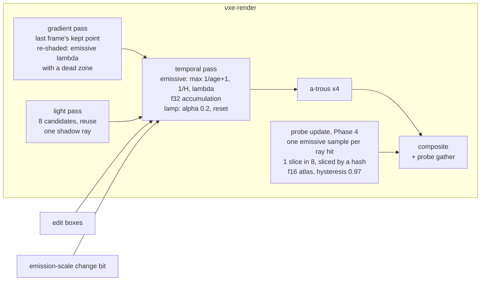

# 0047: Emissive light holds still: a patch bar, a long full-precision emissive history, and an emissive-only gradient that guards it

> **Status:** done (2026-10-29, v0.36.0). Close review clean: every phase landed as amended five times, the gate re-run is green, and still ore light holds (1.50 patches a step at the patch pose, against 74 to 78). The owner's outcome (c), indirect settling and dots in motion, goes to Plan 0049.
> **Decisions:** Owner, 2026-10-27: the long f32 history guarded by an emissive-only gradient (option a); after Plan 0040, before Plan 0032; the strict bar (at most 3 patches a step, 1 sudden step a second, flicker 0.002 log2 a frame); a lag bounded by H is acceptable for changes the guard cannot see.
> **Created:** 2026-10-27
> **Amended:** 2026-10-28 (owner, option a, after Phase 1's done-when 4 tripped at `VEIN_POSE`):
> a new dev Phase 4, "The probe gather holds still", runs before the bar, so the bar measures
> what the owner sees. It starts by attributing the gather's whole-screen steps with new rig
> keys, then picks the mechanism by a decision rule. The old Phases 4, 5 and 6 become 5, 6 and
> 7; dev relabels the log's rows. The diagram, Budgets, Risks, "What this plan does NOT do" and
> the TL;DR follow, and ADR-0036's Consequences gain a scope line.
> **Amended 2026-10-28 (owner, second),** after Phase 4's row 4 mechanism (slices spread by a
> hash) missed done-whens 3 and 5. The hash stays. Phase 4 gains step C, which explains why
> reordering the slices moved `indirect.png`, `showcase_hall.png` and the furnace (a defect is
> fixed and re-measured before anything else), and step D, which continues the measured list
> at the patch pose: the `f32` irradiance atlas with a hysteresis above 0.97, then a per-ray
> emissive clamp. Done-when 5 says how the furnace and hole tests are judged. Phase 3's
> partial-plug lag is accepted as a reading, and Phases 6 and 7 add a partial opening to the
> owner's reveal run. The TL;DR, diagram, Budgets and Risks follow.
> **Amended 2026-10-28 (owner, third),** after step C stopped on its verdict. Step C's rule
> reads the furnace against the probe rays' own direct mean at their hits, not the light
> pass's estimate, so its verdict is row 2 (no defect) and step D proceeds. The furnace test
> now judges the probes against that mean, `indirect.png` and `showcase_hall.png` are
> re-blessed by done-when 5's 1 % rule, and the hole test's bars stay. Step D opens with a
> test-only filmstrip (`STILL_FILMSTRIP`), which Phases 6 and 7 show the owner. The firefly
> clamp's bias on the probe rays goes to Followups. The TL;DR and Risks follow.
> **Amended 2026-10-28 (owner, fourth),** after step D's readings. Phase 4 keeps the slice
> hash alone, on the `f16` atlas at hysteresis 0.97: no `f32` atlas, no clamp (step D's
> result says why). Done-when 3 at the patch pose becomes the hash's reading plus a 10 %
> margin; at `VEIN_POSE` it stands. `indirect.png` renders at a settled 1600 frames and is
> re-blessed by the 1 % rule there; `showcase_hall.png` is re-blessed by the rule at its own
> 256 frames. Done-when 6's cost bar is met on step D's readings, and Phase 6 re-reads the
> Radeon's lamp-off figure quiet. Phase 5's bar holds the direct light to the strict numbers
> and adds the gather's measured share by arithmetic. Probe popping seen at Phase 7 leads to
> a new ADR (next free number). The TL;DR, diagram, Budgets, Risks and Followups follow.
> **Amended 2026-10-28 (owner, fifth),** after the hole test read 69.7 % against 70 % on the
> kept tree. Its 256-frame "settled" value is a transient on both trees. Done-when 5 now reads
> frame 32 against the box's value at 2048 frames after the carve, with a bar of at least
> 52 % (the base's 53.1 %, less 1 point). The owner approved the change.
> **Milestone:** M2 in [`docs/roadmap.md`](../../roadmap.md) (the "one-sample path tracing ...
> temporal accumulation" bullet: static light in a dark cave)
> **Related ADRs:** [ADR-0036](../../adrs/0036-static-emissive-light-on-a-long-full-precision-history-guarded-by-an-emissive-gradient.md)
> (proposed with this plan), [ADR-0018](../../adrs/0018-direct-light-per-pixel-one-sample-from-a-hit-buffer-with-svgf-history-killed-by-edits.md)
> (the light, temporal and filter passes this plan changes),
> [ADR-0025](../../adrs/0025-light-candidates-from-a-power-over-distance-table-of-near-emitter-chunks.md)
> (the candidate table, unchanged), [ADR-0033](../../adrs/0033-eye-adaptation-as-an-asymmetric-two-stage-exposure-on-the-gpu.md)
> (pre-exposure: the history this plan stores is rescaled by it)
> **Source:** the owner, 2026-10-27, after Plan 0040's second Phase 5 session. With the lamp
> off near a vein, "multiple lights are opening on walls one after another", each fairly
> suddenly, plus low-frequency flicker. Emissive history 64 is "better, but still visible". The
> owner asked for a separate plan. Plan 0040 leaves `DEFAULT_EMISSIVE_HISTORY` at 32, and this
> plan owns that default.
> **Starts after:** [Plan 0040](0040-eye-adaptation-asymmetric-auto-exposure-and-pre-exposure.md)
> merges. Its branch changes `light.wgsl`, `temporal.wgsl`, `gradient.wgsl` and `atrous.wgsl`
> (pre-exposed stores, a history rescale, the moment clamp), and this plan's harness reads its
> meter tiles (`Frame::exposure_tiles`). **Before [Plan 0032](../0032-sun-and-sky-hillaire-atmosphere-time-of-day-and-an-outdoor-testbed.md)**:
> 0032 adds the sun's directional sample and sky light into this same long-history part
> (its Decision 3 and 4) and reads its history bars against it. Settling the part's length,
> precision and guard first means 0032 builds on them once, and does not re-read its bars
> after a later change. 0032 then needs a small amendment, listed under Followups. Drafted
> against main at 3af203a and Plan 0040's branch at b05accc. The names dev finds in the tree
> win. Plans 0044 and 0045 also touch `marcher.rs` and `tests/lights.rs`, and whichever lands
> second rebases.

## TL;DR

The lamp-off vein patches come from the emissive direct-light estimator. Its per-frame sample
is a rare-event signal. The temporal pass averages it over about 32 frames, reservoir reuse
correlates neighbouring pixels' errors, and the a-trous filter shapes what is left into
tile-sized blobs that move when the reservoirs change. Plan 0040 measured it under `Manual`:
about 70 of 312 tiles step per half second. This plan makes static light still. It commits
Plan 0040's tile method as a headless patch-and-flicker test. It moves the emissive
accumulation to `f32`, so a long history keeps its mean. It runs the gradient pass for emissive
light on its own, so a long history still follows a dig that opens a vein onto a far wall. Phase 1
found a second source: at `VEIN_POSE` the probe gather makes 83 % of the patches, in
whole-screen steps that ignore the emissive history. So a phase then finds what drives the
probe volume's steps (ray count, slice cadence, the shared rotation, or a light-change window
firing in a still scene) and fixes the cause it measures. It found the slice cadence, and
spreading the slices by a hash of the probe stills `VEIN_POSE` but not the patch pose, and it
moves some indirect tests. So the phase first explains that move (a defect is fixed before
anything else) and then tries, in order, an `f32` irradiance atlas with a longer hysteresis and
a per-ray emissive clamp (amended 2026-10-28, owner, second). Step C found no defect: the
moved tests read an order-dependent transient, and the furnace sits under pi because the
firefly clamp biases the probe rays' direct light about 8.5 % low. So the furnace test now
holds the probes to that direct mean, and a test-only filmstrip lets the owner see the patch
pose before and after step D (amended 2026-10-28, owner, third). Neither step D mechanism
held: the `f32` atlas at 0.99 lags about 1831 frames and fails the furnace, and the clamp
biases indirect light 38 to 53 % low. So the phase keeps the hash alone. It stills
`VEIN_POSE` and leaves about 8 gather patches a step at the patch pose, which becomes that
pose's bar. Phase 5's bar then holds the direct light to the strict numbers, with the gather's
share added by arithmetic. If the owner still sees probes pop in Phase 7, a new ADR (next free number) follows
(amended 2026-10-28, owner, fourth). Only then does the plan pick the
history length and the reuse cap by sweeping them against the bar, and set the default. The
first thing anyone sees is the Phase 1 test printing today's patch counts on the two vein
poses: about 78 per step at the patch pose and 36 at `VEIN_POSE` under default, 0 with the
candidates off.

## Context & problem

`project-context.md` (Rendering, P0): "dark scenes with few lights; emissive voxels as
runtime-changeable lights", with a smooth, natural look. In the consumer's cave, ore veins
are the light while the lamp is off. Light that blotches and steps reads as a rendering fault,
not as the scene.

**What was measured** (Plan 0040's log, step 4; `live/zz_patches.rs` and
`live/patches-*.log` in its worktree, not committed). The scene is the level (`CaveSource`
seed 1, `with_emissive_ore`), at the patch pose (676.2, 514.8, 193.1), yaw 59, pitch -9.7.
The frame is 192 x 108 with `Lighting::default()` and indirect on, 600 frames lamp on, then
900 off. The tiles are the exposure meter's 8 x 8 output tiles. A tile is "full" when all 64
pixels are hits and its mean log2 luminance is above -15. A patch is a full tile whose mean
moves by more than `log2 1.1` between frames 30 apart (0.5 s at 60 fps). Steady-state patches
per step, under `Manual(10.9624)`:

| variant (one change from the default) | patches per step | single-frame steps > 10 % per s |
|---|---|---|
| default (history 32, reuse, 8 candidates) | about 70 | 3 to 16 |
| emissive candidates 0 | 0 | 0 |
| indirect off | about 140 | 30 to 100 |
| emissive history 1, or the filter off (raw irradiance) | about 178 | about 3 900 |
| sampler `list` | about 48 | 35 to 67 |
| candidates 32 | about 43 | 0 to 4 |
| emissive history 64 | about 32 | 0 to 2 |

Flicker, as the tiles' mean |d log2| per frame and the display luma's mean |d| in /255, read
over off frames 24 to 300 and then 600 to 900: default 0.0104 and 0.303, then 0.0064 and
0.218. With history 64: 0.0077 and 0.211, then 0.0041 and 0.128. Auto eye and `Manual` at the
same exposure give 2298 and 2286 patches over the run, so the eye is not the cause. The owner's
windowed session used Plan 0040's `VEIN_POSE` (727.5, 644.3, 208.5), yaw 153.4, pitch 0
(`apps/flythrough/tests/exposure.rs` on its branch). Its patch count is not yet read.

**The mechanism** (ADR-0036 Context has the long form):

1. *A rare-event sample.* `light.wgsl`'s `candidate` draws a chunk from the camera's table
   (ADR-0025) and a voxel face in it. The resampling target leaves visibility out, so
   `resolve_emissive`'s one shadow ray usually finds rock. The pixel's estimate is mostly 0,
   with an occasional value up to `FIREFLY_CLAMP * PI * lum(Le)`.
2. *A short window.* `temporal.wgsl` blends the emissive part at
   `max(1 / (age + 1), 1 / 32)`. That is a running mean to age 32, then an EMA of about 63
   frames' effective weight.
3. *Correlated errors.* Reuse (`REUSE_M_CAP` 20, so M is up to 160 at 8 candidates, plus
   `SPATIAL_TAPS` 5 within `SPATIAL_RADIUS` 30 lighting pixels) holds a kept point for tens of
   frames and spreads it to neighbours. The EMA's samples are therefore not independent. The
   flat list has more per-frame noise (more single-frame steps) but fewer half-second patches.
4. *Blobs.* The a-trous filter (4 iterations, strides 1 to 8, the variance from moments that
   blend at the same emissive rate) turns the remaining error into blobs about a tile wide.
5. *Precision.* The accumulation is `rgba16float`. A blend of `1/H` stores nothing while a
   sample lies within about `H x 2^-11` of the history (1.6 % at 32, 12.5 % at 256). Plan
   0040 also multiplies the history by the exposure ratio every frame. So a longer history in
   half precision stalls.

The 32-frame cap exists for light that changes outside an edit box with no emission-scale
flag, such as a dig that opens a vein onto a far wall. At 32 that light reaches 90 % in 73
frames (`ln 0.1 / ln(31/32)` = 72.5). At 256 it would take 589 (`ln 0.1 / ln(255/256)` =
588.3). Nothing but the cap catches it today: `HistoryKill::Edits` is the default, and the
gradient mode's lambda mixes the lamp in, so a moving lamp shortens the emissive history too.

Figures touched: `nfr.md` §2 Lighting (6.0 ms) and Denoise (3.0 ms) lines on both adapters,
and §3's "everything else in VRAM" line through `Frame::frame_bytes`.

## Decision

ADR-0036. The emissive part blends at `max(1 / (age + 1), 1 / H)` into an `f32` accumulation,
with `H` long. The gradient pass runs whenever emissive candidates are above 0 in the shaded
view, and writes an emissive-only lambda with a dead zone. The temporal pass raises the
emissive blend to that lambda. The lamp's part keeps its own alpha and reset. `H` and
`REUSE_M_CAP` are chosen together by sweeping them against the Phase 1 bar, and the chosen `H`
becomes `DEFAULT_EMISSIVE_HISTORY`.

The probe volume's emissive steps (amended 2026-10-28) are outside ADR-0036. Phase 4 fixes
them within ADR-0023's design (a few rays per probe per frame, a hysteresis blend, a round
robin), choosing the mechanism by measurement. A mechanism outside that design stops for an
ADR (Phase 4's decision rule).

We rejected a world-space emissive cache because it needs a new VRAM structure, fixed-point
atomics and a cell size matched to the contour surface, and its invalidation is the same
visibility question the gradient answers today. The measured fault is a still-camera one, and
the long history reaches it. We rejected variance reduction at the source (more candidates,
per-region tables) as the fix because 4x the candidates bought less than 2x the history, at
4x the candidate cost. We rejected a global history kill on edits near emitters because every
dig would make the whole screen boil.

## Architecture diagram



## Implementation phases

### Phase 1: The patch bar as a headless test, with today's readings
- **Owner skill:** dev
- **What:** commit Plan 0040's tile method as a test that prints today's patch counts at both
  vein poses, attributes them to the direct and indirect parts, and asserts only that it sees
  patches where they exist. It also adds an ignored sweep that later phases run.
  - A new test binary, `apps/flythrough/tests/emissive_stillness.rs`, plus a shared helper in
    `apps/flythrough/tests/support/`. The helper builds the level as `zz_patches.rs` did:
    `CaveSource` seed 1, `with_emissive_ore`, the mirror synced whole before the run, so
    there are no uploads in the window. It renders 192 x 108 with `Lighting::default()` and
    indirect on, under `Manual` exposure at a fixed value. The value is 0040's adapted
    exposure at that pose: 10.9624 at the patch pose, and its equivalent at `VEIN_POSE`, read
    once and pinned in the test. The run is 120 frames lamp on, then 720 off.
  - Per off frame, the helper reads the meter's 8 x 8 tiles (`Frame::exposure_tiles`), and on
    the lighting grid it reads the emissive accumulation (`Frame::accumulated`, rgb) and the
    probe gather target, each averaged over the same tiles mapped to the lighting grid.
  - The **patch statistics** are counted from off frame 120 (2 s, past the first three steps
    of 0040's series) to 720, which is 20 steps of 30 frames. They are: patches per step,
    single-frame steps over 10 % per second, the tiles' mean |d log2| per frame, and the
    display luma's mean |d| per frame (/255). "Full tile" and "patch" mean what they meant in
    0040's log (Context above). Each is printed for the composite, the emissive accumulation
    alone and the gather alone.
  - `the_vein_wall_patches_are_counted` asserts the harness, not the fix. With emissive
    candidates 0 there are 0 patches on every step at both poses. With emissive history 1
    there are at least 100 patches per step on average at the patch pose (0040 read about
    178). The default's readings are printed as `reading:` lines.
  - `emissive_patch_sweep` (`#[ignore]`) prints the statistics for a list of `Lighting`
    variants and reuse caps, given by an environment variable. Its variants are `H` in 32,
    64, 128, 256 and 512, the sampler, and candidates 8 and 16. `REUSE_M_CAP` becomes a
    `Lighting` field (default 20, today's value), so the sweep can set it at 20, 8 and 4.
  - It also prints one reading at 384 x 216 of the default at the patch pose, because
    `SPATIAL_RADIUS` and the a-trous strides are in lighting pixels and so cover a larger
    share of a small frame.
  - The new binary joins the gpu filter in `.config/nextest.toml` (checked by
    `node scripts/check-test-tiers.mjs`), and both tests join the slow list.
- **Files touched:** `apps/flythrough/tests/emissive_stillness.rs` (new),
  `apps/flythrough/tests/support/mod.rs` (or a new support module),
  `crates/vxe-render/src/marcher.rs` (`Lighting::reuse_m_cap` into `Params`),
  `crates/vxe-render/src/shaders/light.wgsl` and `march.wgsl` (the cap from `Params`),
  `.config/nextest.toml`, this plan's log.
- **Done when:**
  1. `the_vein_wall_patches_are_counted` passes on lavapipe. With candidates 0 every step at
     both poses reads 0 patches. With history 1 the patch pose averages at least 100 patches
     per step.
  2. The log records the default's statistics at both poses, split into composite, emissive
     and gather parts, and the 384 x 216 reading. At the patch pose the composite's average
     lies within 50 to 95 patches per step: 0040's about 70, allowing for the shorter window
     and the merge. Outside that range, the log says so and the harness is checked against
     0040's scratch before Phase 2 starts.
  3. With `reuse_m_cap` 20 every existing test in `flythrough::lights` and `flythrough::golden`
     passes unchanged: the field is today's constant.
  4. **The probes' share.** If the gather alone shows more than a third of the composite's
     steady-state patches at either pose, dev stops after this phase and the architect
     amends the plan, since the probes' emissive estimate (`probe_update.wgsl`'s
     `emissive_estimate`) is outside this plan's fix. (Tripped at `VEIN_POSE`, 83 %; the
     amendment of 2026-10-28 adds Phase 4.)

### Phase 2: A full-precision emissive accumulation
- **Owner skill:** dev
- **What:** the temporal pass's accumulation pair becomes a format that stores the emissive
  rgb in `f32`. Dev chooses `rgba32float` for the pair, or a separate `f32` emissive target,
  within the byte bar below. Every reader follows: `atrous.wgsl`'s `variance`,
  `Frame::accumulated` and its readback helper, and Plan 0040's rescale by
  `exposure_ratio()`. The lamp's part and the moments may stay `f16`. `H` stays 32.
- **Files touched:** `crates/vxe-render/src/marcher.rs` (the targets, `frame_bytes`),
  `crates/vxe-render/src/shaders/temporal.wgsl`, `atrous.wgsl`,
  `crates/vxe-render/src/readback.rs` (an `f32` texture read if needed),
  `apps/flythrough/tests/lights.rs`, `docs/nfr.md` (the frame-bytes reading).
- **Done when:**
  1. **The history keeps its mean.** On `lights.rs`'s emissive-ceiling box (1 x 1 target,
     lamp off, filter on, full-resolution lighting, the list sampler, `Manual(1)`), with
     `emissive_history` 512, the temporal pass's emissive accumulation is compared with a
     CPU replay in `f64` of the blend rule. The replay applies
     `max(1 / (age + 1), 1 / 512)` to the light pass's irradiance, read back every frame.
     Over frames 1 to 2048 the two agree within 0.1 % at every frame. The log also records the
     same comparison on the base commit's `f16` accumulation (its largest gap), as the
     before reading.
  2. At `H` 32 the goldens `dark_cave.png`, `dark_cave_half.png` and `indirect.png` pass
     `assert_golden` unchanged (at most 0.1 % of pixels over 2/255). Their settling frames lie
     under age 32, where the blend is a running mean, so only rounding can move them.
  3. `Frame::frame_bytes` grows by at most 16 B per lighting pixel: 3 686 400 B at the
     default (scale 1.5, half: 640 x 360) and 8 294 400 B at scale 1, half (960 x 540). The log
     prints both readings.

### Phase 3: The emissive-only gradient guard
- **Owner skill:** dev
- **What:** ADR-0036's guard.
  - `gradient.wgsl` writes an emissive-only lambda beside today's combined one, in the spare
    channel of `strata_out` or a layout dev chooses. It is the re-shade of last frame's kept
    point against `luminance(prev_light.xyz)`, through a dead zone:
    `max(lambda - LAMBDA_FLOOR, 0) / (1 - LAMBDA_FLOOR)`. `LAMBDA_FLOOR` (proposed 0.05) sits
    above the bfloat16 W rounding of about 0.004, so a still scene reads 0, while a 10 % or
    larger change still registers.
  - The pass runs in the shaded view whenever emissive candidates are above 0. In
    `HistoryKill::Edits` it skips the lamp's re-shade and its shadow ray.
  - `temporal.wgsl` raises `a_emissive` to `clamp(GRADIENT_GAIN * emissive lambda)`, averaged
    over the 3 x 3 strata, and lowers the emissive history's age by the same fraction. The
    lamp's part reads the combined lambda only in `HistoryKill::Gradient`, as today.
  - A `Lighting::emissive_guard: bool` (default on) and a fly-through flag
    `--emissive-guard on|off` switch it, for the sweep and the owner's comparison. The HUD's
    lighting row shows its state (the testbed rule: a toggle shows its mode in the window).
- **Files touched:** `crates/vxe-render/src/shaders/gradient.wgsl`, `temporal.wgsl`,
  `crates/vxe-render/src/marcher.rs`, `apps/flythrough/src/main.rs`, `apps/flythrough/src/hud.rs`,
  `apps/flythrough/examples/hero.rs`, `apps/flythrough/tests/lights.rs`,
  `apps/flythrough/tests/hud_golden.rs` and its golden if the row changes.
- **Done when:**
  1. **A reveal follows.** A new `lights.rs` scene has an emissive face in a closed cell and a
     far wall in a second cell, joined by a one-voxel-thick rock plug. The camera faces the
     far wall, which lies more than 8 voxels from the plug, so it is outside the dilated edit
     box. The lamp is off, the filter on and `H` 256. After 256 settled frames the plug is
     carved. The far wall's centre-region mean emissive accumulation then reaches 90 % of its
     value at 600 frames after the carve within 73 frames with the guard on: no slower than
     today's 32-frame history. The log also prints the frame count with the guard off.
  2. **Still light keeps its history.** `the_gradient_keeps_history_where_nothing_changed`
     gains an emissive case. On the dark cave pose, lamp off, guard on and `H` 256, at least
     99 % of hit pixels read age 63 after 64 still frames, the age they read without the
     guard.
  3. **A moving lamp leaves static light alone.** On a cone turn of the lamp (`lamp_cave`'s,
     with an emissive vein in view, or a scene of dev's choice that has both), the guard on
     and `HistoryKill::Edits`, the emissive part's age at the vein's
     wall pixels keeps rising through the turn. At least 95 % read their pre-turn age plus the
     frames elapsed.
  4. `an_emission_step_settles_within_eleven_frames` and
     `history_dies_in_the_edit_box_and_ages_elsewhere` pass unchanged with the guard on.
  5. The HUD shows `guard on` or `guard off` in its lighting row in the fly-through, with
     `hud_golden` re-blessed if the row's text changed.
- **Partial openings (amended 2026-10-28, owner, second).** A partial plug (a 10 x 10 window
  of the partition) takes 222 frames to reach 90 % with the guard on and 415 with it off. The
  owner accepts that as within "a lag bounded by `H`": at `H` 256 the bound is 589 frames
  (`ln 0.1 / ln(255/256)`), and the guard still halves the lag. It stays a `reading:` line in
  `a_reveal_behind_a_plug_follows_within_seventy_three_frames`, not a bar. The owner judges a
  partial opening in Phase 7's windowed reveal. ADR-0036's Alternative C (the edit-near-light
  bit) stays a fallback, built only if the owner finds the partial reveal slow there.

### Phase 4: The probe gather holds still (amended 2026-10-28, owner)
- **Owner skill:** dev
- **What:** find what makes the probe gather step across the whole screen at `VEIN_POSE`, and
  fix that cause. Phase 1 read the gather at `0 0 0 0 0 0 277 0 0 0 40 54 0 217 ...` per step
  (29.40 of the composite's 35.50 patches per step, 83 %), with no single-frame steps, so each
  step spreads over many frames. It reads the same at emissive history 1 and 32, so the
  temporal pass does not drive it. The mechanism stays open until step A has measured it.
  - **Step A: attribution, no shader change committed.**
    - `emissive_patch_sweep` gains the keys `probe_rays=N` and `probe_slices=N` (the existing
      `Lighting::probe_rays` and `Lighting::probe_slices`). Dev runs both poses at rays 64, 32
      and 16 (slices 8), and at slices 8, 16 and 32 (rays 64), and prints the gather's
      statistics and per-step patches for each.
    - The rig gains a per-off-frame trace for one run at `VEIN_POSE`, printed for the frames
      around each gather step over 8 patches: `Frame::probe_light_window()`, the number of
      probes whose age restarted that frame (read from the state words, as `indirect.rs`'s
      `probe_bytes` reads the atlas), and the gather's tile mean |d log2|. It tells a
      window or a young re-blend from a drift of settled probes.
    - Only if those readings do not separate the suspects: a scratch run with one fixed
      rotation for the whole run, and one with a rotation per probe (seeded by slot and
      frame), as an uncommitted patch under `live/`.
    - The log records every reading before the mechanism's commit, and names the row of the
      rule below that it selects.
  - **Step B: the decision rule.** The first row whose observation holds picks the mechanism.
    "Changes" means the gather's mean or largest step at `VEIN_POSE` moves by a factor of 1.5
    or more.

    | observation in step A | suspect | mechanism dev builds and measures |
    |---|---|---|
    | the light window is open, or probe ages restart, within 30 frames before a step over 8 patches | a window or young re-blend firing in a still scene | find what changes the light key or restarts the ages. If no light changed, fix the trigger, and give `no_light_change_opens_no_window` this case. If a light really changed (an emission scale in the level), **stop**: the window's design goes back to the architect |
    | rays 64 to 16 changes the steps, slices do not | the probe rays' rare-event emissive sample | try in this order, keeping the first that meets the bars: a rotation per probe; a settled hysteresis above 0.97 with an `f32` irradiance atlas (in `f16` a 3 % blend already stores nothing within 1.6 %, so a longer one stalls); a clamp on one ray's emissive term relative to the probe's current irradiance. Each tried mechanism's readings go in the log |
    | the fixed or per-probe rotation run changes the steps, rays do not | the frame's shared rotation correlates a visit's rays | a rotation per probe, seeded by slot and frame |
    | slices 8 to 32 moves the steps' timing or size | the slice cadence (slice `frame % slices` takes the slots with the same `slot mod slices`, which is the probe's x in the wrapped volume, so near probes in a column update together) | spread the slices by a hash of the probe, not by `slot mod slices` |
    | none of the above | unknown | **stop** with the readings: the architect amends |

    These mechanisms tune ADR-0023's design and need no ADR. A mechanism outside it (a
    separate emissive probe channel with its own history or guard, the emissive term moved
    out of the probe rays, or a world-space cache, ADR-0036's Alternative A) **stops** for
    the architect, who writes a new ADR (next free number) before any code.

    Step A selected row 4, and the hashed slices (`live/phase4-row4-hashed-slices.patch`)
    still `VEIN_POSE` (gather 0 patches on every step) but not the patch pose (gather 8.15 /
    44, 21.0 sudden steps per second). With the hash in, the patch pose's steps answer to both
    the rays and the slices. A rotation per probe on top did not help (patch 7.25 / 119, vein
    11.40 / 174), so it is off the list. The hash also moved `indirect.png` (32.2 %),
    `showcase_hall.png` (4.0 %), the furnace's centre texels (down to 2.7129, more than 10 %
    under pi; -9.1 % on the base) and the hole test (69.7 % against its 70 %; 71.5 % on the
    base). Steps C and D follow (amended 2026-10-28, owner, second).
  - **Step C: why reordering moves the indirect tests.** In a still scene the order in which
    probes update should not change what they converge to. So a 32 % move, and a shift in the
    furnace, point either at a defect (in the hash patch, or in the existing slice, age or
    hysteresis logic) or at tests that read before the probes converge. Step C tells the two
    apart before any further mechanism. It commits nothing but a defect's fix and its test.
    - *Is the reading converged?* At the default 8 slices a probe is visited every 8 frames.
      Its first visit blends at 0, the next 8 at `YOUNG_HYSTERESIS` 0.5, then at 0.97. At the
      furnace's 256 frames (32 visits, 23 settled) about half of a texel's weight
      (0.97^23 = 0.50) still lies on visits whose neighbours had seen fewer bounces.
      `indirect.png` is read at 64 frames (8 visits, all at 0 or 0.5). The hole test's
      "settled" value is read 256 frames after the carve. So all three may read a transient
      whose shape depends on visit order. Dev runs, as scratch, the furnace (floor centre and
      centre-probe texels), `indirect.png`'s view (mean luminance and the gather's mean) and
      `showcase_hall.png`'s view out to 2048 frames (256 visits, residual weight
      0.97^247 = 0.05 %). Each runs on the base probe code (53a5520) and with the hash, and
      the log prints each series every 64 frames.
    - *Noise.* The noise of a long reading is the spread of its series over its last 256
      frames. "Agree" means the base and hash long readings differ by at most twice the larger
      spread.
    - *Defect candidates* (dev checks each and the log says what each showed):
      1. A `slot mod slices` assumption left elsewhere: the touched-probe merge, the window's
         4 slices, a read helper, a test that predicts a probe's update frame.
      2. The emissive estimate's random key. `probe_trace` builds `px` from slot bits 0 to 7,
         and `rand` wraps at 128. So 128 probes share every blue-noise texel. On the base
         they always update on the same frame and draw the same numbers, while with the hash
         they do not. That changes the correlation, not the mean, unless something downstream
         is non-linear.
      3. The atlas's `f16` store at 0.97: a blend of 3 % stores nothing within about 1.6 % of
         the old value (`0.03 d < 2^-11`), and the rounding of `pack2x16float` on lavapipe
         may lean one way. Dev replays one furnace probe's blend in `f64` on the CPU from its
         read-back rays, as Phase 2 did for the accumulation, and prints the largest gap.
      4. The scratch's `f16` ray radiance and distance.
    - **The decision rule for step C.** The first row that holds decides.

      | observation | verdict | next |
      |---|---|---|
      | the base and hash long readings disagree, or a candidate shows a fault, or the furnace's long reading lies more than 3.5 % from pi on either (the `f16` stall band of 1.6 %, doubled by the albedo-0.5 bounce series, rounded up; less any offset of the probe rays' own direct mean at their hits from pi. Amended 2026-10-28, owner, third: that mean, not the light pass's floor-centre estimate the test prints) | a defect | fix it as its own commit, with a test that fails before the fix and passes after it. Then re-measure, before any further mechanism: step A's default rows at both poses, the hash rows, done-when 4 and done-when 5. Re-enter this table on the fixed tree. If the fix is the `f16` atlas itself, it is step D's `f32` atlas at hysteresis 0.97, and step D then sweeps only the hysteresis |
      | they agree within noise, and the furnace's long reading lies within 3.5 % of pi on both | no defect: the moved tests read an order-dependent transient | judge the tests by done-when 5's rules, then go on to step D |
      | evidence of a defect that none of the candidates explains | unknown | **stop** with the readings: the architect amends |

    - **Step C's verdict (amended 2026-10-28, owner, third): row 2, no defect.** The base
      and hash long series agree on every pair, and none of the four candidates is at fault.
      The probe rays' direct estimate at their hits averages D = 2.874, -8.5 % of pi: with
      the probes' own irradiance left out, the centre probe's texel mean reads 0.5 D =
      1.43703. The furnace's fixed point is E = 0.5 (D + E) = D, and its long texel mean
      reads +0.8 % (base) and +1.1 % (hash) against D. With `FIREFLY_CLAMP` at 1e6 it reads
      +6.3 % of pi. So the offset from pi is the light estimator's clamp
      (`resolve_emissive` in `light.wgsl`, ADR-0018) at the probe rays' hits, outside the
      probe code and outside this plan (Followups). The floor-centre direct estimate the
      test prints (-0.025 %) is the light pass's, which sees almost none of that clamp.
      The next steps follow from the verdict:
      - `the_furnace_box_reads_pi_of_indirect_irradiance` changes to the form below, with
        the owner's approval given on 2026-10-28. It lands in its own commit before step D's
        first mechanism. The log has its readings in the old and new form on the base probe
        code (53a5520's, unchanged at 93a2c72) and on the tip with the hash.
      - `indirect.png` and `showcase_hall.png` are re-blessed by done-when 5's 1 % rule, in
        the commit that lands the kept mechanism (so every commit's gate passes). The log
        names each one's moved share and its mean luminance change on the same tree. Phase 6
        re-blesses them again only if Phase 5's defaults move them.
      - The hole test's bars stay as written.
    - **The furnace test's new form (amended 2026-10-28, owner, third).** The claim: the probe
      update converges the closed furnace to its fixed point, the probe rays' own direct mean
      `D`, within 256 frames, in every centre-probe texel and in the floor centre's gather.
      - *How `D` is measured,* with readbacks the test already has and no engine change. After
        the 256-frame run and its reads, the test zeroes the centre probe's irradiance tile
        with `ProbeVolume::write_test_tile` before every frame, and steps one frame at a
        time. The box holds one live probe at spacing 16 (the centre probe), so its rays'
        `probe_irradiance` at their hits is 0, and each frame on which the centre probe is
        visited (its texels read back non-zero) leaves `(1 - HYSTERESIS) x 0.5 x D_t` in
        texel `t`. The state stays settled (age 32 or more, not touched, no window), so the
        blend is at `probes::HYSTERESIS`. `D` is the mean of `texel / ((1 - HYSTERESIS) x
        0.5)` over the 36 interior texels and 32 visits (256 frames). Its standard error is
        the spread of the 32 per-visit means over the square root of 32. The test asserts
        that error is at most 0.5 % of `D`; if 32 visits miss that, dev raises them to 64
        and logs it. Dev checks the method once against step C's `live/stepc-donly.patch`
        reading (`D` = 2.874): they agree within 1 %, or dev stops. If step D's `f32` atlas
        lands, `write_test_tile` and `read_probe` follow its format.
      - *The bar.* At 256 frames, as today: (a) every centre-probe interior texel and every
        channel of the floor centre's gather lies within 7 % of `D`; (b) the centre probe's
        texel mean lies within 4 % of `D`. The test prints `D`, its error, its offset from pi
        (about -8.5 %, the Followup's figure, printed and not asserted), and each reading
        against `D` and against pi. The light pass's floor-centre direct mean stays printed,
        labelled as the light pass's.
      - *Where 7 % and 4 % come from.* Against `D`, step C read at 256 frames: floor +3.5 %
        (base) and +0.2 % (hash); texel mean +1.5 % and -2.4 %; texel min -0.6 % (base) and
        -5.6 % (the tip with the hash, 2.7129). Long (2048 frames): texel min -0.5 % and
        -0.4 %, texel max +2.6 % and +3.6 %, floor +2.2 % and +3.3 %. At 256 frames the
        texel mean still lags: on the hash it is -2.4 %, so its deficit after the young
        visits is about 2.4 / 0.985^23 = 3.4 % (the albedo-0.5 bounce shrinks the deficit by
        `1 - 0.5 (1 - h)` a settled visit, 23 settled visits by 256 frames). Step D's
        hysteresis up to 0.99 keeps more of it: 3.4 x 0.995^23 = 3.0 %. The texel min sat
        3.3 % under the texel mean at 256 frames on the hash, so the predicted worst texel is
        about (1 - 0.030)(1 - 0.033) - 1 = -6.2 %, and the worst high reading is +3.6 %.
        Bar (a) is that worst case rounded up to 7 %. Bar (b) is the mean's worst predicted
        lag, 3.0 %, plus twice the 0.5 % measurement error, 4 %.
      - *It still fails on a probe regression.* A lost bounce (the probes' irradiance missing
        from their rays) reads 0.5 D, -50 %. A doubled bounce or a lost normalisation
        diverges or moves the mean by tens of %. A cosine-weight or blend error moves the
        mean, and the mean bar catches any bias over 4 %. A blend that stalls or converges
        slower than the arithmetic above misses (b) at 256 frames. Against `D` the old bar
        allowed -1.6 % to +20.2 % per texel; the new one allows -7 % to +7 %, tighter above
        and wider below, and the mean bar has no counterpart in the old form.
      - If the tip misses the new form, done-when 5's rule applies: the mechanism changes, or
        dev stops for the architect. The bar is not widened again without the owner.

  - **Step D: the next mechanisms, at the patch pose, with the hash kept.** In this order,
    keeping the first that meets done-whens 2 to 6. Every tried setting's readings go in the
    log: the gather and composite statistics at both poses, done-when 5's tests, and the
    reading below.
    0. **A filmstrip, before any mechanism (amended 2026-10-28, owner, third).** A test-only
       debug output in the stillness rig (`apps/flythrough/tests/support/stillness.rs`, driven
       from `emissive_stillness.rs`), behind the env var `STILL_FILMSTRIP`. Unset or empty, it
       writes nothing and the rig behaves as today. Set to a tag (for example `before` or
       `h0.98`), each run of the rig writes, per pose, a contact sheet PNG of the composite
       at every 30-frame step of the window (off frames 120, 150, ..., 720: 21 frames, row by
       row) to `live/filmstrip/<tag>/<pose>-composite.png` in the worktree's root, never
       under `apps/flythrough/tests/golden/` or any other test's directory. Each frame keeps
       its 192 x 108 pixels, and the tiles the rig counts as patches on the step into that
       frame are outlined (one pixel, one colour). If cheap, the same sheets of the emissive
       and gather parts (their tile log2 values under the pinned exposure, as grey) go
       beside it as `<pose>-emissive.png` and `<pose>-gather.png`. The rig prints each
       sheet's path and its frame order to stdout. It uses the PNG encoder the golden tests
       already use: no new dependency and no engine change. Dev writes the `before` sheets
       at both poses on the tip with the hash before step D's first mechanism, and a sheet
       for the kept setting of each mechanism tried. Its commit is test-only and lands before
       the first mechanism's commit.
    1. **An `f32` irradiance atlas and a settled hysteresis above 0.97.** The irradiance
       texels become `f32` rgba (the visibility map stays `f16`), and `probe_gather.wgsl`
       follows. Dev reads 0.97 on the `f32` atlas first, then 0.98, 0.985 and 0.99. The young
       and window blends do not change. The lag a settled probe has, to 90 % of a step that
       neither an edit nor a window catches, is `8 ln 0.1 / ln h` frames: 605 at 0.97, 912
       at 0.98, 1219 at 0.985, 1833 at 0.99. As a reading at each `h`, dev prints the
       gather's 90 % frame in Phase 3's reveal scene with the whole plug.
       - *Exit:* keep the lowest `h` that meets done-whens 2 to 6, and Phase 4 ends there.
         If none does, keep the best `h` only if it lowers the patch pose's gather mean by a
         factor of 1.5 or more and meets done-whens 4 to 6. Otherwise go back to 0.97, and
         keep the `f32` atlas only if step C made it a defect's fix. Then go to 2.
    2. **A per-ray clamp on the emissive term.** In `probe_trace`, one ray's
       `emissive_estimate` is clamped to `k` times the luminance of the probe's current
       irradiance, read from its own texels. The clamp applies only to a settled update
       (age above `YOUNG_UPDATES`, not touched, no window). So a probe that is new, dug
       beside or in a light change still takes the full sample, and a reveal still enters.
       Dev reads `k` at 8, 4 and 2 (proposed).
       - *Exit:* keep the largest `k` that meets done-whens 2 to 6 and stays within the bias
         bar. The bias bar: at both poses the gather's mean linear luminance over off frames
         120 to 720 lies within 3 % (proposed) of the same tree without the clamp, and the
         furnace's long reading moves by at most 1 %.
       - If no `k` meets them, **stop**: the remaining options are outside ADR-0023's
         design, and the architect writes a new ADR (next free number) before any code.
  - **Step D's result (amended 2026-10-28, owner, fourth).** Dev stopped at item 2's exit, and
    the owner decided on the readings instead of opening a new ADR (next free number) now. Phase 4 keeps the
    slice hash alone, on the `f16` atlas at hysteresis 0.97. Both step D mechanisms were
    measured and rejected:
    - *The `f32` atlas with a settled hysteresis above 0.97.* At 0.99 it brings the patch
      pose's gather to 0.30 / 2 per step (0.90 sudden steps per second). But its reveal lag
      is about 1831 frames (a lower bound, against 1007 at 0.97), and the furnace no longer
      settles by 256 frames: its texel mean lags -4.59 % of `D` against the 4 % bar, with its
      worst texel at -9.84 %. At 0.98 and 0.985 the furnace fails the same way. The atlas
      would also add 16 777 216 B.
    - *The per-ray emissive clamp.* At every `k` (8, 4, 2) it biases the gather's mean
      luminance 38 to 53 % low, against the 3 % bias bar. At 8 and 4 it also raises the patch
      pose's composite over the before reading (103.95 and 108.40 against 77.10).
    - *The hash alone* (the tip with `live/phase4-row4-hashed-slices.patch`, `f16` at 0.97):
      at `VEIN_POSE` the gather reads 0 patches on every step. At the patch pose it reads
      8.15 / 44 and 21.0 sudden steps per second, with flicker 0.00365. The `f32` atlas at
      0.97 reads 8.10 / 44 and 20.9, so the precision moves it by under 1 %. The furnace's
      new form passes (worst texel -6.48 % of `D`, texel mean -3.30 %).
    - *What is left at the patch pose.* The composite there reads about 71 to 77 patches a
      step in every variant step D tried, the clamp's aside. The filmstrips in
      `live/filmstrip/` show that the bulk is direct emissive light, which is Phase 5's
      target. Phase 5's bar adds the gather's remaining share by arithmetic.
    - The hash lands in its own commit with the `indirect.png` and `showcase_hall.png`
      re-blesses (done-when 5). Before that commit, dev re-reads the hole test on that tree.
      The log's only reading of the hash on the `f16` atlas is step A's 69.7 % against the
      70 % bar. If it misses, done-when 5's rule applies: a justified change to the test, with
      the owner's approval for any loosening, or a stop.
  - If the chosen mechanism adds a `Lighting` switch, the fly-through gets its flag and the
    HUD's lighting row shows its state (the testbed rule), and Phase 6's old-look run turns it
    off.
  - The phase starts by re-reading the default's gather at both poses with Phases 2 and 3 in,
    as its before reading. The guard should not move the gather (Phase 1 found it identical
    at history 1 and 32), and the log says whether it did.
- **Files touched:** `apps/flythrough/tests/emissive_stillness.rs`,
  `apps/flythrough/tests/support/stillness.rs` (the keys and the trace), and, by the row
  chosen, `crates/vxe-render/src/shaders/probe_update.wgsl`, `crates/vxe-render/src/probes.rs`,
  `crates/vxe-render/src/marcher.rs` (the light key, `Params` or a `Lighting` field, the
  atlas bytes in `frame_bytes`), `crates/vxe-render/src/shaders/probe_gather.wgsl` (only for
  an `f32` atlas), `apps/flythrough/tests/indirect.rs`, `apps/flythrough/src/main.rs` and
  `apps/flythrough/src/hud.rs` (only for a new switch), `apps/flythrough/tests/golden.rs`
  (`INDIRECT_FRAMES`) with `apps/flythrough/tests/golden/indirect.png` and
  `showcase_hall.png` (amended 2026-10-28, owner, fourth), this plan's log. Step C's scratch runs
  go under `live/`, and so do the filmstrips (`live/filmstrip/`, never committed). A defect's fix touches the file the defect is in, and its test goes in
  `probes.rs`'s unit tests or `apps/flythrough/tests/indirect.rs`.
- **Done when** (the Phase 1 rig: lavapipe, 192 x 108, `Lighting::default()` with indirect on,
  off frames 120 to 720, the pinned `Manual` exposures, `H` 32, the gather's own tiles):
  1. **Attributed.** The log has step A's readings for every key variant at both poses and the
     `VEIN_POSE` trace, and names the rule's row and the mechanism it picked, before the
     mechanism's commit.
  2. **The gather's share falls at `VEIN_POSE`.** The gather averages at most a third of the
     composite's patches per step, read in the same run (Phase 1's rule; 83 % today).
  3. **No whole-screen gather step.** At both poses the gather averages at most 1 patch per
     step, no step exceeds 3 (277 at `VEIN_POSE` today, 165 at the patch pose), and it has at
     most 1 single-frame step over 10 % per second (53.6 at the patch pose today). That leaves
     Phase 5's composite bar (mean 3, max 8) to the direct light.
     **Amended 2026-10-28 (owner, fourth).** At `VEIN_POSE` the bar stands as written (the
     hash reads 0 / 0 and 0 per second). At the patch pose it becomes the hash's reading plus
     a 10 % margin: the gather averages at most 9.0 patches per step, no step exceeds 48, and
     it has at most 23 single-frame steps over 10 % per second (8.15 / 44 and 21.0 read; 8.15
     x 1.1 = 8.97, 44 x 1.1 = 48.4, 21.0 x 1.1 = 23.1). *Why 10 %:* nothing after Phase 4 is
     meant to move the gather. Phase 1 read it identical at emissive history 1 and 32, step A
     read it unchanged by the guard, and Phase 5 sweeps only `H` and the reuse cap. The one
     measured perturbation is rounding: the `f32` atlas at the same 0.97 moved it by 0.6 %
     (mean), 0.5 % (sudden steps) and 0 (max). So the margin is over ten times that, and the
     base's 22.75 / 165 and 53.6 still fail all three parts. Phase 5 re-reads this bar at its
     chosen defaults.
  4. **No regression at the patch pose.** The composite's mean patches per step there is no
     higher than this phase's before reading, and the gather's tile flicker is no higher than
     Phase 1's at either pose (0.00430 at the patch pose, 0.00341 at `VEIN_POSE`).
  5. **Indirect light still works and follows changes.** Every test in `flythrough::indirect`,
     `flythrough::lights` and `flythrough::golden` passes unchanged, among them
     `switching_the_lamp_off_drops_the_probe_history`, `an_emission_step_drops_the_probe_history`,
     `a_hole_in_the_wall_lights_the_dark_box_and_filling_it_darkens_it_again` and
     `a_pulse_at_its_mean_leaves_the_probes_still`. If the mechanism moves `indirect.png`
     past `assert_golden`, the log names the moved share and its mean luminance change, Phase
     6 re-blesses it only if that mean is within 1 %, and otherwise dev stops.
     **How the near-floor tests are judged (amended 2026-10-28, owner, second).** On the base,
     `the_furnace_box_reads_pi_of_indirect_irradiance` already reads its centre texels at
     -9.1 % against a 10 % bar, and the hole test reads 71.5 % against 70 %. So their bars are
     not loosened silently:
     - The bars stay as written: 10 % of pi for the floor and every centre texel at 256
       frames; at frame 32 at least 70 % of settled and 10 times the pre-carve value; under
       5 % of the lit box within 64 frames of the fill.
     - If the tip misses one, the mechanism changes until it passes, or the test changes with
       its own justification. That justification is in the log and in the commit that changes
       the test. It restates the claim the test defends, and derives the change from
       arithmetic or step C's readings, not from what makes it pass (for example a furnace
       read at a frame count where step C shows convergence, at the same 10 %). It also
       measures the test on the base probe code (53a5520) and the tip, in its old and new form.
     - A change that loosens a bar (a wider tolerance, a lower ratio, a longer lag) also needs
       the owner's approval before its commit: dev stops for it.
     - `indirect.png` and `showcase_hall.png` are re-blessed by the 1 % rule above only after
       step C's verdict is "no defect", or its defect is fixed. Each is named in the log with
       its moved share and its mean luminance change on the same tree.
     - **Amended 2026-10-28 (owner, third).** Step C's verdict is "no defect". The furnace
       test is judged in its new form (step C's verdict, above): every texel and the floor
       within 7 % of the probe rays' direct mean `D` and the texel mean within 4 %, at 256
       frames. The hole test's bars stay as written. `indirect.png` and `showcase_hall.png`
       are re-blessed by the 1 % rule in the kept mechanism's commit.
     - **Amended 2026-10-28 (owner, fourth): the goldens are read where they have settled.**
       - `indirect.png` renders at 1600 frames, not 64 (`INDIRECT_FRAMES` in
         `apps/flythrough/tests/golden.rs`, with its doc comment). At 64 frames every probe
         has had only its first and young visits, so the golden reads the order-dependent
         transient: the hash moves 32 % of its pixels and its mean luma by +4.06 % (20.75
         against 19.94). The long readings agree within noise (21.493 against 21.696, step
         C). *The arithmetic:* step C's base series falls from a deficit of 8.1 % of its long
         reading at 64 frames to 3.0 % at 512 frames. That is a factor of 0.983 a visit over
         56 visits, which matches `1 - (1 - a)(1 - h)` at albedo 0.5 and h 0.97, 0.985. The
         transient part of the base-to-tip difference, 4.06 % at the first settled visit
         (frame 72), therefore falls as 0.985 per visit. It falls under a quarter of the 1 %
         rule after `ln(0.25 / 4.06) / ln 0.985` = 185 settled visits, frame 72 + 8 x 185 =
         1552. 1600 frames (200 visits, 191 settled) leaves 4.06 x 0.985^191 = 0.23 %, so
         the rest of the 1 % is left for the view's own noise. That noise is about 0.8 %
         peak to peak over the last 256 frames of step C's long series. Step C's series read
         21.55 (base) and 21.43 (hash) at 1600, -0.56 %.
       - Dev reads `indirect.png`'s mean luminance at 1600 frames on the base probe code
         (93a2c72) and on the tip with the hash. The golden is re-blessed at 1600 only if the
         two lie within 1 %. Otherwise dev stops, as the rule says. The log names the moved
         share at 1600 and the mean change. The test's other claim (at least 20 % of hit
         pixels differ from indirect off by more than 8/255) is read at the same count. The
         test joins the slow list if its time on lavapipe calls for it.
       - `showcase_hall.png` keeps its 256 frames. The transient does not explain its move.
         Step C's series is flat from frame 64 on both trees (16.7 to 16.97, its gather
         0.0103 to 0.0107), and at 256 frames the two read 16.81 and 16.88, +0.42 %. Its 4 %
         of moved pixels is the same noise in a new visit order, at the same mean. It is
         re-blessed by the 1 % rule as written, read at 256 frames on the base and the tip.
     - **Amended 2026-10-28 (owner, fifth): the hole test reads against its converged value.**
       On the kept tree the test read 69.7 % against its 70 % (frame 32 after the carve
       against frame 256). Read out to 2048 frames after the carve, frame 256 is itself a
       transient on both trees. The tip's converged value is 0.23008, and frame 32 reaches
       61.4 % of it. On the base (93a2c72) the converged value is 0.23247, and frame 32
       reaches 53.1 % (`live/p4-hole-long-*.log`). The test's claim is that the light arrives
       quickly after the carve. The owner approved this form, which makes the claim against
       the converged value:
       - The settled reference is the box's value at 2048 frames after the carve, not 256.
       - At frame 32 the box reads at least **52 %** of that reference: the base's 53.1 %,
         less a 1-point margin for the run-to-run noise. A tip slower than today's base fails.
         The 10x pre-carve claim stays, and so does the fill's claim (under 5 % of the lit box
         within 64 frames of the fill).
       - The test's doc comment states the reference and where the 52 % comes from. It joins
         the slow list if its time on lavapipe calls for it. The log records both forms on base
         and tip.
  6. **Cost.** The probe update pass at the defaults costs at most 5 % more than before on each
     adapter, read in Phase 6's budget run. `Frame::frame_bytes` grows by at most 16 777 216 B
     (an `f32` rgba irradiance atlas: 32 768 probes x 64 texels x 8 B more), and by 0 for any
     other row.
     **Amended 2026-10-28 (owner, fourth).** With the hash alone `frame_bytes` grows by 0. The
     cost bar is met on step D's readings (release fly-through, spawn pose, defaults, three
     runs each, AC on all but one run, load 1.3 to 3.0). The medians of three, hash against
     base, for the probe update pass: RTX 3080 Laptop +1.9 % lamp on and +3.9 % lamp off;
     Radeon (Cezanne, RADV) +3.7 % lamp on and +4.7 % lamp off. The gather is unchanged. The
     Radeon lamp-off figure lies within 0.3 % of the bar, and its every pair of base and
     hash runs reads +4.0 to +4.75 %. But one of its hash runs was on battery and two runs
     were loaded, so Phase 6 re-reads it as the bar's reading. Quiet means a 1-minute load
     under 1.0 at each run's start. All runs are on AC (the power state is checked and
     logged before each run). There are three runs each of `live/flythrough-base` and the
     tip, interleaved, lamp off, with the median of the last 30 frames per run. The bar is
     the median of three, at most +5 %. If the quiet re-read lands over 5 %, dev records it
     and stops for the owner; the bar is not widened. The RTX figures and the Radeon
     lamp-on figure are re-read in the same session as readings.
  7. **The reordering is explained (amended 2026-10-28, owner, second).** The log has step C's
     long series on the base and the hash, each candidate's finding and the verdict row. If
     the verdict is a defect, its fix and test are committed, and the re-measured readings
     are logged, before any commit of step D. Amended 2026-10-28 (owner, third): the verdict
     is row 2. The furnace test's new form lands in its own commit, with its old and new
     readings on the base and the tip, and the filmstrip's commit and its `before` sheets at
     both poses, before step D's first mechanism.

### Phase 5: The sweep, the defaults and the bar
- **Owner skill:** dev
- **What:** run `emissive_patch_sweep` with the f32 accumulation, the guard and Phase 4's
  probe fix over `H`
  (64, 128, 256, 512) by `reuse_m_cap` (20, 8, 4), with reuse, at both poses. Pick the
  shortest `H`, and at it the highest cap, that meets the bar below. Set
  `DEFAULT_EMISSIVE_HISTORY` and `Lighting::default().reuse_m_cap` to them, and turn
  `the_vein_wall_patches_are_counted`'s default readings into assertions
  (`the_vein_wall_holds_still_with_the_lamp_off`). If no swept pair meets the bar, set the
  best pair, record its readings and stop for an owner amendment rather than loosen the bar.
  - **The direct light's share (amended 2026-10-28, owner, fourth).** The rig gains, test-only,
    a count of the composite's *direct-attributed* events. A direct-attributed patch is a
    composite patch tile on a step whose gather tile did not patch on that step. A
    direct-attributed sudden step is a composite single-frame step on a tile and frame where
    the gather's tile made none. The rig prints them beside the composite and gather counts.
    The sweep picks by the bar below.
- **Files touched:** `crates/vxe-render/src/marcher.rs`, `apps/flythrough/src/main.rs`
  (the fly-through's default follows `DEFAULT_EMISSIVE_HISTORY`),
  `apps/flythrough/tests/emissive_stillness.rs`, `apps/flythrough/tests/support/stillness.rs`
  (the direct-attributed counts), `apps/flythrough/tests/lights.rs` (any
  existing test whose arithmetic named 32, re-derived from the same formula, not loosened),
  this plan's log.
- **Done when** (headless, lavapipe, 192 x 108, both poses, off frames 120 to 720 under the
  pinned `Manual` exposure, the composite's tiles):
  1. **No patches.** The mean over the 20 steps is at most 3 patches per step (1 % of the
     patch pose's 312 full tiles), and no step exceeds 8.
  2. **No sudden steps.** At most 1 single-frame step over 10 % per second, averaged over the
     window.
  3. **No flicker.** The tiles' mean |d log2| per frame is at most 0.002: 0.0064 today, 0.0041
     at history 64. The display luma's mean |d| per frame is at most 0.06/255: 0.218 today,
     0.128 at history 64.

  **Amended 2026-10-28 (owner, fourth): done-whens 1 to 3 with the gather's share.** The bars
  above were set for the direct light, before Phase 4 left the gather at about 8 patches a
  step at the patch pose. Phase 5's knobs (`H`, the reuse cap) do not move the gather, so a
  composite bar of 3 per step can't be met there by any swept pair. The owner's strict
  numbers stay on the direct light. The composite allows the gather only its measured share,
  which Phase 4's done-whens 3 and 4 bound. Read at both poses in one run:
  - *1, patches.* The direct-attributed patches average at most 3 per step, and none exceeds
    8. Every composite patch is either direct-attributed or on a tile whose gather patched,
    so the composite on step `i` is at most `8 + gather_i`, and its mean is at most 3 plus
    the gather's mean in the same run. At `VEIN_POSE` the gather reads 0, so the bar is 3 and
    8 as written. At the patch pose the composite's ceiling is 3 + 9.0 = 12 at Phase 4's
    gather bar. Two parts that each move under 10 % but cross it together count as direct,
    so the split errs strict.
  - *2, sudden steps.* At most 1 direct-attributed single-frame step over 10 % per second.
    The composite is then at most 1 plus the gather's rate in the same run (at most 24 at the
    patch pose at Phase 4's bar, and 1 at `VEIN_POSE`).
  - *3, flicker.* Independent per-frame noise adds in quadrature, so the composite's tile
    flicker is at most `sqrt(0.002^2 + G^2)`, with `G` the gather's tile flicker in the same
    run. A fit of step D's readings (base against hash, and the `f32` rows' hysteresis series,
    each changing only the gather) puts the gather's weight in the composite at 0.79 to 1.0.
    The bar takes 1, because a smaller weight would make the bar unreachable if the weight is
    really 1. With the hash's `G` (0.00365 at the patch pose, 0.00273 at `VEIN_POSE`) the bar
    is 0.00416 and 0.00338. Today's composite reads 0.00632 and 0.00346, so the direct light
    must still fall to about 0.002. The display luma's bar scales by the same factor,
    `0.06 x sqrt(1 + (G / 0.002)^2)` /255: 0.125 and 0.101 at the hash's `G`. This is an
    approximation (the steps are not Gaussian), and at a weight of 0.8 it lets the direct
    part read up to about 0.003. Phase 7's look holds the rest.
  - The gather at the chosen defaults still meets Phase 4's done-whens 3 and 4, re-read in
    the same run.
  4. The 384 x 216 reading of the chosen defaults is logged at the patch pose, as a reading
     and not a bar.
  5. Every test in `flythrough::lights`, `flythrough::indirect` and `flythrough::golden` passes
     at the new defaults. In particular `static_emissive_light_holds_still`,
     `reservoir_reuse_lowers_one_frames_error` and
     `the_lamp_light_that_left_the_cone_drops_in_each_history_mode` hold as they assert today.

### Phase 6: Goldens, readings and the fly-through
- **Owner skill:** dev
- **What:** re-bless any golden the new defaults moved, at lavapipe, and say which in the log
  with the pixel share that moved. Read the budgets (below) on both adapters, and record them
  in `nfr.md`. Prepare the owner's session: a script under the plan's `live/` scratch that
  launches the release fly-through at `VEIN_POSE`, lamp off, auto eye, in two runs. One run
  uses the new defaults. The other uses the old look, `--emissive-history 32 --emissive-guard
  off --reuse-m-cap 20`, which is today's except for the f32 store. The script also adds a
  third run at the reveal: a dig through a wall beside a vein, guard on and then off. If Phase
  4 added a switch, the old-look run also turns it off. Stdout stays visible.
  - **A partial opening (amended 2026-10-28, owner, second).** The reveal run has two digs,
    each guard on and then off. One opens the whole wall between the vein and the view. The
    other opens only part of it, a hole of a quarter of the wall's area or less, like Phase
    3's 10 x 10 plug in a 20 x 20 partition. The smaller the hole, the slower the reveal.
    The script prints which dig and guard state is running.
  - **Filmstrips (amended 2026-10-28, owner, third).** Dev runs the stillness rig with
    `STILL_FILMSTRIP=defaults` at the chosen defaults and `STILL_FILMSTRIP=old-look` at the
    old look's settings, at both poses. With step D's `before` sheets that makes three sets
    under `live/filmstrip/`, and the script prints their paths.
- **Files touched:** `apps/flythrough/tests/golden/*.png` (only those that moved),
  `apps/flythrough/src/main.rs` (`--reuse-m-cap`), `docs/nfr.md`, this plan's log.
- **Done when:**
  1. Every golden the change moved is re-blessed. Each is named in the log with the share of
     pixels over 2/255 against its old bytes. `dark_cave.png` still passes its own assertions
     (lit pixels, sample count).
  2. The budget readings below are in `nfr.md` with machine, commit and load, the probe update
     and gather passes among them (Phase 4's cost bar). The Radeon's lamp-off probe update is
     re-read quiet, on AC, three interleaved runs each of base and tip, as Phase 4 done-when 6
     says (amended 2026-10-28, owner, fourth).
  3. The fly-through's banner or HUD shows the emissive history, the guard and the reuse cap
     in effect.

### Phase 7: The owner's windowed check
- **Owner skill:** human
- **What:** the owner runs Phase 6's script on the dev box. At the vein with the lamp off and
  the eye adapting, the owner watches for 15 s with the new defaults and then the old look.
  Then the dig reveals, the whole opening and the partial one, each guard on and off. Then a
  short flight past the vein. Beside the windowed check, the owner looks at the filmstrips
  under `live/filmstrip/` (`before`, `defaults`, `old-look`, at both poses), so what the bar
  counts can be set against what the owner sees (amended 2026-10-28, owner, third).
- **Files touched:** this plan's log.
- **Done when:** the owner records one of three outcomes, and separately says whether the
  partial reveal is fast enough (amended 2026-10-28, owner, second). (a) The patches and
  flicker are gone, and the defaults stand. (b) Another `H` or cap from the sweep is wanted,
  and the default changes to it with Phase 5's bars re-read. (c) Something is still visible
  (for example in motion), and the architect amends the plan or opens ADR-0036's
  Alternative A. If what is still visible is probe popping (the gather stepping on its own,
  as at the patch pose), the architect writes a new ADR (next free number) first: a separate emissive probe
  channel with its own history or guard, or a world-space cache (amended 2026-10-28, owner,
  fourth). If the partial reveal is too slow, the architect amends the plan to build
  ADR-0036's Alternative C, measured against Phase 3's partial-plug reading.

## Data shapes

```rust
// illustrative
pub struct Lighting {
    // ...
    /// Frames of history the emissive part blends over at least; Phase 5 sets the default.
    pub emissive_history: u32,
    /// Temporal and spatial reuse cap on a reservoir's M, in units of the frame's candidates
    /// (today's REUSE_M_CAP, 20).
    pub reuse_m_cap: u32,
    /// The emissive-only gradient shortens the emissive history where the light changed.
    pub emissive_guard: bool,
}
```

- **Accumulation:** the emissive rgb in `f32`. The pair is at most 16 B per lighting pixel more
  than today's two `rgba16float` targets.
- **Strata:** an emissive lambda per 3 x 3 stratum, in the spare channel of today's
  `rgba16float` strata, or a layout of dev's choice, recorded in `frame_bytes`.
- **`Params`:** the cap and the guard bit. The guard can take `Params::lighting` bit 10 or 11
  if they are free on the tree dev finds, else whichever bit is free.

## Budgets

| `nfr.md` figure | Base (read) | Expected | How the close measures it |
|---|---|---|---|
| §2 Lighting 6.0 ms and Denoise 3.0 ms | `own` 1.5 has no lighting column in the FSR 2 table. `fsr2` 1.5 at the same internal size reads light + temporal + a-trous 1.571 to 1.593 ms on the RTX 3080 Laptop and 9.915 to 9.930 ms on the Radeon (Cezanne, RADV), level spawn (`nfr.md` §2, "FSR 2.2.1 ported to WGSL") | The gradient pass at about one ninth of the light pass's shadow work (25 600 strata at 640 x 360). **A guess:** at most 0.15 ms on the dev box and 1.2 ms on the iGPU. The f32 store costs the temporal and variance passes a few percent. | The release fly-through, `--level --headless --render 1920x1080 --frames 300` at the defaults (`own` 1.5), from the spawn and from `VEIN_POSE` lamp off. Light, gradient, temporal and a-trous are timed per pass, median of the last 30 frames, three runs, exclusive perf lock, memory cap, both adapters (`--adapter`). Bar: the gradient pass at most 0.15 ms on the dev box. The light + gradient + temporal sum stays under 6.0 ms and the a-trous under 3.0 ms there. The iGPU's figures are recorded as readings. |
| §2 Lighting 6.0 ms: the probe passes | `nfr.md` §2's probe volume tables (update and gather per adapter, Plan 0029 Phase 4 and the slow-adapter settings) | Phase 4's kept mechanism, the hashed slices alone (amended 2026-10-28, owner, fourth). **Read** (step D, spawn pose, three runs, loaded): the update +1.9 % lamp on and +3.9 % lamp off on the RTX 3080 Laptop, +3.7 % and +4.7 % on the Radeon; the gather unchanged. The hash's `update_list` filters all 32 768 slots on the CPU each frame: the frame's CPU time read 0.545 to 0.790 ms against the base's 0.646 to 0.652 ms on the RTX, a reading, not a bar | The same runs, the probe update and gather passes timed per pass, and the frame's CPU time for the update list read once on the dev box. Bar: the update at most 5 % over its before reading on each adapter (Phase 4 done-when 6), with the Radeon's lamp-off figure re-read quiet and on AC |
| §3 everything else in VRAM, 1.5 GB | `Frame::frame_bytes` 181 154 464 B at `own` 1.5 with the probe volume (`nfr.md` §3, the FSR 2 entry) | At most +3 686 400 B at the default, +8 294 400 B at scale 1 half (Phase 2's bar; read exactly, Phase 2's log). Phase 4 adds 0 B | `Frame::frame_bytes` printed by the fly-through's autopilot at 1080p, both scales |

Determinism is not touched: everything here is in `vxe-render`, a client-side view.

## Risks & open questions

- **The guard misses changes no reservoir sees.** It re-shades only last frame's kept points.
  An emitter appearing where no pixel's reservoir held a point (streamed in, or stamped by
  another client) is caught only by `H`. Phase 3's reveal test exercises the common case, a
  vein behind rock that reservoirs already favour, because the target leaves visibility out.
  If that test misses its 73 frames, the fallback is to raise the "static light changed" bit
  for `EMISSION_CHANGE_FRAMES` when an edit lands within the light radius, measured against
  the same bar. That fallback is ADR-0036's Alternative C, which gives the guard up only for
  edits. Phase 3 met the bar for a whole opening. A partial opening is slower (222 frames at
  10 x 10, guard on), and the owner accepts that within the `H` bound (amended 2026-10-28,
  owner, second). Alternative C is built only if the owner finds the partial reveal slow in
  Phase 7.
- **Motion is not improved.** Disocclusions and newly seen walls converge at `1 / (age + 1)`
  as today. If the owner's flight finds that the remaining fault, Phase 7 (c) opens the
  world-space cache.
- **The small frame exaggerates spatial reuse.** `SPATIAL_RADIUS` 30 lighting pixels covers
  most of a 96 x 54 lighting grid, but 8 % of the default's 640 x 360. The 384 x 216 reading
  says how far the bar transfers. If it diverges, the radius may need to scale with the grid,
  which would be a later change.
- **The bar may be out of reach** at an affordable `H`. Phase 5 stops for an owner amendment
  rather than loosening it. Extrapolating 0040's 32 and 64 figures geometrically (70 to 32,
  a factor of 0.46 per doubling) predicts about 7 patches per step at 256 and 3 at 512 with
  the cap unchanged, which is why the cap is swept with `H`. The extrapolation is a guess:
  the f32 store and the guard change what it extrapolates.
- **The probe steps may have no cheap cause** (amended 2026-10-28). If step A finds the
  rare-event emissive sample and neither a per-probe rotation, a longer `f32` hysteresis nor
  a per-ray clamp meets Phase 4's bars, the remaining options (a separate emissive probe
  channel with its own guard, or ADR-0036's Alternative A) are new decisions. Phase 4 stops
  for a new ADR (next free number) rather than loosen its bars. A longer probe hysteresis also lags a probe's
  response to a dig by more visits; the indirect tests in its done-when 5 hold that.
  Amended 2026-10-28 (owner, second): the rotation per probe is measured as not helping, so
  the list is the `f32` atlas with a longer hysteresis, then the clamp. Two risks follow:
  - A settled probe at `h` takes `8 ln 0.1 / ln h` frames to follow a change that no edit
    box or window catches: 912 frames at 0.98, 1833 at 0.99, against 605 today. Step D logs
    the reveal scene's gather lag at each `h`, and the owner sees it in Phase 7.
  - A clamp relative to the probe's own irradiance would hold a dark probe dark when a
    light first reaches it. That is why it applies only to settled updates, and the hole
    test and the bias bar hold it.
  Amended 2026-10-28 (owner, fourth): both risks came true. The `f32` atlas at 0.99 lagged
  about 1831 frames and did not settle the furnace by 256, and the clamp biased indirect
  light 38 to 53 % low. The owner keeps the hash alone. The remaining risk is that the patch
  pose's gather (about 8 patches a step, 21 sudden steps a second) shows as probe popping in
  the owner's windowed check. If it does, Phase 7 (c) leads to a new ADR (next free number) (Followups).
- **The indirect tests may read transients** (amended 2026-10-28, owner, second). The
  furnace, `indirect.png` and the hole test read at 64 or 256 frames, when about half a
  probe's weight still lies on early visits. If step C finds no defect, any mechanism that
  changes the visit order or the hysteresis moves them, and they sit near their floors on the
  base. Done-when 5 says how a change to them is justified. It is never a silent loosening.
  Amended 2026-10-28 (owner, third): step C found exactly that, and the furnace's offset from
  pi is the firefly clamp at the probe rays' hits. The furnace's new bars (7 % and 4 % of
  `D`) allow for step D's hysteresis up to 0.99 at 256 frames by arithmetic, not by margin
  left over; a slower mechanism than that misses them, and done-when 5's rule applies.
- **Plan 0038's hero shots** are lamp-off and ore-lit. If they are judged before this plan
  lands, they are judged with today's patches.
- **The gradient's per-frame hash** picks one pixel per stratum, so a small change is found in
  a few frames rather than one. Phase 3's 73-frame reveal bar allows for that.

## What this plan does NOT do

- No world-space light cache, no new candidate table, no light tree (ADR-0036 Alternatives A
  and B; a later plan if Phase 7 asks).
- No new probe structure or estimator (amended 2026-10-28). Phase 4 changes the probe update
  only within ADR-0023's design (rays, rotation, hysteresis and its precision, slices, the
  light-window trigger, a per-ray clamp); anything beyond stops for a new ADR (next free number). No change to
  the probe spacing, the volume's size or the gather's visibility weights. After step D
  (amended 2026-10-28, owner, fourth) it keeps only the slice hash: no `f32` irradiance atlas,
  no hysteresis change, no per-ray clamp.
- No change to the lamp's history, the upscaler or FSR 2. The upscalers' light-change clip
  still reads the existing bits.
- No consumer-facing quality profile. The new `Lighting` fields join the render-settings work
  the owner parked (M2's list).
- No change to the sun or sky. Plan 0032 adds them into this long-history part.

## Implementation log

| phase | owner | state | commit |
|---|---|---|---|
| 1: The patch bar as a headless test | dev | done; stopped at done-when 4 | 031ab3b |
| 2: A full-precision emissive accumulation | dev | done | a2b3852 |
| 3: The emissive-only gradient guard | dev | done | 8263b17 |
| 4: The probe gather holds still | dev | step A 93a2c72; step C 0b848cf; furnace test 9e229f5; filmstrip 5b75f81; step D read 919dbc4; kept mechanism wip 9fbf2b9; done | f069033 |
| 5: The sweep, the defaults and the bar | dev | done | 67872f8 |
| 6: Goldens, readings and the fly-through | dev | done | e1cfe53 |
| 7: The owner's windowed check | human | done; outcome (c), the two remaining faults out of scope by the owner's call | committed with this row |

Phase 1 (lavapipe, llvmpipe LLVM 23.1.3; exclusive perf lock; 1-minute load 1.8 at the start and
9.0 at the end of the readings run, so loaded and indicative for timing; the counts are
deterministic on the adapter). Pinned exposures, read once with a scratch test (`Auto(eye)`, 600
frames lamp on then 900 off at 192 x 108, the last frame's `current`): patch pose 10.9624
(metered -5.935, 0040's value reproduced), `VEIN_POSE` 5.3720 (metered -4.899). Statistics over
off frames 120 to 720 (20 steps), 192 x 108, `Lighting::default()` with indirect on, `Manual` at
the pinned value. Patches per step mean / max, single-frame steps per s, tile |d log2| per frame,
display luma |d| per frame /255, full tiles:

| run | part | patches mean / max | sudden /s | flicker | luma | full tiles |
|---|---|---|---|---|---|---|
| patch, default | composite | 77.55 / 92 | 12.90 | 0.00673 | 0.230 | 312 |
| patch, default | emissive | 210.10 / 221 | 348.0 | 0.02530 | | 267 |
| patch, default | gather | 22.75 / 165 | 53.6 | 0.00430 | | 312 |
| vein, default | composite | 35.50 / 120 | 0.00 | 0.00403 | 0.125 | 312 |
| vein, default | emissive | 223.05 / 251 | 400.5 | 0.02829 | | 302 |
| vein, default | gather | 29.40 / 277 | 0.00 | 0.00341 | | 312 |
| patch, 384 x 216, default | composite | 242.40 / 387 | 73.0 | 0.00599 | 0.175 | 1296 |
| patch, 384 x 216, default | emissive | 740.65 / 767 | 1247.6 | 0.02608 | | 1062 |
| patch, 384 x 216, default | gather | 104.05 / 617 | 256.1 | 0.00449 | | 1296 |
| patch, candidates 0 | all three | 0 on every step | 0 | 0 | 0.001 | 85 |
| vein, candidates 0 | all three | 0 on every step | 0 | 0 | 0.000 | 105 |
| patch, history 1 | composite | 180.10 / 215 | 3988.1 | 0.09967 | 3.981 | 312 |

Per-step composite patches, patch pose: 85 79 72 68 87 81 77 87 73 85 92 92 79 86 60 74 64 67 80
63. Vein pose: 25 27 29 25 20 35 120 23 23 34 38 38 30 94 35 35 19 16 20 24; its gather: 0 0 0 0 0
0 277 0 0 0 40 54 0 217 0 0 0 0 0 0 (whole-screen gather steps at off frames 300-330 and 510-540,
where the composite reads 120 and 94). The patch pose's gather: 41 165 44 24 6 0 0 11 2 0 16 51
26 0 32 0 37 0 0 0. The gather's readings are identical between the default and history 1 at the
patch pose. The emissive part is the temporal pass's accumulation before the a-trous filter.
Done-when 1: candidates 0 reads 0 patches on every step at both poses; history 1 averages 180.10
at the patch pose. Done-when 2: the patch pose's composite average, 77.55, lies within 50 to 95.
Done-when 4: the gather alone reads 22.75 against the composite's 77.55 at the patch pose
(29 %) and 29.40 against 35.50 at `VEIN_POSE` (83 %), over a third at `VEIN_POSE`: dev stops
after this phase for the architect's amendment. Phase 2's replay test, run once on this tree's
`rgba16float` accumulation as the before reading (not committed with this phase; saved in
`live/phase2-wip.patch`): largest gap 13.92 % at frame 2021 (1.50000 against the replay's
1.74258). Gates: `cargo build`, clippy `-D warnings`, `fmt --check`, doc tests,
`check-test-tiers.mjs` clean; `--profile quick` 499 of 499 (a first run at load 28 had
`replay::a_stamp_and_a_collapse_replay_from_the_save` hit the 30 s kill; it passed alone in
14.7 s); `--profile gpu` 176 run, 176 passed, 705.8 s; `flythrough::lights` and `flythrough::golden` whole (the slow list included, default profile): 33 run, 33 passed, 1 skipped (load 6.4).

Merge of main at bc1e7a5 (v0.35.0, Plan 0038) as d9f9fae: one conflict, `.config/nextest.toml`
(both sides' slow-list entries kept). Full tier on the merged tree under the exclusive perf lock
(1-minute load 7.3 at the start, loaded): 706 run, 706 passed, 11 skipped, 2431 s.

Phase 2 (lavapipe, exclusive perf lock). Done-when 1: `the_emissive_history_keeps_its_mean_over_a_long_window`
on the `rgba32float` accumulation reads a largest gap of 0.0001 % at frame 976 (1.74535 against
the replay's 1.74535); before, on the `rgba16float` accumulation (Phase 1's paragraph), 13.92 %
at frame 2021. Done-when 2: `dark_cave_golden_is_lit_by_its_ore_alone`,
`half_resolution_dark_cave_golden_stays_near_the_full_one` and
`indirect_golden_shows_the_vein_s_bounce_light` pass unchanged (load 5.1 to 8.3). Done-when 3:
`Frame::frame_bytes` from `flythrough --autopilot --headless --seed 1 --render 1920x1080
--frames 30` (release, RTX 3080 Laptop, exclusive perf lock, load 5.0 to 7.7): 184 956 992 B at
the default (`own` 1.5, 640 x 360 lighting), 3 686 400 B over the merged base (181 154 464 B plus
Plan 0040's 116 128 B meter at 1280 x 720); 262 770 752 B at `--internal-scale 1` (960 x 540
lighting), 8 294 400 B over Plan 0040's 254 476 352 B. Gates: build, clippy `-D warnings`,
`fmt --check`, doc tests, `check-test-tiers.mjs`, `check-comment-hygiene.mjs` clean; `--profile
quick` 513 run, 512 passed, 1 timed out (`replay::a_stamp_and_a_collapse_replay_from_the_save`
at load 19.7; alone it passes in 14.0 s); `--profile gpu` (load 14.7 at the start) 177 run, 176
passed, 1 failed: `golden::fsr2_golden_matches_and_rcas_is_bypassed_at_zero`, `fsr2.png` 4.1510 %
of pixels over 2/255 (largest 33/255, mean luma 64.255 to 64.289/255, +0.053 %); re-blessed in
this commit, then both `golden` FSR 2 tests pass (0.0000 %).
Phase 3 (lavapipe, exclusive perf lock). The guard is `Params::lighting` bit 10
(`LIGHTING_EMISSIVE_GUARD`), set while `Lighting::emissive_guard` and candidates above 0; its
lambda goes in the strata's `w`. Done-when 1, `a_reveal_behind_a_plug_follows_within_seventy_three_frames`
(one rock chunk; emitter wall at x = 3 facing +x into a cell at x 4..14, y and z 20..40; a
one-voxel partition at x = 14; the far cell x 15..60; camera at (35, 30, 30) facing +x; the far
wall's centre-third pixels with hit x at least 59; `H` 256, lamp off, filter on, `Manual(1)`,
320 x 180 full-resolution lighting; load 2.7 to 6.6): plug the whole 20 x 20 partition, guard on
90 % after 1 frame (0.00000 to 0.12067), guard off 430 frames (0.00000 to 0.10915). Plug a 10 x
10 window (y and z 25..35) of the partition: guard on 222 frames (0.00000 to 0.02715), guard
off 415 (0.00000 to 0.02559). Scratch runs of the same window plug at 16 x 16 and 12 x 12: guard
on 1 frame (guard off 420 and 402); at 6 x 6: guard on 431, off 444. The test asserts the 20 x 20
plug at 73 frames or fewer and prints the 10 x 10 one. Done-when 2,
`the_emissive_guard_keeps_history_where_nothing_changed` (dark cave pose, lamp off, `Edits`, `H`
256, 64 still frames): list and reuse, guard on and off, 57 600 of 57 600 hit pixels at age 63.
Done-when 3, `a_moving_lamp_leaves_the_static_lights_history_alone` (`lamp_cave`, `Edits`, guard
on, a 30-degree cone turn; pixels with an emissive part at least a tenth of the frame's largest):
list 14 041 and reuse 13 221 pixels, every one at its pre-turn age plus the frames elapsed on each
of the 40 frames. Done-when 4: `an_emission_step_settles_within_eleven_frames` 0.081 of the change
left; `history_dies_in_the_edit_box_and_ages_elsewhere` passes (frame 17: 1296 pixels at 0, 56
304 at 16). Done-when 5: the HUD's lighting row reads `guard on` (`--emissive-guard on|off`);
`mode_banner.png` re-blessed, 1.4601 % of pixels over 2/255 against its old bytes (the banner's
last row, now `guard on, exposure manual +0.00 EV`). Gates: build, clippy `-D warnings`, `fmt
--check`, doc tests, `check-test-tiers.mjs`, `check-comment-hygiene.mjs` clean; `--profile quick`
513 run, 511 passed, 2 timed out at load 25.4 (`castle::the_castle_stands_in_the_hall_with_its_gate_facing_the_spawn`,
`replay::a_stamp_and_a_collapse_replay_from_the_save`; alone both pass, 14.5 s); `--profile gpu`
177 run, 177 passed (load 19.4 at the start); the slow list's `lights`, `indirect` and `golden`
tests plus the three new ones 8 run, 8 passed (among them
`the_lamp_light_that_left_the_cone_drops_in_each_history_mode` and
`reservoir_reuse_lowers_one_frames_error`).
Phase 4 step A (lavapipe, exclusive perf lock, load 6.1 at the start and 8.8 at the end; the
Phase 1 rig with Phases 2 and 3 in: `H` 32, guard on). `emissive_patch_sweep` gains the keys
`probe_rays`, `probe_slices`, `guard` and `trace`. Before reading, the default: patch pose
composite 77.10 / 92 (sudden 12.90/s, flicker 0.00671, luma 0.229), gather 22.75 / 165 (53.60/s,
0.00430); `VEIN_POSE` composite 35.40 / 120 (0.00/s, 0.00402, luma 0.124), gather 29.40 / 277
(0.00/s, 0.00341). The gather's readings equal Phase 1's at both poses: the guard does not move
it. The gather, patches per step mean / max, per-step patches, sudden steps per s, flicker:

| variant | pose | mean / max | per step | sudden /s | flicker |
|---|---|---|---|---|---|
| rays 64, slices 8 (default) | patch | 22.75 / 165 | 41 165 44 24 6 0 0 11 2 0 16 51 26 0 32 0 37 0 0 0 | 53.6 | 0.00430 |
| rays 64, slices 8 (default) | vein | 29.40 / 277 | 0 0 0 0 0 0 277 0 0 0 40 54 0 217 0 0 0 0 0 0 | 0.0 | 0.00341 |
| rays 32 | patch | 26.35 / 186 | 0 49 8 186 0 17 91 0 0 28 4 2 3 48 40 0 21 8 0 22 | 64.6 | 0.00491 |
| rays 32 | vein | 63.25 / 285 | 183 192 0 0 125 0 285 4 52 0 0 182 0 0 0 221 0 21 0 0 | 142.4 | 0.00577 |
| rays 16 | patch | 58.95 / 169 | 94 134 71 169 74 35 0 7 33 113 63 2 56 150 10 64 0 68 0 36 | 150.7 | 0.00713 |
| rays 16 | vein | 13.10 / 103 | 103 0 0 0 55 1 0 2 0 0 0 0 73 0 0 25 0 0 3 0 | 50.9 | 0.00419 |
| slices 16 | patch | 23.10 / 292 | 292 38 11 0 11 0 0 15 0 1 0 67 26 0 0 0 0 0 0 1 | 49.2 | 0.00293 |
| slices 16 | vein | 12.50 / 250 | 250 0 0 0 0 0 0 0 0 0 0 0 0 0 0 0 0 0 0 0 | 25.4 | 0.00220 |
| slices 32 | patch | 70.40 / 312 | 312 287 290 201 312 0 0 0 0 0 0 0 0 0 0 0 0 0 0 6 | 185.3 | 0.00613 |
| slices 32 | vein | 55.00 / 312 | 280 0 312 312 135 0 0 0 0 61 0 0 0 0 0 0 0 0 0 0 | 114.9 | 0.00346 |

The `VEIN_POSE` trace (default): over off frames 120 to 720 the light window is open on 0
frames and 0 probe ages restart. Around each gather step over 8 patches the gather's tile mean
|d log2| is 0 on seven frames in eight and moves on one, every 8 frames: step 6 (off 300 to
330, 277 patches) at off 270 0.0015, 277 0.0175, 285 0.0215, 293 0.0189, 301 0.0625, 309
0.0687, 317 0.0404, 325 0.0241 (the frame after each, 0.0006 to 0.0021); step 13 (off 510 to
540, 217 patches) at 485 0.0231, 493 0.0267, 501 0.0243, 509 0.0218, 517 0.0532, 525 0.0618, 533
0.0256; steps 10 and 11 the same pattern. Decision rule: row 1 does not hold (no window, no
restart). Row 2 does not hold: rays 64 to 16 changes the steps (mean 29.40 to 13.10, max 277 to
103), but so do the slices (slices 16 mean 12.50; slices 32 mean 55.00, max 312). Row 3 does not
hold: the rays change the steps (the rotation runs were not needed). Row 4 holds: slices 8 to 32
moves the steps' timing (the steps at `VEIN_POSE` move from 6 and 13 to 0, 2 to 4 and 9) and size
(mean 29.40 to 55.00). The mechanism: the slices spread by a hash of the probe, not by `slot mod
slices`.

Phase 4, the row 4 mechanism (not committed; `live/phase4-row4-hashed-slices.patch` in this
worktree): `ProbeVolume::update_list` takes the slots whose `slot_slice` (the low bits of a
15-bit xorshift-multiply bijection of the slot) is `frame % slices`, so every slice still holds
`PROBE_COUNT / slices` slots. Readings (lavapipe, exclusive perf lock, load 7.5 to 10.4, on
battery; counts, not timings): `VEIN_POSE` composite 21.30 / 35 (0.00/s, flicker 0.00346, luma
0.118), gather 0.00 / 0 on every step (0.00/s, flicker 0.00273), window open on 0 frames, 0 age
restarts. Patch pose composite 74.45 / 96 (8.80/s, 0.00632, luma 0.226), gather 8.15 / 44 (0 44 0
13 5 0 0 14 15 0 0 44 23 0 0 0 4 0 0 1; 21.00/s; flicker 0.00365); its trace moves the gather on
one or two frames in eight (for example off 304 0.0235 and 307 0.0076; 451 0.0822). With the hash
at the patch pose: rays 32 gather 81.00 / 305 (162.7/s), rays 16 112.65 / 312 (275.8/s), slices
16 18.95 / 311 (79.2/s), slices 32 74.30 / 295 (199.1/s; its large steps lie in off 120 to 300,
none after). Against the done-whens: 2 met at `VEIN_POSE` (gather 0 of the composite's 21.30). 3
not met at the patch pose (mean 8.15 against 1, max 44 against 3, 21.0 sudden/s against 1); met
at `VEIN_POSE`. 4 met (composite 74.45 against the before reading's 77.10; gather flicker 0.00365
against 0.00430 and 0.00273 against 0.00341). 5 not met: `flythrough::indirect`,
`flythrough::lights` and `flythrough::golden` whole, 51 run, 4 failed:
`the_furnace_box_reads_pi_of_indirect_irradiance` (floor centre -8.36 % of pi, centre probe
texels 2.7129 ..= 2.8945, under the 10 % floor; at 93a2c72 -5.32 % and 2.8555 ..= 2.9805),
`a_hole_in_the_wall_lights_the_dark_box_and_filling_it_darkens_it_again` (frame 32 at 69.7 % of
settled against 70 %; at 93a2c72 71.5 %), `indirect_golden_shows_the_vein_s_bounce_light`
(`indirect.png` 32.2135 % of pixels over 2/255), `showcase_hall_golden_is_lit_by_its_four_ores`
(3.9844 %). A scratch run of the hash plus a rotation per probe (seeded by a hash of the slot,
`live/phase4-scratch-per-probe-rotation.patch`): patch gather 7.25 / 119 (13.0/s), vein gather
11.40 / 174 (2.6/s), composites 73.70 / 100 and 31.05 / 72. Dev stops here: row 4's mechanism
misses done-when 3 at the patch pose and done-when 5, and the rule names no next mechanism for
row 4. The branch tip carries no probe change. Phases 5 and 6 are not started.

Phase 4 step C (lavapipe, exclusive perf lock, on battery, 1-minute load 6.9 to 18.8, so
loaded; counts and means, no timings). Scratch tests `live/stepc_long.rs` and
`live/stepc_replay.rs` (symlinked into `apps/flythrough/tests/` only while run, not committed),
logs `live/stepc-base.log`, `live/stepc-hash.log`, `live/stepc-diag.log`. Base is the tip's
probe code (93a2c72, identical to 53a5520's); hash is `live/phase4-row4-hashed-slices.patch` on
it. Each series is sampled every 8 frames to 2048; the long reading is the mean of the samples
in frames 1793 to 2048 and its spread their max minus min. Series every 64 frames (64, 128, ...,
2048):

- furnace floor-centre gather, base: 2.8574 2.9727 2.9688 2.9746 2.9648 2.9668 2.9590 2.9551
  2.9492 2.9395 2.9336 2.9355 2.9375 2.9277 2.9375 2.9453 2.9434 2.9512 2.9453 2.9492 2.9629
  2.9629 2.9668 2.9746 2.9609 2.9590 2.9512 2.9512 2.9395 2.9277 2.9395 2.9375; hash: 2.7441
  2.8691 2.8828 2.8789 2.8867 2.8926 2.8906 2.9062 2.9121 2.9102 2.9160 2.9395 2.9492 2.9473
  2.9434 2.9336 2.9414 2.9453 2.9297 2.9453 2.9453 2.9434 2.9316 2.9473 2.9512 2.9570 2.9590
  2.9648 2.9648 2.9688 2.9785 2.9746.
- furnace centre-probe texel mean, base: 2.8265 2.9142 2.9148 2.9162 2.9062 2.9017 2.8971 2.9013
  2.8874 2.8819 2.8719 2.8821 2.8887 2.8817 2.8926 2.8892 2.8899 2.8979 2.9038 2.9041 2.9151
  2.9135 2.9167 2.9220 2.9137 2.9060 2.9038 2.9068 2.8979 2.8982 2.8971 2.8904; hash: 2.6851
  2.7593 2.7916 2.8052 2.8164 2.8314 2.8445 2.8535 2.8635 2.8766 2.8803 2.8975 2.8984 2.8997
  2.8908 2.8832 2.8810 2.8844 2.8760 2.8969 2.8955 2.8900 2.8863 2.8929 2.8893 2.8963 2.8963
  2.8998 2.8954 2.8993 2.9160 2.9162.
- `indirect.png`'s view, mean sRGB luma /255, base: 19.94 20.33 20.37 20.56 20.65 20.82 20.88
  21.04 21.08 21.18 21.25 21.31 21.40 21.37 21.47 21.58 21.58 21.58 21.50 21.39 21.43 21.43
  21.50 21.48 21.55 21.53 21.59 21.64 21.70 21.77 21.68 21.73; hash: 20.75 21.70 21.65 21.62
  21.64 21.67 21.67 21.77 21.69 21.67 21.79 21.79 21.79 21.74 21.72 21.67 21.65 21.56 21.51
  21.48 21.46 21.52 21.56 21.51 21.43 21.41 21.48 21.54 21.55 21.53 21.44 21.45. Its gather
  mean (luminance over the lighting grid), base: 0.0821 0.0846 0.0848 0.0860 0.0865 0.0876 0.0879
  0.0889 0.0891 0.0898 0.0902 0.0906 0.0912 0.0910 0.0917 0.0924 0.0924 0.0924 0.0918 0.0911
  0.0914 0.0914 0.0919 0.0917 0.0923 0.0921 0.0925 0.0928 0.0932 0.0937 0.0931 0.0934; hash:
  0.0869 0.0934 0.0930 0.0928 0.0929 0.0930 0.0930 0.0937 0.0930 0.0929 0.0937 0.0938 0.0938
  0.0934 0.0933 0.0930 0.0929 0.0923 0.0920 0.0917 0.0916 0.0920 0.0923 0.0919 0.0914 0.0913
  0.0917 0.0922 0.0922 0.0920 0.0914 0.0915.
- `showcase_hall.png`'s view, mean sRGB luma, base: 16.80 16.75 16.75 16.81 16.82 16.88 16.79
  16.77 16.86 16.75 16.78 16.73 16.88 16.94 16.81 16.93 16.82 16.87 16.77 16.84 16.85 16.80
  16.86 16.93 16.90 16.90 16.91 16.84 16.97 16.84 16.88 16.72; hash: 16.88 16.84 16.84 16.88
  16.87 16.93 16.83 16.80 16.89 16.77 16.78 16.73 16.88 16.93 16.78 16.89 16.80 16.84 16.73
  16.80 16.83 16.79 16.85 16.90 16.87 16.88 16.88 16.83 16.96 16.84 16.87 16.69. Its gather
  mean, base 0.0103 to 0.0107, hash 0.0105 to 0.0107 throughout.

Long readings, base against hash (mean, spread; the difference against twice the larger
spread): furnace floor 2.93829 (0.02734) against 2.96936 (0.03125), 0.03107 against 0.0625;
centre texel mean 2.89709 (0.01682) against 2.90477 (0.03868), 0.00768 against 0.0774; texel min
2.86005 (0.03125) against 2.86212 (0.04102), 0.00207 against 0.0820; texel max 2.94952 (0.01953)
against 2.97784 (0.03711), 0.02832 against 0.0742; `indirect.png` luma 21.696 (0.171) against
21.493 (0.181), 0.203 against 0.362; its gather 0.09318 (0.00111) against 0.09183 (0.00124),
0.00135 against 0.00248; `showcase_hall.png` luma 16.878 (0.250) against 16.867 (0.278), 0.011
against 0.556; its gather 0.01060 (0.00013) against 0.01055 (0.00008). Every pair agrees. The
furnace against pi: base floor -6.47 %, texel mean -7.78 %, texel min -8.96 %; hash floor -5.48
%, texel mean -7.54 %, texel min -8.90 %. The light pass's direct estimate at the floor centre
(what the furnace test prints) is 3.14079 over the 2048 frames, -0.025 % of pi, on both.

Candidates:
1. `slot mod slices` elsewhere: the tree's only uses are the two in `ProbeVolume::update_list`
   (the touched merge and the slice list), both replaced by the patch; the window's 4 slices go
   through the same function (`slot_slice(s, 4)` is `slot_slice(s, 8) & 3`, nested as on the
   base); no read helper or test predicts a probe's update frame (grep of `crates/` and
   `apps/flythrough/tests/`). No fault.
2. The emissive estimate's random key: `rand` takes `px` mod 128, and `px.y` is slot bits 1 to
   7, so on the base the 4096 probes of one frame use 32 rows (bits 3 to 7; bits 0 to 2 are the
   slice). With the hash they spread over frames. The long readings agree, so the correlation
   does not move a mean. No fault.
3. The `f16` atlas at 0.97: a scratch shader patch (`live/stepc-replay.patch`) writes each
   visit's unrounded per-texel sample and `h` over the probe's ray words after its blend, and the
   CPU replays the furnace centre probe's 36 texels in `f64` over 256 visits (2048 frames).
   Largest gap after visit 10 +0.285 % (frame 1338, texel 3: 2.89258 against 2.88436); mean
   signed gap over the last 256 frames +0.0007 %. No fault.
4. The `f16` ray radiance and distance: a scratch patch (`live/stepc-f32rays.patch`, valid for
   the grey furnace only) stores the ray's radiance and distance as `f32`. Texel mean over the
   last 256 frames 2.89717 against 2.89709 in `f16`. No fault.

Beyond the candidates, on the base with the replay: with the probes' own irradiance left out
of the probe rays (`live/stepc-donly.patch`, so a texel converges to `albedo x` the rays' direct
mean, 0.5 D), the texel mean reads 1.43703, so the probe rays' direct estimate at their hits
averages D = 2.874, -8.5 % of pi. The furnace's fixed point is E = 0.5 (D + E) = D, and the
texel mean reads +0.8 % against it. With `FIREFLY_CLAMP` raised to 1e6
(`live/stepc-noclamp.patch`) the texel mean reads 3.33840 (+6.3 % of pi), with single visits up
to 3.44. So the furnace's shortfall is the light estimator's firefly clamp at the probe rays'
hits (walls 6 to 12 voxels apart, edges and corners within reach), not the probe update; the
floor centre, where the light pass's own estimate is read, sees almost none of it.

Decision rule for step C: base and hash agree, and no candidate shows a fault. The furnace's
long reading lies 7.5 to 7.8 % (texel mean) and 5.5 to 6.5 % (floor) under pi on both, more
than 3.5 %, against the printed floor-centre direct offset of -0.025 %; taken against the probe
rays' own direct mean (-8.5 %), it lies within 1 %. Read with the printed offset, row 1 holds
and its cause is outside the four candidates and outside the probe code (the clamp in
`light.wgsl`'s `resolve_emissive`, ADR-0018's estimator), which is row 3's case. Dev stops here
for the architect; step D is not started. The third amendment (6661d2b) reads it as row 2.

Phase 4 before readings, the probe passes' GPU time (release `flythrough --level --headless
--render 1920x1080 --frames 300 --adapter NVIDIA|AMD`, `--lamp on` and `--lamp off`, the
spawn pose, the defaults: `own` 1.5, 64 rays, 1 in 8; median of the last 30 frames per run,
three runs each; exclusive perf lock, memory cap; power Charging on every run but the last
(AMD, hash, lamp off, run 3: Discharging); 1-minute load 1.3 to 3.0, two runs above 2, so those
are loaded). No `VEIN_POSE` run: the fly-through has no pose flag. `live/p4-base-timing.log`.
Probes (update) ms per run, then gather:

| adapter | lamp | base (93a2c72 probe code) | hash | gather base / hash |
|---|---|---|---|---|
| RTX 3080 Laptop | on | 1.148 1.152 1.128 | 1.154 1.170 1.181 | 0.094 to 0.095 / 0.094 to 0.096 |
| Radeon (Cezanne, RADV) | on | 7.862 7.856 8.008 | 8.154 8.157 8.146 | 0.600 / 0.600 |
| RTX 3080 Laptop | off | 1.056 1.078 1.058 | 1.075 1.099 1.106 | 0.094 to 0.095 / 0.094 to 0.096 |
| Radeon (Cezanne, RADV) | off | 7.265 7.301 7.261 | 7.606 7.596 7.605 | 0.575 / 0.572 to 0.573 |

The medians of three, hash against base: RTX lamp on 1.170 against 1.148 (+1.9 %), off 1.099
against 1.058 (+3.9 %); Radeon on 8.154 against 7.862 (+3.7 %), off 7.605 against 7.265 (+4.7
%). The frame's CPU time, RTX: base 0.646 to 0.652 ms, hash 0.545 to 0.790 ms.

Furnace test, new form (the third amendment; lavapipe, exclusive perf lock, 1-minute load 5.3
to 9.8, loaded; power Not charging). `D` by the zeroed-tile method: at 32 visits the standard
error read 1.251 % (D 2.8542) and at 64 visits 0.888 % (D 2.8387), both over the 0.5 % bar, so
the test takes 256 visits (2048 frames; the test runs about 90 s): base D 2.8788, error 0.386
%, -8.36 % of pi, +0.17 % against step C's `stepc-donly` 2.874. Base probe code (93a2c72): floor
2.9746 (+3.33 % of D, -5.32 % of pi), texels 2.8555 ..= 2.9805 (-0.81 ..= +3.53 % of D), mean
2.9162 (+1.30 % of D, -7.18 % of pi); old form passes (10 % of pi), new form passes. With the
hash: D 2.9010, error 0.380 % (-7.66 % of pi); floor 2.8789 (-0.76 % of D, -8.36 % of pi),
texels 2.7129 ..= 2.8945 (-6.48 ..= -0.22 % of D), mean 2.8052 (-3.30 % of D, -10.71 % of pi);
old form fails (2.7129 under 10 % of pi), new form passes. The light pass's floor-centre direct
over 248 frames reads 3.0814 (-1.92 % of pi) on both.

Phase 4 step D item 0, the filmstrip (`STILL_FILMSTRIP=<tag>`; `filmstrip` in
`apps/flythrough/tests/support/stillness.rs`): per pose `<pose>-composite.png`,
`<pose>-emissive.png` and `<pose>-gather.png` under `live/filmstrip/<tag>/`, 7 x 3 frames of
192 x 108 (off 120, 150, ..., 720, row by row), the patch tiles of the step into each frame
outlined in magenta, the parts' tile means as grey from the sheet's lowest to highest counted
mean. The `before` sheets, the tip with the hash (`STILL_SWEEP=` `emissive_patch_sweep`;
lavapipe, exclusive perf lock, load 2.4; `live/p4-film-before.log`): patch pose composite
74.45 / 96, gather 8.15 / 44 (21.00/s, flicker 0.00365); `VEIN_POSE` composite 21.30 / 35,
gather 0 on every step (flicker 0.00273), as step A's hash readings. Gates: clippy `-D
warnings` and `fmt --check` clean; `--profile quick` 513 run, 511 passed, 2 timed out at 30 s
(`castle::the_castle_stands_in_the_hall_with_its_gate_facing_the_spawn`,
`replay::a_stamp_and_a_collapse_replay_from_the_save`, the two that time out under load in
the earlier phases).

Phase 4 step D item 1, the `f32` irradiance atlas (four words a texel, rgb `f32` and a pad;
`VIS_BASE` 8 388 608 and `STATE_BASE` 16 777 216 words; `probes.rs`, `probe_gather.wgsl`,
`probe_update.wgsl`, `indirect.rs`'s `probe_bytes`), with the hash, at each settled
hysteresis (lavapipe, exclusive perf lock, power Not charging, load 4.8 to 15.7, loaded;
`live/stepd-h.log`, `live/stepd-f32-h099.patch`; filmstrips `live/filmstrip/h0.97` to
`h0.99`). Gather and composite, patches per step mean / max, sudden per s, flicker:

| h | patch composite | patch gather | vein composite | vein gather | reveal gather 90 % |
|---|---|---|---|---|---|
| 0.97 | 74.50 / 96, 8.80, 0.00632 | 8.10 / 44, 20.90, 0.00365 | 21.30 / 35, 0.00 | 0 / 0, 0.00, 0.00273 | 1007 |
| 0.98 | 72.60 / 92, 6.80, 0.00595 | 2.85 / 17, 7.00, 0.00245 | 19.20 / 35, 0.00 | 0 / 0, 0.00, 0.00177 | 1327 |
| 0.985 | 72.15 / 87, 6.20, 0.00579 | 1.55 / 11, 3.90, 0.00185 | 18.65 / 35, 0.00 | 0 / 0, 0.00, 0.00132 | 1663 |
| 0.99 | 71.45 / 83, 6.60, 0.00566 | 0.30 / 2, 0.90, 0.00125 | 18.05 / 35, 0.00 | 0 / 0, 0.00, 0.00088 | 1831 |

Per-step gather at 0.99, patch pose: 0 2 0 2 0 0 0 0 0 0 0 2 0 0 0 0 0 0 0 0. The reveal reading
is `live/stepd_reveal.rs` (Phase 3's reveal scene with the whole plug, indirect on, guard on,
`H` 256): frames after the carve until the far wall's centre-third mean gather rises 90 % of
the way to the mean of frames 2337 to 2400 after it (at 0.99 the series still rises there, so
its 1831 is a lower bound). Done-when 5 at 0.99 (`flythrough::indirect`, `lights`, `golden`,
51 run, `live/p4-dw5-h099.log`): 3 failed, `indirect.png` (32.34 % of pixels over 2/255),
`showcase_hall.png` (3.98 %), and the furnace's new form: D 2.9010, texels 2.6155 ..= 2.9001
(-9.84 ..= -0.03 % of D), mean 2.7678 (-4.59 % of D), floor -0.90 % of D. The hole test passes
at 0.99. The furnace and hole tests at the lower settings: 0.985 furnace texels -8.91 ..= -0.13
% of D, mean -4.24 % (fails), hole 71.7 % (passes); 0.98 texels -8.07 ..= -0.18 %, mean -3.91 %
(fails), hole 70.9 % (passes). With the hash on the `f16` atlas at 0.97 (the furnace commit's
reading) the texels read -6.48 ..= -0.22 % and the mean -3.30 %. Exit: no `h` meets done-whens 2
to 6 (0.97 misses 3; 0.98 to 0.99 miss 5 on the furnace), and no `h` above 0.97 meets 4 to 6, so
the atlas goes back to `f16` at 0.97 (step C fixed no defect with it) and step D goes to item
2. The furnace's measured lag at 256 frames grows with `h` (texel mean -3.30, -3.91, -4.24,
-4.59 % of D at 0.97, 0.98, 0.985, 0.99); the amendment's arithmetic predicted -3.0 % at 0.99.

Phase 4 step D item 2, the per-ray emissive clamp (`live/stepd-clamp.patch`, on the hash with
the `f16` atlas at 0.97): in `probe_trace` a settled update (age above `YOUNG_UPDATES`, not
touched, no window) cuts one ray's `emissive_estimate` to `k` times the mean luminance of the
probe's 36 interior irradiance texels as they stood before the frame's blend. The rig prints
the gather's mean linear luminance over the lighting grid and the window
(`gather mean luminance`, the bias bar's reading). Lavapipe, exclusive perf lock, power Not
charging, load 6.7 to 15.6, loaded; `live/stepd-k.log`; filmstrips `live/filmstrip/k1e30`,
`k8`, `k4`, `k2`. `k` 1e30 is the tree without the clamp:

| k | patch composite | patch gather | patch gather luminance | vein composite | vein gather luminance | reveal gather 90 % | furnace long texel mean |
|---|---|---|---|---|---|---|---|
| none (1e30) | 74.45 / 96, 8.80/s | 8.15 / 44, 21.00/s, 0.00365 | 0.011765 | 21.30 / 35 | 0.055842 | 1007 | 2.90477 |
| 8 | 103.95 / 113, 12.60/s | 1.75 / 10, 0.00/s, 0.00342 | 0.005905 (-49.8 %) | 41.60 / 70 | 0.034778 (-37.7 %) | 1159 | 2.90477 |
| 4 | 108.40 / 123, 13.30/s | 5.55 / 46, 0.00/s, 0.00366 | 0.005626 (-52.2 %) | 46.30 / 78 | 0.032904 (-41.1 %) | 1335 | 2.90477 |
| 2 | 110.60 / 130, 13.60/s | 15.20 / 62, 0.00/s, 0.00380 | 0.005485 (-53.4 %) | 50.65 / 83 | 0.031927 (-42.8 %) | 1647 | 2.87871 (-0.90 %) |

The vein gather reads 0 patches on every step at every `k`. Exit: no `k` meets the bias bar
(the gather's mean within 3 % of the tree without the clamp at both poses; it falls 38 to 53
%), and at 8 and 4 the composite's patch-pose mean (103.95, 108.40) is over the before reading
77.10 (done-when 4). By the plan's rule dev stops: the remaining options are outside ADR-0023's
design, and the architect writes a new ADR (next free number) before any code. The tree carries no probe change
(the hash, the `f32` atlas and the clamp are patches under `live/`). Done-whens 3 and 5 are
not met by any tried setting; 6 is not read for a kept mechanism.

Phase 4, the kept mechanism (the fourth amendment): the slice hash applied
(`live/phase4-row4-hashed-slices.patch`, `f16` atlas at 0.97), `INDIRECT_FRAMES` 1600 with
the FSR 2 indirect comparison kept at its 64 frames (`FSR2_INDIRECT_FRAMES`, its images are
compared with each other at one count), `indirect_golden_shows_the_vein_s_bounce_light` on the
slow list. Lavapipe, exclusive perf lock, power Not charging (on AC), 1-minute load 2.1 to
18.6 (loaded; counts and means, no timings).
- The hole test on this tree: frame 32 0.14136 = 69.7 % of settled 0.20288 (256 frames after
  the carve), 16.4 x the pre-carve 0.00861; it fails its 70 % bar (`live/p4-hole-kept.log`).
  A scratch run read the dark box for 2048 frames after the carve
  (`live/p4-hole-long-hash.log`, `live/p4-hole-long-base.log`; long reading the mean of frames
  1793 to 2048): hash at 32 0.14136, at 256 0.20288, long 0.23008 (spread 0.00342), frame 32 at
  61.44 % of long; base (93a2c72) at 32 0.12354, at 256 0.17273 (71.52 %), long 0.23247
  (spread 0.00354), frame 32 at 53.14 % of long. Series every 64 frames, hash: 0.1940 0.1980
  0.2010 0.2029 0.2053 0.2084 0.2115 0.2115 0.2134 0.2159 0.2188 0.2206 0.2223 0.2251 0.2253
  0.2239 0.2222 0.2256 0.2297 0.2307 0.2318 0.2305 0.2317 0.2303 0.2292 0.2305 0.2306 0.2292
  0.2299 0.2313 0.2295 0.2301; base: 0.1440 0.1531 0.1654 0.1727 0.1792 0.1818 0.1876 0.1932
  0.1971 0.1995 0.2029 0.2091 0.2141 0.2142 0.2191 0.2227 0.2229 0.2247 0.2267 0.2297 0.2305
  0.2336 0.2351 0.2332 0.2374 0.2351 0.2355 0.2327 0.2330 0.2316 0.2314 0.2318. The "settled"
  value at 256 frames is itself a transient on both trees; read against the converged value
  both trees miss 70 %. Dev stops for the owner (done-when 5's rule): every form that passes on
  this tree lowers the ratio or shortens the claim.
- `indirect.png` at 1600 frames (`live/p4-goldens-hash.log`, `live/p4-goldens-base.log`): mean
  sRGB luma 21.4254 (tip) against 21.5519 (base, 93a2c72), -0.59 %, within 1 %; tip against
  base at 1600, 156 of 57 600 pixels over 2/255 (0.27 %, largest 3/255); the tip at 1600
  against the old 64-frame golden 68.87 % (old golden luma 19.9392). 57 600 of 57 600 hit
  pixels differ from indirect off by more than 8/255 (the 20 % claim). Re-blessed at 1600;
  the blessed bytes equal the scratch render (0 pixels differ). The golden test runs 165 s.
- `showcase_hall.png` at 256 frames: luma 16.8824 (tip) against 16.7976 (base), +0.50 %,
  within 1 %; tip against base 2224 pixels over 2/255 (3.86 %, largest 14/255); against the
  old golden 3.98 %. Re-blessed (the test prints luma 16.9, hue shares amber 8.32 %, ember
  0.69 %, cyan 4.59 %, violet 0.06 %).
- `flythrough::indirect`, `lights` and `golden` whole on this tree (`live/p4-dw5-kept.log`,
  `--test-threads 2`): 51 run, 50 passed, 1 failed (the hole test as above), 2 skipped,
  932 s. Clippy `-D warnings`, `fmt --check`, `check-test-tiers.mjs`,
  `check-comment-hygiene.mjs` clean.
- Done-whens 2 to 4 are step A's hash readings (the tree's probe code is that patch): 2 met
  (gather 0 of `VEIN_POSE`'s composite 21.30); 3 as amended met (patch pose 8.15 <= 9.0,
  44 <= 48, 21.0 <= 23 sudden/s; `VEIN_POSE` 0 / 0, 0/s); 4 met (composite 74.45 against
  77.10, gather flicker 0.00365 and 0.00273 against 0.00430 and 0.00341). 6 met on step D's
  timings (`frame_bytes` +0); the Radeon lamp-off re-read is Phase 6's.

- The hole test's new form (the fifth amendment, c27891f): frame 32 against the box's value
  2048 frames after the carve (`HOLE_SETTLED_FRAMES`), bar 52 %; the lit box runs in step.
  Tip: frame 32 0.14136 = 61.4 % of 0.23010, 16.4 x the pre-carve 0.00861; frame 256 0.20288
  (69.7 %, the old form, which fails); fill: dark / lit 0.0302 at frame 64; passes, 194 s.
  Base (93a2c72's probe code): 0.12354 = 53.3 % of 0.23181, 11.6 x the pre-carve 0.01069;
  frame 256 0.17273 (71.5 %, the old form passes); fill 0.0459; passes, 183 s
  (`live/p4-hole-new-hash.log`, `live/p4-hole-new-base.log`; lavapipe, exclusive perf lock,
  AC, load 0.4 at the start, 12.8 at the end). It stays on the slow list.
- Gates on the Phase 4 tree: `flythrough::indirect`, `lights` and `golden` whole, 51 run, 51
  passed, 2 skipped, 1030 s (`live/p4-dw5-final.log`); `--profile quick` 514 run, 513 passed,
  1 timed out at load 10.8 (`replay::a_stamp_and_a_collapse_replay_from_the_save`; its binary
  alone 6 of 6, 13.9 s); clippy `-D warnings`, `fmt --check`, `check-test-tiers.mjs`,
  `check-comment-hygiene.mjs` clean.

Phase 5 (lavapipe, exclusive perf lock; counts, no timings). The rig prints the
direct-attributed counts (`Direct` in `apps/flythrough/tests/support/stillness.rs`). The sweep
(`live/p5-sweep.sh`, `live/p5-sweep.log`; power Not charging, load 3.0 at the start, 13.7 at
the end, 1778 s): `H` by `reuse_m_cap`, reuse, guard on, both poses. Composite mean / max,
sudden /s, flicker, luma /255; direct-attributed mean / max, sudden /s. The gather reads 8.15 /
44, 21.00/s, flicker 0.00365 at the patch pose and 0 / 0, 0/s, 0.00273 at `VEIN_POSE` in every
row, so the amended bars are flicker 0.00416 and 0.00338, luma 0.125 and 0.101:

| H, cap | patch composite | patch direct | vein composite | vein direct |
|---|---|---|---|---|
| 32, 20 (today) | 74.45 / 96, 8.80, 0.00632, 0.226 | 70.75 / 96, 5.90 | 21.30 / 35, 0.00, 0.00346, 0.118 | 21.30 / 35, 0.00 |
| 64, 20 | 33.30 / 49, 2.80, 0.00389, 0.132 | 30.90 / 44, 0.60 | 6.25 / 15, 0.00, 0.00244, 0.077 | 6.25 / 15, 0.00 |
| 64, 8 | 28.80 / 43, 4.10, 0.00417, 0.146 | 27.20 / 43, 1.80 | 5.45 / 17, 0.00, 0.00256, 0.083 | 5.45 / 17, 0.00 |
| 64, 4 | 26.00 / 45, 3.90, 0.00456, 0.164 | 24.10 / 37, 1.80 | 5.15 / 13, 0.00, 0.00270, 0.090 | 5.15 / 13, 0.00 |
| 128, 20 | 6.35 / 18, 2.10, 0.00260, 0.082 | 5.25 / 12, 0.00 | 0.80 / 4, 0.00, 0.00188, 0.055 | 0.80 / 4, 0.00 |
| 128, 8 | 5.30 / 19, 1.60, 0.00268, 0.087 | 4.50 / 9, 0.10 | 0.95 / 5, 0.00, 0.00193, 0.058 | 0.95 / 5, 0.00 |
| 128, 4 | 4.30 / 16, 1.70, 0.00284, 0.095 | 3.45 / 8, 0.30 | 0.70 / 5, 0.00, 0.00200, 0.061 | 0.70 / 5, 0.00 |
| 256, 20 | 1.50 / 7, 1.90, 0.00193, 0.056 | 0.75 / 4, 0.00 | 0.05 / 1, 0.00, 0.00160, 0.044 | 0.05 / 1, 0.00 |
| 256, 8 | 1.15 / 5, 1.40, 0.00193, 0.057 | 0.60 / 3, 0.00 | 0.05 / 1, 0.00, 0.00162, 0.045 | 0.05 / 1, 0.00 |
| 256, 4 | 1.05 / 6, 1.20, 0.00199, 0.061 | 0.40 / 2, 0.00 | 0.05 / 1, 0.00, 0.00165, 0.047 | 0.05 / 1, 0.00 |
| 512, 20 | 0.85 / 6, 1.90, 0.00166, 0.045 | 0.30 / 3, 0.00 | 0 / 0, 0.00, 0.00148, 0.040 | 0 / 0, 0.00 |
| 512, 8 | 0.70 / 3, 1.30, 0.00164, 0.045 | 0.20 / 1, 0.00 | 0 / 0, 0.00, 0.00149, 0.040 | 0 / 0, 0.00 |
| 512, 4 | 0.75 / 6, 1.10, 0.00166, 0.047 | 0.15 / 2, 0.00 | 0 / 0, 0.00, 0.00151, 0.041 | 0 / 0, 0.00 |

The shortest `H` meeting the amended bars at both poses is 256, and at it the highest cap is 20
(`H` 128 misses the direct mean at every cap: 5.25, 4.50, 3.45). `DEFAULT_EMISSIVE_HISTORY`
becomes 256; `DEFAULT_REUSE_M_CAP` stays 20. `the_vein_wall_holds_still_with_the_lamp_off`
asserts the amended bars and Phase 4's done-whens 3 and 4 at the defaults (`live/p5-still.log`;
power Discharging at the start of the run, load 10.7, counts only): patch pose composite 1.50 /
7 (0 6 2 0 0 0 0 7 1 0 1 6 4 0 0 1 2 0 0 0), 1.90/s, flicker 0.00193, luma 0.056; direct 0.75 /
4, 0.00/s; gather 8.15 / 44, 21.00/s, 0.00365; `VEIN_POSE` composite 0.05 / 1, 0.00/s,
0.00160, luma 0.044; direct 0.05 / 1, 0.00/s; gather 0 / 0, 0.00/s, 0.00273. Done-whens 1 to 3
as amended met at both poses (the patch pose's composite also meets the unamended 3 / 8 and
0.002 flicker; its sudden steps, 1.90/s, are under 1 + 21.00). Phase 4's done-whens 3 and 4
met (gather as above; composite 1.50 against 77.10). `the_vein_wall_patches_are_counted`
(defaults now in the new test): candidates 0 reads 0 on every step at both poses; history 1
173.85 a step at the patch pose. Done-when 4, the 384 x 216 reading at the defaults
(`live/p5-384.log`): composite 10.45 / 58, 23.90/s, flicker 0.00212, luma 0.048; gather 40.70
/ 200, 114.00/s, 0.00381; direct-attributed 1.90 / 9, 0.30/s; emissive 112.30 / 193. Done-when
5 (`live/p5-dw5.log`, load 3.3 at the end): `flythrough::indirect`, `lights` and `golden`, 51
run, 50 passed, 1 failed: `showcase_hall.png` 3.4080 % of pixels over 2/255 at the new
default; re-blessed in this commit (1963 pixels, mean sRGB luma 16.8824 to 16.9187, +0.22 %),
then it passes. `static_emissive_light_holds_still`, `reservoir_reuse_lowers_one_frames_error`
and `the_lamp_light_that_left_the_cone_drops_in_each_history_mode` pass unchanged; no
`lights.rs` arithmetic named the default 32. Gates: clippy `-D warnings`, `fmt --check`,
`check-test-tiers.mjs`, `check-comment-hygiene.mjs` clean; `--profile quick` 514 run, 511
passed, 1 failed (`hud::mode_tests::the_banner_names_each_change_and_fades_after_three_seconds`,
its banner now reads `emissive history 256`; the expectation follows), 2 timed out at load
(`castle`, `replay`); after the fix the `flythrough` lib, `castle` and `replay` binaries 54 of
54.

Phase 6. Done-when 1: the full tier at the new defaults (lavapipe, exclusive perf lock, power
Charging, load 0.75 at the start and 4.24 at the end, `--test-threads 2`, `live/p6-full.log`):
712 run, 711 passed, 1 failed, 11 skipped, 2913 s; the failure is
`hud_golden::mode_banner_golden_shows_the_modes_with_the_hud_off` (3819 bytes differ: the
banner's lighting rows now end `emissive history 256, guard on` / `reuse cap 20, exposure
manual +0.00 EV`). `mode_banner.png` re-blessed, 1350 of 57 600 pixels (2.3438 %) over 2/255
against its old bytes; `hud_golden` then 3 of 3. `showcase_hall.png` was re-blessed in Phase
5's commit (3.4080 %); no other golden moved, `dark_cave.png`'s test among the passes.
Done-when 3: `--reuse-m-cap N` (1 to 64, default `DEFAULT_REUSE_M_CAP`); the banner and the
start line read `... emissive history 256, guard on, reuse cap 20, exposure auto eye +0.00 EV`
(the release binary's start line). Done-when 2: the readings are in `nfr.md` §2 ("Static
emissive light on a long guarded history ...", `live/p6-timing.sh`, `live/p6-timing.log`;
release, `--level --headless --render 1920x1080 --frames 300 --adapter NVIDIA|AMD --lamp
on|off`, spawn pose, median of the last 30 frames, exclusive perf lock, memory cap, power "Not
charging" at every run's start and end; base `live/flythrough-base` (93a2c72's tree), tip
`live/flythrough-tip` (this commit's code), interleaved). The Radeon lamp-off re-read, quiet
(1-minute load 0.79 to 0.99 at each run's start): probe update base 7.277, 7.334, 7.303 ms,
tip 7.606, 7.635, 7.610 ms; medians 7.610 against 7.303, +4.20 % (bar 5 %). The other
readings, medians tip against base: RTX 3080 Laptop lamp on 1.206 against 1.175 (+2.6 %, load
0.96 to 2.17), off 1.115 against 1.105 (+0.9 %, load 1.54 to 1.79); Radeon lamp on 8.146
against 7.871 (+3.5 %, load 0.92 to 1.54), off (loaded, 1.06 to 2.32) 7.655 against 7.396
(+3.5 %). Gather unchanged (RTX 0.097 to 0.099, Radeon 0.572 to 0.600). The tip's lighting
passes on the RTX, lamp on: gradient 0.083 to 0.084 ms (bar 0.15), light + gradient + temporal
0.98 to 0.99 ms (bar 6.0), a-trous 0.483 to 0.488 ms (bar 3.0); Radeon lamp on gradient 0.454
to 0.460, light 7.004 to 7.132, temporal 0.618 to 0.626, a-trous 2.371 to 2.398. Frame CPU time
RTX base 0.439 to 0.461 ms, tip 0.523 to 0.592 ms. `frame_bytes` 184 956 992 B on both. No
`VEIN_POSE` timing: the fly-through has no pose flag. Filmstrips (lavapipe, exclusive perf
lock, power Not charging, load 2.0; `live/p6-film-defaults.log`, `live/p6-film-old.log`):
`live/filmstrip/defaults/` (the defaults: patch composite 1.50 / 7, direct 0.75 / 4, gather
8.15 / 44; vein composite 0.05 / 1) and `live/filmstrip/old-look/` (`h=32,guard=off,cap=20`:
patch composite 74.45 / 96, direct 70.75 / 96, gather 8.15 / 44, flicker 0.00632, luma 0.226;
vein composite 21.30 / 35, flicker 0.00346), each `<pose>-composite.png`, `-emissive.png`,
`-gather.png` for `patch` and `vein`. Gates on this commit's tree: clippy `-D warnings`, `fmt
--check`, doc tests, `cargo deny check` (advisories, bans, licenses, sources ok),
`check-test-tiers.mjs`, `check-comment-hygiene.mjs`, `check-doc-links.mjs` (326 links),
`check-index-rows.mjs` clean; the full tier as above, with `hud_golden` 3 of 3 after the
re-bless.

Phase 7 (the owner, 2026-10-28, `live/session1.sh`, `live/session1.log`: 21:40 to 21:44, power
Not charging, 1-minute load 2.29, 1.34, 1.24 and 1.15 at the four runs' starts; RTX 3080
Laptop; `live/flythrough-tip`, e1cfe53's code). Runs: 1, the new defaults (`--level --seed 1
--hud`); 2, the old look (`--emissive-history 32 --emissive-guard off --reuse-m-cap 20`); 3,
the reveal with the guard on; 4, the reveal with the guard off. The owner: "It is much better,
but still bad." The patches on still walls are greatly reduced. Outcome (c), for two faults,
both out of this plan's scope by the owner's call: (1) with indirect light on, the light takes
several seconds to settle when flying into new areas and after the lamp toggles (`F7`); with
indirect off it is fine; (2) small light dots on a fast camera turn and on a dig, which the
owner saw the same in the old look (history 32), so they predate this plan. The partial reveal
was not singled out as too slow. The owner closes 0047 on its stillness result; a new
measure-first plan, drafted by the architect, takes both faults.

### Notes

- Phase 6: `apps/flythrough/src/hud.rs` (the banner names the reuse cap; `BANNER_ROWS` 6 to 7,
  since any placement of the cap adds a row at the defaults) is outside Phase 6's Files
  touched. No owner script is written (the orchestrator's instruction); the owner's commands
  go in the hand-off. The fly-through has no pose flag, so the owner flies to `VEIN_POSE`
  by hand and no `VEIN_POSE` timing is read.
- Phase 5: `apps/flythrough/src/hud.rs` (the banner test's expected text and a doc example now
  read `emissive history 256`), `.config/nextest.toml` (the new test on the slow list) and
  `apps/flythrough/tests/golden/showcase_hall.png` (re-blessed at the new default, so the
  commit's gate passes) are outside Phase 5's Files touched.
- Phase 4: `fsr2_carries_the_indirect_golden_s_bounce_light` shared `INDIRECT_FRAMES`; it keeps
  64 frames through its own `FSR2_INDIRECT_FRAMES`, so it runs as before.
- Phase 4: `indirect_golden_shows_the_vein_s_bounce_light` joins the slow list (165 s at 1600
  frames); `.config/nextest.toml` is outside Phase 4's Files touched.
- Merge d9f9fae: the tree's names match the plan's; Plan 0038 renamed nothing this plan's
  files use.
- Phase 2: the other readers of `Frame::accumulated` switch to `readback::read_float`:
  `apps/flythrough/tests/indirect.rs` and `crates/vxe-render/tests/exposure.rs`, outside Phase
  2's Files touched.
- Phase 2: `apps/flythrough/tests/golden/fsr2.png` is re-blessed in this phase's commit (not in
  Phase 2's Files touched; Phase 6 is the re-bless phase). The cavity has no emitter: only the
  lamp's part changed precision.
- Phase 3: `crates/vxe-render/src/shaders/march.wgsl` (the `LIGHTING_EMISSIVE_GUARD` constant)
  and `.config/nextest.toml` (the three new `lights` tests join the slow list) are outside
  Phase 3's Files touched. `README.md`'s flag table has no `--emissive-guard` row (not in Files
  touched).
- Phase 3: done-when 1 is met with the plug as the whole one-voxel partition. With the plug a
  10 x 10 window of it the guard takes 222 frames to 90 %, three times a 32-frame history's 73,
  and at 6 x 6 it is no faster than the guard off. The gradient reads a change on the one
  frame after the carve, in the strata whose sampled pixel's kept point the opening uncovered;
  where that is under about half the strata, the age falls only part way and the running mean
  from there is slow. The plan's Risks name ADR-0036's Alternative C as this case's fallback;
  it is not built.
- Phase 4: the furnace test's `D` is measured over 256 visits, not the amendment's 32 (or 64):
  at 32 and 64 visits its standard error read 1.251 % and 0.888 %, over the 0.5 % bar; at 256
  it reads 0.38 to 0.39 %. The test takes about 90 s on lavapipe. Its name is unchanged.
- Phase 4: step A is its own commit (93a2c72) before any mechanism, so the log's readings and
  the chosen row precede the mechanism's commit, as done-when 1 asks.
- Phase 1: `readback::read_float` (an `rgba16float` or `rgba32float` read by the texture's
  format) is added in this phase's commit, in `crates/vxe-render/src/readback.rs`, which Phase 1's
  Files touched does not list; the stillness rig reads the accumulation through it so Phase 2's
  format change needs no edit there. The rig is `apps/flythrough/tests/support/stillness.rs`.
- Phase 1: the window is off frames 120 to 720 numbered from 1 (the first lamp-off frame), so a
  run is 120 frames lamp on and 720 off. A part's tile is its lighting-grid pixels under the
  meter's tile, each `clamp(log2(max(Y / exposure, 2^-16)), -16, 16)`; it counts where the
  composite's tile is full and the part's own mean is above -15.
- Phase 1: `the_vein_wall_patches_are_counted` also runs the default at both poses (the
  `reading:` lines); the 384 x 216 reading is `emissive_patch_sweep`'s run with `STILL_SWEEP`
  unset (the default at both poses, then `pose=patch,size=384x216`).

### Close triggers

_(Facts for the architect. No recommendations, and no suggested version bump.)_

- **What shipped:** feature (`vxe-render` and the testbed). The emissive accumulation is
  `rgba32float`; an emissive-only gradient guard; the probe slices spread by a hash of the
  slot; `DEFAULT_EMISSIVE_HISTORY` 32 to 256; the stillness rig and its bar as tests.
- **Public API changed:** `vxe-render`: `Lighting::reuse_m_cap` and `Lighting::emissive_guard`
  (fields), `DEFAULT_REUSE_M_CAP` (20), `DEFAULT_EMISSIVE_HISTORY` (256),
  `LIGHTING_EMISSIVE_GUARD` (`Params::lighting` bit 10), `probes::slot_slice`,
  `readback::read_float`; `Frame::accumulated` is `rgba32float`. Fly-through flags:
  `--emissive-guard on|off`, `--reuse-m-cap N`; the banner and start line name the guard and
  the cap; `hud::BANNER_ROWS` 6 to 7.
- **Goldens re-blessed:** `fsr2.png` (Phase 2, 4.1510 %), `mode_banner.png` (Phase 3, 1.4601 %;
  Phase 6, 2.3438 %), `indirect.png` (Phase 4, at 1600 frames, 68.87 % against its 64-frame
  bytes, mean luma -0.59 % against the base at 1600), `showcase_hall.png` (Phase 4, 3.98 %,
  +0.50 % against the base; Phase 5, 3.4080 %, +0.22 %).
- **Tests changed in form:** the furnace judged against the probe rays' direct mean `D`
  (9e229f5, the third amendment); the hole test against the dark box 2048 frames after the
  carve at 52 % (f069033, the fifth amendment); `indirect.png` at 1600 frames (the fourth).
- **Budget readings:** `docs/nfr.md` §2 (Plan 0047 Phase 6: the probe update, the gather and
  the lighting passes, both adapters; the Radeon lamp-off update +4.20 % read quiet) and §3
  (Phase 2: `frame_bytes` 184 956 992 B at the default, +3 686 400 B; 262 770 752 B at scale
  1, +8 294 400 B; Phase 4 adds 0 B). Machines, power and loads in the log above.
- **Gate at e1cfe53's code:** `cargo nextest run --workspace --profile full --no-fail-fast
  --test-threads 2` under the exclusive perf lock: 712 run, 711 passed, 1 failed
  (`mode_banner.png`, re-blessed in e1cfe53; `hud_golden` then 3 of 3), 11 skipped, 2913 s;
  `cargo test --doc --workspace` 7 passed; `cargo clippy --workspace --all-targets -- -D
  warnings` exit 0; `cargo fmt --all --check` exit 0; `cargo deny check` advisories, bans,
  licenses and sources ok; `check-doc-links` (326 links), `check-comment-hygiene`,
  `check-index-rows`, `check-test-tiers` exit 0. The final `--profile quick` run is in this
  commit's message.
- **Outstanding `human` phases:** none. Phase 7's outcome (c) leaves two faults to a new plan
  (the owner's call): indirect light settling over seconds after a move or a lamp toggle, and
  small light dots on a fast turn or a dig.

## Followups

- **The firefly clamp biases the probe rays' direct light low** (amended 2026-10-28, owner,
  third). ADR-0018's estimator clamps one emissive sample at `FIREFLY_CLAMP` (2) times
  `PI lum(Le)` (`resolve_emissive` in `light.wgsl`). At the probe rays' hits in the furnace
  (walls 6 to 12 voxels apart, edges and corners in reach) the direct estimate averages about
  8.5 % under pi, and with the clamp at 1e6 the furnace reads +6.3 % of pi with single
  visits up to 3.44. Fixing it (a clamp that keeps the mean, or one sized by the hit's
  geometry) changes ADR-0018's estimator for every pass that uses it, and is its own plan.
  That plan decides whether the furnace test judges against pi again. Not this plan's scope.
  At the close (2026-10-29) Plan 0048 takes it.

- **A new ADR (next free number), if the owner sees probe popping in Phase 7** (amended 2026-10-28, owner,
  fourth). The slice hash leaves the patch pose's gather at about 8 patches a step. Inside
  ADR-0023's design the measured options are spent: a rotation per probe did not help, the
  `f32` atlas with a longer hysteresis lags (about 1831 frames at 0.99) and fails the
  furnace, and the per-ray clamp biases the light. The next options are new decisions: a
  separate emissive probe channel with its own history or guard, or a world-space cache
  (ADR-0036's Alternative A). The architect writes a new ADR (next free number) with those as its options, then
  a plan, before any code. At the close (2026-10-29) the owner did not single out probe
  popping. Phase 7's outcome (c) names two other faults, indirect light settling over seconds
  after a move or a lamp toggle and small light dots on a fast turn or a dig, and hands both to
  Plan 0049, a measure-first plan. That plan opens the new ADR if its spike points at the probes.

- Plan 0032 amendment (when this plan merges): its directional sample and sky ray land in the
  emissive part at this plan's `H`. The gradient's emissive re-shade then has to include the
  directional sample, or the sun's turn bit must keep shortening the part as 0032 already
  plans. 0032's history bars are read at the new default.
- If the 384 x 216 reading diverges from the bar: a spatial reuse radius that scales with the
  lighting grid.
- Close review nits (2026-10-29), each for whichever plan next touches the file: a comment
  line over 100 columns in `light.wgsl` (the `emissive_irradiance` header) and in
  `apps/flythrough/src/hud.rs` (the banner's doc example). The Budgets' `VEIN_POSE` timing
  was not read, because the fly-through has no pose flag; a `--pose` flag would let a later
  plan read it. `ProbeVolume::update_list` filters all 32 768 slots on the CPU each frame
  (0.52 to 0.59 ms of frame CPU against 0.44 to 0.46 ms on the RTX); a per-slice slot table
  built once would remove it.
