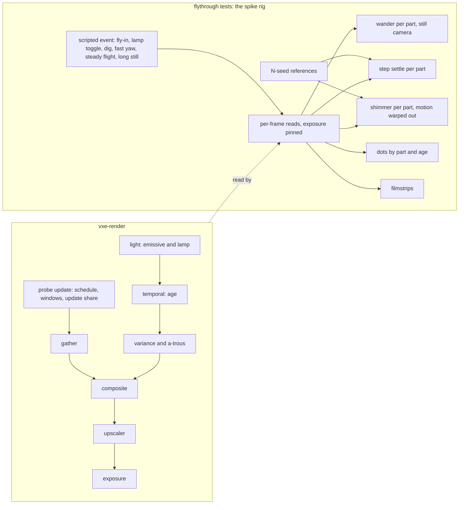

# 0049: Light holds still at rest, settles fast, and young pixels hold no dots: a wander, settle, shimmer and dot spike, then mechanisms chosen by measurement

> **Status:** abandoned (2026-11-03, owner: "drop"). Phase 1 ran and its readings stand in the
> Implementation log below; Phases 2 to 8 were never built, and bars B0, B1 and B2 stayed
> proposals the owner never set. [Plan 0051](0051-steady-light-spike-converge-and-freeze-and-a-world-space-emissive-cache.md)
> takes the wander, the settle, the dots and the shimmer, on a mechanism this plan's candidate
> list did not hold. This file is the plan as it stood at tag `archive/plan-0049` (121737f),
> with the links repaired: every amendment and the only Implementation log. The branch and
> worktree are gone. The tag keeps the five unmerged commits, with the rig
> (`apps/flythrough/tests/support/settle.rs`, `apps/flythrough/tests/settle.rs`, the
> `stillness.rs` helpers, `Frame::set_composite_capture`). `live/` in the log is now
> `renders/plan-0049-live/` (local, gitignored), `.git/lane-archive/plan-0049/` holds session 2,
> and the session's owner words are in [`LIGHT-FEEDBACK.md`](../../../LIGHT-FEEDBACK.md).
> Note on the readings: the rig set no look, so they are face normals with no rock detail.
> **Created:** 2026-10-28
> **Approved:** 2026-10-28 (owner), with the answers under "Owner answers". The spike runs
> beside Plan 0048, and the mechanisms run after it. Plan 0032 waits for this plan, so the
> order is 0047, 0048, 0049, 0032. Bars B1 and B2 are not fixed at approval: Phase 1 proposes
> them from its readings, and the owner sets them in a new `human` Phase 2 before any
> mechanism. Old Phases 2 to 6 become Phases 3 to 7. Exposure stays out of scope, and its
> reading and filmstrip go to the owner. The adapter switch lands in Phase 1 as
> `VXE_TEST_ADAPTER`, for reading-only tests. The gain question waits for Plan 0048's pick,
> as a conditional in Phase 3. (The order and the gain question are superseded by the
> 2026-10-29 amendment below.)
> **Amended 2026-10-29 (owner):** "after all these reviews and merges are done, I want to
> concentrate on a real fix for the light flicker; without it it doesn't make sense to move
> forward." Two changes:
> 1. **This plan runs alone, end to end, first.** Its mechanisms no longer wait for Plan 0048.
>    The order is 0047, then this plan, then 0048, then 0032. Every other plan stays parked
>    until the owner accepts the light in Phase 6. Every phase and bar is read on Plan 0047's
>    merged tree. Phase 3's re-read on 0048's tree is gone, and its conditional done-when (now
>    5) is "not applicable": 0048 comes later and must hold this plan's bars (a done-when of
>    its own).
> 2. **Shimmer in motion joins the scope.** At Plan 0047's Phase 7 check the owner also sees
>    the light shimmer or crawl during ordinary flight, not only on a fast turn. Phase 1 gains
>    a fifth run, a steady flight and a slow pan, and a named shimmer metric, attributed by part.
>    Phase 2 sets bar B5 with B1 and B2. Phases 3 and 4 gain the shimmer's candidates and rule,
>    Phase 5 asserts B5, and Phase 6 adds a steady flight. The title, the TL;DR, the bars and
>    the Budgets follow.
> **Amended 2026-10-29 (owner, second):** Phase 1's spike found that the light never settles
> at a still camera (Resume notes at 4d8b8f1, RTX, vein, lamp off, indirect on). Over frames
> 1024 to 8192 after a lamp toggle, the probe gather's view-mean tile log2 wanders with a
> standard deviation of 0.10 to 0.17, and the composite follows it. Two still renders of one
> pose with other seeds differ by 16 to 32 % a tile, so the shimmer floor and the settle read
> the wander, not the event. The owner chose to fix the still-camera wander first. Six changes:
> 1. **A new bar B0, the still-camera wander** ("The wander", "The bars"), the plan's first
>    target. Phase 1 proposes it, and the owner sets it in Phase 2 with B1, B2 and B5.
> 2. **References are seed-averaged.** The shimmer floor and every settled reference average
>    `N` seeds, with `N` derived from the measured seed spread so the floor falls below the
>    `log2 1.05` stop. The cost is stated ("Seed-averaged references", Budgets).
> 3. **The settle is read as the event's step:** the frame by which the seed-averaged view-mean
>    has made 90 % of its change. Bars on the per-tile settle come only after B0 holds.
> 4. **A new Phase 3, the probe side: the light holds still at rest**, first among the
>    mechanism phases. Its candidates are measured against a decision rule, and the mechanisms
>    stay open for the owner. Old Phases 3 to 7 become Phases 4 to 8. Phase 4 and Phase 5
>    re-read the settle, dot and shimmer readings once B0 holds. The phase numbers in the
>    earlier amendments and in "Owner answers" are those of their date. The log's phase table
>    is dev's to renumber.
> 5. **The stop rule:** if no probe-side candidate reaches B0 within its costs, the lane stops
>    for ADR-0038 before any code, comparing indirect designs (Phase 3, decision rule 5).
> 6. **Phase 1 finishes** with the seed-averaged floor, the step settle, the wander table, the
>    exposure share, and proposed B0, B1, B2 and B5. It then stops at Phase 2. (Item 6 is
>    superseded by the third amendment below.)
> **Amended 2026-10-29 (owner, third):** the shimmer floor is read once, after B0 holds. The
> seed-averaged floor costs a guessed 8.7 hours on the RTX, and it would be redone after B0
> anyway, when N is derived again. So:
> 1. **Phase 1 finishes with the cheap readings only:** run (vi)'s wander table, the step
>    settle `S90` with its `N_step`, the dots, exposure's share, and proposed B0, B1 and B2.
>    It then stops at Phase 2. The shimmer readings, the steady-flight run (v), the N = 32
>    floor and the proposed B5 leave Phase 1. Its done-whens are renumbered.
> 2. **Phase 2:** the owner sets B0, B1 and B2.
> 3. **The end of Phase 3**, once B0 holds and N is derived again, reads the seed-averaged
>    shimmer floor with its N/4-against-N check, the shimmer table and its attribution, and
>    proposes B5. The lane then stops briefly for the owner to set B5, before Phase 4 or
>    Phase 5 keeps any shimmer candidate.
> 4. The derivations of N stay as written.
> 5. **Phase 2 becomes a windowed session** before the owner sets the bars. The owner sees
>    the problem in the live app and describes it in their own words, and the log records
>    that description beside the readings. To support it, the fly-through's `--pose vein|patch`
>    moves from Phase 6 into Phase 1 as a small dev item, with its mode in the banner. Phase 6
>    keeps the rest of its flags.
> **Milestone:** M2 in [`docs/roadmap.md`](../../roadmap.md) (the "one-sample path tracing ...
> temporal accumulation" bullet, and the probe volume's indirect light)
> **Related ADRs:** [ADR-0023](../../adrs/0023-indirect-light-from-a-scrolling-probe-volume.md)
> (the probe update whose response this plan may change),
> [ADR-0018](../../adrs/0018-direct-light-per-pixel-one-sample-from-a-hit-buffer-with-svgf-history-killed-by-edits.md)
> (the estimator, its firefly clamp, the temporal and a-trous passes),
> [ADR-0036](../../adrs/0036-static-emissive-light-on-a-long-full-precision-history-guarded-by-an-emissive-gradient.md)
> (Plan 0047's stillness, which this plan must not regress),
> [ADR-0033](../../adrs/0033-eye-adaptation-as-an-asymmetric-two-stage-exposure-on-the-gpu.md)
> (the eye adaptation the spike separates from the light),
> [ADR-0037](../../adrs/0037-probe-rays-direct-light-keeps-its-energy-apart-from-the-screen-firefly-clamp.md)
> (Plan 0048's probe direct light, which lands after this plan; amended 2026-10-29, owner).
> No ADR at draft: see Decision.
> **Source:** the owner at Plan 0047's Phase 7 windowed check, 2026-10-28, on branch
> `plan-0047` at e1cfe53 (emissive history 256, the guard on, reuse cap 20, probe slices
> spread by a hash): (1) "When indirect lights are on, I have to wait several seconds until
> the light settles; it's very unnatural. With indirect off it is fine", when flying into new
> areas and after the lamp toggle (`F7`). (2) "When I turn the camera fast to another angle I
> see light artifacts, like small light dots. Same thing when I dig." The dots were the same
> in the old look (history 32), so they predate Plan 0047. (3) *Amended 2026-10-29 (owner):*
> at the same check the light also shimmers or crawls during ordinary flight, with no fast
> turn.
> **Starts after:** [Plan 0047](0047-emissive-light-holds-still-long-guarded-history.md)
> merges: its stillness rig (`apps/flythrough/tests/support/stillness.rs`), its filmstrips,
> its asserted bars and its defaults are this plan's "before". *Amended 2026-10-29 (owner):*
> the whole plan runs alone on 0047's merged tree, Phase 1 to Phase 7, with no lane beside it.
> Phase 2, the owner setting the bars, follows Phase 1's readings, and the mechanisms follow
> Phase 2. **Before [Plan 0048](0048-probe-rays-direct-light-without-the-clamp-bias.md)**,
> which starts after this plan merges and must hold this plan's asserted bars, and **before
> [Plan 0032](../0032-sun-and-sky-hillaire-atmosphere-time-of-day-and-an-outdoor-testbed.md)**,
> which starts after 0048. Drafted against main at cb7b70b and Plan 0047's branch at
> e1cfe53. The names dev finds in the tree win.

## TL;DR

Four defects. **First (amended 2026-10-29, owner, second): at a still camera, with indirect
light on, the light never settles.** The probe gather's view-mean wanders with a standard
deviation of 0.10 to 0.17 log2 over thousands of frames, and the composite follows it. At the
vein, the composite's view-mean wanders 0.041 to 0.059 with indirect on and 0.015 to 0.035
with it off. The other three are seen in motion.
After flying into a new area, a lamp toggle or a dig, the light takes seconds to settle. A fast
turn or a dig leaves small bright dots. And during ordinary flight the light shimmers or crawls
(amended 2026-10-29, owner). This is the owner's "real fix for the light flicker", so the plan
runs alone and first, before Plans 0048 and 0032. The plan does not pick a mechanism until a
reading names it (the measure-first rule, cb7b70b).

**Phase 1 is a spike.** It scripts the runs (a flight into a new area, a lamp toggle, a dig, a
fast yaw, a steady flight with a slow pan, and a long still series) and reads each part of the
light frame by frame with the exposure pinned. The parts are the composite, the emissive part,
the lamp's part, the a-trous output, the probe gather, the upscaled display, and the eye's
exposure on its own. Every reference that stands for "settled" averages `N` seeds, with `N`
derived from the measured seed spread (amended 2026-10-29, owner, second). From those
readings Phase 1 gives four figures:
- the **wander**: the standard deviation and range, over frames 1024 to 8192 at a still
  camera, of each part's view-mean and per-tile log-luminance;
- the **step settle**: the frame by which the seed-averaged view-mean has made 90 % of its
  change after an event;
- **dots**, bright outlier pixels, counted by the part that carries them and by the pixel's
  history age;
- the **shimmer**: each tile's log-luminance change from the frame before, with the camera's
  motion warped out through the hit buffer, minus a seed-averaged floor.

In Phase 2 the owner first watches the problem live in the fly-through, started at the spike's
poses with `--pose vein|patch`, and describes it. The owner then sets the bars B0, B1 and B2
from the wander, settle and dot readings. The
shimmer and its floor are read once, after B0 holds, and the owner sets B5 then (amended
2026-10-29, owner, third). **Phase 3 then fixes
the still-camera wander (B0) on the probe side.** It measures more probe rays, a longer or a
variance-adaptive hysteresis, a per-probe rotation, a screen history for the gather, and the
jitter's lighting-grid noise, each with its cost. If none reaches B0 within the costs, the lane
stops for ADR-0038 to compare indirect designs, such as a world-space radiance cache. Once B0
holds, Phases 4 and 5 re-read the settle, the dots and the shimmer, and build their candidates
against B1, B2 and B5. The candidates stay selectable, and the owner checks the result in the
window. The first thing anyone sees is Phase 1's test printing the wander table by part, with
indirect on and off.

## Context & problem

`project-context.md` (Rendering, P0): dark scenes, emissive voxels and a headlamp as the
light, with a smooth, natural look. Light that drifts for seconds after the camera arrives,
and sparkles where the camera turns or digs, reads as a rendering fault.

**What the tree does today** (Plan 0047's branch at e1cfe53; read, not measured):

- *The probe schedule* (`probes.rs`, `probe_update.wgsl`). One slice in 8 updates per frame,
  so a probe is visited every 8 frames. A slot holding a new probe (age 0) blends at
  hysteresis 0. It then blends at `YOUNG_HYSTERESIS` 0.5 for its next `YOUNG_UPDATES` 8
  visits (64 frames), then at `HYSTERESIS` 0.97. A step in a settled probe's input is 90 %
  done after `ln 0.1 / ln 0.97` = 75.6, so 76 visits: **608 frames, 10.1 s at 60 fps.**
- *Noise after a restart* (the architect's arithmetic). A blend at hysteresis h keeps
  `(1 - h) / (1 + h)` of one visit's variance in the limit: 1/3 at 0.5, 1/65.7 at 0.97. A
  probe leaving its young visits carries about `sqrt(65.7 / 3)` = 4.7 times the settled noise,
  and the excess drains at 0.97 a visit, on the same 76-visit scale. Its bounce term also
  reads neighbours that are themselves young.
- *The scroll.* The volume follows the camera in whole probe steps (16 voxels). A slot whose
  tag names another probe gathers with weight 0 until its first visit, at most 8 frames
  later. It then runs the young schedule above.
- *The light-change window* (`marcher.rs`, `LightKey`). A change of the lamp's switch or
  parameters, the shadow walk, the candidate count or an emission scale opens 16 frames
  that visit one probe in 4 at hysteresis 0. Each probe gets 4 visits, and its age restarts
  at 1. **`F7` changes `Lighting::lamp`, which is in the key, so the toggle opens the
  window** (to be confirmed by Phase 1's reading). After it, every probe runs the young
  visits (64 frames) and then the 0.97 drain. The window's own visits are single 64-ray
  estimates, so the gather is at its noisiest just after a toggle.
- *The lamp in the probes.* The probe rays light their hits with the headlamp
  (`probe_update.wgsl`, `lamp_lit`). The lamp's pose follows the camera, and **the pose is
  not in `LightKey`**. So with the lamp on, every turn or move changes the probes' input
  with no window, and the bounce follows at 0.97: about 608 frames to 90 %.
- *Edits.* A dig flags the probes within one spacing of its box as touched (age restarts at
  1, young blend). The temporal pass resets the pixels inside the dilated edit box to age 0,
  and Plan 0047's guard shortens the emissive history where the gradient sees a change.
- *Eye adaptation* (Plan 0040, ADR-0033). The owner chose 0.15 / 2 / 10 s and max 16. After
  the lamp goes off, the slow stage's dark adaptation takes about 10 s. Indirect light raises
  the meter's target, so exposure can lengthen a settle that the owner reads as the light's.
  The owner's "with indirect off it is fine" argues against exposure alone, but no reading
  separates them.
- *Young pixels* (`temporal.wgsl`, `atrous.wgsl`). A pixel whose history is rejected
  (reprojection taps fail on material, normal or distance, or the pixel is in an edit box)
  restarts at age 0. Its emissive part is then one sample of a rare-event estimator, clamped
  only at `FIREFLY_CLAMP` 2 times `PI lum(Le)`. Under `VARIANCE_AGE` 4 the variance comes
  from a 7 x 7 neighbourhood. The a-trous luminance weight `exp(-|l - l'| / (SIGMA_LUM
  sqrt(var)))` can keep an outlier apart from its neighbours. The gather goes straight to the
  composite with no screen history. Our upscaler at 1.5 (the default) has its own history and
  RCAS.

**Suspects, not conclusions:**

- *Wander at a still camera* (amended 2026-10-29, owner, second; Phase 1 read it, see the
  Resume notes at 4d8b8f1): each probe visit is a 64-ray estimate blended at 0.97. That keeps
  1/65.7 of one visit's variance, with a memory of about 33 visits (267 frames), so the noise
  that is left moves slowly. All probes in a slice share the frame's ray rotation, so their
  errors are correlated. The bounce term reads neighbouring probes, which feeds the slow error
  back. And at scale 1.5 the jitter moves the lighting grid each frame, which adds per-tile
  noise on the lighting grid (emissive 0.225 against 0.039 at scale 1) that the display does
  not show (about 0.02 either way). Hysteresis 0.99 cut the gather's wander to 0.067 and 0.112,
  and a per-probe rotation only to 0.112 and 0.140.

- *Settling:* the 0.97 drain after the young visits; new probes after a scroll; the window's
  noise; the lamp's pose missing from the window; and dark adaptation.
- *Dots:* raw emissive samples at age-0 pixels with too little spatial filtering; reprojection
  rejects on a fast turn; the firefly clamp's level; young probes' gather noise; and the
  upscaler's own history and sharpening.
- *Shimmer in flight* (amended 2026-10-29, owner): the probe gather's noise, which reaches the
  composite with no screen history and changes each time a probe in view is visited or the
  camera crosses a probe cell; reprojection rejects along silhouettes and grazing walls while
  moving; the lamp's per-pixel sample, whose lit point moves with the camera; the scroll's
  new probes; and the upscaler's history and RCAS.

Plan 0047 found that 83 % of a defect came from a part nobody had suspected. So nothing here
is fixed before a reading attributes it.

**The `nfr.md` figures touched:** §2 the probe volume's two passes (at most 1.7 ms outside a
light-change window and 3.2 ms inside one, on the dev box), the lighting line (6.0 ms) and
the denoise line (3.0 ms). §3 the frame's bytes, only if a candidate adds state.

## Decision

Fix the still-camera wander first (amended 2026-10-29, owner, second). While the light
wanders at rest, the settle and the shimmer read the wander, not the event. So B0 is set and
met before any settle, dot or shimmer mechanism, and every reference that stands for
"settled" averages seeds. Measure first. The spike reads the settle, the dots and the shimmer by part and by pixel age
under pinned exposure, with indirect light on and off, on scripted camera runs. Each mechanism phase then
builds the cheapest candidate the readings point to, keeps it only if its bar holds with no
regression, and stops for an architect amendment when no candidate fits. The candidates stay
selectable in the fly-through until the owner's windowed check.

**No ADR at draft.** No alternative is rejected yet. ADR-0038 is written in an amendment, before
any code, if the spike points to a change of ADR-0023's update model beyond its constants: a
separate lamp channel in the probes, an update order that is no longer a round robin, or a
world-space cache. *Amended 2026-10-29 (owner, second):* ADR-0038 is also owed, before any
code, if no probe-side candidate of Phase 3 reaches B0 within its costs. It then compares
indirect designs, for example a world-space radiance cache against today's probe volume. The next free ADR number is in `docs/adrs/README.md`.

## Architecture diagram



## Implementation phases

Each phase ships as its own commit. `dev` implements all phases in one session with no review
between phases. The architect reviews once at the end, in a fresh session. Lane rule 9c
applies throughout: exploratory runs (sweeps, attribution runs, long series) go on the RTX
3080 Laptop, labelled with the adapter, and every done-when reading, golden and gate stays on
lavapipe. A sweep's winner is re-read on lavapipe before its commit.

### Phase 1: The wander, settle, shimmer and dot spike
- **Owner skill:** dev
- **What:** a rig that scripts the runs, reads every part per frame under pinned exposure, and
  prints the still-camera wander, the step settle and dot counts with their attribution, every
  settled reference averaged over seeds (amended 2026-10-29, owner, second). The shimmer's
  definitions, its run (v) and its floor are built here, but read at the end of Phase 3, after
  B0 holds (amended 2026-10-29, owner, third).
  Filmstrips show the owner what the numbers count. No shader, default or engine behaviour
  changes.
- **The rig** (`apps/flythrough/tests/support/settle.rs`, beside `stillness.rs` and reusing its
  `VeinLevel`, poses, tile reduction and `filmstrip`):
  - **Parts read per frame:**
    - the composite's meter tiles;
    - the display image;
    - the emissive accumulation (`Frame::accumulated`);
    - the lamp's part;
    - the a-trous output (`Frame::filtered`);
    - the gather (`Frame::indirect_irradiance`);
    - the pixel age (`Frame::moments`, its `z`);
    - the hit buffer's world position and normal per lighting-grid pixel, for the shimmer's
      warp;
    - the exposure value.

    A part with no accessor today (the lamp's part, the exposure value if none exists) gets
    a test-only read in `vxe-render`.
  - **Runs.** Each run is at both poses (`PATCH_POSE`, `VEIN_POSE`), lamp on and lamp off,
    indirect on and off, at the rig's 192 x 108 and the defaults. Exposure is
    `Manual(pose.exposure)`, plus one `Auto` run per event that reads the exposure's own
    settle.
    - **(i) Fly-in.** A straight path of 160 voxels (10 probe spacings, so 10 scrolls) at 40
      voxels a second (4 m/s, 2/3 voxel a frame at 60 fps), ending at the pose, then still.
      Dev picks a path clear of rock and records it as a constant. Run it twice: with the
      volume following the camera, and with the origin pinned at the end pose's
      (`ProbeVolume::set_origin`). The difference is the scroll's share.
    - **(ii) Lamp toggle.** Still camera, settled 1024 frames, then the lamp on to off and off
      to on, as `F7` does. The rig asserts the window's state on each frame
      (`Frame::probe_light_window`).
    - **(iii) Dig.** Still camera, settled 1024 frames, then a radius-10 carve into the wall in
      view, applied as Plan 0047's hole test applies its edit.
    - **(iv) Fast yaw.** Still camera, settled 1024 frames, then a yaw of 90 degrees over 10
      frames (540 deg/s), and again over 30 frames (180 deg/s), then held still.
    - **(v) Steady flight** (amended 2026-10-29, owner; read at the end of Phase 3, amended
      2026-10-29, owner, third). Two sub-runs, each from a start pose
      settled 1024 frames, lamp on and off, indirect on and off:
      - *(v-a) flight:* a straight path along a cave passage at the fly-through's normal speed
        (`fly.rs`'s `SPEED`, 30 voxels a second, half a voxel a frame at 60 fps) for 360
        frames, 180 voxels, so about 11 scrolls. Dev picks a passage clear of rock that ends
        at or near `VEIN_POSE` and one near `PATCH_POSE`, and records each as a constant.
      - *(v-b) pan:* the camera holds its position and yaws at 30 deg/s (half a degree a
        frame) for 360 frames, 180 degrees.

      The shimmer is read over frames 64 to 359 of each sub-run, after the onset. The flight
      also runs with the origin pinned at its middle pose, so the scroll's share shows.
    - **(vi) Long still series** (amended 2026-10-29, owner, second). The camera is still at
      the pose. The lamp is switched into the state read, as `F7` does (which opens the
      window), and the run goes on for 8192 frames. This is the spike's `long_series`. It is
      read at both poses, lamp on and off, indirect on and off, and at the vein also at scale
      1 beside the default's 1.5. The lamp state named is the one during the series. The
      spike's table at 4d8b8f1 names the state before the toggle, so its "lamp on" rows are
      lamp off here.
  - **The wander** of part p at a still camera (amended 2026-10-29, owner, second), from run
    (vi). It is read on p's own grid, over frames 1024 to 8192 after the toggle, which is past
    the 64 + 608-frame drain:
    - *Blocks.* The window is cut into 448 blocks of 16 frames. Each block is one jitter
      cycle (`JITTER_PHASES` 16). Each full tile's log2 (the rig's transform, with its
      `FULL_LOG2` floor) is averaged over a block's frames. That block value `x_b(t)` carries
      the slow wander, and the jitter's per-frame noise averages out of it.
    - *The view-mean* `v_b` is the mean of `x_b(t)` over the full tiles. **`sigma_view`** is
      the standard deviation of `v_b` over the 448 blocks, and **`R_view`** is its range (max
      minus min).
    - *Per tile.* `sigma_t` is the standard deviation of `x_b(t)` over the blocks, and `R_t`
      its range. **`sigma_tile`** is the mean of `sigma_t` over the full tiles, `sigma_tile_p90`
      its 90th percentile, and `R_tile` the mean of `R_t`.
    - *The jitter's share.* Beside each block figure, the rig prints `sigma_tile` from single
      frames, without blocks, and the scale-1 run beside the 1.5 run.
    - *What is printed,* per pose, lamp state, indirect state and part: `sigma_view`, `R_view`,
      `sigma_tile`, `sigma_tile_p90` and `R_tile`. The parts are the composite, the display,
      the emissive part, the lamp's part, the a-trous output and the gather.
    - *The gather's share* of the composite's wander, as variance, per setting:
      `(sigma_view_on^2 - sigma_view_off^2) / sigma_view_on^2`. This assumes that the gather's
      wander is independent of the direct parts' wander, and the log says so.
    - The spike's figures at 4d8b8f1 (single frames every 128 frames) are the smoke reading.
      The block figures replace them.
  - **Seed-averaged references** (amended 2026-10-29, owner, second). A reference that stands
    for "settled" averages `N` renders, one per seed. A seed is the renderer's random-number
    offset, as in the spike's `seed offset 2^20` floor mode. Seed k is `k * 2^20`, with k from
    0, so a reading repeats.
    - *Why.* Two still renders of one pose with other seeds differ by `c_1` a tile at
      4d8b8f1: composite 0.2198, display 0.2407, emissive 0.2894, filtered 0.1619 and gather
      0.3212 (references over 512 frames). Each render carries its own slow wander. Averaging
      N independent renders divides the residual's spread by `sqrt(N)`, and the mean absolute
      pair difference with it.
    - *When each is read* (amended 2026-10-29, owner, third). Phase 1 reads `N_step` and the
      seed-averaged settle references. The shimmer floor's N is derived and read only at the
      end of Phase 3, after B0 holds, from the `c_1` re-read there. The derivation below gives
      today's figures.
    - *N for the floor.* The floor is under the stop when `c_1 / sqrt(N) < log2 1.05` =
      0.0704, so `N > (c_1 / 0.0704)^2`: composite 9.7, display 11.7, emissive 16.9, filtered
      5.3 and gather 20.8. **N = 32** at every part. Then the gather's pair reads 0.3212 /
      5.657 = 0.0568 (0.81 of the stop), the composite's 0.0389 and the display's 0.0426.
    - *N for the step settle.* `N_step` is the smallest power of two from 4 to 32 at which
      `3 sigma_view / sqrt(N_step)` is at most a tenth of the event's single-seed step `|D|`,
      that is `N_step >= (30 sigma_view / |D|)^2`. A lamp toggle at the vein (`|D|` about 4
      log2, `sigma_view` about 0.06) needs 4. An event whose step needs more than 32 prints
      "under the wander" and gets no settle bar.
    - *The check.* The rig reads the same-pose pair at N/4 and N (8 and 32 at today's spread)
      and prints the ratio. The `1/sqrt(N)` model puts it at 2.0. If the pair at N is still
      above `log2 1.05` at a part, N doubles once (to 64 at today's spread). If the doubled N also fails, dev stops for the
      architect, because the residual is then not independent across seeds.
    - *Length.* Each render's reference is frames 1024 to 1087 after its pose is set, past
      the 672-frame drain. Seeds, not length, average out a wander whose memory is about 267
      frames. The settle's reference stays at frames 2048 to 2111 after the event.
    - *Re-derived after B0.* Once Phase 3's kept setting meets B0, `c_1` and `sigma_view` are
      re-read, and both N are derived again by the same formulas. That makes Phases 4 to 6
      cheaper.
    - *The cost* (the owner accepts it on the RTX, 2026-10-29). The shimmer floor is 8 pairs,
      16 references of N × 1088 frames: **557 056 frames per sub-run and setting** at N = 32,
      read once, at the end of Phase 3 (amended 2026-10-29, owner, third). At a smaller N
      after B0 it costs proportionally less.
      A step-settle run is N_step × (1024 + 2112) frames, at most 100 352 per event and
      setting. The spike's long series ran at about 3.5 ms a frame on the RTX at 192 x 108.
      **That is a guess from the logs' write times, not a timing**, and the rig prints its own
      frames a second. At that rate a floor takes about 33 minutes per sub-run and setting,
      and the 16 shimmer settings about 8.7 hours, run unattended under the exclusive perf
      lock. If the measured rate puts the matrix over 12 hours, the floor uses 4 pairs (about
      4.3 hours at the same rate), and the log says so. Lavapipe is a guess of 25 ms a frame,
      from the toggle test's 27 s. Its re-read derives N from lavapipe's own `c_1` at the
      composite and the display only (16 if the RTX's spread holds) and uses 4 pairs: 8 × 16 ×
      1088 = 139 264 frames, about an hour.
  - **The step settle** of part p after an event (the stop, the toggle, the carve), amended
    2026-10-29 (owner, second):
    - The curve `M_p(f)` is p's view-mean (the mean of its full tiles' log2, the rig's
      transform) at frame f, averaged over `N_step` seeded runs of the event.
    - `M_pre` is `M_p(0)`, the last frame before the event. `M_post` is the mean of `M_p` over
      frames 2048 to 2111 after the event. The change is `D = M_post - M_pre`.
    - **`S90_p`** is the first frame after which `M_p` stays within `0.1 |D|` of `M_post` up to
      frame 2048. This is the rig's `mean_90`, read on the seed-averaged curve and in log2.
    - `S90_off` is the composite's `S90` with indirect off, and `S90_on` the same with it on.
    - The rig still prints the per-tile `S_p` of the draft (90 % of the full tiles within
      `log2 1.1` of their reference in every later frame up to 2048), with the reference
      averaged over the same seeds. **No bar is set on the per-tile settle until B0 holds**
      (owner, 2026-10-29). Phase 4 re-reads it then.
    - The curve every 8 frames is printed beside both.
  - **The dots** in a frame of the display image:
    - A **dot** is a pixel whose luma is over its 5 x 5 median by more than 24/255 and more
      than twice that median.
    - The **excess** is the count minus the same pose's count settled and still, which is
      the floor of real sparkle on crystal edges.
    - Each dot is attributed to every lighting-grid part that shows an outlier under it by
      the same rule on that part's own luminance. A dot with no part under it is the
      upscaler's.
    - Each dot is also bucketed by its pixel's age: 0, 1 to 3 (under `VARIANCE_AGE`), 4 to
      15, 16 to 63, 64 and over.
    - Read frames 1 to 60 after the yaw stops or the carve lands. For the yaw, the rig also
      prints the share of age-0 pixels whose hit was in view the frame before
      (reprojection rejects on a visible surface).
  - **The shimmer** of part p in a steady-flight sub-run (amended 2026-10-29, owner). It is
    read on p's own grid (the lighting grid for the lighting parts, the display for the
    display image):
    - *The warp.* For frame f, the rig moves frame f-1's luminance of p to frame f on the CPU.
      Each pixel's hit position in f is projected with frame f-1's camera. The pixel is
      **accepted** if the f-1 pixel it lands in hit within half a voxel of the same point,
      with the same face normal, so disocclusions and silhouettes drop out. This warp is the
      rig's own, from the hit buffer, independent of the temporal pass's reprojection.
    - *The tile change.* For each full tile t with at least half its pixels accepted, `T_f(t)`
      is the mean luminance of p over t's accepted pixels in frame f, and `W_f(t)` the mean of
      the warped frame f-1 over the same pixels. Then `c_f(t) = |log2 T_f(t) - log2 W_f(t)|`,
      with the rig's log2 transform and its `FULL_LOG2` floor.
    - *The floor.* At 8 poses evenly spaced along the sub-run, the rig renders the pose and the
      one before it still, each to its seed-averaged reference ("Seed-averaged references":
      N seeds, frames 1024 to 1087 each; amended 2026-10-29, owner, second), and reads the
      same `c` between the two references. That is the change the
      motion makes by itself (the lamp's lit point moving, the warp's resampling). `c0` is its
      mean over the tiles and the 8 pairs, one number per sub-run, part and setting, printed.
    - **The shimmer `H_p`** is the 95th percentile, over the read frames and tiles, of
      `max(0, c_f(t) - c0)`. The rig also prints its mean, and the **crawl share**: the
      share of tile-frames where `c_f(t) - c0` exceeds `log2 1.1`, the patch threshold.
    - *Its attribution.* `H` of each lighting part beside the composite's; the display's `H`
      against the composite's (the upscaler's share); indirect on against off (the gather's
      share); lamp on against off (the lamp's sample); the following flight against the
      pinned one (the scroll); `H` by age bucket, and the per-frame share of age-0 pixels the
      rig's warp accepts (the reprojection's rejects); and the probe-freeze sweep below (the
      probe updates' noise against the gather's interpolation as the camera moves).
    - A tile change measured against a converged still render at every pose of the path was
      considered. It needs one converged render per frame, 360 times 2112 frames per sub-run,
      so the converged renders set only the floor here.
  - **Sweeps by scratch patch.** Constants the spike needs to vary are swept by patches under
    the worktree's `live/` (not committed, as Plan 0047 did). These are `FIREFLY_CLAMP` at 1,
    2 and 8, `YOUNG_UPDATES` and `HYSTERESIS`, and the upscaler off (scale 1). For the shimmer,
    also a probe freeze (no probe update after the start pose has settled, the origin pinned),
    which keeps the gather's interpolation and removes its update noise.
  - **The adapter switch, `VXE_TEST_ADAPTER`** (owner, 2026-10-28). Rule 9c anticipates a
    test-support switch, and this phase builds it for later lanes to reuse.
    - **Where it lives.** One function in `apps/flythrough/tests/support/mod.rs`,
      `reading_device(pool_bytes)`, beside `software_device`. Its doc comment names the
      variable and the rule. Any reading-only render test in the workspace calls it, and
      `crates/vxe-render/tests` can copy it.
    - **Values.**
      - Unset, empty or `fallback`: lavapipe through `force_fallback_adapter: true`, as
        today.
      - Any other value: the first adapter whose name contains it, ignoring case (`rtx`,
        `radeon`). With no match, the test panics and lists the adapters.
    - **What may call it.** Only reading tests: `#[ignore]`d or env-gated, printing readings,
      asserting nothing that a gate runs. Every reading they print names the adapter.
    - **What may not.** Asserted tests and goldens keep `software_device` and stay forced to
      lavapipe. A test in Plan 0043's quick or gpu tiers that calls `reading_device` is a
      review finding.
  - **Filmstrips.** With `STILL_FILMSTRIP` set, each event writes contact sheets of the
    composite, the gather and the age image under `live/filmstrip/<tag>/`. Dots are marked on
    the composite's sheet. Each event's `Auto` run also writes a strip of the composite beside
    the pinned run's, with the exposure value printed per frame. That shows the owner what the
    eye adds to the settle (owner, 2026-10-28). The steady flight writes a **shimmer
    filmstrip** per sub-run: every 4th frame of the read range, the composite beside a heat
    map of `c_f - c0` per tile, and the gather's strip beside it (amended 2026-10-29, owner).
- **The fly-through's `--pose NAME`** (moved from Phase 6, amended 2026-10-29, owner, third).
  This is a small dev item for Phase 2's windowed session.
  - `--pose vein|patch` (with `--level`) starts the camera at the spike's exact pose:
    `VEIN_POSE` or `PATCH_POSE`, with the position, yaw and pitch of
    `apps/flythrough/tests/support/stillness.rs`.
  - The pose constants move to one definition in the app crate, which the test support
    re-exports, so the binary and the rig cannot drift apart.
  - The pose's exposure is not applied; the session runs on auto exposure unless
    `--exposure` is given.
  - The mode banner shows `pose vein` or `pose patch` until the camera first moves (the
    show-mode rule). `--pose` without `--level`, or with an unknown name, is a parse error
    that lists the names.
- **Files touched:** `apps/flythrough/tests/support/settle.rs` (new: the settle, dot and
  shimmer rig, the warp among it), `apps/flythrough/src/main.rs`, `apps/flythrough/src/hud.rs`
  and `apps/flythrough/src/lib.rs` (`--pose`, its banner mode and the shared pose constants;
  amended 2026-10-29, owner, third),
  `apps/flythrough/tests/support/stillness.rs` (shared helpers made public),
  `apps/flythrough/tests/support/mod.rs` (`reading_device` and `VXE_TEST_ADAPTER`),
  `apps/flythrough/tests/settle.rs` (new), `.config/nextest.toml` (the new file on the gpu
  and slow lists; `scripts/check-test-tiers.mjs` checks it), `crates/vxe-render/src/marcher.rs`
  (test-only reads, if a part or the hit buffer has none), this plan's log.
- **Done when:**
  1. `the_lamp_toggle_opens_the_light_window` asserts on lavapipe that on the first encoded
     frame with a probe update after the lamp switches, `probe_light_window()` is true, and
     that it stays true for exactly 16 such frames. Today's code says so. If it fails, that
     reading is the finding.
  2. `a_turn_with_the_lamp_on_opens_no_window` asserts that a 90-degree yaw with the lamp on
     leaves the window closed. This records the gap the suspects name, as a reading. It
     becomes a bar only if Phase 4 keeps the lamp-pose window.
  3. `settle_readings` prints for each event, pose and lamp state, with indirect on and off
     (amended 2026-10-29, owner, second):
     - `S90` per part on the seed-averaged curve, with `N_step`, `D` and the curve;
     - "under the wander" where `N_step` would exceed 32;
     - the per-tile `S` beside it, as a reading;
     - the `Auto` run's exposure settle;
     - the pinned-origin fly-in beside the following one.

     The log carries the table, RTX and lavapipe columns, with at least `VEIN_POSE` lamp off
     re-read on lavapipe.
  4. `dot_readings` prints for the fast yaws and the dig: the excess dots summed over frames
     1 to 60, the excess at frames 1, 8 and 16, the split by part and by age bucket, and the
     reject share. The scratch sweeps' readings are in the log, labelled.
  5. **The attribution table** in the log. For each symptom (the wander, the settle at each
     event, the dots at each event), it names the share each source owns. The shimmer's row
     is read at the end of Phase 3 (amended 2026-10-29, owner, third):
     - *wander* (amended 2026-10-29, owner, second): the gather's share of the composite's
       variance (indirect on against off), the emissive part's and the lamp's part's own
       `sigma_view`, and the jitter (scale 1 against 1.5, and the single-frame against the
       block `sigma_tile`);
     - *settle:* exposure (the `Auto` run minus the pinned one); the scroll (following minus
       pinned); the lamp's pose (lamp-on fly-in and yaw against lamp-off); the drain after a
       restart (the gather's `S` against the 64 + 608 frame schedule); the window's noise;
       and the emissive history;
     - *dots:* the parts and age buckets above, the reject share, and the clamp's and the
       upscaler's sweeps;

     Shares that cannot be separated are named as joint. The log states, per symptom, the
     dominant source and its share. If exposure owns a share, that share and its `Auto`
     filmstrip go to the owner. No mechanism here is built for it (owner, 2026-10-28).
  6. The filmstrips exist for every event at both poses, and the log lists their paths. The
     steady flight's shimmer strips come with Phase 3's shimmer readings.
  7. `VXE_TEST_ADAPTER` works:
     - unset, a reading test reports lavapipe;
     - set to `rtx` on the dev box, it reports the RTX 3080 Laptop;
     - `rg software_device` and `rg reading_device` show that no asserted test calls
       `reading_device`.
  8. **The wander table** (amended 2026-10-29, owner, second). `wander_readings` prints, from
     run (vi), `sigma_view`, `R_view`, `sigma_tile`, `sigma_tile_p90` and `R_tile` for every part,
     at both poses, lamp on and off, indirect on and off, and the vein at scale 1. The log
     carries the table with RTX and lavapipe columns, with at least `VEIN_POSE`, lamp off,
     indirect on and off re-read on lavapipe. The rig's frames a second on each adapter is
     in the log beside it.
  9. **`--pose` works** (amended 2026-10-29, owner, third):
     - the release binary is built (`cargo build --release -p flythrough`);
     - a parse test beside the parser asserts that `--level --pose vein` and `--level --pose
       patch` give exactly `VEIN_POSE`'s and `PATCH_POSE`'s position, yaw and pitch, that
       `--pose` without `--level` and `--pose cave` are errors, and that the banner's mode
       line reads `pose vein`.
  10. **The proposed bars**, in the log under "Proposed B0, B1 and B2", derived from the
     readings and labelled as a proposal (B0 amended 2026-10-29, owner, second; B5 moved to
     Phase 3, amended 2026-10-29, owner, third):
     - **B0:** the composite's and the display's `sigma_view`, `R_view` and `sigma_tile` with
       indirect on against the same with indirect off, at each pose and lamp state, in the
       form under "The bars". The proposal states the numbers each setting needs, the
       gather's `sigma_view` that the variance model says meets them, and the share of
       today's gather wander that is.
     - **B1:** the composite's step settle `S90_on` against `S90_off` at each event, as a
       margin in frames, a ratio, or both.
     - **B2:** the excess dots as a share of today's sum over frames 1 to 60, and a later
       frame by which the excess falls under a share of frame 1's.
       Where today's excess is at or under zero (the dig's smoke reading is -2623, its
       settled view holding more dots than its first frames), the proposal is "no excess"
       against the floor's own frame-to-frame spread instead of a share.

     Each number cites the reading it comes from. The hand-off to the owner lists the
     filmstrips beside it, and the exposure share from done-when 5. **The lane stops here**
     until Phase 2 records the owner's bars.

### Phase 2: The owner sees the light live and sets B0, B1 and B2
- **Owner skill:** human
- **What** (amended 2026-10-29, owner, third): a windowed session in the release fly-through on
  the dev box, then the bars. The owner watches the problem in the live app and describes, in
  their own words, what they see. The owner then reads Phase 1's wander, settle and dot
  tables, the attribution table, the proposed B0, B1 and B2, and the filmstrips, the `Auto`
  strips among them, and sets the three bars (owner, 2026-10-28; B0 amended 2026-10-29,
  owner, second). B5 is set at the end of Phase 3. No other lane runs meanwhile (amended
  2026-10-29, owner).
- **The session's runs.** The orchestrator scripts them with the existing flags and
  `--pose`, with stdout visible:
  - the camera still at each pose (`--level --pose vein`, `--level --pose patch`) for about a
    minute each, lamp off and on (`--lamp off|on`), indirect on and off (`--indirect on|off`);
  - the same still view at a lower `--probe-rays`, which shows how the wander grows as the
    rays fall. No hysteresis flag exists at 7d60826. The hysteresis reading is shown only if
    the orchestrator builds a scratch binary from `live/sweep-hysteresis-0.99.patch`,
    uncommitted;
  - a lamp toggle (`F7`) at the vein, a dig beside it, a fast turn, and a short flight.
- **Files touched:** this plan's log (the owner's description beside the readings, and the
  bars), and "The bars" with the owner's numbers. The architect makes that edit as a dated
  amendment, since dev edits only the Status line and the log.
- **Done when:**
  - The log records the owner's description of each run, in the owner's words, beside the
    matching Phase 1 readings.
  - The log records B0, B1 and B2 as the owner set them: numbers in frames, dot counts
    and log2 units, per event, sub-run, pose or lamp state where they differ, marked
    `(owner, <date>)`.
  - "The bars" carries the same numbers.
  - The owner states whether exposure's share, if any, changes ADR-0033's constants. That
    change, if wanted, is another plan.

### Phase 3: The probe side: the light holds still at rest
- **Owner skill:** dev
- **What** (amended 2026-10-29, owner, second): meet B0 on the probe side before any settle,
  dot or shimmer mechanism. Measure each candidate below against B0 with its cost, at the
  owner's bars from Phase 2, with Phase 1's wander table as the before. Keep what the decision
  rule keeps, and leave every kept candidate selectable. The mechanisms stay open until the
  owner's windowed check (the owner decides by measurement).
- **Sweeps first.** Each candidate is first read on the RTX under rule 9c, by scratch patch
  or setting, on run (vi) at both poses, lamp on and off, indirect on. The ones within their
  costs are then built as settings and re-read on lavapipe.
- **The arithmetic behind the order** (the architect's; a white-noise model of the visits,
  which the readings test). Phase 1's smoke figures and the variance model under "The wander"
  put the vein's gather `sigma_view` needed for the proposed B0 at 0.52 to 0.60 of today's. That
  is a variance cut of about 2.8 to 3.6 times. A blend at hysteresis h keeps `(1 - h) / (1 + h)`
  of one visit's variance: 0.01523 at 0.97. A 3.6 times cut needs 0.00423, so h = 0.9916, or
  4 times the rays, or a mix.
- **Candidates** (each a value of one `Lighting` setting, old behaviour selectable, the banner
  naming it):
  - **W1, more probe rays.** `Lighting`'s rays per probe raised over 64 (`RAYS_PER_PROBE`,
    today the maximum), swept at 128 and 256. The model gives a variance cut of 2 and 4
    times. Cost: the trace and blend passes grow about linearly with the rays, **a guess**
    of up to +1.4 ms at 128 rays on the RTX against the 1.567 ms reading, which crosses the
    1.7 ms line. The scratch grows by `MAX_UPDATES × 2 words × 4 B` a ray: 4 227 072 B at 64
    rays, 8 421 376 B at 128 and 16 809 984 B at 256. The same rays can instead be spread
    over more frames (more slices visited per frame), at the same cost per unit of variance.
  - **W2, a longer or a variance-adaptive hysteresis.** (a) `HYSTERESIS` swept at 0.98,
    0.99, 0.992 and 0.995. A fixed 0.992 makes a settled probe's step 90 % done after
    `ln 0.1 / ln 0.992` = 287 visits, 2296 frames or 38 s, against 608 frames today. So (a)
    is a reading, not a candidate to keep alone. (b) **Variance-adaptive:** each probe keeps
    a running estimate of its visit-to-visit spread and blends at the long hysteresis while a
    new visit lies within `k` of those spreads of its history. A visit outside `k` (a real
    change) drops it to the young blend for the next visits. The light window, a dig's
    touched probes, a scroll's new probes and the young visits keep their schedules
    unchanged. `k` and the long h are swept. Cost: one f32 per probe (32 768 × 4 B =
    131 072 B) for a per-probe spread, or one per irradiance texel (32 768 × 36 × 4 B =
    4 718 592 B) for a per-texel one, unless free bits of the probe's state word hold it.
    About 10 ALU ops a texel in the blend, **a guess** under 0.05 ms.
  - **W3, a per-probe rotation.** Each probe's ray set is rotated by its slot's own random
    rotation, not the frame's shared one (`live/sweep-per-probe-rotation.patch`). This
    decorrelates the probes in a slice. Smoke reading: the gather's wander 0.112 and 0.140
    against 0.123 and 0.168, a variance cut of only 1.2 and 1.4 times, so it is read alone
    and in combination with W1 or W2. Cost: a few ALU ops a ray, about 0.
  - **W4, a screen history for the gather.** This is the same mechanism as Phase 4's G,
    measured here at a still camera, with its history length `N_g` swept up to 1024 frames.
    The model predicts that it cuts the per-tile, frame-to-frame part. It cuts the
    view-mean's wander only when `N_g` is long against the wander's memory, which is about
    267 frames at 0.97 (33 visits of 8 frames). The reading decides. Cost: as G, one 8 B a
    pixel history, **a guess** of 7 372 800 B at a 1280 x 720 lighting grid, under 0.1 ms.
  - **W5, the jitter's lighting-grid noise.** At scale 1.5 the per-tile noise on the lighting
    grid is about 6 times scale 1's (emissive 0.225 against 0.039, composite 0.091 against
    0.016), and the display is about 0.02 either way. Two options: (a) the lighting grid
    traced unjittered, with the hit grid and the upscaler keeping the jitter; (b) the
    lighting history weighted by the jitter phase, so a pixel's history is not torn by the
    sub-pixel offset. W5 serves B0's per-tile figures on the lighting parts. It is kept only
    if the display's `sigma_tile` holds and the Plan 0047 goldens move under its 1 % rule.
    Cost: 0 for (a), a few ALU ops a pixel in the temporal pass for (b).
- **Diagnostic sweeps** (readings, not candidates): the bounce term off, and a probe freeze at
  a still camera. These separate the wander that feeds back through the bounce from the
  per-visit noise.
- **The decision rule:**
  1. Every candidate and every promising pair is read. The log carries one row each, with
     `sigma_view`, `R_view` and `sigma_tile` per part and setting, and its costs.
  2. A candidate or pair is **eligible** when all of these hold:
     - B0 holds at both poses, lamp on and off;
     - its costs are within `nfr.md` §2 (the probe passes at most 1.7 ms outside a window and
       3.2 ms inside one; lighting 6.0 ms; denoise 3.0 ms), and its bytes are stated;
     - B3 holds;
     - **the real-change paths keep their speed**: the step settle `S90` of the lamp toggle,
       the dig, the fly-in and the lamp-on yaw is no later than Phase 1's at the same run.
       The lamp-on yaw is in the list because the lamp's pose is not in `LightKey`.
  3. Among the eligible ones, the cheapest, by the probe pass's ms and then by its bytes,
     becomes the default. The other eligible ones stay selectable for the owner's check.
  4. A candidate that meets B0 but slows a real-change path is not eligible. The log records
     its pair of readings.
  5. **The stop rule** (owner, 2026-10-29): if no candidate or pair is eligible, the lane
     stops for an architect amendment and **ADR-0038** before any code. ADR-0038 compares
     indirect designs against today's probe volume, for example a world-space radiance
     cache. The next free number is in `docs/adrs/README.md`; 0038 is expected.
  6. If B0 already holds at Phase 1's readings, the phase records "not needed" and builds
     nothing.
- **After B0 holds:** `c_1` and `sigma_view` are re-read at the kept setting, and both N are
  derived again ("Seed-averaged references"). Then Phase 1's settle and dot tables are re-read
  at the kept setting. Those re-reads are the before of Phases 4 and 5.
- **The shimmer, read once here** (amended 2026-10-29, owner, third). At the kept setting and
  the re-derived N, dev runs Phase 1's run (v) and its seed-averaged floor ("The shimmer",
  "Seed-averaged references"), with the N/4-against-N check. That is the first and only full
  floor reading. It gives the shimmer table, the shimmer row of the attribution table, the
  shimmer filmstrips, and a proposed B5. **The lane then stops** until the owner sets B5,
  which the architect records as a dated amendment. That stop needs no window, and no
  shimmer candidate in Phase 4 or Phase 5 is kept before it.
- **Files touched:** `crates/vxe-render/src/probes.rs`,
  `crates/vxe-render/src/shaders/probe_update.wgsl`, `crates/vxe-render/src/shaders/temporal.wgsl`
  and the composite's shader (W4 only), `crates/vxe-render/src/shaders/light.wgsl` and
  `crates/vxe-render/src/marcher.rs` (W5), `crates/vxe-render/src/lib.rs` (the setting),
  `apps/flythrough/src/main.rs` and `apps/flythrough/src/hud.rs` (the flag and the banner),
  `apps/flythrough/tests/settle.rs`, this plan's log.
- **Done when:**
  1. B0 holds at both poses, lamp on and off, on lavapipe at the kept setting. The
     candidate's wander table is in the log beside Phase 1's.
  2. The log's candidate table carries every candidate's reading and cost, with the eligible
     ones marked and the default named.
  3. The real-change paths' `S90` at the kept setting are in the log beside Phase 1's, none
     later.
  4. B3 holds, and B4 holds at the kept setting.
  5. With the kept setting off, every image and test reads as before: the old path is
     bit-identical, asserted on one golden.
  6. The re-derived N and the re-read settle and dot tables are in the log.
  7. `shimmer_readings` (moved from Phase 1, amended 2026-10-29, owner, third) prints for
     each steady-flight sub-run, pose, lamp state and indirect state, at the kept setting:
     - `H`, its mean and the crawl share per part;
     - the seed-averaged floor `c0` per part, with N beside it and the N/4-against-N ratio;
     - the accepted share of the warp and `H` by age bucket;
     - the pinned flight and the probe-freeze sweep beside the following one.

     The log carries the table, RTX and lavapipe columns, with at least the `VEIN_POSE`
     flight, lamp off, re-read on lavapipe. A floor `c0` above `log2 1.05` at any part after
     N is doubled means the warp or the residual is too coarse to read shimmer, and dev stops
     for the architect.
  8. The attribution table's shimmer row is in the log, with its shares: the composite;
     direct (the emissive part and the lamp's part apart); the probe gather (indirect on
     minus off, and the probe freeze against the following run); the temporal pass and its
     reprojection (`H` by age and the reject share); the upscaler (the display against the
     composite, and scale 1); and the scroll (the pinned flight). The steady flight's shimmer
     filmstrips are listed with their paths.
  9. **Proposed B5**, in the log, labelled as a proposal: the composite's and the display's
     `H` and crawl share per sub-run, as a share of this reading, or as a margin over the
     indirect-off reading where the shimmer is the gather's, whichever the attribution
     supports. The lane stops until the owner's B5 is recorded.
  10. Or, in place of 1 to 9, the log records the stop rule's trigger, with every
     candidate's row, and the lane waits for ADR-0038.

### Phase 4: The probe side: the light settles fast and the gather holds still in flight
- **Owner skill:** dev
- **What:** on Plan 0047's merged tree with Phase 3's kept setting, and with Phase 3's re-read
  of the settle and shimmer as the before (amended 2026-10-29, owner, second), build the
  candidates the decision rule names, in its order, and keep the first that meets bar B1 and
  the probe side's share of B5, with B0, B3 and B4 held. *Amended 2026-10-29 (owner):* no re-read
  on Plan 0048's tree; 0048 comes after this plan.
- **Candidates** (each a value of one `Lighting` setting, old behaviour selectable, the banner
  naming it):
  - **R, a running-mean schedule.** A probe's n-th visit after a restart blends at
    `h = min(HYSTERESIS, n / (n + 1))`, so it holds the plain mean of its visits until that
    mean is as quiet as 0.97's limit (n = 32), with no young-noise drain after it. The
    window keeps its first visit at 0, so stale bounce still goes, and runs the mean after.
    No memory; the age bits already count visits up to 127. Sources: the drain after a
    restart, the window's noise, and the scroll's new probes.
  - **P, an update share for young probes.** Probes of age at most `Y` whose cells lie within
    the view's near box join the frame's list beyond its slice, as touched probes do, up to
    `MAX_TOUCHED`. Sources: the scroll and the drain. Cost: the update pass, against the
    1.7 ms line.
  - **L, a window when the lamp's pose moves.** The lamp's pose enters the window's trigger
    when it has moved more than one probe spacing or turned more than `T` degrees since the
    last window. At most one window per `W` frames. Source: the lamp's pose. Cost: windows
    while flying, against the 3.2 ms line inside a window and the 1.7 ms line on average.
    `T` and `W` are swept. A window's visits are single estimates at hysteresis 0, so L is
    kept only if B5 holds with it in the steady flight, lamp on.
  - **G, a screen history for the gather** (amended 2026-10-29, owner). If Phase 3 kept W4,
    G is that setting, and here only its `N_g` is re-swept for the flight (amended
    2026-10-29, owner, second). The gather is
    accumulated in the temporal pass with the lighting's reprojection, age and edit resets, so
    a probe visit's step in view is spread over the screen history instead of reaching the
    composite in one frame. Its history length is capped at `N_g` frames (swept), so the
    gather still follows a settle. Source: the gather's noise in flight. Cost: one history
    of 8 B per lighting-grid pixel, **a guess** of 7 372 800 B at 1280 x 720 (1920 x 1080 at
    the default's 1.5), unless it fits in a history's free channels; `frame_bytes` states it.
- **The decision rule:**
  1. A source owning at least 25 % of `S_on - S_off` at any event gets its candidates,
     cheapest first: R, then P, then L.
  2. A probe-side source (the gather's noise, the scroll, the lamp's pose in the probes)
     owning at least 25 % of the excess `H` in any steady-flight sub-run gets its candidates,
     cheapest first: R, then G, then P (amended 2026-10-29, owner).
  3. Keep the first candidate, or the first pair, that meets B1 at every event it serves and
     the probe side's share of B5 in every sub-run. A candidate that meets one and breaks the
     other is not kept; the log records the pair of readings.
  4. If the dominant source has no candidate here, stop for an architect amendment: a
     separate lamp channel in the probes, which needs ADR-0038; the emissive history, which
     is ADR-0036's ground. Exposure is out of scope (owner, 2026-10-28). Its reading and
     filmstrip went to the owner in Phase 2, and B1 is read with exposure pinned.
  5. If B1 and the probe side's share of B5 already hold at Phase 3's re-read, the phase
     records "not needed" and builds nothing.
- **Files touched:** `crates/vxe-render/src/probes.rs`, `crates/vxe-render/src/shaders/probe_update.wgsl`,
  `crates/vxe-render/src/shaders/temporal.wgsl` and the composite's shader (G only),
  `crates/vxe-render/src/marcher.rs`, `crates/vxe-render/src/lib.rs` (the setting),
  `apps/flythrough/src/main.rs` and `apps/flythrough/src/hud.rs` (the flag and the banner),
  `apps/flythrough/tests/settle.rs`, this plan's log.
- **Done when:**
  1. B1 holds at every event, pose and lamp state on lavapipe at the kept setting (the
     candidate's readings beside the before's in the log).
  2. The steady flight's `H` at the kept setting is in the log beside Phase 3's re-read for every
     sub-run, and the probe side's share of B5 holds.
  3. B0, B3 and B4 hold.
  4. With the kept setting off, every image and test reads as before: the old path is
     bit-identical, asserted on one golden.
  5. *Not applicable* (amended 2026-10-29, owner). The conditional on Plan 0048's per-probe
     gain is gone: 0048 runs after this plan, starts from its merged tree, and must hold this
     plan's asserted bars on its own tree (a done-when in 0048).

### Phase 5: The screen side: no dots on a fast turn or a dig, no shimmer in flight
- **Owner skill:** dev
- **What:** build the dot and shimmer candidates the decision rule names, in its order, and
  keep the first that meets bar B2 and the screen side's share of B5 with B0, B3 and B4 held.
  Its before is Phase 3's re-read of the dots and the shimmer at Phase 3's kept setting
  (amended 2026-10-29, owner, second).
- **Candidates:**
  - **Y1, an age-aware clamp for young pixels.** In the variance pass, a pixel of age under
    `VARIANCE_AGE` has its emissive luminance clamped to `k` times the largest of its
    geometric neighbours' in the 3 x 3. It is biased only while the pixel is young. Source:
    dots at age 0 to 3 in the emissive accumulation.
  - **Y2, a filter that blurs young pixels.** The a-trous luminance weight is relaxed for
    young pixels, scaled by `1 / (age + 1)` or off under `VARIANCE_AGE`, so the filter
    averages a young outlier into its plane. Source: dots that survive the filter at young
    ages.
  - **Y3, the reprojection's acceptance on a turn and in flight.** If the reject share on
    visible surfaces is high, the tap test (`HISTORY_COS`, the distance tolerance at depth t)
    is fixed where it rejects valid history on rotation or translation. Source: age-0 dots on
    surfaces in view the frame before, and shimmer carried by young pixels in flight (the
    rig's warp accepts a pixel the temporal pass rejects).
  - **Y4, the upscaler's history.** If the upscaler owns the dots or the shimmer, its clip
    or RCAS is limited where the lighting history is young, or its history's clip box is
    widened where the lighting is stable. Source: the upscaler's dots, and the display's `H`
    above the composite's.
  - **Y5, the lamp's part in flight** (amended 2026-10-29, owner). The headlamp is a point
    light with one shadow ray per hit (`lamp_lit`), so its part is exact per hit, but the
    jittered rays and the moving lamp move its shadow edges and contour crossings every
    frame. Dev reads in the tree which of the temporal and a-trous passes the lamp's part
    goes through. If the lamp's part owns the shimmer, it is taken through the history and
    the filter with the emissive part, or its shadow ray's origin is made stable under the
    jitter, cheapest first. Source: shimmer in the lamp's part, lamp on.
- Dots and shimmer carried by the gather go to Phase 4's candidates. The clamp's level is a reading only:
  the screen's clamp stays, as the owner ruled for Plan 0048.
- **The decision rule:** a source owning at least 25 % of the excess dots at either event,
  or of the excess `H` in any steady-flight sub-run, gets its candidate, in the order Y1, Y2,
  Y3, Y4, Y5 within its source. Keep the first that meets B2 and the screen side's share of
  B5. If the dominant source is none of these, stop for an architect amendment. Plan 0047's
  reveal bar is the test that a young-pixel filter must not slow: frame 32 of the hole test at
  least 52 %, and the plug reveal's frames.
- **Files touched:** `crates/vxe-render/src/shaders/atrous.wgsl`, `crates/vxe-render/src/shaders/temporal.wgsl`,
  `crates/vxe-render/src/shaders/upscale.wgsl` (Y4 only), `crates/vxe-render/src/shaders/light.wgsl`
  (Y5 only), `crates/vxe-render/src/marcher.rs`,
  `crates/vxe-render/src/lib.rs`, `apps/flythrough/src/main.rs`, `apps/flythrough/src/hud.rs`,
  `apps/flythrough/tests/settle.rs`, this plan's log.
- **Done when:**
  1. B2 holds at both yaws and the dig, at both poses, on lavapipe at the kept setting.
  2. B5 holds in every steady-flight sub-run, at both poses, lamp on and off, on lavapipe,
     with Phase 3's and Phase 4's kept settings and this phase's together.
  3. B0, B3 and B4 hold.
  4. The kept setting off is bit-identical to the before on one golden.

### Phase 6: The bars as tests, the goldens, the readings, the owner's commands
- **Owner skill:** dev
- **What:** turn B0, B1, B2 and B5 into asserted tests on lavapipe, re-bless the goldens the kept
  settings moved by Plan 0047's 1 % rule, read B4 on both adapters into `nfr.md`, and prepare
  the owner's check.
- **The fly-through:**
  - `--pose vein|patch` landed in Phase 1 (amended 2026-10-29, owner, third). Here it gains
    only the `x,y,z,yaw,pitch` form, with its banner mode, if Phase 7 needs a pose beyond the
    two.
  - A free key dev picks runs the rig's fast yaw (90 degrees over 10 frames), and the banner
    names the key.
  - `--fly-path vein|patch` flies the rig's steady-flight path (v-a) at normal speed from its
    start, then hands the camera back, and the banner names the run while it plays (amended
    2026-10-29, owner).
  - Each kept candidate has a flag and a banner mode, `old` or the kept value.
  - The owner's commands go in the hand-off, with stdout visible.
  - The five runs' filmstrips at the before and the kept settings are listed with their
    paths, the shimmer strips among them.
- **Files touched:** `apps/flythrough/tests/settle.rs`, `apps/flythrough/tests/golden/*.png`
  (only those that moved), `apps/flythrough/src/main.rs`, `apps/flythrough/src/hud.rs`,
  `.config/nextest.toml`, `docs/nfr.md`, this plan's log.
- **Done when:**
  1. `the_light_holds_still_at_rest` asserts B0 at `VEIN_POSE` and `PATCH_POSE`, lamp on and
     off, on run (vi), at the kept settings (amended 2026-10-29, owner, second). That is 8
     series of 8192 frames, 65 536 frames, **a guess** of 27 minutes on lavapipe at 25 ms a
     frame. It goes on the slow list.
  2. `indirect_light_settles_about_as_fast_as_direct_light` asserts B1 at `VEIN_POSE` and
     `PATCH_POSE` for the fly-in, the lamp toggle (both ways) and the dig, lamp off. The lamp-on
     fly-in is asserted too if Phase 4 kept L.
  3. `a_fast_turn_and_a_dig_leave_no_dots` asserts B2.
  4. `a_steady_flight_holds_the_light_still` asserts B5 for the flight (v-a) and the pan
     (v-b) at `VEIN_POSE`'s and `PATCH_POSE`'s paths, lamp on and off (amended 2026-10-29,
     owner). Its floor uses the N derived after B0 (Phase 3), and its references reuse Phase 3's
     reading where the kept settings since have not moved the floor. If that floor's cost on
     lavapipe exceeds the slow tier, dev stops for an architect amendment of the test's form
     (amended 2026-10-29, owner, second).
  5. Every moved golden is named in the log with its share over 2/255.
  6. B4's readings are in `nfr.md` with machine, commit and load.
  7. The banner test reads the new modes.

### Phase 7: The owner's windowed check
- **Owner skill:** human
- **What:** the owner runs these runs in the release fly-through on the dev box, each with
  the kept settings and with `old`, indirect on and off, auto exposure:
  - the camera held still at the vein and at the patch for a minute, lamp on and off, the
    light watched for wander (amended 2026-10-29, owner, second);
  - a flight into a new area;
  - the lamp toggle (`F7`) both ways at the vein;
  - a dig beside the vein;
  - fast turns, by hand and by the yaw key;
  - a steady flight along a passage at normal speed with slow turns, by hand and by
    `--fly-path`, lamp on and off (amended 2026-10-29, owner).

  Beside the window, the owner looks at the filmstrips.
- **Files touched:** this plan's log.
- **Done when:** the owner records one of three outcomes:
  - (a) the wander, the settle, the dots and the shimmer are gone, and the defaults stand;
  - (b) another swept value is wanted, the default changes to it, and Phase 6's bars are
    re-read;
  - (c) something is still visible. The owner names which of the runs, and Phase 8 or
    an architect amendment follows.

### Phase 8: The owner's findings, if any
- **Owner skill:** dev
- **What:** if Phase 7 recorded (b), set the chosen value as the default and re-read Phase 6's
  bars and goldens. If it recorded (c) for a source a kept candidate covers, sweep that
  candidate's parameter against the owner's run and re-read the bars. If it recorded (a), log
  "not needed" and change nothing. A source outside the kept candidates stops for an
  architect amendment. After the owner's pick, the losing candidates are removed with their
  flags, banner modes and tests, as Plan 0048 does, unless the owner keeps one for
  comparison.
- **Files touched:** as Phases 3 to 6 for the candidate in question, this plan's log.
- **Done when:** the log records the owner's outcome and either "not needed" or the new
  default with Phase 6's tests passing at it, and no losing candidate's flag remains in
  `--help` or the banner.

## The bars

**B0, B1, B2 and B5 are not fixed at approval** (owner, 2026-10-28; B5 amended 2026-10-29,
owner; B0 amended 2026-10-29, owner, second). Phase 1 proposes them from its readings, and
the owner sets B0, B1 and B2 in Phase 2 and B5 at the end of Phase 3, after B0 holds (amended
2026-10-29, owner, third). Their form is fixed here, and their numbers come from those stops.
**B3 and B4 stand as drafted.** All six are read on lavapipe at 192 x 108, both poses, on
Plan 0047's merged tree (amended 2026-10-29, owner). B0, B1, B2 and B5 are read under
`Manual(pose.exposure)`. **B0 is the first target and is met first** (Phase 3). Bars on the
per-tile settle wait until B0 holds.

- **B0, the still-camera wander** (amended 2026-10-29, owner, second). The intent: with
  indirect on, the still image wanders about as little as with indirect off. It is read on run
  (vi) over frames 1024 to 8192 ("The wander"), at each pose and lamp state, with indirect on
  against the same with indirect off. It bounds the composite's and the display's
  `sigma_view` and `R_view`, and the display's `sigma_tile`. The display carries the per-tile
  figure because the lighting grid's per-tile noise at scale 1.5 is the jitter's, which the
  display does not show. The lighting parts' per-tile figures are printed for attribution.
  The architect's proposed form, for the owner to set in Phase 2:
  - `sigma_view_on <= max(1.25 sigma_view_off, sigma_view_off + 0.010)`;
  - `R_view_on <= max(1.25 R_view_off, R_view_off + 0.05)`;
  - the display's `sigma_tile_on <= max(1.25 sigma_tile_off, sigma_tile_off + 0.010)`.

  The 1.25 is the draft's B1 ratio. The added 0.010 log2 (0.7 % in luminance) keeps a quiet
  indirect-off reading from setting an unreachable bar. The table applies the form to
  the spike's smoke figures (composite, single frames every 128 frames, RTX). Phase 1's
  block figures replace them. The gather's `sigma_view` needed comes from the variance model
  under "The wander": `sigma_on^2 = sigma_off^2 + (k sigma_gather)^2`, with `k` fitted per
  setting from today's figures.

  | pose, lamp during | indirect off sd / range | B0 sd / range | indirect on today | cut needed (sd) | gather sd today | gather sd needed |
  |---|---|---|---|---|---|---|
  | patch, off | 0.027 / 0.127 | 0.037 / 0.177 | 0.039 / 0.221 | 5 % | 0.103 | 0.093 |
  | patch, on | 0.030 / 0.109 | 0.040 / 0.159 | 0.013 / 0.057 | met | 0.035 | met |
  | vein, off | 0.035 / 0.146 | 0.045 / 0.196 | 0.059 / 0.280 | 24 % | 0.123 | 0.073 |
  | vein, on | 0.015 / 0.065 | 0.025 / 0.115 | 0.041 / 0.191 | 39 % | 0.168 | 0.088 |

  At the vein the gather's wander has to fall to 0.52 to 0.59 of today's. The smoke reading at
  `HYSTERESIS` 0.99 meets the vein's lamp-off row (composite 0.034) and misses the lamp-on row
  (0.028 against 0.025).
- **B1, the settle** (read as the event's step, amended 2026-10-29, owner, second). At each
  event and lamp state, the composite's step settle `S90_on` against `S90_off`, on the
  seed-averaged curve: the margin or ratio the owner sets in Phase 2. An event that reads
  "under the wander" has no B1. The architect's starting point at draft was
  `S_on <= max(S_off + 30, 1.25 S_off)` frames, and Phase 1's proposal replaces it. A bar on
  the per-tile `S` waits until B0 holds.
- **B2, the dots.** At each yaw and at the dig, the excess dots summed over frames 1 to 60 as a
  share of Phase 1's reading at the same run, and a frame by which the excess falls under a
  share of the before's frame 1. The owner sets both numbers in Phase 2. The draft's starting
  point was 25 % and 10 % by frame 16.
- **B5, the shimmer in flight** (amended 2026-10-29, owner). In each steady-flight sub-run
  (the flight and the pan, both paths, lamp on and off), the composite's and the display's
  shimmer `H` and crawl share (Phase 1, "The shimmer"): a share of Phase 1's reading at the
  same run, or a margin over the indirect-off reading, as the owner sets at the end of Phase 3
  (amended 2026-10-29, owner, third). `H` is read against the seed-averaged floor (amended 2026-10-29, owner, second). The
  architect's starting point, a guess to be replaced by Phase 1's proposal: `H` at most half
  of Phase 1's, and the crawl share under 1 %. Phase 4 owns the probe side's share of it and
  Phase 5 the screen side's, as Phase 3's re-read splits it.
- **B3, no regression.** Every asserted test in `apps/flythrough/tests/emissive_stillness.rs`,
  `apps/flythrough/tests/indirect.rs` (the furnace, the hole and the window tests) and
  `apps/flythrough/tests/lights.rs` (the reveal behind a plug) passes with its bars unchanged.
  The furnace is in its Plan 0047 form, against D; Plan 0048 returns it to pi after this
  plan (amended 2026-10-29, owner). Loosening a bar stops the lane (lane rules).
  Moving a reference to where its quantity has settled follows cb7b70b's rule, with base and
  tip readings logged.
- **B4, the costs** (`nfr.md` §2), on the dev box at the streamed spawn, release binary, three
  quiet runs:
  - the probe update and gather at most 1.7 ms outside a window and 3.2 ms inside one;
  - light plus gradient plus temporal under 6.0 ms, and the a-trous under 3.0 ms;
  - the frame's bytes changed by an amount stated exactly.

  The Radeon's figures are recorded as readings. With L kept, the same flight's mean probe
  cost with the lamp on is read against the 1.7 ms line.

## Data shapes

```rust
// illustrative: the rig's readings
pub struct Wander {                 // run (vi), frames 1024..=8192, 16-frame blocks
    pub part: Part,                 // Composite, Display, Emissive, Lamp, Filtered, Gather
    pub sigma_view: f32,            // sd of the view-mean over the blocks, log2
    pub range_view: f32,
    pub sigma_tile: f32,            // mean over tiles of each tile's sd over the blocks
    pub sigma_tile_p90: f32,
    pub range_tile: f32,
    pub sigma_tile_frames: f32,     // the same from single frames: the jitter's share
}
pub struct Settle {
    pub event: Event,               // FlyIn { pinned }, LampToggle { to_on }, Dig, Yaw { frames }
    pub part: Part,                 // Composite, Emissive, Lamp, Filtered, Gather, Exposure
    pub seeds: u32,                 // N_step
    pub s90: Option<u32>,           // the seed-averaged view-mean's 90 % frame; None: under the wander
    pub step: f32,                  // D, log2
    pub frames_to_90: Option<u32>,  // the per-tile S, a reading until B0 holds
}
pub struct Dots {
    pub excess_sum: u32,            // frames 1..=60
    pub excess_at: [u32; 3],        // frames 1, 8, 16
    pub by_part: [u32; 6],          // emissive, lamp, filtered, gather, upscaler, joint
    pub by_age: [u32; 5],           // 0, 1-3, 4-15, 16-63, 64+
    pub reject_share: f32,          // age-0 pixels whose hit was in view last frame
}
pub struct Shimmer {
    pub run: Flight,                // Path { pose, pinned }, Pan { pose }
    pub part: Part,                 // Composite, Emissive, Lamp, Filtered, Gather, Display
    pub h_p95: f32,                 // H: p95 of max(0, c - c0), log2 units
    pub h_mean: f32,
    pub crawl_share: f32,           // tile-frames with c - c0 > log2 1.1
    pub floor_c0: f32,              // the seed-averaged pairs' mean change
    pub floor_seeds: u32,           // N
    pub accepted: f32,              // the rig's warp: accepted pixel share
    pub by_age: [f32; 5],           // H by age bucket
}
```

W1 grows the probe scratch by 65 536 B a ray over 64. W2's adaptive form adds 131 072 B (per
probe) or 4 718 592 B (per texel), unless the state word's free bits hold it. W3 and W5 add
nothing. W4 is G. Candidate R needs no new state. P reuses the touched path's list room. L adds a lamp pose to
the history's light key. G adds one gather history (a guess of 7 372 800 B at the default's
grid). Y1 and Y2 read the age already in the moments. Y5 adds nothing if the lamp's part
joins an existing history's channels. Any added buffer is
stated in `frame_bytes`.

## Budgets

| `nfr.md` figure | Base (read) | Expected | How the close measures it |
|---|---|---|---|
| §2 the probe volume's two passes | outside a window 1.567 ms, inside 2.701 ms (RTX, Plan 0029 Phase 10); Plan 0047's hash +1.9 to 3.9 % on the update | *Phase 3 (amended 2026-10-29, owner, second):* W1 grows about linearly with the rays, **a guess** of up to +1.4 ms at 128 rays on the RTX, which crosses the 1.7 ms line unless the visits per frame fall with it. W2: under 0.05 ms, **a guess**. W3: about 0. W4, W5: 0 on the probe passes. *Phase 4:* R: 0. P: the update grows with the young probes in view, **a guess** of +10 to 30 % while flying, 0 at rest. L: more frames inside a window while flying with the lamp on. G: 0 on the probe passes | `flythrough --level --headless --render 1920x1080 --frames 3000` at the defaults, plus `--lamp-toggle 64`, plus the fly-in path and `--fly-path vein` (amended 2026-10-29, owner), per-pass timestamps, median of the last 30 frames, three quiet runs, exclusive perf lock, memory cap, both adapters. Bar B4 |
| §2 lighting 6.0 ms and denoise 3.0 ms | Plan 0047 Phase 6's readings | W4 as G. W5 (a): 0; (b): a few ALU ops a pixel in the temporal pass, **a guess** under 0.05 ms. Y1, Y2: a few ALU ops a pixel in the variance and a-trous passes, **a guess** under 0.05 ms on the RTX. Y3: 0. Y4: under 0.05 ms. G: one more history read and write a pixel in the temporal pass, **a guess** under 0.1 ms on the RTX. Y5: under 0.05 ms, or 0 if only the shadow origin moves | The same runs, the light, gradient, temporal, variance and a-trous passes timed |
| §3 `Frame::frame_bytes` | Plan 0047's close reading | W1: +4 194 304 B of probe scratch at 128 rays, +12 582 912 B at 256 (from 4 227 072 B at 64). W2 adaptive: +131 072 B per probe or +4 718 592 B per texel, or 0 in free state bits. W3, W5: 0. W4 as G. 0 B for R, P, Y1 to Y5; L a few words of uniform; G one 8 B-a-pixel history, **a guess** of 7 372 800 B at a 1280 x 720 lighting grid, or 0 if it fits in free channels | `frame_bytes` printed by the rig and the autopilot |

**The rig's own cost** (amended 2026-10-29, owner, second; no `nfr.md` figure, the owner
accepts it on the RTX). The seed-averaged shimmer floor is 557 056 frames per sub-run and
setting at N = 32 and 8 pairs. It is read once, at the end of Phase 3 at the N derived after
B0, not in Phase 1 (amended 2026-10-29, owner, third), so Phase 1 costs only its wander
series, step-settle runs and dot runs. A step-settle run is at most 100 352 frames per event and
setting. A wander series is 8192 frames per setting. At **a guessed** 3.5 ms a frame on the
RTX at 192 x 108, the floor matrix takes about 8.7 hours at N = 32 (4.3 at 4 pairs), and
less at a smaller N after B0. Phase 1's wander matrix of 8 settings and 65 536 frames takes
about 4 minutes. Lavapipe's floor
re-read at N = 16 and 4 pairs takes about an hour at a guessed 25 ms a frame. B0's asserted
test takes about 27 minutes. The rig prints its frames a second, and the log replaces these
guesses with it.

Determinism is not touched: everything is in `vxe-render`, a client-side view.

## Risks & open questions

- **A quieter probe is a slower one** (amended 2026-10-29, owner, second). A longer hysteresis
  cuts the wander and slows every real change it is not told about: at 0.992 a settled
  probe's step takes 2296 frames to 90 %. The lamp's pose is not in `LightKey`, so a lamp-on
  turn is such a change. Phase 3's decision rule makes "the real-change paths keep their
  speed" a condition of eligibility, with the lamp-on yaw among them. A variance-adaptive
  hysteresis can mistake slow real change for noise. The fly-in and the lamp-on yaw read
  that.
- **The wander may not be per-visit noise** (amended 2026-10-29, owner, second). If it is fed
  back through the bounce term or set by the shared rotation's correlation, more rays and a
  longer hysteresis cut it less than the `(1 - h) / (1 + h)` model says. The smoke reading
  already shows that: 0.99 cut the vein's lamp-on gather wander by 1.5 times where the model
  says 1.74. The bounce-off and probe-freeze sweeps in Phase 3 separate the causes. If the
  probe volume cannot reach B0 within its costs, the stop rule takes the question to ADR-0038.
- **Seeds may not be independent enough** (amended 2026-10-29, owner, second). The `1/sqrt(N)`
  average assumes the residual of each seeded render is independent. The N = 8 against
  N = 32 ratio checks it. A ratio well under 2 means part of the residual is common to all
  seeds, such as a bias of the scene's sampling, and that part is not wander. Dev stops for
  the architect after N = 64.
- **The rig's cost can crowd the RTX for a night** (amended 2026-10-29, owner, second). The
  floor matrix is a guess of 8.7 hours at N = 32, read once at the end of Phase 3 (amended
  2026-10-29, owner, third). It runs unattended under the exclusive perf lock and
  the memory cap, and no other lane runs meanwhile (amended 2026-10-29, owner).
- **A faster probe response is a noisier one.** R holds the plain mean, so it is never
  noisier than today's young blend, and after 32 visits it is today's 0.97. P and L spend
  more rays. Plan 0047's stillness tests (B3) are the guard. Its patch pose's gather bar
  carries a 10 % margin.
- **The lamp-pose window can fire constantly while flying.** `W` bounds it. If L is the only
  fix and it misses B4, a separate lamp channel in the probes is the next option. At
  32 768 probes times 64 texels times 8 B, that is 16 777 216 B. It is ADR-0038's
  alternative, not built here.
- **A young-pixel filter can blur a real reveal.** Plan 0047's reveal and hole tests are in B3
  for that reason.
- **The dot rule could count real detail.** The settled count is subtracted for this reason,
  and the filmstrips let the owner judge whether a counted dot is one he sees.
- **Exposure may own part of the settle.** It stays out of scope (owner, 2026-10-28). The
  spike's reading and an `Auto` filmstrip go to the owner, who decides on ADR-0033's
  constants.
- **Plan 0048 moves the probe rays' variance, after this plan** (amended 2026-10-29, owner).
  Its schemes C and D change the per-visit noise, which sets how fast a probe can respond
  quietly, and its unbiased schemes put more of the tail into the probes. This plan no longer
  waits for it. Instead 0048 starts from this plan's merged tree and must pass this plan's
  asserted settle, dot and shimmer tests with their bars unchanged (0048's done-when). If
  0048 cannot, that is an amendment to 0048, not a loosening here.
- **Settling fast and holding still pull apart** (amended 2026-10-29, owner). A probe that
  responds faster (P, L, a shorter young schedule) is noisier in flight, and a screen history
  for the gather (G) lags a settle. The decision rules keep only a candidate that meets B1 and
  B5 together, and Phase 1's readings show the owner both sides before the bars are set.
- **The shimmer's warp can read its own error as shimmer.** Resampling at half a voxel and the
  lamp's lit point moving make a change with no fault in it. The converged pairs' floor `c0`
  is subtracted for that reason, and a floor above `log2 1.05` stops the spike (Phase 1
  done-when 5).
- **The steady flight's floor is costly on lavapipe:** 16 seed-averaged references of N ×
  1088 frames per sub-run and setting (amended 2026-10-29, owner, second; was 16 converged
  renders of 2112 frames). Exploratory sweeps run on the RTX under rule 9c, and the asserted
  B5 test may cut the references to 1024 frames where every part has settled (logged).
- **The fly-in on lavapipe is slow** (per-frame readbacks over 2048 frames after the stop). The
  asserted tests read at 192 x 108 and may stop reading at 1024 frames if every part has
  settled by then (logged).

## What this plan does NOT do

- Change the screen's firefly clamp, which stays as the owner ruled for Plan 0048, or the
  probe rays' direct estimator, which is Plan 0048's.
- Change the eye adaptation's constants (ADR-0033, the owner's 0.15 / 2 / 10 s). The spike
  only reads its share.
- Build a separate lamp or emissive probe channel or a world-space cache. Each is ADR-0038
  and a plan of its own if the spike points there, or if Phase 3's stop rule fires (amended
  2026-10-29, owner, second).
- Change Plan 0047's emissive history, guard or reuse cap.
- The sun and sky's probe input (Plan 0032).

## Owner answers

1. **Order (owner, 2026-10-28; superseded by answer 7, 2026-10-29).**
   - Phase 1, the spike, starts once Plan 0047 merges and runs beside Plan 0048.
   - Phases 3 onward, the mechanisms, start after 0048 merges. Phase 3 re-reads the spike
     there first.
   - Phase 2, the owner's bars, follows Phase 1.
   - The owner's answer used the draft's numbering, under which the mechanisms began at
     Phase 2.
2. **Plan 0032 waits for this plan (owner, 2026-10-28).** The order was 0047, 0048, 0049, then
   0032; answer 7 replaces it.
3. **Plan 0048's gain under this plan's schedule.** Open at approval; not applicable since
   answer 7, because 0048 runs after this plan and holds its bars (Phase 3 done-when 5).
4. **Bars B1 and B2 are not fixed now (owner, 2026-10-28).** Phase 1 produces the readings,
   the filmstrips and a proposed B1 and B2 derived from them. The owner sets the bars in
   Phase 2, before any mechanism. B3 and B4 stand as drafted.
5. **Exposure (owner, 2026-10-28).** If exposure owns part of the settle, it stays out of
   scope. The reading and a filmstrip go to the owner, who decides on ADR-0033's constants.
6. **The test-support adapter switch (owner, 2026-10-28)** lands in Phase 1 as
   `VXE_TEST_ADAPTER`, through `reading_device` in `apps/flythrough/tests/support/mod.rs`.
   - It is for reading-only tests, and later lanes reuse it.
   - Asserted tests and goldens stay forced to lavapipe.
7. **This plan first and alone (owner, 2026-10-29):** "after all these reviews and merges
   are done, I want to concentrate on a real fix for the light flicker; without it it doesn't
   make sense to move forward."
   - The order is 0047, then this plan end to end, then 0048, then 0032. Every other plan
     stays parked until the owner accepts the light in Phase 6.
   - Every phase and bar is read on Plan 0047's merged tree. Phase 3's re-read on 0048's
     tree is gone.
   - 0048 starts after this plan merges and must pass this plan's asserted settle, dot and
     shimmer tests, and Plan 0047's stillness tests, with their bars unchanged.
8. **Shimmer in flight joins the scope (owner, 2026-10-29).** At Plan 0047's Phase 7 check
   the light also shimmers or crawls during ordinary flight. Phase 1 reads it in a fifth run
   (a steady flight and a slow pan) with the metric under "The shimmer", the owner sets B5 in
   Phase 2, Phases 3 and 4 carry its candidates, Phase 5 asserts it, and Phase 6 flies it.
9. **Still-camera wander first (owner, 2026-10-29, second).** After the spike's readings at
   4d8b8f1, which show the light wandering at a still camera:
   - B0, the still-camera wander, is the first target and is fixed first. Phase 1 proposes
     it, and the owner sets it in Phase 2 with the other bars.
   - The shimmer floor and every settled reference average N seeds, with N derived from the
     measured seed spread so the floor falls below the stop. The RTX makes the cost
     acceptable.
   - The settle is read as the event's step. Bars on the per-tile settle come only after B0
     holds. The shimmer is read against the seed-averaged floor.
   - The wander's mechanisms are a new probe-side phase (Phase 3), placed first among the
     mechanism phases. Its candidates are measured with a decision rule, and the mechanisms
     stay open. The settle, dot and shimmer candidates follow and are re-read once B0 holds.
   - If no probe-side candidate reaches B0 within its costs, the lane stops for ADR-0038
     before code, comparing indirect designs.
10. **The shimmer floor after the wander (owner, 2026-10-29, third).** The N = 32 floor and the
    proposed B5 leave Phase 1, which ends with the wander table, the step settle, the dots,
    exposure's share and proposed B0, B1 and B2. The owner sets those three in Phase 2. The
    floor, with its N/4-against-N check, and the proposed B5 are read once at the end of
    Phase 3, after B0 holds, and the owner sets B5 there. Reason: the floor costs about 8.7
    hours on the RTX and would be redone after B0 anyway.

## Implementation log

> Written by `dev`: one row per phase as its commit lands, then the close block. **The phases
> above are the contract. This section records what happened.** Observations, never conclusions:
> no pass list, no self-assessment. Deviations and unmet done-whens are **always** disclosed.
> Keep it shorter than `## Implementation phases`.

| phase | owner | state | commit |
|---|---|---|---|
| 1: The wander, settle, shimmer and dot spike | dev | done; code in the wips 4d8b8f1 and 6fa6b80 | committed with this row |
| 2: The owner sees the light live and sets B0, B1 and B2 | human | not started | |
| 3: The probe side: the light holds still at rest | dev | not started | |
| 4: The probe side: the light settles fast and the gather holds still in flight | dev | not started | |
| 5: The screen side: no dots on a fast turn or a dig, no shimmer in flight | dev | not started | |
| 6: The bars as tests, the goldens, the readings, the owner's commands | dev | not started | |
| 7: The owner's windowed check | human | not started | |
| 8: The owner's findings, if any | dev | not started | |

### Phase 1 readings

**Conditions.** 192 x 108 internal, 288 x 162 display (`up1.5`: our upscaler, jittered,
sharpness 0.5) unless `scale1`; `Manual(pose.exposure)` unless `auto`. RTX: NVIDIA GeForce RTX
3080 Laptop GPU through `VXE_TEST_ADAPTER=rtx`; lavapipe: `VXE_TEST_ADAPTER` unset. Exclusive
perf lock, memory cap. Power "Charging" or "Not charging" for every reading except the RTX
scale-1 dot sweep and the hysteresis-0.99 toggle, which straddled "Discharging" (frame counts,
no timing). Load: the RTX wander runs 0.14 to 1.15; the RTX settle runs 0.58 to 2.52 (loaded
where over 2); lavapipe 1.06 to 11.46, its own threads (loaded). Profiles: the RTX wander table
in the dev profile (flythrough and dependencies at opt-level 2); every later run in
`cargo test --release`. The release re-read of the vein lamp-off wander matches the dev one to
the printed digits. Logs: `live/wander-rtx.log`, `live/wander-rtx-release.log`,
`live/wander-lvp.log`, `live/settle-dry-rtx.log` (seed 0, filmstrips), `live/settle-rtx.log`,
`live/settle-lvp.log`, `live/settle-h099-rtx.log`, `live/dots-{base,clamp1b,clamp8,s1}-rtx.log`.

**The rig's rate.** Wander series (render plus a read-back every frame): RTX dev profile 36 to
52 frames a second, 44 to 79 at scale 1; RTX release 194.5 (indirect on) and 217.5 (off);
lavapipe release 12.6 and 13.1 (indirect on), 110.5 and 120.9 (off). A settle run (1024 +
event + 2111 frames) takes 4 to 11 s on the RTX in release.

**The wander (done-when 8),** run (vi), frames 1025 to 8192 after the toggle, 448 blocks of 16;
`sv` = `sigma_view`, `R` = `R_view`, `st` = `sigma_tile` (p90 and `R_tile` in the logs),
`sf` = `sigma_tile` from single frames; the lamp state is the one during the series. RTX, up1.5:

| pose, lamp | indirect | composite sv / R / st / sf | display sv / R / st | emissive sv / st / sf | filtered sv / st | gather sv / R / st |
|---|---|---|---|---|---|---|
| patch, on | on | 0.0129 / 0.0604 / 0.0213 / 0.0678 | 0.0093 / 0.0396 / 0.0117 | 0.0380 / 0.3066 / 0.5110 | 0.0208 / 0.0970 | 0.0349 / 0.1518 / 0.0385 |
| patch, on | off | 0.0168 / 0.0924 / 0.0684 / 0.1539 | 0.0194 / 0.1052 / 0.0751 | 0.0383 / 0.3054 / 0.5107 | 0.0205 / 0.0942 | - |
| patch, off | on | 0.0372 / 0.2137 / 0.0873 / 0.1571 | 0.0534 / 0.2916 / 0.1101 | 0.0379 / 0.3056 / 0.5102 | 0.0308 / 0.1722 | 0.1025 / 0.5018 / 0.1341 |
| patch, off | off | 0.0271 / 0.1461 / 0.1344 / 0.2412 | 0.0333 / 0.1766 / 0.1616 | 0.0383 / 0.3054 / 0.5107 | 0.0302 / 0.1704 | - |
| vein, on | on | 0.0413 / 0.2214 / 0.0509 / 0.1043 | 0.0577 / 0.3017 / 0.0646 | 0.0532 / 0.2709 / 0.3950 | 0.0153 / 0.0778 | 0.1678 / 0.8583 / 0.1800 |
| vein, on | off | 0.0143 / 0.0694 / 0.0534 / 0.1268 | 0.0184 / 0.0930 / 0.0602 | 0.0532 / 0.2709 / 0.3950 | 0.0153 / 0.0778 | - |
| vein, off | on | 0.0593 / 0.3136 / 0.0776 / 0.1290 | 0.0830 / 0.4207 / 0.1001 | 0.0532 / 0.2709 / 0.3950 | 0.0351 / 0.1529 | 0.1241 / 0.6627 / 0.1334 |
| vein, off | off | 0.0350 / 0.1600 / 0.1206 / 0.1826 | 0.0423 / 0.2038 / 0.1437 | 0.0532 / 0.2709 / 0.3950 | 0.0351 / 0.1529 | - |
| vein, on, scale1 | on | 0.0416 / 0.2167 / 0.0506 / 0.0512 | 0.0594 / 0.3182 / 0.0659 | 0.0514 / 0.2557 / 0.2564 | 0.0168 / 0.0744 | 0.1676 / 0.8563 / 0.1799 |
| vein, on, scale1 | off | 0.0147 / 0.0647 / 0.0529 / 0.0533 | 0.0185 / 0.0838 / 0.0610 | 0.0514 / 0.2557 / 0.2564 | 0.0168 / 0.0744 | - |
| vein, off, scale1 | on | 0.0589 / 0.3151 / 0.0754 / 0.0758 | 0.0830 / 0.4364 / 0.0987 | 0.0514 / 0.2557 / 0.2564 | 0.0344 / 0.1445 | 0.1241 / 0.6630 / 0.1334 |
| vein, off, scale1 | off | 0.0352 / 0.1717 / 0.1167 / 0.1170 | 0.0418 / 0.2057 / 0.1379 | 0.0514 / 0.2557 / 0.2564 | 0.0344 / 0.1445 | - |

The lamp's part reads `sv`, `st` 0 at every setting (its block values repeat exactly), with a
single-frame `sf` of 0.2207 (patch) and 0.2582 (vein). Lavapipe, vein, up1.5: lamp on,
indirect on 0.0408 / 0.2195 / 0.0506 composite, 0.0571 / 0.2989 / 0.0640 display, gather
0.1679 / 0.8585 / 0.1801; indirect off 0.0135 / 0.0668 / 0.0527 and 0.0175 / 0.0864 / 0.0589;
lamp off, indirect on 0.0590 / 0.3101 / 0.0776 and 0.0828 / 0.4160 / 0.1001, gather 0.1241 /
0.6626 / 0.1334; indirect off 0.0370 / 0.1679 / 0.1208 and 0.0444 / 0.2047 / 0.1430; emissive
`sv` 0.0567 at all four. The gather's share of the view-mean variance (the rig's line; it
assumes the gather's wander independent of the direct parts'), composite / display: RTX patch
lamp on -0.709 / -3.348, patch lamp off 0.468 / 0.610, vein lamp on 0.880 / 0.898, vein lamp
off 0.651 / 0.740; scale 1 vein 0.874 / 0.903 and 0.644 / 0.747; lavapipe vein 0.891 / 0.906
and 0.607 / 0.713.

**The step settle (done-when 3),** composite `S90` on the seed-averaged view-mean, `N_step` from
the composite's wander `sv` of the state after the event and the first seed's `D`; `u` is
"under the wander" (one seed, no bar). Each cell is `S90` frames / `D` log2 / `N_step`,
indirect on then off; the gather's own `S90` (indirect on) beside. The toggle row's lamp is the
state before. RTX, up1.5, pinned:

| event | patch, lamp on | patch, lamp off | vein, lamp on | vein, lamp off |
|---|---|---|---|---|
| fly-in | 876/+0.92/4; 1384/+0.16/16; G 780 | 1932/+0.40/8; 167/+1.15/4; G none | 127/-1.36/4; 48/-2.17/4; G 1804 | 2032/+0.15/u; 1448/+0.52/4; G none |
| toggle | 15/-4.67/4; 1/-4.16/4; G 43 | 4/+4.65/4; 1/+4.20/4; G 8 | 3/-4.11/4; 1/-4.63/4; G 1064 | 4/+3.97/4; 1/+4.62/4; G 2012 |
| dig | 276/+0.14/8; none/+0.01/u; G 29 | 2040/+0.19/u; 134/+0.52/4; G 1420 | 18/-1.04/4; 8/-1.43/4; G 41 | 34/-1.74/4; 30/-0.84/4; G 580 |
| yaw 10 f | 1092/+0.34/4; 2040/+0.09/4; G 1052 | 1724/+0.42/8; 97/+1.13/4; G none | 1912/+0.27/32; 2040/+0.13/8; G 1916 | 2040/+0.06/u; 652/+0.42/8; G 2024 |
| yaw 30 f | 1648/+0.10/32; 752/-0.38/4; G 1016 | 2048/+0.10/u; 1952/+0.36/8; G 2044 | none/+0.03/u; 1572/-0.27/4; G 2020 | none/-0.09/u; none/-0.02/u; G none |

The emissive part's own `S90`: fly-in 250 to 260 (patch), 1000 (vein); dig 169 to 217 (patch),
336 (vein); yaw 10 f 161 (patch), 69 (vein); yaw 30 f 568 to 712 (patch), 636 to 780 (vein).
The per-tile `S` and every part's curve every 8 frames are in `live/settle-rtx.log` (`per-tile`,
`curve`, `tile-curve` lines). Lavapipe, vein, lamp off (`live/settle-lvp.log`): fly-in 2032/u
and 1012/+0.52/4; toggle 4/+3.97/4 (gather 2012) and 1/+4.62/4; dig 34/-1.73/4 (gather 580)
and 32/-0.83/4; yaw 10 f 2040/u and 288/+0.42/8; yaw 30 f none/u both. The window opens on
frames 1 to 16 after the toggle and on no later frame in 1 to 64, both adapters. At
`HYSTERESIS` 0.99 (`live/sweep-hysteresis-0.99.patch`, RTX, indirect on, 4 seeds) the toggle's
composite `S90` reads 15, 4, 2 and 3 (patch on, patch off, vein on, vein off) and the gather's
40, 8, 256 and 756, against 43, 8, 1064 and 2012 at 0.97.

**Exposure's share,** the `Auto` run's exposure `S90` (one seed) against the pinned run's
display `S90`: vein toggle lamp on to off 352 against 66 (indirect on) and 352 against 8 (off);
patch the same 328 against 62 and 264 against 250; off to on 22 to 24 against 1 to 13. Vein
fly-in, lamp on: 1824 against 412 (indirect on), 768 against 316 (off). Vein dig, lamp off:
520 against 179 (indirect on). Vein yaws, lamp off: 984 to 1092 against 288 to 2048. The
`auto-vs-pinned` filmstrips show it. The `Auto` runs' gather columns in `live/settle-rtx.log`
are wrong (see Notes); the lavapipe `Auto` runs read it right.

**The dots (done-when 4),** RTX, up1.5, pinned, seed 0 (`live/dots-base-rtx.log`): excess
summed over frames 1 to 60 (the floor per frame and its sd), at frames 1/8/16; by part E
emissive, F a-trous, G gather, U upscaler; ages mostly 1 to 63.

| run | patch lamp on | patch lamp off | vein lamp on | vein lamp off |
|---|---|---|---|---|
| dig, indirect on | 15 (0.0, 0.0), 4/0/0 | 5830 (19.7, 4.5), 742/239/71; E 3810 F 3166 G 3085 U 479 | 586 (0.0, 0.0), 27/7/1; E 453 G 574 | -2630 (93.6, 5.8), 18/-48/-68 |
| dig, indirect off | 1816 (49.4, 6.8), 178/108/38; E 1014 F 1096 U 361 | 6423 (85.5, 7.7), 658/279/97; E 5036 F 4687 U 380 | 429 (26.2, 7.0), 126/38/-12; E 742 F 449 | 2209 (141.9, 8.3), 425/124/-24; E 2105 F 1217 |
| yaw 10 f, on / off | -160 / -302 | 509 / 1525 | 55 / -355 | 10 / -353 |
| yaw 30 f, on / off | -184 / -817 | -240 / -29 | 17 / -273 | -134 / -64 |

Reject share (age-0 lighting pixels whose hit the rig's warp finds in the frame before): yaw
0.000 (patch) and 0.008 (vein), dig 0.016 and 0.000. Sweeps, the same runs: `FIREFLY_CLAMP` 1
(`live/sweep-clamp-1.patch`) and 8 (`live/sweep-clamp-8.patch`) move the dig sums by -49 to
+23 % with no common sign (patch lamp off indirect on 5670 and 6496; vein lamp on indirect on
718 and 299) and leave most yaws within their floors' spread (`live/dots-clamp1b-rtx.log`,
`live/dots-clamp8-rtx.log`). Scale 1 (no upscaler, no jitter; `live/dots-s1-rtx.log`) reads
the dig sums, indirect on / off: patch lamp on 32 / 764, patch lamp off 6260 / 3853, vein lamp
on 4342 / 389, vein lamp off -2847 / 1151; the yaws -1400 to 352.

**The attribution table (done-when 5).**

| symptom | source: share (reading) |
|---|---|
| wander | the gather: 0.88 / 0.90 of the vein's composite / display view-mean variance with the lamp on, 0.65 / 0.74 with it off, 0.47 / 0.61 at the patch lamp off; at the patch lamp on the composite wanders less with indirect on (share -0.71). The emissive part's own `sv` 0.038 (patch) and 0.053 (vein) at every setting, which sets the indirect-off floor. The lamp's part 0. The jitter: per tile only, the composite meter's `sf` 0.104 against `st` 0.051 at up1.5 and 0.051 against 0.051 at scale 1; the display 0.065 either way; the view-mean the same at scale 1 (0.0416 against 0.0413). Dominant: the gather, at the vein |
| settle, toggle | the composite's step is direct light: `S90` 1 to 15 frames with indirect on or off. The gather's tail: 1064 and 2012 frames at the vein, past the 64 + 608-frame schedule, and 256 and 756 at hysteresis 0.99, so the wander owns most of that tail (joint with the drain and the window). Exposure: 264 to 352 frames to dark, alike with indirect on and off. Dominant: exposure for the view to dark, the gather's wandering tail for the indirect light |
| settle, fly-in | the scroll: 0 (following and pinned read the same to the printed digits on both paths, which stay inside the 512-voxel volume). The lamp's pose: the gather's `D` +3.18 (patch) and +0.89 (vein) with the lamp on against +0.04 and -0.06 off, gather `S90` 780 and 1804. The emissive history: emissive `S90` 260 and 1000. Exposure: 1824 against 412 at the vein lamp on. Dominant: joint, the emissive history and the lamp's pose |
| settle, dig | vein: composite 18 to 34 frames, indirect on or off within 4 to 10 frames; gather 41 (lamp on) and 580 (lamp off). Patch: under the wander or 134 to 2040. Emissive `S90` 169 to 336. Dominant: none past the wander at the composite; the gather at 580 frames at the vein lamp off |
| settle, yaw | the emissive history: emissive `S90` 69 to 780, composite 652 to 2040 with indirect off; the lamp's pose (gather `D` +0.52 / `S90` 1916 at the vein lamp on, 32 seeds); most lamp-off and 30-frame yaws are under the wander. Dominant: the emissive history and the wander |
| dots, dig | the emissive part and the a-trous output (E and F each carry 50 to 95 % of the excess, mostly jointly), ages 1 to 63, with indirect on or off alike (patch lamp off 5830 and 6423); the gather adds 574 and 3085 where indirect is on; the upscaler under 25 %; the clamp's sweep no lever; reject share 0 to 0.016. Dominant: the emissive part's young pixels after the carve |
| dots, yaw | no excess past the floor's spread at the vein; the patch lamp off 10-frame yaw 509 and 1525, emissive and a-trous, ages 4 to 63. Reject share 0 to 0.008. The rig does not reproduce the owner's turn dots at these poses |

**Proposed B0, B1 and B2** (a proposal, for the owner in Phase 2).

- **B0** in "The bars"'s form, from the RTX block figures (lavapipe in brackets where the
  plan's re-read exists). Each row: the bound from indirect off, then today's indirect on.
  - patch, lamp on: composite `sv` <= 0.0268, `R` <= 0.1424; display `st` <= 0.0939. Today
    0.0129, 0.0604, 0.0117: met.
  - patch, lamp off: composite `sv` <= 0.0371, `R` <= 0.1961; display `sv` <= 0.0433, `R` <=
    0.2266, `st` <= 0.2020. Today 0.0372, 0.2137; 0.0534, 0.2916, 0.1101. The gather's `sv`
    has to fall from 0.1025 to 0.068 (0.66 of today's by `sv`, 0.61 by `R`).
  - vein, lamp on: composite `sv` <= 0.0243 [0.0235], `R` <= 0.1194 [0.1168]; display `sv` <=
    0.0284 [0.0275], `R` <= 0.1430 [0.1364], `st` <= 0.0752 [0.0736]. Today 0.0413, 0.2214;
    0.0577, 0.3017, 0.0646. The gather's `sv` from 0.1678 to 0.066 (0.40 by `sv`, 0.38 by `R`,
    from the display).
  - vein, lamp off: composite `sv` <= 0.0450 [0.0470], `R` <= 0.2100 [0.2179]; display `sv`
    <= 0.0529 [0.0555], `R` <= 0.2548 [0.2559], `st` <= 0.1796 [0.1787]. Today 0.0593,
    0.3136; 0.0830, 0.4207, 0.1001. The gather's `sv` from 0.1241 to 0.055 (0.44 by `sv`,
    0.42 by `R`, from the display).

  The display binds at every missed row. The variance model then asks a cut of the gather's
  wander variance of 2.3 (patch lamp off) to 7.0 (vein lamp on) times.
- **B1.** (a) The composite's `S90_on <= max(S90_off + 30, 1.25 S90_off)` at each event where
  neither reads "under the wander". Today it holds at the four toggles, the vein's digs, the
  patch fly-in lamp on and the lamp-on 10-frame yaws, and misses the vein fly-in lamp on (127 against 78), the patch fly-in lamp off (1932 against
  209), the patch 10-frame yaw lamp off (1724 against 127) and the patch 30-frame yaw lamp on
  (1648 against 940). (b) Because the composite's 90 % at a toggle is the direct light's and
  hides the gather's tail, a bar on the gather's own `S90` at the toggle and the dig: at most
  120 frames (2 s), against 43, 8, 1064, 2012 (toggle) and 29, 41, 580 (dig) today. (b) is read
  after B0, since the tail at the vein is the wander's (0.99 reads 256 and 756).
- **B2,** per run. Where today's excess sum is over twice its spread (`2 sd sqrt(60)` from
  the floor's sd, 0 to 129 dots by run): the sum at most 25 % of today's, and the excess at
  frame 16 at most 10 % of today's frame 1. Today (sum / frame 1) that is the digs patch lamp
  on 15 / 4 and 1816 / 178, patch lamp off 5830 / 742 and 6423 / 658, vein lamp on 586 / 27
  and 429 / 126, vein lamp off indirect off 2209 / 425, and the 10-frame yaws patch lamp off
  509 / 82 and 1525 / 126 and vein lamp on indirect on 55 / 0. Elsewhere (the other yaws and
  the vein lamp-off dig with indirect on, at or under the floor): no excess, the sum at most
  `2 sd sqrt(60)`.

**Filmstrips (done-when 6)** under `live/filmstrip/p1/`, seed 0, both poses, every event and
setting: `<pose>-<event>-lamp<0|1>-ind<0|1>-<pinned|auto>-up-display.png` (the display at
frames 0 to 2048 after the event, dots marked), `-gather.png` (the gather's tiles) and
`-age.png` (the pixel age); `<pose>-<event>-lamp<0|1>-ind<0|1>-auto-vs-pinned.png` (pinned
above, `Auto` below, the exposure per frame in the `auto exposure` log lines). The smoke strips
of the wip stay under `live/filmstrip/smoke/`.

**`--pose` (done-when 9).** `--level --pose vein|patch` starts at `flythrough::VEIN_POSE` or
`PATCH_POSE`, which `tests/support/stillness.rs` now re-exports; the exposure stays auto unless
`--exposure`; the banner's first row reads `pose vein` until the camera first moves, and stdout
prints the pose. `pose_starts_the_level_at_the_rigs_still_camera` asserts the positions, yaws
and pitches, the two errors and the banner row. The release binary is built.

**Done-whens 1, 2 and 7** as at the wip 4d8b8f1: the window test and the lamp-on turn test pass
on lavapipe; `reading_adapter` reports lavapipe unset and the RTX with `rtx`; `rg
reading_device` finds it only in `#[ignore]`d tests.

### Notes

- Phase 1 deviations:
  - The settle's series reads every frame to frame 256 after the event, then every 4th frame
    and frame 2111, holding the last value between, so a `S90` past 256 is late by at most 3
    frames.
  - `N_step` comes from the composite's wander `sigma_view` of the state after the event
    (`VXE_WANDER_LOG`) and the first seed's composite `D`.
  - The `Auto` run is one seed per event and setting. The dots are seed 0's.
  - The shimmer's run (v), its floor and B5 are not read (third amendment).
- The wip's rig divided the gather by the frame's exposure, but the gather texture is absolute
  (`composite.wgsl` multiplies it by `exposure_now()`). Fixed in this phase. Under the pinned
  exposure this was a constant offset of `log2 exposure`, so `sigma`, `D` and `S90` were not
  changed; the wip's absolute gather levels were. The RTX settle log's `Auto` gather columns,
  the `p1` gather filmstrips (their scale) and the dry run's gather dot column predate the fix;
  the dots were re-read after it (`live/dots-base-rtx.log`). Plan 0047's `stillness.rs` divides
  the gather by the pose's exposure the same way; it was not changed.
- Repeat RTX runs of one seed differ a little (the dig's dot sum, patch lamp on indirect off:
  1830 in the dry run, 1816 in the re-read).
- The pinned-origin fly-in reads the same as the following one to the printed digits, at both
  poses and every setting.
- The fast yaws give no dot excess past the floor's spread at the vein, and the rig does not
  show the owner's turn dots at these poses.

### Close triggers

- **What shipped:**
- **Public API changed:**
- **Budget readings:**
- **Gate at the tip:**
- **Outstanding `human` phases:**

## Followups
