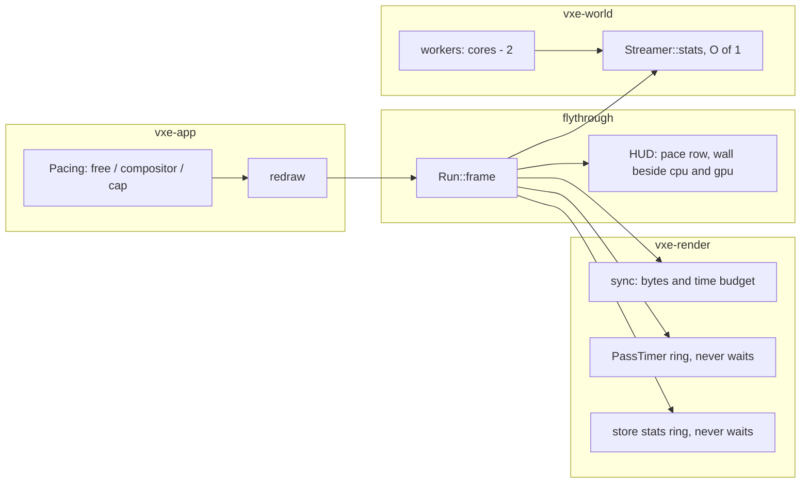

# 0064: The window's frame: what paces it, workers that leave no core, and readbacks that wait

> **Status:** done (closed 2026-11-11, v0.46.0). Verdict: clean; free pacing is the default and
> reads below the compositor's in every windowed cell, the frame path waits on the GPU nowhere,
> and the sync's time budget stays off because no budget kept residency (the plan's rule).
> Amended 2026-11-11 (owner): Phase 4b fixes the sync's time budget before the close review;
> Phase 5's windowed reading taken at the RTX only, the Radeon's window recorded as unread
> **Created:** 2026-11-10
> **Milestone:** cross-cutting (code health), like [Plan 0044](../0044-hot-path-and-defect-pass.md).
> It serves `docs/nfr.md` section 2's frame and section 5's streaming line.
> **Related ADRs:** none yet. Phase 1 is a spike; if its reading makes the pacing a trade
> (frames the compositor never shows against a frame of latency), the architect writes the ADR
> before Phase 2 starts.
> **Source:** the owner, 2026-11-10: "I'm a bit afraid that we have avg 30-50 fps on my machine
> with no load and very little details/effects". A static review of the tree at `50b637a`
> followed. **The owner asked for no load tests, so every figure in this plan is an estimate
> from reading the code and the readings already on record; Phase 1 takes the first reading.**
> **Starts after:** Phases 1 and 2 touch `crates/vxe-app/src/shell.rs` and the fly-through's
> flag table only and may run beside Plan 0060. Phases 3 to 5 edit `marcher.rs`, `main.rs`,
> `hud.rs` and `gpu_world.rs` and start on main after Plan 0060 merges (owner, 2026-11-10;
> `docs/plans/README.md`, Sequence). **If Phase 1 reads free pacing no better than the
> compositor's, the plan stops there and Plan 0065 does not start** until the architect has
> read the windowed figures: the window then has another cause.

## TL;DR

The recorded GPU frame is 7.5 to 12 ms at the owner's window, yet the window shows 30 to 50
fps. The review's reading of the code says the window is not bound by rendering: the shell
asks the compositor for a frame callback on every present, so a frame's CPU work starts only
after the frame before it was shown, and CPU and GPU run one after the other. On top of that
the HUD waits on the GPU every frame, a stdout line waits on it once a second, and the
streamer's workers take every core but one.

This plan first **measures** what paces the window (Phase 1), then removes each wait the
reading confirms. The first thing the owner sees: a `pace` row in the HUD that names the
pacing mode and shows the wall time of a frame beside its CPU and GPU time, so the gap is on
screen.

## Context & problem

Each item was read in the source at `50b637a`. Lines are for orientation; `dev` re-reads each
at the phase's start commit.

- **The frame callback gates the next frame.** `Shell::redraw` (`crates/vxe-app/src/shell.rs`)
  calls `window.pre_present_notify()` before every present. In winit 0.30.13 on Wayland that
  requests a `wl_surface.frame` callback, and the event loop returns no `RedrawRequested`
  while one is outstanding (`platform_impl/linux/wayland/event_loop/mod.rs`, the
  `FrameCallbackState::Requested` test). `Pacing::Unthrottled` with `AutoNoVsync` therefore
  does not do what `ShellConfig`'s doc says: frame N+1 starts after the compositor showed
  frame N. The frame's wall time is the sum of CPU and GPU, rounded up to the display's
  refresh (6.06 ms at the dev box's 165 Hz), not the larger of the two. **Arithmetic from the
  readings on record, not a reading:** 4 to 5 ms of CPU plus 7.5 to 12 ms of GPU plus the
  bake's 1.5 ms slice is 13 to 19 ms, which rounds up to 18.2 or 24.2 ms: 41 to 55 fps.
- **The dev box presents across two GPUs.** The panel hangs off the AMD iGPU and Hyprland
  composites there; the RTX has no connected output. Each presented frame crosses to the
  iGPU. That is the machine, not the engine, but it lengthens the wait above and belongs in
  every windowed reading's label.
- **The HUD waits on the GPU every frame** while it shows: `PassTimer::read_all_ms` and two
  `read_ms` calls map and then `poll(wait_indefinitely())`. This is Plan 0044's Phase 2, moved
  here whole (see "Decision").
- **A stdout line waits on the GPU once a second**, HUD or not: `read_store_stats` in the
  fly-through's queue line submits, maps and waits.
- **The streamer's workers take every core but one.** The fly-through sets
  `available_parallelism - 1` workers (15 on the dev box). With the main thread spinning on
  `ControlFlow::Poll`, no core is left for the compositor or the driver's threads while chunks
  generate. **Suspected** as part of the streaming line's p99 of 45 to 84 ms; not measured.
- **The mirror's upload is bounded by bytes, not time.** `GpuWorld::sync` uploads up to
  `SYNC_BUDGET_MIB` of packed bricks on the render thread; the time that takes is unbounded.
  `docs/nfr/02-frame-budget.md` reads the sync as most of the streaming CPU. Plan 0044's
  Phase 4 removes a duplicate sizing call and does not bound the time.
- **`Streamer::stats` walks every resident chunk** to count the full ones, and the frame
  calls it three times, two of them only for `ticks`.

## Decision

Measure first, then fix what the reading confirms, in the shell and on the frame's CPU path.
No pixel changes: every golden stays byte-identical.

- **Pacing.** `Pacing::Unthrottled` becomes what its doc says: no frame callback is requested,
  so a frame starts as soon as the loop is idle. Pacing by the compositor stays available as
  its own named mode, and the fly-through's default is whichever the owner picks in the window
  (Phase 2). We rejected **keeping the callback and starting the next frame's CPU work
  early**: it hides the serialisation by rendering a frame ahead, which adds a frame of
  latency to input and to an edit's appearance.
- **Plan 0044's Phase 2 moves here.** It touches `PassTimer` and three call sites, claims no
  golden, and its fix is worth little while it sits behind three plans. Plan 0044 keeps its
  other phases.
- **Workers default to two fewer than the logical cores**, kept only if Phase 4's reading
  shows the frame's p99 lower with residency no worse. We rejected **lowering the workers'
  priority**: it needs a per-platform call and a dependency or `unsafe`.
- **The sync gets a time budget beside its byte budget.** We rejected **packing slot words on
  the workers** here: it moves the mirror's format knowledge across a thread boundary and
  wants its own plan (`docs/backlog.md`).

## Architecture diagram



## Implementation phases

Every phase gates on `node scripts/test-changed.mjs --profile quick`, plus `--profile gpu`
under the perf lock when it touches `vxe-render`; the tip gates on
`cargo nextest run --profile gate`. Readings run under the perf lock and name the machine,
the commit, the 1-minute load, the granted present mode and the display's refresh. A windowed
reading on the dev box also says "RTX rendering, iGPU compositing".

### Phase 1: What paces the window (a spike)
- **Owner skill:** dev
- **What:** the `frames:` summary and the HUD gain the wall time between frames beside the
  frame's CPU and GPU time, and the shell logs the present mode the surface was granted. A
  `--pace free|compositor` flag selects whether `pre_present_notify` is called. Both arms are
  read in a window.
- **Files touched:** `crates/vxe-app/src/shell.rs`, `apps/flythrough/src/main.rs`, `hud.rs`,
  `lib.rs`, `docs/plans/logs/0064.md` (new).
- **Done when:**
  - A shell unit test (no window, under 1 s) asserts `Pacing`'s new mode maps to "no frame
    callback" and the old behaviour to its own named mode, and the flag parses both words.
  - The HUD's `pace` row shows the mode and `wall / cpu / gpu` in ms; `a_shown_hud_names_the_pace`
    (CPU only, under 1 s) asserts the row's text for both modes.
  - The log holds, for each arm, at the level's spawn and the showcase start, HUD hidden and
    shown, wall p50 and p99 beside CPU and GPU p50, three runs each. **The reading decides
    Phase 2:** if `free` reads no better than `compositor` within the spread, the log says so,
    Phase 2 is struck and the plan goes back to the architect with the reading.

### Phase 2: The pacing the reading supports, as the default
- **Owner skill:** human
- **What:** the owner flies both modes in the window and picks the fly-through's default.
  `dev` then sets it and keeps the other mode behind the flag.
- **Files touched:** `apps/flythrough/src/main.rs`, `crates/vxe-app/src/shell.rs` (the doc of
  `ShellConfig` and `Pacing`), `docs/plans/logs/0064.md`.
- **Done when:** the log has the owner's words on both modes (smoothness, tearing, fan noise),
  the default equals the pick, and the banner names the mode on a plain start.

### Phase 3: Nothing on the frame waits for the GPU
- **Owner skill:** dev
- **What:** Plan 0044's Phase 2 as written there (a ring of 3 query sets, `try_read_all_ms`,
  the two `read_ms` timers in the same form, `LightingRow` reused, the HUD allocation test
  covering `refresh_hud_stats` and the banner). The queue line's `read_store_stats` gets the
  same ring and prints the newest finished set.
- **Files touched:** `crates/vxe-render/src/marcher.rs`, `apps/flythrough/src/main.rs`,
  `hud.rs`, `crates/vxe-render/tests/gpu_frame.rs` or a new `tests/gpu_*.rs` file.
- **Done when:**
  - Plan 0044 Phase 2's three done-whens hold as written there.
  - A counter of blocking polls on the frame path reads **0 over 300 frames** of a headless
    run with the HUD on and the queue line due at least once (lavapipe, about 10 s, an
    estimate). Before the fix it reads at least 601: two a frame and one for the line.
  - The queue line prints the same fields; its `missing` figure may be up to 2 frames old,
    which the line says.

### Phase 4: The frame's CPU: workers, the sync's time, the stats
- **Owner skill:** dev
- **What:**
  - The fly-through's default worker count is `available_parallelism - 2`, at least 1, behind
    a `--workers N` flag.
  - `GpuWorld::sync` takes a time budget beside the byte budget and stops selecting uploads
    when either is spent; what it leaves is first in the next sync. The default is 2 ms, a
    proposal Phase 5 reads.
  - `Streamer` keeps `resident_full` as a counter and exposes `ticks()`; the frame calls
    `stats()` once.
- **Files touched:** `apps/flythrough/src/main.rs`, `lib.rs`,
  `crates/vxe-render/src/gpu_world.rs`, `crates/vxe-render/tests/gpu_mirror.rs`,
  `crates/vxe-world/src/stream.rs`, `crates/vxe-world/tests/` (the streaming test file).
- **Done when:**
  - `stats_counts_match_a_walk` (CPU, under 2 s): after a seeded flight of load, demote and
    evict steps, `stats().resident_full` equals a count over the resident map at every step.
  - `a_sync_stops_at_its_time_budget` (lavapipe, about 5 s, an estimate): with a clock the
    test supplies that advances a fixed step per uploaded chunk, a sync of 64 pending chunks
    under a budget of 8 steps uploads exactly 8 and defers 56, and the next sync starts with
    the 9th. With the budget unset the same sync uploads all 64, and the slot words are
    byte-identical in both orders (the existing `a_slot_holds_the_packed_brick_s_own_words`).
  - The world's pinned hashes and every golden are unchanged: neither the worker count nor
    the budget changes a voxel.
  - The autopilot of `docs/nfr.md` section 5's protocol is read at 15 and at 14 workers,
    three alternated rounds: frame CPU p99, streaming CPU p50 and p99, residency p95. The 14
    default is kept only if p99 is lower and residency p95 is within the spread; otherwise it
    is reverted and the log says so.

### Phase 4b: A time budget that bounds the whole sync
- **Owner skill:** dev
- **Amended 2026-11-11 (owner).** Phase 4's time budget made residency p95 8.2 to 8.8 s against
  261 to 301 ms without it (RTX, the autopilot; readings log, Phase 4), and 2, 4 and 8 ms all
  missed. Read in the code: `select` sizes chunks up to the byte budget before `upload` reads the
  clock, and the deferred chunks are sized again at every later sync, so the budget bounds only
  the upload's tail and the work left grows. Phase 4 set the default to no budget; the owner
  chose to fix the mechanism in this plan rather than leave it off or drop it.
- **What:**
  - The time budget bounds the whole sync: selection reads the clock too, and stops sizing
    once the budget is spent, not only once the byte budget is.
  - A chunk sized and then deferred is not sized again: its size (or its packed words) is kept
    with it until it uploads or its chunk changes (an edit, a demotion, an eviction drops it).
  - The default is the smallest budget that meets the done-when's residency rule, read from a
    sweep; if none does, the default stays no budget and the log says why.
- **Files touched:** `crates/vxe-render/src/gpu_world.rs`, `crates/vxe-render/tests/gpu_mirror.rs`,
  `apps/flythrough/src/main.rs` (the default), `docs/plans/logs/0064.md`.
- **Done when:**
  - `a_sync_stops_at_its_time_budget` also holds when the test's clock advances in selection:
    a sync whose budget is spent while sizing uploads what it has sized within the budget and
    defers the rest, and the deferred chunks are not sized again at the next sync (a counter
    the test reads). The slot words stay byte-identical to an unbudgeted sync.
  - A chunk edited while deferred uploads its edited words, not the kept ones (a test).
  - The world's pinned hashes and every golden are unchanged.
  - The autopilot of `docs/nfr.md` section 5's protocol, RTX, three alternated rounds against no
    budget, at 2, 4 and 8 ms: residency p95 within the no-budget arm's spread plus 10 % (a
    proposal), and streaming CPU p99 and frame CPU p99 read. The default is the smallest budget
    that meets the residency rule and lowers streaming p99 outside the spread; otherwise none.

### Phase 5: The close's readings
- **Owner skill:** dev
- **What:** the readings of "Budgets", headless and windowed, into `docs/nfr/02-frame-budget.md`
  and the log.
- **Files touched:** `docs/plans/logs/0064.md`, `docs/nfr/02-frame-budget.md`, `docs/nfr.md`
  (section 5's residency line, if it moved).
- **Done when:** every row of "Budgets" has a before (Phase 1's start commit) and an after,
  on both adapters where the row is a GPU or frame figure. Amended 2026-11-11 (owner): the
  window's wall-frame row is read on the RTX only (the owner's session at the tip,
  `live/session64b.sh`); the Radeon's window is recorded as unread. Phase 4b's readings refresh
  the streaming and residency rows if its default is a budget.

## Data shapes

```rust
// illustrative
pub enum Pacing {
    /// No frame callback: a frame starts when the loop is idle.
    Unthrottled,
    /// A frame starts after the compositor showed the last one.
    Compositor,
    Cap { hz: u32 },
}

pub struct SyncBudget {
    pub bytes: u64,
    pub time: Option<Duration>,
}
```

## Budgets

| `nfr.md` figure | Base | Expected | How the close measures it |
|---|---|---|---|
| The window's wall frame (no line today) | Phase 1's `compositor` arm | **an estimate:** wall p50 near the larger of CPU and GPU instead of their sum | the windowed runs of Phase 1, both modes, HUD hidden and shown |
| §2 streaming line, 1.0 ms: frame CPU p50 3.4 to 4.2 ms, p99 45.9 to 83.6 ms (Plan 0059's fix pass) | the start commit's reading | **guesses:** p99 under 10 ms with the time budget; p50 lower by 0.2 to 0.5 ms from the stats; the line stays missed at p50 | the autopilot of section 5's protocol, three alternated rounds |
| §5 residency p95, 500 ms (314 to 354 ms on record) | the start commit's reading | no worse than the spread; a time budget and one worker fewer can only slow it, so this is the bar that can fail | the same runs |

## Risks & open questions

- **The reading may refute the headline.** The winit gate is read in the source; its effect on
  this compositor with this driver is not. Phase 1 exists for that, and Phase 2 is struck if
  it reads no better.
- **A free-running window draws frames nobody sees** and runs the GPU and the fans flat out.
  The `Cap` mode exists for that; the owner's pick in Phase 2 covers it.
- **Tearing.** `AutoNoVsync` may be granted `Immediate`. Phase 1 logs what was granted.
- **A time budget slows residency under load.** It is the row of "Budgets" that can fail;
  the remedy is a larger budget, read, not a guess.
- **Determinism:** untouched. `vxe-world` reads no clock; the time budget is in `vxe-render`
  and the test supplies its clock. The worker count changes the order chunks arrive in, never
  their content.
- **Threading:** `Streamer::stats` stops taking the workers' queue lock twice a frame; no new
  lock is added.

## What this plan does NOT do

- Shader work: the baked light's waste is [Plan 0065](../0065-the-baked-lights-waste-atomics-a-filter-of-zeros-and-a-scan-per-frame.md).
- Plan 0044's other phases (bind groups, the sync's sizing, the march's inner loop).
- Packing slot words on the workers, or any change to the mirror's format (`docs/backlog.md`).
- Anything about the dev box's two-GPU present path; it is recorded as a label on readings.
- A budget line for the bake's slice and the queue's step (`docs/backlog.md`).

## Implementation log

> Written by `dev`: one row per phase as its commit lands, then the close block. Readings,
> attempts and resume notes go to `docs/plans/logs/0064.md`.

| phase | owner | state | commit |
|---|---|---|---|
| 1: what paces the window | dev | done: code (flag, present-mode log, HUD `pace` row, `frames:` wall, 3 CPU tests) and the owner's 24 windowed runs, `free` below `compositor` in every cell, Phase 2 stands; see [the readings log](../logs/0064.md) | fc05003 (code), de791ba (readings) |
| 2: the pacing default | human | done: owner's window 2026-11-11, pick `free` (flights loaded by other lanes' builds; no tearing or fan difference noticed, loaded); `--pace` defaults to `free`, the banner's `pace` row names it on a plain start; see [the readings log](../logs/0064.md) | 7b6e3ea, aa4ee55 (readings), 0248b41 (default and banner) |
| 3: nothing waits for the GPU | dev | code done: `ReadbackRing` (3 read-back buffers) under `PassTimer` and the store's counters, `try_read_all_ms` / `try_read_ms` / `Frame::try_store_stats` on the frame path, blocking-read counters on the `frames:` line (608 before, 0 after over 300 lavapipe frames), the HUD's refresh and banner allocation-free (4749 B a frame before, 0 after); deviations: one query set and one resolve buffer serve the ring, `--lamp-toggle` and `--fade-reading` keep the waiting read; autopilot HUD on/off readings on both adapters in the log; see [the readings log](../logs/0064.md) | 373beb9, 284cbd9 (readings) |
| 4: workers, the sync's time, the stats | dev | done: `resident_full` counter and `ticks()`, `stats()` once a frame, `sync_budget_time` with a test clock, `--workers N`, `--sync-ms MS`, 4 new tests; 14 against 15 workers read (RTX, three rounds, at 2 ms and at none): p99 not lower, **default reverted to cores - 1**; deviation: `--sync-ms` defaults to none, not 2 ms (residency p95 3.0 to 13.7 s at 2, 4 and 8 ms against 0.26 to 0.30 s at none); see [the readings log](../logs/0064.md) | a9298c6 |
| 4b: a time budget over the whole sync | dev | done: selection reads the clock (`SyncPoint`) and stops sizing once the budget is spent; a sized chunk keeps its size (`Sizing`) until it uploads or changes; `SyncStats::sized_chunks` / `kept_sizes`; 2 new tests, 1 extended; sweep (RTX, three rounds, loaded): residency p95 2.7 to 6.9 s at 2, 4 and 8 ms against 297 to 303 ms at none, **default stays none** by the plan's rule; see [the readings log](../logs/0064.md) | 00731f9 |
| 5: the close's readings | dev | done: headless before (37f6845), main merged (f8c1ffc) and after (a9298c6) on the RTX 3080 Laptop and RADV RENOIR, three rounds, into the log and `docs/nfr/02-frame-budget.md`; the window's after read on the RTX at 2552989 (the owner's session, `live/session64c.log`, 8 runs, HUD shown, two rounds), the RENOIR's window recorded as unread (owner, 2026-11-11); `docs/nfr.md` section 5 not edited (residency did not move out of the line on record); see [the readings log](../logs/0064.md) | 4a6f8d8, 9a93156 (window) |

### Notes

- Phase 3 deviations: one query set and one resolve buffer serve the 3-buffer read-back ring
  (not 3 query sets); `--lamp-toggle`, `--fade-reading` and `--read-missing` keep their waiting
  reads (373beb9).
- Phase 4 deviation: `--sync-ms` defaults to none, not the plan's 2 ms; residency p95 read 3.0
  to 13.7 s at 2, 4 and 8 ms against 0.26 to 0.30 s at none (a9298c6). `select` sizes chunks up
  to the byte budget before `upload` reads the clock, and the time-deferred chunks are sized
  again in the next sync.
- Phase 4: the 14-worker default is reverted to cores - 1 by the plan's rule (a9298c6).
- Phase 4b: `SyncClock` takes the point it is read at (`SyncPoint`), so a test advances it for
  selection or upload alone. A sync whose selection spent the budget writes one chunk; the
  first done-when is read that way. Kept are sizes, not packed words. No budget met the
  residency rule (2.7 to 6.9 s against 0.30 s); `--sync-ms` stays none, and Phase 5's
  streaming and residency rows are not refreshed.
- Phase 5: the window's after is the owner's session at 2552989 from `live/session64c.sh`, not
  the done-when's `live/session64b.sh` (overwritten; its 15:33 runs discarded by the owner, the
  window partly out of focus); two rounds, HUD shown only; the RADV RENOIR's window unread
  (owner, 2026-11-11).
- Phase 2's tearing and fan words were given under load ("no difference noticed, loaded").
- `a_shown_hud_and_the_queue_line_wait_on_the_gpu_nowhere` marked `#[ignore = "soak"]` (12.3 s
  alone on lavapipe; 98f1a2a): Phase 3's 0-blocking-reads done-when runs in no gate.
- Noticed, not acted on: five other gpu tests and two CPU tests read over 10 s in the tip's gate
  run (named in the readings log, Gate at the tip).

### Close triggers

- **What shipped:** `vxe_app::Pacing::Compositor` beside `Unthrottled` (no frame callback) and
  the present-mode log; the fly-through's `--pace free|compositor` (default `free`), the HUD's
  `pace` row and the `frames:` wall time; `ReadbackRing` under `PassTimer` and the store's
  counters with `try_read_all_ms` / `try_read_ms` / `Frame::try_store_stats`, a blocking-read
  counter; an allocation-free HUD refresh and banner; `Streamer::ticks()` and a kept
  `resident_full`; `MirrorConfig::sync_budget_time` with `SyncClock`, bounding selection and
  upload, and kept sizes for deferred chunks; `--workers N`, `--sync-ms MS` (default none).
- **Public API changed:** `vxe_app::Pacing::Compositor`, `Pacing::frame_callback`;
  `vxe_render::marcher::ReadbackRing`, `PassTimer::try_read_all_ms`, `try_read_ms`,
  `blocking_reads`, `Frame::copy_store_stats`, `try_store_stats`, `store_blocking_reads`;
  `vxe_render::SyncClock` (takes a `SyncPoint`), `vxe_render::SyncPoint`,
  `GpuWorld::set_sync_clock`, `MirrorConfig::sync_budget_time`,
  `SyncStats::time_deferred_chunks`, `sized_chunks`, `kept_sizes`; `vxe_world::Streamer::ticks`.
- **Budget readings:** windowed RTX (Phase 1, 24 runs): wall p50 `compositor` 13.0 to 17.2 ms,
  `free` 10.6 to 13.5. Blocking reads over 300 lavapipe frames 608 before, 0 after. Headless
  autopilot (`--seed 1`, 1280 x 720, loaded 5 to 13), base 37f6845 against tip a9298c6: RTX
  3080 Laptop frame CPU p99 71 to 105 against 69 to 105 ms, streaming p99 50 to 84 against 45
  to 81, residency p95 302 to 341 against 301 to 338 ms; RADV RENOIR frame CPU p99 57 to 61
  against 58 to 59, streaming p50 2.66 to 2.71 against 2.61 to 2.62, residency p95 304 to 310
  against 302 to 304 ms. Workers 14 against 15 (RTX): frame CPU p99 62.5 to 65.4 against 63.5
  to 66.0 ms. Phase 4b's sync time budget (RTX, three rounds, loaded 7.6 to 11.6): residency
  p95 at none 297 to 303 ms, at 2 ms 6590 to 6867, 4 ms 3787 to 4120, 8 ms 2664 to 2775;
  streaming p99 none 44.5 to 48.6, 2 ms 31.5 to 31.6, 4 ms 38.9 to 41.9, 8 ms 92.4 to 125.4.
  Windowed RTX at the tip (2552989, 8 runs, HUD shown, load 1.2 to 1.8) against
  Phase 1's HUD-shown cells: wall p50 `free` level 11.235 to 11.270 against 11.682 to 11.775,
  showcase 12.194 to 12.273 against 13.360 to 13.484; `compositor` level 14.927 to 15.011
  against 13.745 to 14.141, showcase 18.022 to 18.184 against 16.766 to 17.230; blocking reads
  0 in every run. Rows in [the readings log](../logs/0064.md).
- **Gate at the tip:** `cargo nextest run --workspace --profile gate` at 00731f9 (lavapipe for
  the gpu binaries, exclusive perf lock, 16G cap, `scripts/build-guests.sh` first, 1-minute load
  5.6 at the start and 1.9 at the end): 725 run, 725 passed, 102 skipped, 554.3 s, exit 0.
  Doctests passed; clippy, fmt, `cargo deny check`, doc links, comment hygiene, index rows,
  plan size, test tiers: exit 0.
- **Outstanding `human` phases:** none; the RADV RENOIR's window is recorded as unread (owner,
  2026-11-11).

## Followups

- An open reading (the owner, 2026-11-11): the window's frame rate differs a lot with its
  workspace in or out of focus. Expected for `compositor` pacing (Hyprland throttles frame
  callbacks for a hidden window); whether it also moves `free` pacing is not isolated.
  Parked in `docs/backlog.md` ("The window's frame rate out of focus").
- **The window's frame CPU doubled between Phase 1 and the tip** (1.5 to 2.4 ms p50 against
  3.8 to 4.5). Close review, 2026-11-11: it is the live queue's step at rest, Plan 0060's,
  which Plan 0067 owns, not this plan's code. In `live/session64.log` (Phase 1, before 0060)
  the queue keeps baking through every run and its step reads 0.43 to 1.21 ms p50 a line; in
  `live/session64c.log` (the tip) the queue empties after 5 to 10 s (`baked +0`, `jobs 1`)
  and the step reads 2.84 to 3.56 ms p50 on every such line (79 lines), about the 2 to 2.5 ms
  of the rise. The lane's own suspects cannot carry it: the ring's reads run after the frame
  CPU's timestamp is taken, the store copy is one buffer copy, `stats()` walks less than
  before, and the headless autopilot reads the same frame CPU at `f8c1ffc` (main merged,
  before Phases 3 and 4) and at `a9298c6`.
- **Phase 3's 0-blocking-reads done-when runs in the soak tier only**
  (`a_shown_hud_and_the_queue_line_wait_on_the_gpu_nowhere`, 12.3 s); the gate defends the
  ring itself (`the_frame_s_timers_and_store_counts_read_back_without_waiting`), not the
  fly-through's wiring. The close review ran it once at 72ff4cb: pass, `blocking reads 0`.
  A cheaper variant under the 10 s line is parked in `docs/backlog.md`.
- **The sync's time budget left residency short** (2.7 to 6.9 s p95 at 2 to 8 ms against
  0.30 s without): about 0.3 ms of render-thread time a chunk. The cheaper upload it needs is
  the backlog's "Slot words packed on the workers", now with this reading.
- `ReadbackRing` lives in `marcher.rs`; `readback.rs` is its natural home, for Plan 0045.
