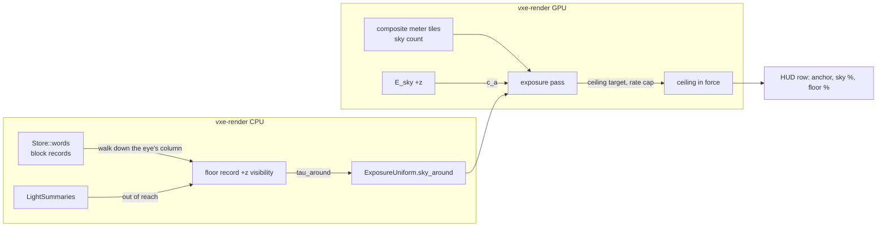

# 0097: The exposure's anchor by the sky around the camera: the floor record under the eye, a time constant, and the canopy's shade kept in daylight

> **Status:** done, closed 2026-11-23, v0.70.0: the close review of 2026-11-22 sent two majors back (a soak test the lift broke, highlight protection with no asserting GPU test), the fix pass met both and the review is clean; the gate 1316 of 1316 on lavapipe (lane plan-0097 from main 123964e7, 2026-11-21). **Amended 2026-11-22
> (owner), window 97b: the lift, Phases 3b and 3c (dark places stay dark; ADR-0081 amended).**
> **Amended 2026-11-22 by the architect at window 97c's verdicts (the owner: "1a looks great", the
> lift stays 4): Phase 3b's bars 2 and 3 restated, Phase 3d added (the exposure's step just after a
> stop, from the 0098 lane's reading).**
> **Amended 2026-11-22 (architect; owner confirmed 2026-11-22): Phase 3d closes as not reproduced at the
> tip (the eye moves 0 EV across the stop; no fix), its invariant test stays as a guard; the near
> jumps read with the exposure constant are routed to Plan 0098.**
> Approved 2026-11-20 (the owner's picks at window W2, all as recommended: the
> anchor by the sky around the camera's position, a small plan of its own, the slope's step
> lines to the backlog). **The lane starts after Plan 0095 closes and merges** (owner's
> order, 2026-11-20).
> **Created:** 2026-11-20
> **Milestone:** M10: Outdoors in [`docs/roadmap.md`](../../roadmap.md); Plan 0094's exposure
> follow-up.
> **Related ADRs:** [ADR-0081](../../adrs/0081-the-sky-anchor-holds-by-the-sky-over-the-cameras-floor-or-in-view-and-releases-where-both-are-absent.md)
> (proposed with this plan: the anchor holds by the sky over the camera's floor or in view,
> releases where both are absent); it rests on
> [ADR-0033](../../adrs/0033-eye-adaptation-as-an-asymmetric-two-stage-exposure-on-the-gpu.md)
> (the exposure model and its `[min, max]`),
> [ADR-0070](../../adrs/0070-sky-light-is-baked-visibility-coloured-at-read-with-a-long-history-ray-where-stale.md)
> (the baked sky visibility per record, the source it reads) and
> [ADR-0076](../../adrs/0076-light-stability-rules-world-history-per-source-a-fade-per-transition-and-a-ratcheted-pop-counter.md)
> rule 5 (the ceiling moves under the rate cap and follows the surroundings; its clause of this
> date points at ADR-0081) and rule 6 (the coarse stable answer first).

## TL;DR

At window W2 (2026-11-20, the forest at `--sun 10,180`) the owner reached a deep-shade spot and
read it "too bright": Plan 0094 Phase 7b anchors the exposure's ceiling by the share of **sky
in view**, so one canopy closing over the last sky pixel releases the ceiling from -4.34 EV
toward +2 and the floor washes to pale mint, about 5 EV on one leaf. This plan anchors by the
**sky around the camera** instead: the `+z` sky visibility of the baked record of the floor
under the eye (ADR-0070's 256-ray hemisphere fraction, already on the CPU in the store's
block words), smoothed by a time constant, combined with the in-view share by the larger of
the two so every scene Phase 7b held stays bit for bit; a tunnel or cave, whose floor sees no
sky, still releases to `max`, and the night stays at +2 EV under Phase 8a's clamp. Phase 1
reads the measure at the two W2 spots and the tunnel before the threshold is pinned; Phase 2
builds it; the owner's window judges the forest, the noon tunnel and the owed open hills at
midnight; Phase 4 writes the picks as tests. The first thing a reader sees is Phase 1's table:
the floor's hemisphere share at the shade spot against the 1 %-sky spot and the deep tunnel.

## Context & problem

**The HUD at W2** (the owner flying the forest at `--sun 10,180`, both arms of Plan 0095's
spike, so Plan 0094's exposure): at x 237.4 y 642.8 z 596.7 with 1 % of the view sky, `ceiling
-4.34 EV`, `eye -4.34`, the floor right; at x 367.4 y 690.8 z 569.4 with 0 % sky, the ceiling
releasing toward `max` (+1.38 EV and climbing to +2), `eye -0.86` against `scene -1.8`, the
floor pale mint. The two spots are about 14 m apart under one canopy. Phase 7b's ceiling target
is `c_a` at a share of `F` = 1/256 and over, `max` at 0, log2-linear between (`AutoExposure::
ceiling_target`, `exposure.wgsl`'s `ceiling_target`); the forest floor meters between 1/256
and 1/128 of sky at the readings' poses (`docs/plans/logs/0094.md`, Phase 7b bar 1: "a thin
margin, the measure's arm (c) case"), so a leaf decides it.

**The owner's rules, binding here:** the exposure follows the surroundings, not the time of day
(window 94b); stable over precise; no waiting for light to settle. **The verdicts that must
hold:** "noon tunnel all good" (94c run 1: deep in the tunnel at noon the ceiling releases to
`max` and the lamp-lit walls meter themselves), and the night held at +2 EV (94c's 2b, Phase
8a: `c_a >= max` is `max` at every share).

**The sources in `vxe-render`** (read for ADR-0081): the brick records' per-face sky
visibility (`bake/record.rs`, `record_visibility`, `VIS_BAKED`, `SKY_STALE`; the store keeps
every block's words on the CPU in `Store::words`), the chunk summaries (`bake/summary.rs`,
`LightSummaries::summary`, a record per chunk with the faces' mean visibility per direction),
the column map (`gpu_world/columns.rs`, the highest opaque voxel per 2-voxel column) and
`E_sky` (`sky_irradiance.wgsl`, the unoccluded sky's irradiance per axis: the anchor's level,
no visibility). ADR-0081 picks the floor record under the eye, with the own chunk summary as
the fallback out of reach, and names the rest.

**Budgets touched** (`docs/nfr.md` section 2): the exposure pass (0.035 ms on the RTX at
rest, `docs/nfr/02-frame-budget.md`), the render thread's frame CPU; no VRAM (the uniform's
spare word).

## Decision

The anchor holds by `s = max(f_sky / F, f_floor / F_floor)`: the ceiling's target is `log2 c =
mix(log2 max, log2 c_a, min(s, 1))`, the ceiling in force steps toward it under the rate cap as
today. `f_floor` is the `+z` visibility of the first baked record with a `+z` face in the brick
column under the eye, within `AROUND_REACH` cells; the camera's own chunk summary's `+z`
visibility out of reach; absent (the term drops, Phase 7b's behaviour) where neither exists.
It is smoothed on the CPU at `tau_around` before it enters the uniform. A stale record answers
with its old value. `F_floor` 0 is the before. We rejected the hits' baked visibility
(view-dependent), the chunk summaries' spatial mean (reads through rock: a shallow tunnel
anchors), the column map's footprint (a vertical line, not a hemisphere), camera rays (a new
ray source where a baked hemisphere exists; the fallback arm) and a hysteresis pair (a step
where the rules want fades): ADR-0081.

**Amended 2026-11-22 (owner), window 97b: the release is bounded by a lift.** The release's
top is no longer `max` but `c_top = min(max, c_a 2^L)`, `L` the **lift** in EV
(`AutoExposure::sky_anchor_lift`, `DEFAULT_SKY_ANCHOR_LIFT` 4, a guess the window reads; `None`
is the before): `log2 c = mix(log2 c_top, log2 c_a, min(s, 1))` with `s` as above. By day the
eye opens at most `L` EV over the daylight anchor wherever it stands, so a place the daylight
reaches only through a crack shows dark against the daylight it is cut from; the two shares
still decide where between `c_a` and `c_top` the target sits, the ceiling in force still steps
under the rate cap, and the night (`c_a >= max`) is untouched. The reason for 4: the pupil's 2
to 8 mm is 16 times, the fast part of adaptation; the rods' twenty minutes are not a game's
daytime eye. Rejected: a slope in the floor's share (the local daylight followed in part: the
deep lamp tunnel brighter than the sky-lit middle, which the owner read as overexposed at window
97, and a step at the record's last quantum), a slow release rate (a look that depends on how
long the owner stood there), a lower `N` or a lower day `max` (both darken the W2 shade, a bar):
ADR-0081's amendment of this date.

## Architecture diagram



## Implementation phases

Each phase ships as its own commit; `dev` runs them in one session, the architect reviews once
in a fresh session. Phases 1 and 2 are exploration before the owner's window (lane rules 2b):
readings and CPU tests of data and API, no new image tests until Phase 4. Per-phase tests run
by `node scripts/test-changed.mjs --profile gpu --binaries <names>`; the whole gpu tier is the
tip's.

### Phase 1: The reading: the sky over the floor at the W2 spots, the tunnel, the mouth and the hills
- **Owner skill:** dev
- **What:** a CPU reader of the measure (`bake::sky_over_floor(store, eye) -> Option<(f32,
  Source)>`: the walk down the eye's brick column over the store's CPU block words, the own
  chunk summary out of reach, `Source` naming which answered) and a reading that prints it
  beside Phase 7b's in-view share, the metered level, the ceiling in force and the eye at the
  scenes that decide the threshold.
- **Files touched:** `crates/vxe-render/src/bake/summary.rs` (or a sibling `bake/around.rs`
  if `summary.rs` nears the cap), `bake/store.rs` (a `pub(crate)` record lookup by voxel over
  `words`, the same directory arithmetic `common.wgsl`'s record read uses), `bake/mod.rs`,
  `crates/vxe-render/tests/gpu_sun/` or `tests/rules.rs` (the CPU test),
  `apps/flythrough/tests/gpu_outdoor/ceiling.rs` (`reading::the_sky_over_the_floor`),
  `apps/flythrough/tests/support/terms.rs` (a forest rig generated about given voxel
  positions), `docs/plans/logs/0097.md`.
- **Done when:**
  1. **The reader is pinned on built records** (`the_floor_record_under_the_eye`, CPU, under
     1 s): on a `Store` whose CPU words hold hand-built blocks (`visibility_words`,
     `record_words`), an eye 17 voxels over a floor cell with a `+z` face at visibility 0.12
     reads `Some((0.12 within 1/255, Record))`; with that cell marked `SKY_STALE` the same
     value; with the floor's record missing and the chunk summary at 0.5, `Some((0.5,
     Summary))`; with the floor 9 cells down and no summary, `None`; a cell with faces but no
     `+z` face is walked past.
  2. **The table before the threshold** (`reading::the_sky_over_the_floor`, `gpu_outdoor.rs`,
     lavapipe, 160 x 90, the store baked by `support::bake_around` at radius 1 about each
     pose, 256 samples, 24 frames, a reset, 24 frames; under 60 s or soak; the RTX beside it by
     `VXE_TEST_ADAPTER`): at the W2 shade spot (eye x 367.4 y 690.8 z 569.4 voxels, the
     fly-through's `--source outdoor --trees forest --sun 10,180`; the rig generated about it
     from the same source and seed) and the W2 1 %-sky spot (x 237.4 y 642.8 z 596.7), both
     facing as the owner did (the HUD's yaw if in the W2 log, else along -x at pitch -10
     degrees), the tunnel's deep pose at noon with the lamp on (Phase 7b's), the tunnel 3 m
     inside the mouth facing in, the mouth from inside, the hills at noon facing away, the
     forest at 17:45: `f_floor` and its source, `f_sky`, metered, ceiling, eye. The table is in
     the log. `F_floor`'s default is the largest power-of-two fraction under both W2 spots'
     `f_floor` and over the deep tunnel's; the 3 m pose is read, not barred.
  3. **The stop rule:** if the shade spot's `f_floor` is 0 or under 2/255 (indistinguishable from
     the deep tunnel's at the `u8` quantum), or its source is `Summary`, the phase stops for
     the architect (ADR-0081 Alternative E, camera rays, is the arm built then), and Phase 2 is
     not started on the record.
  4. **The measure's cost** is printed: the walk's microseconds a frame on the RTX release
     (`bake::sky_over_floor` timed over 600 frames); under 20 us is the expectation, stated.

### Phase 2: The anchor by the floor's sky: the field, the time constant, the combined target, the HUD and the flag
- **Owner skill:** dev
- **What:** `AutoExposure` gains `sky_anchor_floor` (`F_floor`, the default from Phase 1; 0 is
  the before) and `sky_around_tau` (1 s); the frame computes `f_floor` each frame from the
  camera, smooths it (`f += (t - f) (1 - exp(-dt / tau))`, a `None` holding the last value and
  flagging absence after `tau` seconds without an answer), and writes it into the uniform's
  spare word (`_pad1` becomes `sky_around`, and a flag bit for absent); `ceiling_target` (Rust
  and WGSL) takes both shares and combines them by the larger normalised share; the HUD's
  exposure row shows it (`ceiling -4.34 EV (anchor 4, sky 1 %, floor 12 %)`), the fly-through's
  `--sky-anchor-floor X|off` and a settings row carry `F_floor`, the banner names it when not
  the default; `tau_around` is a settings row only.
- **Files touched:** `crates/vxe-render/src/exposure.rs`, `shaders/exposure.wgsl`,
  `shaders/common.wgsl` (if the state carries the readout), `frame/encode.rs`
  (`exposure_uniform`), `frame/mod.rs`, `frame/settings.rs` (two rows), `layout_tests.rs`,
  `crates/vxe-render/tests/gpu_exposure.rs`, `apps/flythrough/src/cli/outdoor.rs`,
  `cli/tests/outdoor.rs`, `hud/stats.rs`, `hud/modes.rs`, `docs/flythrough.md`,
  `docs/plans/logs/0097.md`.
- **Done when:**
  1. **The combined target** (`the_ceiling_target_follows_the_floor_too`, CPU, under 1 s,
     beside `the_ceiling_target_follows_the_sky_in_view`): at a day ground with `c_a` under
     `max`, `ceiling_target(ground, sky 0, floor F_floor)` is `c_a` exactly (`==`);
     `(sky F, floor 0)` is `c_a` exactly; `(0, 0)` is `max` within 1/256 EV; `(0, F_floor /
     2)` is `sqrt(c_a max)` within 1/256 EV; `(F / 2, F_floor / 2)` equals `(F / 2, 0)` (the
     larger share decides, both at a half); with `sky_anchor_floor` 0 every clause of the 7b
     test holds unchanged (the before); at a night ground (`c_a >= max`) `max` at every pair.
  2. **The time constant** (`the_floor_share_settles_at_tau`, CPU, under 1 s): a step of the
     floor's share from 0 to 0.5 at `dt` 1/60 and `tau` 1 reaches 0.5 (1 - 1/e) within 1/256
     at frame 60, monotonically; an absent answer holds the last value for 60 frames and reads
     absent at frame 61 (the term drops); `tau` 0 jumps.
  3. **The shade keeps the daylight** (`the_shade_under_the_canopy_keeps_the_anchor`,
     `gpu_outdoor.rs`, lavapipe 160 x 90, the two W2 poses on Phase 1's rig, baked at radius 1,
     the exposure settled; under 60 s, so soak; the RTX beside by `VXE_TEST_ADAPTER`): the
     settled eye at the shade spot is within 1 EV of the settled eye at the 1 %-sky spot (the
     before, printed: about 3.5 EV apart and climbing); both ceilings in force are within 1/64
     EV of `c_a`; with `sky_anchor_floor` 0 the shade spot releases (the before, asserted so
     the test sees its mechanism).
  4. **The noon tunnel and the night hold.** `the_tunnel_exposes_for_its_walls_by_day` (soak)
     passes unchanged: deep at noon `f_floor` is 0 (printed), the ceiling in force within 1/64
     EV of `max`, the eye the meter's; at midnight the ceiling and the eye within 1/64 EV of
     `max` (+2 EV); `reading::the_ceiling_by_hour` unchanged.
  5. **The open sky is byte-identical.** `outdoor_noon`, `outdoor_sunset`,
     `outdoor_forest_sunset`, `cave_mouth`, `outdoor_night`, `fsr2.png`, `upscaled.png` and the
     two profile goldens are byte-identical to the tip's bless in both arms (`sky_anchor_floor`
     default and 0), read before any bless; a moved pixel is a stop for the architect, not a
     bless. `the_ceiling_moves_at_the_rate` (`gpu_exposure.rs`) passes unchanged (its rig
     holds no baked record: the term is absent).
  6. **The flag and the rows.** `--check-args` accepts `--sky-anchor-floor`; the banner names
     `sky anchor floor X` when not the default and nothing when it is; the HUD row shows the
     floor share and `floor -` while absent; the two settings rows round-trip (Plan 0069's
     setter test lists them); `ExposureUniform` in `layout_tests.rs` (its size unchanged, the
     field named). **Cost:** 0 ms on the GPU by construction (one `max` and one `mix`), the
     walk's CPU as Phase 1 read it, stated.

### Phase 3: The owner's window
- **Owner skill:** human
- **What:** a windowed session on Linux, a `live/session97.sh` runner with the tip's binary and
  `live/bin94c` (or the tip of main before this plan) as the before, the fly-through's stdout
  visible, the HUD's exposure row on. Runs, in this order: (1) **the owed first run** from
  Plan 0094's Followups: the open hills at midnight (`--source outdoor --time 00:00`, the
  default spawn), a word on the moonlit level at +2 EV; (2) the forest at `--sun 10,180`, the
  owner's W2 path from the 1 %-sky spot into the deep shade and back, with the before beside
  it; (3) the forest at 15:00, the same path; (4) the noon tunnel with the lamp on, from the
  mouth to the deep pose and back (94c's "all good" as the bar); (5) the cave mouth from inside
  and out. The architect quotes the words into the log and routes any pick: `F_floor` and
  `tau_around` are settings, a wrong place for the measure (ADR-0081's Negative) is the stop
  for Alternative E.
- **Files touched:** `live/` (untracked), `docs/plans/logs/0097.md`.
- **Done when:** the owner's words per run are in the log; run (2) says the deep shade is no
  longer "too bright" against the before, or names what is wrong; run (4) still reads "all
  good" or names the change; run (1) has a word on the moonlit level.

- **Amended 2026-11-21 (owner), window 97 (`live/session97.log`), the owner's words:**
  (1) midnight hills: "night is good". (2) forest 10,180: "deep shade was better in new
  version"; "wobble is still there" (motion, not exposure; routed to the diagnosis window, not
  this plan). (3) forest 15:00: "fine". (4) noon tunnel, lamp on: "blue overexposure is back",
  the before "even worse", "it was better before" (tip: floor 2 %, ceiling +0.92, eye +0.92,
  scene -10.4 EV; before: ceiling and eye +2.00, scene -9.1 EV; the lit near walls clip). (5) cave
  mouth: "strange lines on brick edges" and distant trees' shadows changing with the camera still
  (routed to the diagnosis window). The floor term stays (F_floor 1/8). **The owner picked
  highlight protection for (4)** over a lower daytime ceiling: Phase 3a below.

### Phase 3a: Highlight protection: the eye never clips the view's bright tail
- **Owner skill:** dev
- **What:** The meter also reads a high percentile of the view's luminance (the brightest few
  percent; the dev reads 95th to 99th on the tunnel and picks, the log names it). The eye is
  capped so that percentile maps at or under a white point just below 1.0 after the tone curve:
  `eye <= ev_of(white) - ev_of(L_hi)`, then the ceiling and the rate as today. In a mostly dark
  view with lit walls the cap holds the walls under white; in a uniformly dark tunnel (no bright
  tail) it does nothing and the release to the ceiling stands. The percentile comes from the
  existing meter pass (a coarse histogram or a max of tile maxima, whichever the pass already
  affords), smoothed with the eye's own rate so it does not pump. A flag `--exposure-highlight
  P|off` and a HUD field (`hi -X EV`).
- **Done when:** (1) the noon tunnel at the window's pose (`live/session97.log` run 4) reads its
  near lit walls at or under the white point on the RTX headless, with the before (the cap off)
  printed. (2) The W2 shade spot, the night hills and the 15:00 forest keep their eye within 0.25
  EV of the Phase 2 tip (the cap is idle there, or the log names why not). (3) Every golden
  byte-identical in both arms or the moved ones named and judged at the next window.
  (4) `the_ceiling_moves_at_the_rate` unchanged. (5) A short window (tunnel, cave mouth, the
  forest at 10,180) closes it; the runner is built, the owner opens it.

- **Amended 2026-11-22 (owner), window 97b (`live/window97b/verdicts-orchestrator.md`, the
  stills beside it), the owner's words:** run 3, the forest at 10,180: "3a looks better"
  (the tip over the before). Run 2, the cave mouth: "before and after mostly same". Run 1, the
  noon tunnel with the lamp, on the tip at x 262.1 y 4.6 z 489.0: "we still have this part
  where there is blue light and it is very bright. such thing will never happen in real life.
  Should be much darker in this case" (HUD: scene -7.4 EV, eye -1.29 at the ceiling -1.29,
  anchor 4, sky 0 %, floor 5 %, `hi +0.51`: the cap is not binding); on the before at x 274.2
  y 1.2 z 482.5 "seems worse" (eye -0.43 at the ceiling, floor 3 %, scene -7.1). So the cap
  does its job (bar 1's clipping) and the complaint is the release itself: at 5 % of the floor's
  sky the target sits 5.5 EV over the daylight anchor. **The owner picked a rule that dark
  places stay dark** (how far the eye may lift a dark scene): Phases 3b and 3c below, then the
  close. **Routed out, not this plan's:** the tunnel's light leaks (a blinking sunlit wall at
  x 96.5 y 0.5 z 535.5 and a white patch deep in the tunnel, on both builds, with 0 coarse
  waiting in view); a separate diagnosis has them.

### Phase 3b: The lift: by day the eye opens at most `L` EV over the daylight anchor
- **Owner skill:** dev
- **What:** `AutoExposure` gains `sky_anchor_lift: Option<f32>` (`L` in EV;
  `DEFAULT_SKY_ANCHOR_LIFT` 4; `None` is the before). `ceiling_target` (Rust and WGSL) releases
  toward `c_top = min(max, c_a 2^L)` instead of `max`: `log2 c = mix(log2 c_top, log2 c_a,
  min(s, 1))`, `s` the larger normalised share as today; `step_ceiling`, the rate cap,
  `tau_around`, `F`, `F_floor`, the night clamp (`c_a >= max` is `max`) and the highlight cap
  are untouched. The uniform carries the lift (a word of its own or a factor; `layout_tests.rs`
  names it). The HUD's exposure row reads `ceiling -4.35 EV (anchor 4, lift 4, sky 0 %, floor
  5 %)`; the fly-through's `--sky-anchor-lift L|off` and the settings' exposure leaf carry it;
  the banner names `sky anchor lift L` or `sky anchor lift off` when not the default. **The
  arithmetic at `c_a` -6.75 (noon, the readings' rig) and `max` +2, so `c_top` -2.75:** floor
  5 % (x 262.1): -4.35 against the tip's -1.50 (the HUD's -1.29 at a rounded 5 %); 3 % (x 274.2):
  -3.71 against -0.10; 1.6 % (window 97's x 304.4): -3.25 against +0.90; the deep pose's 1.2 %:
  -3.13 against +1.17; a sealed cave by day (no sky in view, floor 0 or absent): -2.75 against
  +2.00; at 15:00 (`c_a` -6.19) `c_top` is -2.19, at 17:45 (-2.08) +1.92, at night +2.00. A
  floor at `F_floor` and over, and a sky share at `F` and over, stay `c_a` exactly, so the W2
  shade, the mouth, the hills and every open-sky golden are unchanged by construction.
- **Files touched:** `crates/vxe-render/src/exposure.rs`, `exposure/tests.rs`,
  `shaders/exposure.wgsl`, `frame/encode.rs`, `frame/settings.rs`, `layout_tests.rs`,
  `apps/flythrough/src/cli/outdoor.rs`, `cli/tests/outdoor.rs`, `hud/{modes,stats}.rs`,
  `apps/flythrough/tests/gpu_outdoor/ceiling.rs`, `docs/flythrough.md`,
  `docs/plans/logs/0097.md`.
- **Done when:**
  1. **The release is bounded** (`the_release_is_bounded_by_the_lift`, CPU, under 1 s, beside
     `the_ceiling_target_follows_the_floor_too`): at a day ground with `c_a` 6 EV under `max`
     and `L` 4, `ceiling_target(ground, 0, None)` is `c_a 2^4` within 1/256 EV; `(0, Some(F_floor
     / 2))` is `c_a 2^2` within 1/256 EV (the mix's midpoint between `c_a` and `c_top`);
     `(F, Some(0))` and `(0, Some(F_floor))` are `c_a` exactly (`==`); with `L` 8 (over the 6 EV
     gap) `(0, None)` is `max` within 1/256 EV (`c_top` clamps); with `L` 0 every pair is `c_a`
     (the hard anchor); with `sky_anchor_lift` `None` every clause of `the_ceiling_target_follows_
     the_floor_too` and `_the_sky_in_view` holds as written (the before); at a night ground
     (`c_a >= max`) `max` at every pair with `L` 4.
  2. **The deep tunnel by day is darker than by night by the gap** (`the_tunnel_exposes_for_its_
     walls_by_day`, soak, amended, the test opened): at noon with no bake and no sky in view the
     ceiling in force is within 1/64 EV of `c_a 2^L` (`c_a` from `AutoExposure::ceiling(ground)`,
     printed) and `max` with the lift off (the before, asserted); at midnight the ceiling and the
     eye within 1/64 EV of `max` in both arms; the centre's **linear** luminance noon over
     midnight is `log2(c_a 2^L / max)` within 0.5 EV, as a plain `assert!` (Plan 0094's leftover
     tautology goes with it; the backlog entry is struck in the log). **Amended 2026-11-22:**
     the clause as first written compared display bytes after the tone curve (-2.954 EV read
     against -4.753; the exposure ratio exact), and the curve is not linear, so the bar was
     wrong, not the code. The test reads the centre before the tone curve (the frame's linear
     target, or the display bytes through the curve's inverse where no channel is within 4
     levels of 0 or 255); if neither is readable in the rig, the clause becomes: the display
     luma at noon is under midnight's by at least 1 EV of display value, and the exposure in
     force noon over midnight is `c_a 2^L / max` within 1/64 EV, and the log says which form
     ran.
  3. **The reading on the window's poses** (`reading::the_lift_in_the_tunnel`, `gpu_outdoor.rs`,
     160 x 90, `bake_around` radius 1 at 256 samples, 48 frames with a reset at 24; the RTX by
     `VXE_TEST_ADAPTER`, lavapipe otherwise; a reading, under 60 s or soak): the noon tunnel with
     the lamp on at x 262.1 y 4.6 z 489.0 and x 274.2 y 1.2 z 482.5 (the window-97b stills'
     `fly at`, facing +x at pitch 0, the tunnel's dark end at the centre as the stills show),
     window 97's x 304.4 y 8.8 z 465.7, Phase 7b's deep pose, the mouth from inside, the W2 shade
     and 1 %-sky spots at 10,180, the hills at midnight; per pose and per arm (lift off, 6, 4, 2):
     the floor and sky shares, `c_a`, the ceiling in force, the eye, `hi`, and the metered mean
     and the tail's level (`hi`'s `now_log2`, the brightest percent) each as EV under the sunlit
     ground's `log2(0.5 E / pi)`, so the close can say how far under the daylight the blue walls
     are in absolute terms (about 7 EV is 5 % of the sky; much brighter is the lighting's, the
     leak diagnosis's). The table is in the log. **Bars at the default (amended 2026-11-22):** x 262.1's
     ceiling in force is within 1/64 EV of `ceiling_target` at the pose's own read shares in
     both arms, and at least 2.0 EV under the lift-off arm's (the first bar, 2.5, was the
     arithmetic at a floor share of 5 %, the window's rounded HUD; headless the pose reads
     6.27 % and the gap 2.367 EV, which the formula gives; the owner at 97c: "1a looks
     great"); the W2 shade's and the 1 %-sky spot's eyes
     are within 1/64 EV of the lift-off arm's; the midnight hills and the deep midnight tunnel
     read +2.000 in every arm; the mouth from inside within 1/64 EV of the lift-off arm's.
  4. **The goldens are byte-identical in both arms** (the lift default and off; Phase 2 bar 5's
     list and Phase 3a bar 3's run), the three files 3a found unchanged by main excepted as there;
     a moved pixel is a stop for the architect, not a bless. `the_ceiling_moves_at_the_rate`
     passes unchanged at `L` 4 (its anchored 3.53 + 4 is over its `max` 7, so `c_top` is `max`:
     arithmetic); a pick under 3.5 at the window sets that rig's lift off, named in the log.
  5. **The flag and the rows:** `--check-args` accepts `--sky-anchor-lift 4` and `off`; the
     banner names `sky anchor lift X` when not the default and nothing when it is; the HUD row
     shows `lift L` after the anchor; the exposure leaf round-trips the field; `ExposureUniform`
     in `layout_tests.rs` names the word. **Cost:** 0 ms on the GPU by construction (one `min`
     and one multiply in the pass's single invocation), stated.

### Phase 3c: The short window: the tunnel under the lift
- **Owner skill:** human
- **What:** a windowed session on Linux, `live/session97c.sh` on the live-runner lib, the tip's
  release binary against `live/bin97b` (Phase 3a's tip, the before), stdout visible, the HUD's
  exposure row on. Runs: (1) the noon tunnel with the lamp on, from the mouth past x 262, x 274
  and x 304 to the deep pose and back, tip then before: a word on the blue section ("much
  darker" met, or which way `L` moves) and a word on the deep lamp section, which by day now
  sits about 5 EV under 94c's +2 (the trade the lift makes; the window-97 before at +2.00 read
  "even worse", so 94c's "all good" is not the bar there, the owner's eye is); (2) **only if run
  1 names a direction**, the tunnel again on the tip at `--sky-anchor-lift 6` or `2`; (3) the
  forest at 10,180 on the W2 path, tip only: the shade is unchanged by construction, the owner
  confirms it by eye. The night is not run: bar 3's +2.000 rows and the byte-identical
  `outdoor_night` stand for it. The architect quotes the words into the log and routes the
  pick into Phase 4.
- **Files touched:** `live/` (untracked), `docs/plans/logs/0097.md`.
- **Done when:** the owner's words per run are in the log; run 1 says the blue section is dark
  enough or names `L`'s direction, and has a word on the deep lamp section; run 3 says the shade
  is as before.

### Phase 3d: The exposure's step just after a stop
- **Owner skill:** dev
- **What:** The 0098 lane's wobble table on this plan's base reads one step of the auto
  exposure at the 7th frame after the camera stops: 12.12 % of the near pixels change in that
  frame, none with the exposure pinned (`docs/plans/logs/0097.md`, "Finding for the
  architect's next amendment"). First the reading that names which term stepped; then the
  step is removed so the eye in force moves at most the rate in any frame, a stop included
  (ADR-0076 rule 5).
- **Files touched:** `apps/flythrough/tests/gpu_outdoor/ceiling.rs` (or `gpu_wobble.rs` for the
  reading), `crates/vxe-render/src/exposure.rs`, `crates/vxe-render/src/shaders/exposure.wgsl`,
  `docs/plans/logs/0097.md`.
- **Done when:**
  1. **The reading** (the wobble rig's forest and protocol: 120 settle frames, fly 20 frames at
     1 m/s, stop, 30 frames; RTX by `VXE_TEST_ADAPTER`, a reading, soak): per frame from the
     last fly frame to stop +15, the exposure in force, its target, the ceiling in force and
     its target, the floor and sky shares, the highlight cap's level and whether it binds; the
     log names the term whose value moves at stop +7 and by how many EV. If the exposure in
     force moves no more than the rate there, the step is not the eye's: the dev says so in the
     log and stops for the architect (the suspects then are a value applied a frame late or the
     upscaler's pre-exposure).
  2. **The invariant** (`the_eye_holds_the_rate_across_a_stop`, the same protocol on lavapipe
     at 160 x 90 if it runs under 10 s, else soak): on every frame from the last fly frame to
     stop +30 the one-frame step of log2 exposure is at or under `R_f + 1/256` (0.0625 + 1/256
     = 0.0664 EV at 60 Hz); the test fails on the base before the fix (named in the log with
     the step it read).
  3. The wobble table's `default` arm, unpinned, reads no frame pair of the stop's first 16
     over 1 % near (it read 12.12 % at +7; pinned, 0.12 % at most).
  4. Every exposure golden byte-identical, or each move named with its count; a moved pixel
     in a still scene is a stop for the architect.
- **Amended 2026-11-22 (architect; owner confirmed 2026-11-22): the phase closes as "not reproduced at
  the tip", with no change to the exposure.** Bar 1's stop clause fired (the readings log,
  "Phase 3d"; the RTX 3080 laptop, loaded, indicative, 16ae8dc0): the exposure in force is
  -6.6005 EV on every frame from the fly's last to stop +29 at fly 20 and fly 180, the ceiling
  on its anchored target, the adapted level and the highlight cap both over it. The 0098
  lane's 12.12 % step (read on 56cb9931, before the lift's b6283105) does not reproduce.
  **Which commit removed it is not established, and no bisect is asked for**; the two readings
  differ in base and in load, so "the lift removed it" is a guess. The bars now read:
  1. **Met as the reading above.** The term named: none of the eye's.
  2. **The invariant stays, as a regression guard; the clause "fails on the base before the
     fix" is struck** (there is no fix to come before it). The dev commits
     `the_eye_holds_the_rate_across_a_stop` from `live/p3d-invariant-draft.rs` into
     `apps/flythrough/tests/gpu_outdoor/ceiling.rs` beside `the_tunnel_exposes_for_its_walls_
     by_day` (binary `gpu_outdoor`; in `gpu_wobble.rs` beside the reading instead if the forest
     rig's support module is not reachable from `gpu_outdoor`, said in the log), **born
     `#[ignore = "soak"]`**: its lavapipe time is not read, and 171 forest frames with the
     bake queue stepping are a guess of well over the 10 s line (the tunnel test beside it
     reads 25.4 s). It is no gate's; the weekly soak runs it. The dev runs it once on lavapipe
     and once on the RTX and logs both times and the largest step; the mark comes off only on
     a quiet lavapipe reading under 10 s. **What it defends, stated plainly:** in this rig the
     step reads 0.0000 EV, so the test has never been seen to fail. The dev shows it bites
     with one uncommitted run in which the exposure is made to jump on a stop frame (the means
     is the dev's, named in the log with the step the assertion printed); if nothing in the
     rig can make it jump, the log says so and the test's doc comment says it guards a
     constant.
  3. **Met by the reading:** the wobble table's `default` arm at the tip, unpinned, reads 0.02
     to 0.09 % near per frame pair over the stop's first 16 (+7: 0.07 %). The bar is the
     table's, as written; bar 1's own fly-20 protocol reads one pair of 18.67 % at stop +3
     with the exposure constant, which is not this bar's and not this plan's (below).
  4. **Met by construction:** the phase changes no render source and no shader, only a test
     file, so no golden can move; no golden run is owed for this phase (the tip's gate tier
     renders them).
- **Routed out, to Plan 0098** (the readings log, "Finding for Plan 0098"): with the exposure
  constant, 18.67 % of the near pixels change in one frame pair at fly 20's stop +3, and the
  wobble table's largest near pair of the stop is 2.26 %, later than +16. Neither is the
  exposure's; this plan does not chase them, and no scene or rig is simplified to hide them.

### Phase 4: The picks as tests and the docs
- **Owner skill:** dev
- **What:** the window's picks as defaults (any `F_floor` or `tau_around` move, with the
  affected goldens re-blessed as a disclosed change and their difference counts in the log),
  the walk reading as a test, and the docs' rows.
- **Files touched:** `apps/flythrough/tests/gpu_outdoor/ceiling.rs`, `crates/vxe-render/src/
  exposure.rs` (defaults), `docs/flythrough.md`, `docs/nfr/02-frame-budget.md` (the exposure
  row's note), `docs/plans/logs/0097.md`.
- **Done when:**
  1. **The walk does not wobble** (`reading::the_canopy_walk_exposure`, RTX release, `gpu_outdoor.rs`,
     a camera path between the two W2 spots and back at 15 voxels a second, about 9.4 s each
     way at 60 Hz, the store baked along it): per frame `f_floor`, `f_sky`, the ceiling in
     force and the eye; the ceiling in force stays within 0.5 EV of `c_a` on every frame; the
     largest one-frame step of log2 exposure is at or under `R_f + 1/256` (0.0625 + 1/256);
     the trace is in the log. The lavapipe form at 160 x 90 is a soak test asserting the same
     two clauses over 120 frames at 4 x the speed if it runs under 60 s, else the reading alone.
  2. **The picks are the defaults:** `DEFAULT_SKY_ANCHOR_FLOOR`, `DEFAULT_SKY_AROUND_TAU` and
     (amended 2026-11-22) `DEFAULT_SKY_ANCHOR_LIFT` are the windows' values, their doc comments
     name the reading; every golden byte-identical to Phase 2's bless unless a pick moved it,
     each move named with its count.
  3. `docs/flythrough.md`'s exposure rows name `--sky-anchor-floor` and (amended 2026-11-22)
     `--sky-anchor-lift`, the floor share and the lift in the HUD row and the befores (`off`);
     `docs/nfr/02-frame-budget.md`'s exposure row notes the walk's CPU microseconds with machine
     and commit.

## Data shapes

```rust
// illustrative
pub struct AutoExposure {
    // ... as today ...
    /// The sky share over the camera's floor at and over which the anchor holds in full
    /// (ADR-0081); 0 is the sky in view alone.
    pub sky_anchor_floor: f32,
    /// The time constant, in seconds, the floor's share is smoothed at before it enters the
    /// exposure; 0 jumps.
    pub sky_around_tau: f32,
}

/// Which answered the sky over the floor.
pub enum AroundSource { Record, Summary }

/// The uniform's spare word: the smoothed floor share, with a mode bit for absent.
// ExposureUniform { ..., sky_share: f32, sky_around: f32 }  // _pad1 renamed, 112 B unchanged
```

The walk: from the eye's voxel, the brick cell (8 voxels) that holds it, then down one cell at
a time over at most `AROUND_REACH` (8) cells, reading each cell's record from the chunk's CPU
block words (`Store::words`, the directory the shader reads); the first record with the `+z`
direction bit and `VIS_BAKED` answers with its `+z` byte over 255. No `vxe-world` read.

## Budgets

| `nfr.md` figure | Expected | How the close measures it |
|---|---|---|
| Section 2, the exposure pass (0.035 ms RTX at rest) | unchanged by construction (one `max`, one `mix`) | stated, not re-timed |
| Section 2, the render thread's frame CPU | + the walk, under 20 us a frame (a guess, Phase 1 bar 4 reads it) | `bake::sky_over_floor` timed over 600 frames, RTX release, the forest |
| Section 3, VRAM | 0 (the uniform's spare word) | `layout_tests.rs`: the uniform's size unchanged |
| Section 7, the test tiers | the two soak tests under 60 s each on lavapipe; the gate gains three CPU tests under 1 s | `node scripts/test-times.mjs` on the tip's gate log |

## Risks & open questions

- **The floor is not the eye** (ADR-0081's Negative): a low overhang or a skylit room reads the
  floor's hemisphere, not the eye's. The window's runs (4) and (5) look at the tunnel and the
  mouth; the stop is Alternative E.
- **The record has not landed.** At a cold start or after a stamp the term is absent for the
  seconds Plan 0096's drain takes, and the exposure shows Phase 7b's release, then re-anchors
  as a fade under the rate cap. Disclosed; the no-wait rule is met by the coarse answer (the
  view's share), not by waiting.
- **Determinism:** render-side only, f32 on the CPU with the frame's `dt` as ADR-0033's model
  already is; the headless tests step a fixed `dt`. Nothing reaches `vxe-world`.
- **Threading:** the store's CPU words are read on the render thread where the queue's step
  writes them; the walk takes the same borrow the summary chain does, no new lock.
- **Both W2 spots may read alike** at the `u8` quantum: Phase 1's stop rule.
- **`tau_around` against the rate cap:** two smoothing stages can read slow when stepping out of
  a cave; the walk reading and the window's run (4) are the bars, and `tau` is a setting.

## What this plan does NOT do

- No rays from the camera (ADR-0081 Alternative E, the fallback arm, built only on a stop).
- No change to the meter, its weights, `F` (1/256), the rate (3.75 EV/s), the night clamp or
  `OUTDOOR_MAX`.
- No tone-curve toe, no change to the moonlit level: a word at the window's run (1) routes to a
  setting (`--exposure-max`, `compensation_ev`) and a re-bless, per Plan 0094's Followups.
- The thin step lines along voxel slopes seen at W2 are a look entry in `docs/backlog.md`, not
  this plan's.
- No change to the bake, the records' layout or the column map.

## Implementation log

> Written by `dev`: one row per phase as its commit lands, then the close block. **The phases
> above are the contract. This section records what happened.** Observations, never conclusions:
> no pass list, no self-assessment. Deviations and unmet done-whens are **always** disclosed.
> Keep it shorter than `## Implementation phases`. Readings, gate counts, attempts, sweeps and
> resume notes go to the plan's readings log, `docs/plans/logs/0097.md` (started from
> `templates/readings-log.md`), and this section links it once it exists.

| phase | owner | state | commit |
|---|---|---|---|
| 1: The reading: the sky over the floor | dev | done; `F_floor` 1/8; readings in [`logs/0097.md`](../logs/0097.md) | ea15d52f |
| 2: The anchor by the floor's sky | dev | done; bar 4's baked deep noon tunnel at +1.18 EV, not `max` (Notes) | 5d1cbf77 |
| 3: The owner's window | human | done, window 97 (2026-11-21); words in the amendment and the readings log | b3277359 (setup) |
| 3a: Highlight protection | dev | built, P99 default; short window awaits the owner | 8ff3bbe4 |
| 3b: The lift | dev | done, `L` 4 default; bars 2 and 3 as amended 2026-11-22 read and met (readings log) | b6283105, 16ae8dc0 |
| 3c: The short window | human | run 2026-11-22 (window 97c): "1a looks great", the lift stays 4 | the log |
| 3d: The exposure's step just after a stop | dev | closed as amended: not reproduced; the guard soak-marked, bites on a forced jump (readings log) | bc359c32 |
| 4: The picks as tests and the docs | dev | done; the walk's ceiling 0.0000 EV from `c_a`, step 0.0512 EV (RTX), 0.0625 (lavapipe soak, 12.5 s); no default moved | 80cd7134 (wip), the phase commit |
| Fix pass (close review) | dev | done; majors 1 and 2, minor 3, nit 4 (Notes; readings log, "Fix pass") | 71e5003c, 8a8c36fb, 4b6e8cd4, committed with this row |

### Notes

_(Deviations from the plan, with the commit, stated without justification. Done-whens not
satisfiable as stated, and what was done instead. Followups noticed and not acted on. One line
each. Empty is fine.)_

- Phase 1: the reader and its record lookup by cell are in `bake/around.rs`
  (`sky_over_floor`, `floor_sky`, `cell_record`), not `bake/store.rs`; the CPU test is the unit
  test `bake::around::tests::the_floor_record_under_the_eye` over `floor_sky` (a `Store` needs a
  device), not in `tests/rules.rs`; it adds a cells-of-4 case.
- Phase 1: `ceiling.rs`'s `read` became `read_with` (an `AutoExposure` and a bake flag; it
  returns the floor share too); `read` calls it unchanged.
- Phase 1: the W2 log has no yaw. Facing -x at pitch -10 the shade pose meters 2.75 % sky, not
  W2's 0 %; facing -x at pitch -30 it meters 0 % and the ceiling releases to +2 EV (the yaw
  sweep in the log).
- Phase 1: the deep noon tunnel's floor reads 3/255, not 0; at `F_floor` 1/8 that is 0.094 of
  the share.
- Phase 2, bar 4 not met as stated with a baked store: the deep noon tunnel's floor reads
  0.0118 and its ceiling in force is +1.176 EV, not within 1/64 EV of `max` (+2.000);
  `the_tunnel_exposes_for_its_walls_by_day` bakes no store and passes unchanged. Routed to the
  window's run 4 against the before.
- Phase 2, bar 3: the W2 shade pose is facing -x at pitch -30 (`w2_shade_camera`, no sky in
  view); the eyes of the two poses are 0.52 EV apart in both arms (the plan's 3.5 EV before is
  not reproduced with the store baked; the ceiling clause separates the arms).
- Phase 2, bar 5: the committed `outdoor_night.png` differs from main's own render at 123964e7
  (1827 pixels by at most 2/255); the tip renders main's image byte for byte in both arms. The
  file is not re-blessed.
- Phase 2: `F_floor` and `tau_around` are `AutoExposure` fields (`sky_anchor_floor`,
  `sky_around_tau`), carried by the render settings' one `lighting.exposure` row (an enum, one
  leaf) as `sky_anchor_share` is; no separate rows were added. The HUD reads the fed share from
  `ExposureReadout::sky_floor` (set on the CPU by `Frame::exposure_readout`).
- Phase 2: the uniform's spare word carries the floor's share over `F_floor` (`sky_around`)
  and a mode bit (`EX_AROUND`, bit 3) marks it present; the frame walks and smooths only with
  the anchor in force and `F_floor` over 0.
- Phase 2: the tunnel test's tautology (Plan 0094's leftover) is not fixed: the test was not
  opened.
- Phase 3a names no `Files touched`; it touched `exposure.rs`, a new `exposure/highlight.rs`,
  `exposure/tests.rs` (the module's tests moved out of `exposure.rs` for the 1200-line cap),
  `shaders/exposure.wgsl`, `shaders/composite.wgsl` (the meter tile's last word),
  `frame/{compose,encode,mod}.rs`, `layout_tests.rs`, `lib.rs`, the fly-through's
  `cli/{mod,outdoor}.rs`, `cli/tests/outdoor.rs`, `hud/{modes,stats}.rs` and their tests,
  `tests/gpu_outdoor/ceiling.rs` and `docs/flythrough.md`.
- Phase 3a: the tail reads each hit pixel's brightest channel per 8 x 8 tile (the largest in
  the tile), not luminance; sky pixels are left out (with them in, `the_ceiling_moves_at_the_rate`
  failed and four goldens moved: readings log, attempt 1).
- Phase 3a: the highlight state is a 16-byte buffer of its own (`ExposureHighlight`,
  `Frame::exposure_highlight`), not fields of `ExposureState`; the HUD prints `hi +X EV` only
  while the cap is on and read back (nothing when off).
- Phase 3a bar 1: the window's clipping state is not reproduced headless at the window-97 pose
  (darkest metered view -7.39 EV against the window's -10.4); the cap binds and lowers the
  over-white share where the lit wall fills the top percent (readings log).
- Phase 3a bar 3: `castle_gate.png`, `look_gradient27.png` and `look_trilinear8.png` render
  differently from their committed files in both arms, byte-identical to main's own render at
  123964e7; not blessed (readings log).
- Phase 3b touched `lib.rs` (the default's export) and the fly-through's `cli/mod.rs`
  (`start_auto`) besides its list; `frame/encode.rs` and `frame/settings.rs` are unchanged (the
  lift is set in `ExposureUniform::set_auto`; the settings' one `lighting.exposure` row carries
  the field with `AutoExposure`).
- Phase 3b: the lift is the uniform's spare word `_pad0`, renamed `lift` (`2^L`, 0 for off).
- Phase 3b bar 2 not met as stated: the centre's display luma noon over midnight reads -2.954
  EV against `log2(c_a 2^L / max)` -4.753 EV (lavapipe); the exposures' ratio is -4.753 EV. The
  clause is a plain `assert!` as written and fails; the test is soak (no gate runs it).
- Phase 3b bar 2: the eye-within-settles clause asserts the default arm; the lift-off arm's eye
  reads +1.373 against +2.000 under the highlight cap (no bake) and is printed.
- Phase 3b bar 3 not met as stated: x 262.1's ceiling in force is 2.367 EV under the lift-off
  arm's, not 2.5; the headless floor share there reads 6.27 % (the window's HUD 5 %). Every other
  clause holds. The reading ran 82 s on the RTX (debug, loaded), over 60 s; it stays a reading.
- Phase 3b, after the amendment of 2026-11-22: bar 2's linear form ran (-4.482 EV against
  -4.753, lavapipe); bar 3's gap 2.367 EV against 2.0, ceiling at its target in both arms (RTX,
  58.3 s).
- Phase 3d bar 1: the exposure used is -6.6005 EV on every frame from the fly's last to stop +29
  (fly 20 and fly 180, RTX), bound by the ceiling at `c_a`; the wobble table's default arm at
  16ae8dc0 reads at most 0.09 % near per pair in the stop's first 16 frames (the 0098 lane read
  12.12 % at +7 on 56cb9931). Stopped per the bar; bars 2 and 4 not done.

- Phase 3d bar 2: the guard's lavapipe run read 8.65 s at load 2.94 (loaded); the soak mark
  stays. The bite run forced the jump with a midnight sky and an exposure reset at stop +5.

- Phase 4 bar 1: along the walk (facing along each leg, pitch -10) the view's sky share is
  0.0127 to 0.0955, over `F` on every frame, so the view holds the anchor; the floor share
  (0.13 to 0.26) is not what holds it on this path.
- Phase 4 bar 1: the lavapipe form walks both legs whole at 4 x (142 frames each way), not
  "120 frames" (120 voxels covers neither 141-voxel leg).
- Phase 4 bar 1: the floor walk's CPU time is one `sky_over_floor` call timed on the test
  thread at each frame's eye, not inside `Frame::step`.
- Phase 4 bar 3: `docs/flythrough.md` unchanged; its rows already named both flags, the HUD's
  floor and lift and the `off` befores.
- Phase 4's readings ran on mains, the battery charging from 66 %, loaded (readings log).

- Architect, 2026-11-22: Phase 3d amended to close as not reproduced (its bars restated in the
  phase). **A finding for Plan 0098, not this plan's:** near-pixel jumps with the exposure
  constant, 18.67 % at fly 20's stop +3 and 2.26 % after +16 in the wobble table; the text to
  lift is in the readings log, "Finding for Plan 0098".

- Fix pass: major 1 (71e5003c) the shade test's before asserts `release_top(c_a)`, a lift-off
  arm `OUTDOOR_MAX`; major 2 and nit 4 (8a8c36fb) the highlight test's rig raises `max` to 2^8
  (at 2^4 the ceiling is under the cap); minor 3 (4b6e8cd4) five tests read `frame_bytes`, not six.

### Close triggers

_(Facts for the architect. No recommendations, and no suggested version bump.)_

- **What shipped:** feature (the exposure's anchor by the sky over the camera's floor,
  highlight protection, the lift; tests and docs).
- **Public API changed:** `vxe-render`: `AutoExposure` fields `sky_anchor_floor`,
  `sky_around_tau`, `sky_anchor_lift`, `highlight_percentile` and methods `ceiling_target`
  (takes the floor's share), `release_top`, `floor_term`; `ExposureReadout::sky_floor` and
  `highlight`; `ExposureState` words `sky_around`, `hi_tail`, `hi_white`; `ExposureUniform`
  112 to 128 B (`lift` in the former `_pad0`); `ExposureHighlight` (16 B, its own buffer);
  `SkyAround`; `sky_over_floor`, `AroundSource`, `AROUND_REACH`; `white_exposed`,
  `HIGHLIGHT_WHITE`; `DEFAULT_SKY_ANCHOR_FLOOR`, `DEFAULT_SKY_AROUND_TAU`,
  `DEFAULT_SKY_ANCHOR_LIFT`, `DEFAULT_EXPOSURE_HIGHLIGHT`; `Frame::sky_floor`,
  `Frame::exposure_highlight`. Shader interfaces: `exposure.wgsl` (the uniform, `ExHighlight`,
  the `EX_AROUND` mode bit), `composite.wgsl` (the meter tile's last word, the tile's tail).
  Config: the fly-through's `--sky-anchor-floor`, `--exposure-highlight`, `--sky-anchor-lift`.
- **Budget readings:** the frame's exposure buffers +32 B (the uniform +16 B, the highlight
  state 16 B), on top of Plan 0094's +115 216 B: +115 248 B at 1280 x 720 internal (frame
  inventories, lavapipe). The floor walk's CPU time 0.226 us mean, 0.501 us max a frame (RTX
  3080 Laptop host, release, 80cd7134, loaded; `docs/nfr/02-frame-budget.md`).
- **Gate at the tip:** `scripts/build-guests.sh`; `cargo nextest run --profile gate` run 4 at
  ef49b0bc exit 100 (1290 run, 1288 passed, 2 failed, 226 skipped, 1914.9 s, loaded), the two
  failures fixed by 73e0842a and their binaries (`gpu_upscale`, `gpu_look_field`) rerun whole
  exit 0 (10 passed); the whole gate was not rerun (the orchestrator's call). Doctests exit 0
  (10 passed); `cargo clippy --workspace --all-targets -D warnings` exit 0; `cargo fmt --all
  --check` exit 0; `cargo deny check` exit 1 before the merge of main (RUSTSEC-2026-0592, `url`
  2.5.8), exit 0 after it (main ed2fb525, `url` 2.5.9). Readings log, "The tip's gate".
- **Outstanding `human` phases:** none (Phases 3 and 3c run).

## Followups

- ADR-0081's Outcome at the close: the source that answered at each window scene, `F_floor`,
  `tau_around` and the lift `L` as read, and whether Alternative E was needed.
- ADR-0076 rule 5's clause of 2026-11-20 says the anchor "releases only where both are absent";
  with the lift it releases there by at most `L` EV over the anchor. ADR-0081 carries the bound;
  the one-line touch to ADR-0076 (proposed, Plan 0090's) is the architect's at whichever of the
  two is accepted first.
- ADR-0076 rule 5's clause of this date is accepted with ADR-0076 at Plan 0090's close; if
  Plan 0090 accepts it first, ADR-0081 carries the clause alone.
- Plan 0094's leftover tautology in `the_tunnel_exposes_for_its_walls_by_day` (the luma clause
  inside `if ratio.abs() <= 0.5`; `docs/backlog.md`, "Plan 0094's leftovers") is in Phase 2's
  file: fix it there if the test is opened, and say so in the log.
