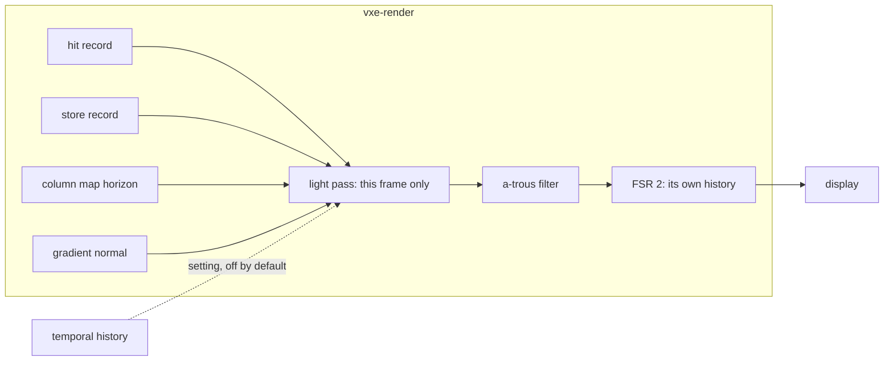

# 0098: A calm light by default: no screen history, smooth sources to the mid range, and the FSR 2 turn

> **Status:** done. **Closed 2026-11-24** (the architect's close review in a fresh session, v0.72.0):
> clean, no blocker. The calm picks are the defaults on every profile and accepted at windows W2
> and W3; light history on is rejected; the dig under `--dig-hold on` is accepted at window 98e on
> both adapters (a slight colour change at a landing, in the backlog with the parked staged
> records); the dig frame's step time on the RTX after the fix pass is ruled a reading (the
> section "The close review" under the Implementation log). ADR-0082 accepted with an Outcome. The
> terraces, the coarse tier's wobble and the sun under cover are Plan 0100's; the bake step is
> Plan 0099's. The amendments, in order: **Amended 2026-11-22 (architect, owner confirm owed)**, at window W1's
> verdicts (section "Amendment at W1"): the picks are light history off, `key far column`,
> `key far mix step`, the band `4..8` and `penumbra disc`; Phase 6 (a bake landing fades in the
> store) and Phase 7 (the one further window, W2) are new; Phase 5 becomes a spike of
> render-side arms for the far trees, no content changed; Phase 4 runs last with its bars
> restated. **Amended 2026-11-23 (architect, owner confirm owed)**, at Phase 6's readings
> (section "Amendment at the Phase 6 readings"): the landing pop is the light pass switching
> source, no store word, so Phase 6b (the switch itself fades, by the block's landing frame) is
> new and runs before W2; W2's runs 2 and 4 are restated.
> **Amended 2026-11-23 (owner)**, at window W2's verdicts (section "Amendment at W2"): the calm
> picks are accepted and become the defaults, light history off under lamps too; `landing fade`,
> `source fade` and `far light wide` stay settings, off; Phase 4's near bar is restated from the
> readings; Phase 8 (a dig under the calm picks neither darkens its surround nor flashes),
> Phase 9 (the sunlit terraces at noon, a reading) and Phase 10 (the owner's look, W3) are new.
> **Order from here: 8, 9, 4, 10.**
> **Amended 2026-11-23 (architect's rulings, owner confirm owed)**, at Phase 4's findings
> (section "Amendment at Phase 4's findings"): the shown key shadow under the defaults is the
> column map's horizon at every distance, the disc's ray is cast and never shown; Phase 4's
> far bar moves to the arm with the queue stopped; Phases 11 (the soak bars), 12 (the HUD's
> `light:` row) and 13 (the key ray that is never shown is not cast, and a test of the
> default's near key shadow) are new. **Order from here: 11, 12, 13 (beside W3), 10, the close.**
> **Amended 2026-11-23 (owner, W3)**, at window W3's verdicts (section "Amendment at W3"): the
> calm defaults stand on both adapters and light history on is rejected as an alternative; the
> dig is not accepted, so Phase 14 (a fresh hole shows a held world value until its bake lands)
> and Phase 15 (the owner's look at the dig alone) are new; the noon terraces, the coarse
> tier's wobble and the sun under cover go to one follow-on plan, outlined there (the
> architect's recommendation, owner confirm owed). **Order from here: 11, 12, 13, 14, 15, the
> gate, the close.**
> **Amended 2026-11-24 (owner)**, at window 98d (Phase 15; section "Amendment at window 98d"):
> the dig under Phase 14's held value is not accepted on the RTX ("white inside and black
> around when digging") and costs over Portable's frame line on the RENOIR; the plan stays
> open for it. The owner's delay of the dig is answered there (feasible only with staged
> mirror records, not taken first). Phase 16 (every dig's faces land within a few frames,
> whatever the queue holds), Phase 17 (the held value is the store's record, and the image
> test re-derived) and Phase 18 (the owner's look at digs in a row) are new; Phase 14 ends as
> amended, Phase 15 is run and not accepted. **Order from here: 16, 17, 18, the gate, the
> close.**
> **Created:** 2026-11-21
> **Milestone:** M10: Outdoors in [`docs/roadmap.md`](../../roadmap.md)
> **Related ADRs:** [ADR-0082](../../adrs/0082-the-light-pass-keeps-no-screen-history-by-default-and-reads-smooth-sources-to-the-mid-range.md)
> (proposed with this plan),
> [ADR-0079](../../adrs/0079-the-key-lights-visibility-is-read-with-no-screen-history-the-record-or-the-column-maps-horizon-at-the-far-a-deterministic-penumbra-near.md)
> (the key light's far estimate and the approach penumbra this builds on),
> [ADR-0042](../../adrs/0042-the-far-shading-normal-blends-to-the-27-count-gradient-by-the-voxels-size-on-screen.md)
> (the far normal's band, which this widens),
> [ADR-0076](../../adrs/0076-light-stability-rules-world-history-per-source-a-fade-per-transition-and-a-ratcheted-pop-counter.md)
> (rule 6),
> [ADR-0055](../../adrs/0055-render-settings-are-one-struct-with-an-apply-class-per-field-and-profiles-are-named-values.md)
> (the settings row this adds)
> **Source:** the owner's diagnosis window of 2026-11-21 (his words in
> [`logs/0098.md`](../logs/0098.md)) and the rule agreed that evening: no new wobble plan until
> one switch combination in the window reads calm, and the plan ships that combination.

## TL;DR

The diagnosis window found a switch combination the owner calls calm on the slopes with no
grain: **the light passes with no screen history, and smooth sources out to the mid range**
(`light history off`, `key far column`, `key far mix step`, `far normal 8,12`). This plan makes
that combination one named setting, confirms it by eye in the scenes the window did not reach,
and then makes the picks the defaults. What it does not yet have a fix for is the second
source the window named: **the far trees wobble after a turn because of FSR 2**, which the
owner wants kept; Phase 2 reads where FSR 2 loses the far pixels before any mechanism is
written. The first thing the owner sees (Phase 3, window W1): the forest and the noon slope
under `calm` against today's default, flying, stopping and turning. The headless proof: the
wobble rig's `calm` arm against its `albedo` arm.

## Context & problem

Plans 0094 and 0095 passed their bars and the owner saw no change; ADR-0082's Context has why
and what the window found. The verdicts this plan is written against:

| what the owner switched | his words |
|---|---|
| smooth far, light history off | "now things got better, nothing on slopes", "no grain" |
| light history back on | "yes, its light history - with it wobble worsens" |
| exposure back to auto | "stays calm" |
| upscaler off (native) | "no wobble on turn, slight when move on the distance" |
| FSR 2 back on | "yes fsr makes them wobble - trees, but without it picture is not right" |
| `queue freeze` on | "freeze makes things worse" |
| default far, history off, approach | "when I move shadow moves with me which is not right" |
| the same with `penumbra disc` | "shadow does not move" |

**What the window left unseen** (each is a run of W1, not an assumption of this plan):

- The calm combination on the noon slope (scene A's dashes "wobble while flying" under every
  switch tried there, and neither `light history` nor `far normal 8,12` was tried there; `2..6`
  was "clearly the best" of off, `1..2` and `2..6`).
- The "bright places around the trees when moving" under the smooth far (seen once with the
  history on, cause unread).
- Whether `penumbra disc` grains with no history (one random ray a frame with nothing to
  average it), and how the disc's centre ray alone looks (`key jitter off`: a hard shadow, the
  same every frame, the cheapest).
- Any scene under lamps: the fired lights' and the emissive terms with no history.

**Two things the owner answered before the window that the window overturned.** "Stop refining
what is in view" lost to "freeze makes things worse", so this plan does not touch the bake
queue. "Seconds after stopping" narrowed to two sources: the history (slopes, grain) and FSR 2
(trees, after a turn and slightly while moving at a distance).

The budget figures this touches: `docs/nfr.md` section 2's lighting line (4.0 ms; the window's
HUD read the light pass at 3.36 ms under approach and 1.74 ms under disc on the RTX 3080
Laptop, one pose, not a reading of record) and the upscaler's line if Phase 5 changes FSR 2's
render scale.

## Amendment at W1 (2026-11-22; architect, owner confirm owed where marked)

W1 ran in two sittings on 2026-11-22; the owner's words are in [`logs/0098.md`](../logs/0098.md)
("Phase 3: W1's verdicts"), with the leak window's and the Plan 0097 lane's finding beside
them. What they settle, and what they do not:

| question | W1's answer | standing |
|---|---|---|
| calm against the default | calm: "wobble on slopes is gone"; the default: "wobble on slopes came back" | the owner's words |
| key far | column: the baked record shows false sun under the canopy ("with keyfar column its dark") | the owner's words (leak window) |
| penumbra | disc: under approach "light rays are gone when I am distant", "no such behaviour when I am on penumbra disc"; approach is the tunnel wall's blink ("now it doesn't blink" under disc); both disc and history off calm the deep-shade dashes | **owner confirm owed**: no pick was stated, `key jitter off` was not judged, grain under disc with no history was not asked; "the shadow did not follow" under approach is withdrawn ("I may be mistaken on shadows") |
| band | "I think 4..8" | **owner confirm owed** (his "I think"; the slopes were called calm at `8..12`) |
| under lamps | the castle: "no grain, all good" with light history **on**; off was not flipped | unjudged: history off indoors has no verdict |
| FSR 2 levers | none beats scale 1.5 with FSR 2's own phases; scale 1 "does look right, fps is around 30" | the owner's words |
| what is left | "only distant trees", while moving | the owner's words |
| a denser canopy | wobbles less (256, then 160, then 64), and "this is not the way... we don't know what models will be used in the end and can't simplify models"; 256 with calm: "almost no wobble, but trees looks bad" | the owner's words; a rule |

**Three things the readings add** (all in the log):

- **A bake landing pops with no screen history.** Under `calm` with the exposure pinned, 15.61 %
  of the near pixels change in the one frame a chunk's bake lands (stop +43), and nothing
  moves with the queue stopped. The store fades a block's words, and the key words' change was
  left to the light pass's history (`bake/queue/step.rs`), which `calm` turns off; which of
  the image's reads carries the pop is not read. ADR-0082's "holds without a fade" is wrong and
  is amended. The Plan 0097 lane's finding (18.67 % of near pixels in one frame at stop +3
  after a 20-frame fly, the exposure constant, the default arm, a debug build: indicative) is
  the same suspect and is read in Phase 6, on its short fly as it stands.
- **The far trees' wobble is sparse geometry under jitter, made visible by the light.** At a
  still camera 17.46 % of the far hits change between two jitter phases, 16.28 points of it
  leaves at 15 to 60 m, where a voxel is 2 to 4.5 px: over a pixel, so a LOD mip chosen by
  pixel size never applies. The same flips under `--view albedo` move 1 to 3 % of the far
  pixels over 4 levels against 22 % lit, and the owner called albedo "no wobble". So the
  flips are there in every arm; what the eye sees is the difference in light between the two
  hits a jitter step picks. **No mechanism is known to calm it on any model.** That is the
  honest state, and Phase 5 is a spike, not a fix.
- **The default with the history on read better on the trees once** (W1 run 8i: "trees seem
  better - wobble only on move and only distant trees"), unexplained; a history averages the
  two hits' light over the phases, which is one reading of it and a guess.

**The rule this amendment is written under** (owner, 2026-11-22, on the test tunnel's roof slot
and on the leaf fill): no scene, model or fixture is simplified so that a check passes. The
wobble rig's forest, its leaf fill and its fly lengths stay as they are.

## Amendment at the Phase 6 readings (2026-11-23; architect, owner confirm owed)

Phase 6 built what it was written to build and the pop did not move
([`logs/0098.md`](../logs/0098.md), "Phase 6 readings"): `landing fade` changes no stop pair by
more than 0.07 points (`calm,pin` 15.57 % off, 15.59 % on; fly 20: 36.72 % both), every pop
falls in a frame where one block lands over the fallback chain, and every such landing reads
0 changed cells. The W1 amendment guessed the pop was a store word (the key words); that guess
was wrong. **What the readings and the code say instead** (a strong suspect, not yet read per
pixel; Phase 6b's first step reads it):

- A face whose chunk holds no block has no record, so the light pass casts its sky ray and the
  temporal pass shows the visibility pair. With no light history the pair is reset every frame,
  and a reset pair holds its seed alone (`pair_step`, pair.wgsl): the column map's answer at
  the hit (`column_estimate`), which is 1 above the column's top and 0 under it. The ray's
  sample is never shown.
- The frame the chunk's first block lands, the face's own cell holds a baked visibility
  (`sky_baked`, shade.wgsl), no ray is cast, and the pixel shows the baked term
  (`sky_baked_term`, temporal.wgsl). Under a canopy that is a step from no sky light to the
  baked share, in one frame, over every pixel of the chunk. No word in the store changed: the
  chain holds no sky visibility to fade from.
- With the history on, the step rides `no_ray_fade` (2.26 % under `default,pin`); `calm` has
  no history to carry it.

**The decision.** The switch of source fades in the light pass, timed by a world record and not
by a screen history: the block carries the frame it first landed, and for the fade's frames
the temporal pass mixes what the pixel showed before the block toward the block's baked term
(Phase 6b). The "before" needs no second ray: it is the column's answer, one map read. Rejected
here: a screen history kept only for pixels whose source just switched (it is the history
this plan removes, and a pixel that enters the view mid-fade has none), and accepting the pop
(the owner's rule: a stable image first). If the per-pixel reading refutes the suspect, 6b
builds nothing and reports.

**Four smaller things settled here.**

1. **Phase 5's `far light wide` is within the phase as written**: its text says that where the
   named term does not pass through the filter, the arm widens that term's own source, and the
   log says which (`21fcdf67`: the face's baked sky visibility mixed toward its chunk
   summary's by the far normal's weight). Two notes: the filter's relaxation stayed under the
   same switch, so W2 judges both as one arm; and a chunk summary is one value a direction
   over 6.4 m, read with no blend across chunks, so the reading's 7.35 % against `calm`'s
   13.78 % says calmer, not right. W2's run 4 asks both.
2. **`light history far` leaves W2.** It read 35.21 % at the turn's +10 against `calm`'s
   13.78 %, and it was "the last to build and the first to drop". It stays a setting on the
   debug page (it costs nothing when off); the session does not walk the owner through it.
3. **`--binaries gpu_wobble` checks nothing**: every test in the binary is ignored (readings
   and soak), so the run reports 0 tests. From here a phase's GPU run is two things, both
   named: an unignored `gpu_*` binary that renders through the files the phase touched, and
   each reading by its exact filter with `--run-ignored only`, with the count of tests run
   (over 0) in the log. Phases 6b and 4 say which.
4. **W2's run 2** compares both fades off against both on (Phase 7).

**One thing the code reading adds, for the dev to confirm and nothing more:** with the light
history off, every cast sky ray's sample is dropped (the reset pair shows its seed). If the
reading agrees, the cast is cost with no image; skipping it is a followup, not this phase.

## Amendment at W2 (2026-11-23; owner)

W2 ran on 2026-11-23 (`live/session98b.sh`, `live/bin98b` at `925859c9`; its runs 6 and 7 on
Plan 0096's binary, which holds none of this plan's picks). The owner's words are in
[`logs/0098.md`](../logs/0098.md) ("Phase 7: W2's verdicts"). The verdicts are his; the causes
named below are suspects until Phases 8 and 9 read them.

| question | W2's answer | what follows |
|---|---|---|
| the calm picks, the forest (1a, 2a) | "1a looks great, even distant wobble is not too bad"; "2a all looks correct, no wobble, only problem is dig" | the five picks are the defaults (Phase 4); the disc and `4..8` stand, `key jitter off` stays a setting (no word for it) |
| under lamps (3) | "no flicker, all good with defaults of this window" (light history off) | light history is off everywhere; no split by term |
| the landing's two fades (2b) | "a bit more wobble, but acceptable"; against 2a at the landings: "no difference"; "fade length is right", and the ground while it waits: "acceptable" | `landing fade` and `source fade` stay settings, off by default (owner, 2026-11-12: a cheap arm not picked stays a setting) |
| `far light wide` (4) | "not calmer, framerates are around 70-90" | stays a setting, off; no far-trees arm is picked |
| the distant trees | "not too bad" under calm | no work here; the backlog's "Distant trees that do not wobble" and Plan 0033's re-read carry what is left |
| **a dig under calm** (1a, 2a) | "Problem with blink on digging is back, area around becomes darker, and the dig itself lights up"; without `--calm` on the same binary (5): "there is no flash on a dig" | **a finding, fixed here before the close: Phase 8** |
| **the sunlit terraces at noon** (1b) | "on sunlighted spots I see wobble on slopes" (the steps' small shadow squares on the sunlit face move; `live/window98b/1b-sunlit-slope-wobble.png`) | **a finding, read here: Phase 9**; a fix only if cheap |
| without the picks (5, 6, 7) | 5: "a slight wobble on slopes"; 6 and 7 (Plan 0096's binary): "wobble is back and hard, on slopes and trees alike" | the picks are what removes it; the Radeon at Portable under the picks is unjudged (Phase 10) |

**Phase 4's near bar could not be met as written, and is restated.** It read: no stop pair
moves more near pixels over 4 levels than `calm,pin,nqueue`'s largest plus 2 points. Three
readings say it measured the wrong thing (the log, Phases 6 and 6b):

- A landing's frame is the machine's, not the rig's: the same pop fell at stop +40 on a loaded
  run, inside the fly on a quiet one, and in the settle once the rig read every settle frame
  back. A bar on the stop reads a landing in one run and none in the next.
- Where a landing is read, a first block over the chain moves 37.3 % of the near pixels over 4
  levels in its frame under `calm` (a mean of 17.7 levels), and 15 to 20 % under the default
  with the history on. `source fade` cuts the mean 3.4 to 5.5 times and leaves the share over
  4 levels where it was (37.15 %): a fade from black in linear light is not under 4 levels a
  frame, and no 16-frame fade of a 64-level change can be.
- The owner looked at exactly this (2a against 2b) and saw "no difference", with 2a "all
  looks correct".

So the bar splits (Phase 4): **the image at rest with nothing landing is asserted** (the arm
with the queue stopped), and **a landing's step is a recorded reading**, printed by the rig
and written into ADR-0082's Outcome as accepted by eye at W2, not a bar. Rejected: a bar on
the share over 4 levels at a landing (it would fail on the picture the owner accepted), and a
bar on the fade's monotonic steps (the fades are off by default, so it would test a setting
nobody runs).

**The perceptual mix for `source fade` is dropped, not parked.** It was the answer to a bar
that is gone; the owner sees no difference with the fade on, and the fade is off. If someone
turns the setting on for a look later, the log's "What the fade does" has the two reasons and
the options.

**The dig under calm (Phase 8).** With `--calm` a dig darkens the area around the hole and
the fresh hole shows white with black voxels until its light lands
(`live/window98b/1a-dig-blink.png`); the same binary without `--calm` shows no flash. The
orchestrator's suspect, unconfirmed: with the light history off nothing carries the dig's two
switches of source. By the code, three places can step with no history: the dig's ring is
marked stale, so its faces leave the baked term for the reset pair's seed (two estimates of
one term, temporal.wgsl) and return when the re-bake lands, and the store's fade skips a stale
word (Phase 6b's "not covered"); the hole's new faces hold no record of their own and show the
seed (the column's answer, 1 for open) until the dig's block lands; and the key words in the
ring re-bake with nothing to fade them. Any of the five picks could be the one, not only the
history, so Phase 8's first step reads which.

**The sunlit terraces (Phase 9).** W1 called the slopes calm under `calm` at approach and
`8..12` on the forest slope; W2's noon slope ran the disc at `4..8`. What moves is the one-voxel
shadow each step casts on the next at a high sun. Suspects, none read: the disc's one random
ray a frame with no history to average it (W1's open risk), the far normal's band ending
nearer than before (`4..8` against `8..12`), `key far column`'s mix step crossing the face, and
FSR 2's jitter on a shadow under a pixel wide. The owner's priority is a stable image, so it
is read before it is parked.

**What else the log owed after W2, settled here.**

1. **The rig's landing timing.** Landings fall where the machine puts them; the restated bar
   does not depend on it, and the rig keeps printing every pop with its segment and frame.
2. **The RADV RENOIR's pass times** (owed from Phase 6b) stay in Phase 4.
3. **The cast sky ray whose sample is never shown** (history off: Phase 6b's reading agrees,
   0.00 % of cast pixels show anything but the seed) stays a followup; Phase 8 may want that
   sample at a dig, so nothing removes the cast before Phase 8 lands.
4. **The Plan 0097 lane's finding** (18.67 % of the near at stop +3 after a short fly) is the
   same switch of source at a landing (Phase 6b step 1) and falls under the reading above.
5. **Runs 6, 7 and 7b** (far shadows at the profile's tiers "fine"; Portable at 720p "frames
   around 25, softer acceptable"; the dig's light under Portable "grainy", bright specks) are
   Plan 0096's, on its binary, and are not this plan's work.

## Amendment at Phase 4's findings (2026-11-23; architect's rulings, owner confirm owed)

Phases 8, 9 and 4 are in ([`logs/0098.md`](../logs/0098.md), their sections). The dev agents
reported six findings. **Every ruling here is the architect's; the owner has not spoken on
any of them.** The four that loosen or move a bar, or touch what the owner accepted by eye,
are listed again under "Questions for the owner", each with a recommended option; the lane
goes on by the rulings, and an owner's "no" is a fix pass.

### What the default key shadow is (finding 2, read first: three others hang on it)

**Confirmed in the shaders by the architect** (`temporal.wgsl`'s key branch, `pair.wgsl`
`key_mean`, `light_history_at`, `column_key_visibility`, `shade.wgsl` `key_from_store`,
`frame/settings.rs`'s lighting bits):

- With light history off, `Params::history` bit 0 is clear, the temporal pass takes no taps,
  `accepted` stays false and the key branch's `reset` is true at every pixel in every frame.
  The dig hold reprojects the visibility pair alone and leaves `accepted` false.
- `far_on` is `LIGHTING_KEY_BAKED` and a store face and no entity. `key far column` sets
  `LIGHTING_KEY_BAKED` with `LIGHTING_KEY_COLUMN`, and "a store face" is a property of the
  hit (`reads_store`: an opaque cube face entered from air), true with no store baked at all.
- Under `far_on` and `reset`, `k_far` is the column map's horizon and `key_mean` returns the
  seed, `k_far`. The cast sample `vis.y` reaches nothing. With `far_on` the band's mix, blend
  or step, mixes `k_far` with `k_far`.
- The light pass still casts the disc's ray wherever the far normal's weight is under one
  half (`key_from_store` is false there).
- `column_key_visibility` returns 0 wherever the hit, lifted along its face normal, lies
  under its own column's top, at any sun elevation; elsewhere the horizon toward the sun with
  the disc's width of ramp.

**So, under the defaults, at every opaque cube face and at every distance, the key light's
visibility is the column map's horizon.** No disc penumbra is shown, `key jitter` moves
nothing (Phase 9: `knj` equals `calm` to the pixel), `key far mix` changes only where the
ray is cast, and `key far baked` differs only where a fresh key record is held. `gpu_sun`'s
roof slab agrees: a rise of 0 voxels under the defaults against 2.8 with the history on.

**Inferred from the code, not read on a rig:**

- A face under any cover gets no sun at any sun angle: a floor behind a window, a cave
  mouth's floor at a low sun, the ground under a canopy at 15:00. The forest golden shows
  the last (finding 6); no rig reads the first two.
- At an entity hit and at a field surface `far_on` is false, so a reset mean shows the raw
  sample: one random disc ray a frame with nothing to average it, at a shadow's edge falling
  on an entity. `walker_shadow.png` moved 18 % at the re-bless; nobody has looked at it move.
- Phase 9's key share (22 to 32 % of the moved step-shadow pixels show the key value moving
  at the jittered hit) is the column horizon's hard edge sampled at a hit that moves with
  the jitter: a one-voxel step's shadow is one map cell's edge, with no penumbra to spread
  it and no mean to hold it. The history closing 57 to 68 % fits (with it the ray's mean is
  shown and carried). The same cause is likely, not proven: no arm reads a soft edge with no
  history, because none exists.

**What follows.**

1. **The picture the owner accepted is this picture.** W2's 1a ("looks great") and 2a ("all
   looks correct") ran the five picks, so they showed the column horizon's key shadow near
   and far. The accepted default is: sun shadows from the column map, hard-edged but for the
   disc's ramp at the horizon, none of it under cover. The ruling keeps it. Nothing in this
   plan adds a penumbra.
2. **W1's "penumbra disc" over "approach" re-read.** The approach penumbra takes the cast
   sample as it is with no history (`k = vis.y`), so under `calm` approach was the only arm
   that showed a true ray near, and the column's answer from the band's half outward. Where
   the two disagree (under a canopy, in the tunnel) the picture changed with distance: "light
   rays are gone when I am distant" and the tunnel wall's blink are that seam. "Disc" under
   `calm` showed the column's answer everywhere: no seam, so "no such behaviour" and "now it
   doesn't blink". **The owner picked one source at every distance over a true ray near; the
   word "disc" named it by accident.** The pick stands as he saw it. What it is called is
   corrected in the docs (below) and in ADR-0082's Outcome at the close.
3. **The docs stop claiming a disc penumbra by default.** Corrected with this amendment:
   `docs/flythrough.md` (`--penumbra`, `--key-far`, `--key-far-mix`, the debug page's `key
   jitter`) and ADR-0082 (still proposed; its Negative list said the disc shows per-frame
   noise with no history, which is true only at an entity or a field surface). The plan's
   earlier sections keep their words as history; "the disc" in the W1 and W2 amendments and
   in Phase 4 reads as "the penumbra setting at `disc`", whose ray is not shown.
4. **The ray that is cast and dropped is cost with no image**, in the light pass, on every
   near cube face, every frame. Its share of the pass is unread. Skipping it is one more
   clause in `key_from_store` behind settings that exist, and the goldens re-blessed in
   Phase 4 pin the image it must not move: **Phase 13, in this plan, with a stop rule** (more
   than that clause, or any golden moving, and it goes to the backlog instead). The sky ray
   whose sample is never shown (Phase 6b) is **not** skipped here: the dig hold reads it
   (`pair_taken` runs `pair_step` over the cast rays), so it stays a followup.
5. **A soft near shadow with no screen history is a design question for a later plan**, with
   the sun under cover beside it. The two known arms both fail something the owner said: a
   true ray near shows the seam against the column (W1), and a running mean is the history
   this plan removes. Backlog, dated today.

### The rulings on the other findings

**1. Phase 4's far bar: the far is asserted at rest, printed while the queue steps
(options (b) and (c) together; (a) rejected).** One configuration reads far +30 at 13.59,
23.48 and 26.43 % (fly 180) and 17.91, 36.45 and 41.52 % (fly 20) over runs: the queue
still holds 1300 to 1400 chunks at the stop, their sky records land in the far during the
stop at the machine's pace, and the reading is "to the stop's last frame", so it counts
every landing after frame 30. It is the near bar's fault again (the W2 amendment: "a
landing's frame is the machine's, not the rig's"), and the answer is the same split. With
the queue stopped the arm read 9.98 % (fly 180) and 11.39 % (fly 20): that is the jitter
and FSR 2 on the far trees with nothing landing, which is what "even distant wobble is not
too bad" judged. A median of several runs (a) is rejected: it triples a 15-minute arm to
average out the queue's timing, which is not the claim, and a median of 13, 23 and 26 still
moves by more than 2 points with one more run. The bar's value is not known from one run a
fly, so Phase 11 reads it three times and stops if the at-rest far is not steady either.

**3. The HUD's `light:` row: fixed here, before the close (Phase 12).** The row prints
`QUEUE_BRICK_SAMPLES` whatever the queue's tiers are; the owner's rule is that a toggle
under test shows its true mode in the window, and W3's runs 4 and 5a to 5d
(`live/session98c.sh`) compare tiers under Portable. **Until a binary with Phase 12 is in
the session, those runs' tier is the one on the run's command line and in the run's title,
not the banner's `4096`;** the session's notes say so.

**4. `the_wobble_table_over_the_arm_set` keeps its table and loses its assertion; the claim
moves to the at-rest arm.** The bar (Plan 0095 Phase 10: the default's stop +0 near, first
frame to last, at most `albedo`'s plus 2 points) defended "the near does not go on settling
after a stop". It has failed since Phase 1 for two reasons that are not that claim: an
exposure step in the stop (14.5 of 19.83 points, Plan 0097's) and landings in the stop (a
plateau that steps out between +40 and +60), the quantity the W2 amendment already ruled a
reading. Restating it against the `before` arm is rejected (it would bar a configuration
nobody ships, and `default, pinned` read 5.35 % there too). Retiring the test is rejected:
Plans 0095 to 0098 re-read the wobble through its table. The claim is defended where it can
be read: `default,pin,nqueue`'s stop +0 near, the same quantity with the same bar as
written (`albedo`'s 0.05 % plus 2 points: 2.05 %), on the arm where nothing lands and the
exposure is fixed; it read 1.02 % and 1.20 % in Phase 4. Phase 11 moves it.

**5. The files past Phase 4's list: no assertion weakened, no scene or fixture changed;
three things for Phase 11 and 13.** Read: the diffs of `gpu_sun.rs`, `gpu_exposure.rs`,
`gpu_lights.rs`, `gpu_dynamic_lights.rs`, `gpu_outdoor/flicker.rs`, `menu.rs` and
`gpu_wobble.rs` between `311c5e6a` and `248d64db`. Each mechanism test sets the
configuration it reads (`light_history: true`) and keeps its assertions and its rig to the
byte; `menu.rs` and the CLI tests pin the new defaults. What the close review should not
have to find again:

- **`gpu_sun.rs`'s `frame()` helper now sets history on, `key far baked` and blend for the
  whole file**, so no test of `vxe-render` renders the default's near key shadow (the
  nearest, `the_far_horizon_is_the_same_every_frame`, reads the far under `column`). The
  picks' own image has the re-blessed goldens and nothing that names its property. Phase 13
  adds the test.
- **The dig test's baseline arm is not the arm the owner judged.** `before` keeps the disc;
  the fly-through's default before Phase 4 was the approach penumbra, and W2's run 5 ("no
  flash") ran it. The bars barely moved (ring 1.38 to 1.36 %, hole 31.24 to 31.11 %, excess
  +0.0 to +0.1), so nothing was loosened to pass, but the doc comment claims run 5. Phase 11
  puts `approach` into `before` and reads the test again.
- **A reading that is not a number passes the near bar.** `rest.near_pair > 2.5` is false
  for NaN (`wobble_on` returns NaN on one path); the far check tests for it. Phase 11.

**6. `outdoor_forest_afternoon.png`: the golden stands as blessed and says what it shows; it
is the defaults' honest picture with no store, and it is a finding.** Before: sunlit ground
between the trunks at 15:00. After: black ground, lit only where no canopy is overhead
(`live/p4/golden-before/` against `apps/flythrough/tests/golden/`). The log's reason (most
of the frame past the band) is not it: by the code the same holds at every distance. Two
terms go dark together. The key light: the column's answer is 0 under a canopy at any sun
angle, **with or without a store**; the slanted sun between the trunks is gone under the
defaults in the window too, and the owner looked at that forest at `--sun 10,180` (W2's 1a
and 2a) and called it correct. The sky term: with no record the reset pair shows the column's
answer, 0 under a canopy, and the cast sky ray is dropped; a baked store gives the face its
record's visibility, so this half lasts only until the bake lands (W2's 2b: "acceptable").
The golden defends that the default image with no store is what it is, frame for frame;
blessing it was right. What it shows a consumer: **with no store bound, or before the bake
lands, every face under cover is unlit by sun and sky.** That is a limit of the picks, said
in ADR-0082's Outcome at the close and in the backlog entry of ruling 5; whether it is
acceptable for a consumer that renders with no bake is the owner's (question 4). Phase 13
makes the golden's doc comment say what the image is, so the next reader does not take it
for a broken sun.

### Questions for the owner (each with the recommended option; none holds W3)

1. **The far bar moves to the queue-stopped arm, and the far with the queue stepping
   becomes a printed reading** (ruling 1). Recommended: yes; it is the split you made for
   the near at W2. The other option: keep the stepping bar and take the median of several runs
   (the soak run several times over, and still not steady).
2. **The old wobble table stops asserting; its claim is asserted on the queue-stopped arm at
   the bar as written, 2.05 %** (ruling 4). Recommended: yes. The other options: retire the
   table, or keep a test that has failed since Phase 1.
3. **The default sun shadow has no penumbra and no sun under cover; you accepted the
   picture without those words** (finding 2). Recommended: keep it as the default, name it
   truthfully in ADR-0082 and the docs, and park the soft, true near shadow as a later plan.
   The other option: a look before the close at one interior with a low sun through an
   opening (no rig or window has shown one), and at a shadow's edge on a moving entity.
4. **With no store, or before a bake lands, faces under cover are black** (finding 6).
   Recommended: accept for this plan (the window bakes within seconds and you called the
   wait acceptable); the backlog entry carries "a better value before the bake". The other
   option: the default keeps the light history where a face has no record, which gives back
   the wobble there.

## Amendment at W3 (2026-11-23; the owner's verdicts, the architect's routing)

W3 ran on the evening of 2026-11-23 (`live/session98c.sh`, `live/bin98d` at `248d64db`: the
calm picks as defaults, `dig hold` on; stills under `live/window98c/`). The owner's words are
in [`logs/0098.md`](../logs/0098.md) ("Phase 10: W3's verdicts"). **The verdicts are his and
binding. The mechanisms named below are the architect's reading of the code and are suspects
until a reading names them** (Phase 14's step 1 for the dig, the follow-on plan's for the
rest). The routing in "What closes this plan" is the architect's recommendation; the lane
goes on by it, and an owner's "no" moves a subject back into this plan.

| question | W3's answer | what follows |
|---|---|---|
| the defaults against light history on (6a) | history on: "light edges are grainy, but overall light looks better", then "wobble comes back, and light only visible when I close", and "light only comes when I see it, even after turn looks completely unnatural" | **the defaults stand; light history on is not an alternative**, for the forest or the terraces |
| **a dig under the defaults** (1b; 1a is `dig hold` off) | 1a: "not good"; 1b: "better but not ideal"; typed: "darken, have white flash". Stills: a pure white patch and pure black faces in the fresh hole (`1b-dig2-during.png`), fresh faces too bright with speckle on new grass side faces (`1b-dig1-during.png`) | **Phase 8's look failed. Phase 14, in this plan** |
| the dig on the RENOIR at Portable (5, 5c) | "dots when I dig"; "dots disappear after light land"; at `--bake-tiers 4096,256,256`: "dots disappear faster" (`5-radeon-dig-dots.png`, `5-radeon-inside-hole-dots.png`, `5c-dig-during.png`, `5c-dig-after.png`) | the same class as the white hole: a wrong value until the bake lands, at 1,024 and 4,096 samples alike. **Phase 14**. Settled holes are clean at both counts, so the profile's 1,024 near tier stands (Plan 0096's leftover, answered) |
| **the noon terraces** (2) | "light settles on slopes and wobbling"; typed: "wobble on slopes" (`2-noon-settling.png`, `2-noon-settled.png`: the slope covered in hard one-voxel shadow dashes) | Phase 9's route (i) is void: its switch is the light history, now rejected. **The follow-on plan's first subject** |
| **near trunks and leaves** (3) | "slight wobble after stop and turn", "on trees, trunks and leaves nearby"; "once coarse light changes to a normal one, wobble stops" | a new finding: the wobble belongs to the coarse tier's record, not to the settled defaults (no regression against W2's 2a once loaded). **The follow-on plan's second subject** |
| **the sun under cover** (6a) | the floor has no sun patches under the defaults; with them the light is "comparable to the trees" and better; the screen history's way of getting them is rejected | a requirement, recorded below and in the backlog. **The follow-on plan's third subject, with an ADR** |
| the RENOIR at Portable under the defaults (4) | "its much better, light takes maybe 5 sec to load, and fps is around 30"; typed: "bearable" | accepted. Nothing owed here |
| the frame rate at a dig and while the bake drains | about 30 fps on the RTX (HUD: bake step 26 to 31 ms) | the bake step on the main thread: Plan 0099, as before |
| not run | 5d (1,024 at `--render window`) and 6b (the tunnel's roof slot) | 5d is moot (the settled hole is clean at 1,024); 6b moves to the follow-on plan's window |

### The dig: why Phase 8's test passed and the owner's eye did not

`flicker::a_dig_under_calm_neither_darkens_nor_flashes` (read by the architect:
`apps/flythrough/tests/gpu_outdoor/flicker.rs`) asserts three figures of the defaults' arm
against **the history-on arm's largest plus a margin**. Three faults, none of them the dev's:
the bar was the plan's.

1. **The baseline holds the fault.** The history-on arm's hole reads brighter than its
   settled value by over 4 levels in 62.58 % of its pixels on the RTX and 31.24 % on
   lavapipe, with a mean excess of +10.4 levels (the log, Phase 8). A bar of "no worse than
   that plus 2 points" passes any hole that flashes as much as the history's does. The
   owner's "no flash" at W2's run 5 was said of his pose in the window, and nothing checked
   that the rig's baseline arm was clean in the rig.
2. **The rig's pose does not make the white.** It digs once, 35 voxels ahead at 30 degrees
   down, under the forest's canopy, in a chunk whose light is settled: the removed surface's
   visibility is 0.055 and the hole's settled 0.033, both dark. The window's white needs a
   surface under open sky on a pale material, dug into from above and dug again (the log
   said so: "no rig here holds that pose"). On the RTX the rig's dig also lands in 1 to 3
   frames; in the window the queue held thousands of chunks and 322 in view were waiting
   (`1b-dig1-during.png`'s HUD).
3. **The statistics cannot see three of the four faults.** A share of pixels brighter by
   over 4 levels counts a white pixel the same as one 5 levels up; a mean hides a white
   patch beside black faces; nothing reads darker-than-settled in the hole (black), and
   nothing reads a pixel against its neighbours (speckle, dots).

**What Phase 14's test measures instead:** each pixel against **its own values before and
after** (no arm as the baseline), darker as well as brighter, isolated pixels against their
neighbours, in the pose where the reading reproduces the white, and it is shown to fail on
the tree before the fix.

### The dig: what a fresh face shows today (read in the code, not on a rig)

Confirmed by the architect in `temporal.wgsl`, `pair.wgsl`, `edits.wgsl`,
`frame/encode.rs` and `bake/summary.rs` at `96b92ba2`:

- **The hole takes its light from cast rays.** A pixel whose hit lies in a held dig box
  (`in_dig_hold`) reprojects the sky's visibility pair alone (`dig_pair`, `pair_taken`). On
  the dig's own frames the kill box (`in_edit`) refuses the reprojection, so the pair is
  the seed (`pair_step` returns the estimate at the seed's age); after them it blends one
  sky ray a frame (the HUD's `sky rays 1`), a sample of 0 or 1, at `1 / (age + 1)`.
- **The seed is the removed surface's value, or 1, or 0.** Where the face's own cell holds
  a record, stale or not, the seed is that record's visibility at `SEED_AGE` (8 samples).
  Until its job lands a dug chunk's block is `provisional_block`'s: a kept brick keeps its
  record, a new brick takes the mean of the records of the bricks around it, so a face a
  metre down the hole holds the visibility of the surface that was dug away. Where the
  cell holds no record the seed is `column_estimate`: 1 if the hit, lifted 2.5 voxels
  (`SEED_LIFT`) along its face normal, is above its column's top, else 0, nothing between,
  at `SEED_COLUMN` (2 samples).
- **The ring's hold stops at the dig's bounding box.** `dig_ring_held` is false inside a
  held box, and the box is the edit's bounds, so the ground at the corners of the box about
  a round dig is ring by geometry and takes the hole's path, rays and all.
- **The ring's hold needs a record.** It applies where the face's own cell holds a stale
  record and the ray was cast (`sky_cast && rec_face`); a ring face with no record of its
  own (a chunk at the coarse tier or not landed) is not held.
- **The key term is the column map's horizon** in the hole as everywhere (the amendment
  above); it does not change at the landing.

What that predicts for each thing the owner saw. **Inferred, to be read in step 1:**

| what the owner saw | the candidate from the code |
|---|---|
| a pure white patch, gone at the landing | the sky term at a visibility of 1 on pale rock: the removed open surface's record, or the column's 1 at a floor face whose lifted point is above its own column's new top. It leaves at the landing, so it is the sky term and not the key's |
| pure black faces beside it | the column's 0 at a face whose lifted point lies under a rim cell's top, or a face with no record and no chain value (the HUD's `missing ... black`) |
| fresh faces too bright (`1b-dig1`) | the removed surface's visibility on a face that will land far darker |
| speckle on new grass side faces; pixel-size dots on the RENOIR, in the hole and on the ground around it, at any sample count, gone at the landing | a short mean of one binary ray a frame shown raw (a seed of 2 samples where the column seeded it); around the hole, the box's corners. Not the bake's sample count: the bake is not what is on screen yet |
| "darken" (typed; not visible in the stills) | not known. Candidates: the auto exposure answering a white patch that fills the view from above (Phase 8's rig read the exposure moving under 0.2 %, with no white in it); ring faces with no record of their own (`1b-dig1`'s HUD: 322 in view waiting, 101 coarse), which the hold does not cover; the box's corners |

### Routing the terraces, the coarse tier and the sun under cover

**The noon terraces.** The cause as far as it is read (Phase 9, and the amendment at Phase
4's findings): the shown key shadow is the column map's horizon, a hard edge one map cell
wide, evaluated at the hit; the hit moves with the jitter and crosses the edge inside a
voxel face (22 to 32 % of the moved pixels), and FSR 2 resolves a one-voxel edge from a
half-rate lighting grid (60 to 76 %: nothing moves at the lighting pixel). With no upscaler
and no jitter nothing moves. Three world-space candidates, none read:

- **(a) The key shadow evaluated at the voxel face's centre (recommended as the first
  arm).** One value per face, fixed in the world: a jittered hit cannot cross an edge
  inside a face, and the shadow's edge falls on a face's edge, which FSR 2 already resolves
  as it resolves an albedo edge (W1: albedo "no wobble"). It is a few lines where the
  temporal pass calls `column_key_visibility`. It does not touch the 60 to 76 % directly;
  whether an edge on a face's edge resolves calmly from the half-rate grid is the question
  the spike answers. It gives up the horizon's ramp inside a face (the ramp becomes steps a
  face wide).
- **(b) The column map's answer filtered in the world** (bilinear over the map's cells, a
  soft edge fixed in the world). The jitter then crosses a ramp, not a step. It needs the
  horizon march to read four cells where it reads one, on every lit pixel.
- **(c) The key term at the full rate.** It removes the half-rate resolve and pays the key
  pass at 2.25 times the pixels; on the RENOIR that is the budget.

**Not in this plan, though (a) is a few lines.** As a default it moves every sunlit golden
and needs the owner's eye on the shadow's new look; as a setting nobody has looked at it
calms nothing. And the third subject (a key term baked per face in the store) is the same
idea done whole, a value fixed per face in the world, so (a) is its cheap probe and the
two belong in one plan. The concrete next step: the follow-on plan's Phase 1 builds (a)
default-off, reads it through Phase 9's rig as it stands
(`gpu_wobble/terraces.rs`), and its window shows it.

**The coarse tier's wobble on near trunks and leaves.** New at W3, read by nobody. A
coarse block is the live queue's first pass over a chunk, refined later (`TABLE_COARSE`,
`bake/record.rs`); the HUD names it `coarse 8/256` beside `bricks 8/4096`, the same brick
edge at a sixteenth of the samples. How its records differ from the full tier's beyond the
sample count is not read here. Hypotheses only: (1) at 256 samples two neighbouring
bricks' values lie far apart (the bake's noise frozen as a step in space), and on thin
geometry the jittered hit moves between them; (2) a face whose cell or direction the
coarse block does not hold falls to the chain, and with no history the chain's last answer
is the column's 0 or 1 at a lifted point that flips under sparse leaves; (3) the
smoothed-normal mix (`sky_baked_term`) reads the neighbour directions' records, and which
of them a coarse block holds changes the weights across a jitter step.
The far normal's band is not a candidate at this range. Route: a reading (the wobble rig's
near class with the store held at the coarse tier, the source word a pixel) and then a
fix, in the follow-on plan. Plan 0099 shortens the time a face holds its coarse record; it
does not make the record calm, so the finding is not left to it.

**The sun under cover: the requirement.** Sun patches under canopies and through openings
that are (1) steady at a still camera and while moving, (2) present at a distance, the
same as near, and (3) present before the surface comes into view and after a turn. A
screen history gives none of the three (W1, W3). So the source is in the world: a key
term baked in the store (ADR-0079's key record, which today leaks: the bake's key ray
counts lit at its cap, the backlog's "The record by rule at every opening, and the bake's
key ray at its cap"), or a shadow source better than the column map. The backlog's "The
sun's shadow near under the calm defaults" carries it, with W3's verdict and the stills.

### What closes this plan, and what the next plan takes

**This plan closes after the dig is fixed and looked at: Phases 11 to 13 (in flight),
Phase 14, Phase 15, the gate, the close review.** Its subject is the calm defaults, and
they are accepted on both adapters; the main push waits on this merge. The dig is inside
because the owner ruled so at W2 and the defaults broke it. The other three are not:

- The terraces wobbled before this plan (the diagnosis window's scene A, under every
  switch) and the defaults did not make them worse; what W3 took away is the last switch
  that hid them.
- The coarse tier's wobble is the time before the bake lands, a state the owner called
  "acceptable" at W2 and "no wobble anymore" once loaded.
- The sun under cover is a design question with an ADR.

**The next plan, to be drafted by the architect at this amendment's confirmation** (the
next free plan number at drafting; one plan, three subjects, in this order):

- **Title:** "A sun fixed in the world: the key shadow a face at a time, the coarse tier
  held still, and sun under cover".
- **1. The key shadow's edge under jitter (a spike, exploration).** Arms (a), then (b),
  default-off, on Phase 9's rig; the owner's window on the noon slope picks. No ADR for
  the spike; a pick that changes what ADR-0079's horizon is evaluated at is recorded in
  the ADR of subject 3.
- **2. The coarse tier's wobble (a reading, then a fix).** The three hypotheses above; the
  fix is written once the reading names the source. An ADR only if the fix changes the
  coarse record's layout or what the chain answers.
- **3. The sun under cover (design, then phases).** **Needs an ADR**, superseding
  ADR-0079's clause on the near key source and extending ADR-0082's limit: the baked key
  term near against a better shadow source against the column map as it is. It depends
  on the key ray's cap fix (the small plan the backlog names, or its first phase taken
  here; the architect says which at drafting). Window runs: the forest floor at 15:00
  from a distance and after a turn, and the tunnel's roof slot (W3's 6b, not run).
- **The order's reason:** 1 is the cheapest and the one always on screen at noon, and its
  result (does a value fixed per face calm the edge?) tells subject 3 whether a baked key
  term will; 2 is independent and can run beside 1; 3 is the largest and is designed with
  1's reading in hand.

### Budgets and risks this amendment adds

- **Phase 14 (guesses, measured there).** Nothing at rest. In flight, no more than Phase
  8's readings (the temporal pass on against off: +0.04 ms on the RTX 3080 Laptop, +0.66
  ms on the RADV RENOIR); if the fix shows a held value where the rays are cast today,
  the light pass's rise in flight (0.13 to 0.40 ms and 1.16 to 3.94 ms) may fall, which is
  a reading and not a bar. Any store word the fix adds is stated in bytes a block.
- **Section 7.** Phase 14's image test is soak (its sibling is 62 s on lavapipe); the gate
  grows only by its CPU test.
- **The reading may not reproduce the white headless.** Then the phase stops with what the
  pose shows, and the owner's window is the only instrument: the fix would be chosen from
  the code alone, which this plan has been burned by, so the stop is real.
- **No estimate is right for every hole.** A fresh face's true value needs the bake. The
  aim is a value that is never white, never black, never noise, and close enough that the
  one fade at the landing is small; the reading's error table says how close each
  candidate is.
- **`temporal.wgsl` is 31 lines under the file-size gate.** The fix's shader code goes to
  `pair.wgsl` or a file of its own.
- **Phase 13's skip and Phase 14 meet at the dig box.** Phase 13 does not skip the sky
  cast because the dig hold reads it; if Phase 14's fix shows no ray in the box, the
  followup on the unshown sky cast loses its exception. Phase 14 runs after 13 lands.

### Questions for the owner (each with the recommended option; the lane goes on by them)

1. **What closes Plan 0098.** Recommended: the dig fix (Phase 14) and one short look at
   the dig alone (Phase 15), then the close; the terraces, the coarse tier and the sun
   under cover go to the one follow-on plan above, drafted next. The other option: the
   terraces' arm (a) is built here before the close, default-off, and Phase 15 looks at it
   too (a day more, a second verdict to wait on, and a re-bless inside this plan if it is
   picked).
2. **The follow-on plan's order: the terraces' edge, the coarse tier, the sun under
   cover.** Recommended: yes. The other option: the sun under cover first (the larger
   change to the picture; the terraces then wait for its key term).
3. **The Phase 8 hole path (the pair over cast rays) after Phase 14.** Recommended: it
   stays reachable as a value of `--dig-hold` for Phase 15's before-and-after and is
   removed at the close if the look passes (you rejected it at W3; it is not a cheap arm
   someone may want). The other option: keep it as a setting.

## Amendment at window 98d (2026-11-24; owner)

Phase 15 ran on 2026-11-24 (`live/session98d.sh`, `live/bin98f` at `d967db57`: Phase 14's
held value from 12 near rays as the default; stills and the orchestrator's record under
`live/window98d/`, the owner's words in [`logs/0098.md`](../logs/0098.md), "Phase 15: window
98d's verdicts"). **The verdicts and the decision to keep this plan open for the dig are the
owner's. The mechanisms below are the architect's reading of the code at `f7c71266` and are
suspects until Phase 16's step 1 reads them.**

| run | the owner's words | what follows |
|---|---|---|
| 2: the RTX, the forest at `--sun 10,180`, the default, several digs in a row at x 0.5 y 640.5 z 579.5 | "it got better, but still - white inside and black around when digging" (`2-default-dig.png`; HUD: 101 in view waiting, all coarse, drain 2.5 s, queue depth 3411, digs +3 ms, 77 fps) | **not accepted. Phases 16 to 18, in this plan** |
| 3: the RENOIR at Portable, the forest at 15:00, the default | "not bad" (`3-radeon-dig.png`; HUD while the dig is held: temporal 19.63 ms, light 5.40 ms, gpu 36.5 ms, 36.4 fps, 860 waiting, slice 15.73 ms) | the look passes there and **the cost does not**: the held value's rays put the frame over Portable's 33.3 ms line. Phase 17 |
| 1: the before (`--dig-hold rays`) | no verdict given | none owed; `rays` stays the test's bite check |
| his question | "Maybe we should fix it by delaying the dig a bit?" | answered below: feasible, not with the mirror as it is, and not the first step |

**What happens to Phases 14 and 15.** Phase 14 ends as it stands: step 1 (the reading in
the owner's pose) is done and kept; step 2's held value (`d967db57`, wip) is the base Phases
16 and 17 change; its Done-when lines on the image test's first claim and on the readings
"with the fix" are **replaced by Phase 17's**; its gate test of the mechanism and its CPU
test stand, restated in Phase 17. Phase 15 is **run, not accepted**; Phase 18 is its
successor. Nothing is renumbered.

### Why the hole is still white and black: the wait, not only the value

Phase 14 treated the fault as a wrong value shown while the bake is awaited, and looked for
a better estimate. Its own readings say no estimate meets the bar (the best: white 16.9 %,
black 22.0 % of the hole on lavapipe), and they hold the larger fact: **the first dig lands
in 3 frames on the RTX and the second and third in 66** (the RENOIR 8 and 56, lavapipe 11
and 74). The owner dug several times in a row with 101 chunks waiting. What he saw for a
second or more is the estimate, and behind it earlier holes whose light had not landed
(`3-radeon-dig.png`: "a large dark area to its left (an earlier dig, light not landed)").

The queue already puts a dig ahead of every other job (`open_digs` pushes at the front and
`promote`s). Read in `bake/queue/digs.rs`, `bake/queue/step.rs` and `bake/job_loop.rs`, five
things can still hold a dug face back. **Suspects, in the order the code suggests; step 1's
timeline names which bind:**

- **S1. A re-dug chunk's job runs to its end and is thrown away.** `invalidate` and
  `take_boxes` mark a chunk in a job stale; `Placement::place` releases its block when it
  closes; `open_digs` skips every chunk still in a job (`!in_job`). So a dig made while an
  earlier one is in flight waits for all of the earlier job's samples, which are wasted,
  and only then opens the union. `JobLoop::withdraw` exists and is not used here.
- **S2. A stale job that is not a dig's blocks the same way and is not promoted.** A first
  pass or a refinement running in a ring chunk goes stale at the edit and keeps its place
  behind the promoted jobs; the dig for its chunk waits until it ends. With a deep queue
  (the still: depth 3411) the open slots hold such jobs. This fits the land arm's reading:
  a sixteenth of the samples and nearly the same wait (49 against 66 frames), so the wait
  is not the dig's own samples.
- **S3. The hole lands with its ring.** One job a chunk bakes every dig brick of the chunk,
  the touched bricks (ring 1, the box dilated by one voxel) together with every brick
  within `DIG_REACH` (32 voxels, ring 2), and its block is placed when its last face ends.
- **S4. Ring chunks open by the two-slice rule, one or a few a step** (`left >= 2 * cap`),
  ring 1 first. The owner's pose is at a chunk corner (x 0.5, y 640.5 = 10 x 64), so the
  hole itself spans several chunks.
- **S5. A pending job needs a free table slot** (`QUEUE_SLOTS`, 16); a dig pushed at the
  front waits in `pending` while every slot holds an open job.

Not a suspect: the sample count for the sky. A brick direction draws `SKY_BAKE_RAYS` (256)
sky rays at any count, so the land arm buys little for an outdoor hole.

### The owner's delay: is it feasible?

**Not with the mirror as it is. With staged records it is, at a cost this plan does not
take first.**

- **Why not today.** The mirror is one state: `GpuWorld::sync` rewrites a dug brick's slot
  in place and flushes the chunk's record, the table and the column map's tops in the
  frame's own encoder, ahead of the march. The bake's rays walk those same bindings
  (bake.wgsl: group 0, the frame's shadow walk, `sky_ray_open` on the column's top). So the
  bake can trace the edited geometry only once the march draws it. Holding the upload back
  delays the bake by the same frames and gains nothing.
- **What would allow it: staged records.** (1) `sync` writes a dug chunk to a fresh record
  and its changed bricks to fresh slots, and keeps the old ones alive (it already gives a
  chunk a new record on a tier change and frees the old one in the same sync); (2) the
  table entry's flip waits D frames; (3) the bake's module takes one more replaced read
  (`bake_source` already replaces the candidate table and the LOD origin): a chunk lookup
  that consults a short list of staged chunks first; (4) the column map carries the staged
  columns' new tops for the bake alone; (5) in those D frames the march, the light pass's
  rays, the field pass and the emitter lists read the old state, while the world, its
  collision and the edit's result are immediate and deterministic as today.
- **Its cost.** VRAM: a record and the changed bricks' slots a dug chunk, for D frames,
  inside ADR-0013's reservation (small). Code: a two-phase commit in `gpu_world` (frees
  deferred, a dig onto a staged chunk, the band repair across chunk faces, the light
  lists), under ADR-0013 and ADR-0022; that is an ADR and a plan of its own, in the crate's
  most invariant-heavy file. **Latency:** D must cover the landing. The floor is the
  readback (a submit, a poll, a place: 2 to 3 frames); the first dig today takes 3 frames
  on the RTX and 6 to 8 on the RENOIR at 30 fps, which is 200 to 270 ms of visible lag
  there, not 50. And while a later dig takes 66 frames no delay covers it.
- **So the order is forced.** The delay is only worth anything once every dig lands within
  a few frames, which is Phase 16. After that it would replace at most a handful of frames
  of a held value with the old picture. Whether that is still wanted is the owner's eye at
  Phase 18.

Rejected, with the reason:

- **Holding the edit's upload back** (the simple reading of "delay the dig"): the bake has
  nothing to trace until the upload.
- **A second whole mirror**: the live mirror is 343 MB at the owner's pose (the still).
- **Freezing the screen's pixels in the dig's box**: a screen history, gone under a camera
  move and rejected by ADR-0082.
- **Blocking the frame on the dig's readback** so the light lands in the dig's frame: a
  stall on the main thread, where the RTX already dips to about 30 fps at a dig.
- **A full bake of the dug faces on the CPU against the world**: a second sampler to keep
  equal to bake.wgsl (the walk, the absorbing materials, the column rule, the key disc, the
  emitters). A small CPU *estimate* is taken in Phase 17; it is a held value, not the bake.
- **The land arm as the route** (the coarse count for a dig): its wait is nearly the full
  count's, and its landing darkens ring chunks for a cause not found. Step 1 reads the
  cause because a dark landing may be a fault in the coarse tier at large (W3's wobble on
  near trunks under the coarse record is the follow-on plan's); the arm itself goes.

**No ADR now.** Nothing here supersedes a recorded decision: the jump is ADR-0046's rings
and ADR-0080's "the queue bakes what the image reads" applied to the dig; the held value in
the store is ADR-0076's rule 3. ADR-0082's Outcome at the close names the dig's rule as
Phases 16 and 17 built it and this section's rejected lines. Staged records, if the owner
asks for them after Phase 18, are a plan with its own ADR.

### What the held value becomes

It covers only the frames from the dig to the landing (Phase 16's bound) and the fade after
it. For that span the 12 near rays a pixel are the wrong tool: on the RENOIR the temporal
pass reads 3.1 ms at rest and 15.7 to 19.6 ms while a dig is held, and the Portable frame
goes over its line. Phase 14's readings also say why the estimate never matched the landed
picture: "the held face's own visibility lands near the landed record's, and the term does
not": the landed term is read from brick-cell records, mixed over the cell's directions and
bilinear over the cells about the face; the held one was a value a pixel in the temporal
pass.

**So the held value moves into the store.** At the edit, `provisional_block` writes each
touched brick's directions an estimate made on the CPU against the world (the base Phase 14
found: the removed surface's value, capped; times an openness from a few short rays, a
dozen of 16 voxels, from a few of the direction's faces), and the light pass reads it as it
reads any record: the same form as what lands, no ray cast, no pair kept, nothing added to
the temporal pass. The landing is the store's own fade from the provisional block
(`DIG_FADE`, the world's clock). The ring keeps Phase 8's hold (its stale record held; the
readings have it clean: under 0.6 % at 4 levels). ADR-0076's two statements: **the
history is the store's provisional record** (world space; no screen accumulation), and
**one fade carries the switch** from the held record to the job's (the queue's `DIG_FADE`
frames, linear a record, monotonic); the stale ring to its re-bake rides `FADE` as today.

`--dig-hold` after Phase 17: `on` the store-held value (the default), `near` Phase 14's 12
rays (kept through Phase 18 only: the owner called it "not bad" on the RENOIR, so the look
compares the two; question 3), `rays` Phase 8's path (the bite check), `off`; `land` is
removed.

### The image test, re-derived (the owner has agreed the bar changes with the mechanism)

The old claim was "the estimate is within 4 levels of the truth at 98 % of the hole in every
frame". No estimate can be: the truth needs the bake. The new claim has two parts, both
measured directly at the owner's pose, no arm as a baseline:

1. **It lands.** Every dig's touched bricks hold their job's records within **N frames of
   that dig's frame**, the third of three in a row and a dig made with 100 chunks waiting
   included.
2. **Until then, nothing is white or black.** In the frames before the landing and its
   fade, the share of hole pixels more than **32 levels** above the larger of their own
   `before` and `after`, or more than 32 below the smaller, is at most 2 %. After the
   fade the original bar holds (4 levels, 2 %). The ring keeps the original bar in every
   frame (it passes today, and a landing that darkens ring chunks fails it).

32 levels is an eighth of the display range: the architect's figure for "a face that reads
as white or as black beside its neighbours", against Phase 14's error table (the removed
surface's value is off by 8.6 levels in the mean, 43 to 60 at the largest). It is not
derived; step 1 of Phase 17 prints the excess's histogram so the owner sees where it sits
(question 2). The `rays` arm must fail both parts.

### Plan 0099 (the bake step off the main thread)

It starts after this plan merges and owns `bake/queue/` from then. This amendment keeps its
change to `digs.rs`, the sink in `step.rs` and the use of `JobLoop::withdraw`; it adds no
stage to the step and no new store word. What 0099 inherits: ring 1 as a job of its own
ahead of ring 2, a withdrawn (not awaited) stale job at a re-dig, the CPU estimate inside
`take_boxes` (which moves to the bake thread with it), and **the bound of Phase 16 as the
base of its "an edit's light" line** ("the dig's near ring within the base's frames plus
2": with the thread on, a dig lands within this plan's N plus 2). The main-thread cost of a
dig's step (the dip to about 30 fps) stays 0099's; this amendment may not raise it.

### Budgets and risks this amendment adds

- **`docs/nfr.md` section 2, Portable (33.3 ms, one line).** While a dig is held the
  frame on the RADV RENOIR at Portable must cost no more than the same frame under
  `--dig-hold off` plus 1.0 ms of GPU time, and the temporal pass no more than its rest
  value plus 0.7 ms (Phase 8's reading: +0.66). Window 98d read +16.5 ms. Measured in
  Phase 17 at the window's pose; the reading goes to `docs/nfr/02-frame-budget.md` at the
  close.
- **Section 2, Floor: denoise 2.0 ms, streaming 1.0 ms.** The temporal pass on the RTX
  3080 Laptop while a dig is held: its rest value plus 0.1 ms (it read 0.25 at rest and
  1.4 to 4.2 held). The bake step's main-thread time on a dig's frame: no more than
  `d967db57`'s at the same pose plus 1.0 ms on either adapter (the estimate's rays and the
  withdrawals are the new work; a guess of under 0.5 ms).
- **Section 4, an edit's light.** N: 4 frames on the RTX 3080 Laptop, 6 on the RADV
  RENOIR at Portable, 8 on lavapipe. **Guesses until Phase 16's step 1**: the floor is the
  readback's 2 to 3 frames; the first dig with an idle queue reads 3, 6 to 8 and 4 to 11
  today for ring 1 and ring 2 together.
- **The bake's slice does not grow.** `edit_ms` (3 ms) stays; the jump changes the order
  of the samples, not their number a frame.
- **Section 7.** The image test stays soak (60 to 102 s on lavapipe); the gate grows by
  Phase 16's queue test and Phase 17's CPU test (under 1 s each, guesses).
- **Risk: the timeline names none of S1 to S5.** Then Phase 16 stops at its reading.
- **Risk: ring 1 alone cannot land in N on the RENOIR or lavapipe** (the readback's
  latency and the slice at that adapter's rate). The dev stops; the bound is restated by
  the architect from the reading, and the owner's question 1 (the delay) is asked with the
  real figure.
- **Risk: the store-held estimate reads worse than the 12 rays a pixel.** A value a brick
  direction is coarser than a value a pixel. The test's part 2 and the owner's run against
  `near` say; if it fails part 2, the dev stops with the histogram.
- **Risk: a faster landing shows more of the landing's step.** Four frames of fade from an
  estimate off by tens of levels is a visible change, soon over. The test's "one fade"
  claim stands; whether it reads as a flash is Phase 18's question.
- **This plan now touches the bake queue**, which "What this plan does NOT do" excluded
  (Plan 0096's ground, closed since). The exception is the dig's order and its provisional
  block, nothing of the drain, the tiers or the slice.
- Determinism: none touched. The world's edit and its result are as they were; the
  estimate is render-side and need not be bit-equal across adapters.

### Questions for the owner (each with the recommended option; the lane goes on by them)

1. **The delay.** Recommended: not built now. Phase 16 makes every dig land within a few
   frames and Phase 17 holds a calm value for those frames; you look at it in Phase 18. If
   the few frames still read as a flash, staged records (the old picture held until the
   light is ready, a lag of 3 frames on the RTX and about 6 on the Radeon) become the next
   plan, with an ADR. The other option: draft that plan now, to run after this one whatever
   Phase 18 says.
2. **The bar before the landing: 32 levels at 2 % of the hole, and N of 4, 6 and 8
   frames.** Recommended: yes, with the histogram of Phase 17's step 1 in front of you at
   the window. The other option: a tighter level (16), which the estimate may not meet in
   the first hole on open ground.
3. **The 12-ray arm (`near`) after Phase 18.** Recommended: removed at the close if the
   store-held value looks at least as good on the Radeon (it costs 16 ms a frame there
   while a dig is held, so it cannot be Portable's default). The other option: keep it as
   a setting for the fast adapter.

## Amendment after window 98e (2026-11-24; owner)

Window 98e (Phase 18) accepted `--dig-hold on` on both adapters ("so much better, not ideal
but acceptable"; a slight colour change at a landing, the same on the Radeon) and rejected
`near`, which the fix pass removed. Two rulings from the fix pass's report, both the owner's
word of 2026-11-24:

1. **`gpu_sun::a_dig_rebakes_the_key_words_with_the_sky_ring`, the claim at the dig's
   step, is restated for the held record.** The test asserted Phase 16's record shape: the
   floor brick `SKY_STALE` with its +z key kept. Phase 17 writes every touched brick a held
   record, so at the dig's step the claim is: the record is not stale (`VIS_BAKED`), a face
   outside the dig's box dilated by one voxel keeps its own record's sky value (+z 1.0 on
   the test's floor), and `KEY_BAKED` is clear, which `store_key_cell` answers as "none",
   never as 0. Every later claim of the test stays as written (the key re-baked with ring
   1's landing, `KEY_BAKED` set, +z 255; the stamp and `keys_baked` at the end). The dev
   edits that one assertion and its doc comment, nothing else in the test. Rejected: keeping
   the old key words in cells with no dug face (shown only under `--key-far baked`, and the
   stale claim would still fail), and restoring `SKY_STALE` on held records (undoes Phase
   17).
2. **The dig frame's step time on the RTX after the fix pass is a reading, not a stop.**
   Phase 17's bar was its own tree plus 0.5 ms; the fix tree read +2.1 ms (sequence A, four
   runs a tree) and +1.1 ms (B), with a spread between runs larger than the difference; the
   Radeon read +0.7 and -0.4. It goes to the readings log and to the close review, which
   rules on it; Plan 0099 moves this step off the main thread and inherits the figure.

## Decision

**Ship the combination the owner called calm as the default once W1 confirms it; read FSR 2
before fixing it.** ADR-0082 records the decision and the three rejected lines (a better
history, a frozen queue, no upscaler). Inside this plan we also reject: a fix for the approach
penumbra's camera-following before the pick (the owner may take the disc or the centre ray, at
about half the light pass's time), and an asserting harness before the window (lane rules 2b).

## Architecture diagram



## Implementation phases

Each phase ships as its own commit. Phases 1, 2, 5, 6 and 6b are **exploration** (they name
readings, not image tests; CPU tests of data and flags stay with their phase). From the
W2 amendment on the order is 8, 9, 4, 10: Phases 8 and 4 assert (they are not exploration),
Phase 9 is exploration, Phase 10 is the owner's. The lane needs the debug page's switches of `diag-edges` (`ac0d4132`): it
stacks on `plan-0097` with that commit, or starts from main once Plan 0097 has merged and
cherry-picks it; the orchestrator's call.

### Phase 1: The calm combination as one setting (exploration)
- **Owner skill:** dev
- **What:** `light history` becomes a render setting (ADR-0055: a `Lighting` field in place
  of the hook `LightHooks::no_history`, a settings-file row, `--light-history on|off`, the
  debug page's row), and one flag, `--calm`, sets the window's combination: light history off,
  `key far column`, `key far mix step`, `far normal 8,12`. The HUD's lighting row and the
  banner name `calm` and each row that is off its default. The wobble rig gains the arms `calm`
  and `calm,native`. No default changes.
- **Files touched:** `crates/vxe-render/src/frame/settings.rs`,
  `crates/vxe-render/src/frame/encode.rs`, `apps/flythrough/src/cli/outdoor.rs`,
  `apps/flythrough/src/cli/tests/outdoor.rs`, `apps/flythrough/src/toggles.rs`,
  `apps/flythrough/src/hud/modes.rs`, `apps/flythrough/tests/gpu_wobble.rs`,
  `docs/flythrough.md`, `docs/plans/logs/0098.md`.
- **Done when:**
  - CPU (`apps/flythrough/src/cli/tests/outdoor.rs`, under 1 s): `--calm` parses to exactly
    those four values; `--calm --far-normal 2,6` keeps the later flag's band; the lighting row
    reads `light history off` and the banner names `calm`.
  - Readings in the log (no assertion), RTX 3080 Laptop and RADV RENOIR, 1080p, the forest at
    15:00 and at `--sun 10,180`, the hills at noon: the light pass's time under the default
    and under `--calm`; the wobble rig's soak reading
    (`gpu_wobble` `the_wobble_table_over_the_arm_set`, born soak, about 10 min on the RTX) for
    `default`, `albedo`, `calm`, `calm,native`: the far and near shares while flying, after
    the stop and after the turn.
  - `--binaries gpu_wobble` is the phase's GPU run.

### Phase 2: Where FSR 2 loses the far trees after a turn (exploration, a spike)
- **Owner skill:** dev
- **What:** Readings that split the trees' post-turn wobble inside the FSR 2 path, under
  `--calm` and under `--view albedo` (the light out of the picture), on the wobble rig's turn.
  For the far class, per frame over the 30 frames after the turn: the share of pixels whose
  history FSR 2 rejects or shortens, split by stage (the depth clip's disocclusion, the lock's
  release, the accumulate pass's colour clamp); the motion vectors' error against the exact
  reprojection of the hit record's world point; and the share of far pixels whose hit changes
  between two jitter phases at a still camera (leaves under a pixel that a jitter step finds
  or misses). Then each lever that is a constant or a flag today, read the same way: the
  render scale 1.5 against 1.3 and against 1.0 with FSR 2 on (its antialiasing at native),
  `--jitter-phases`, and the far normal's band. Levers that need no new shader logic get a
  debug-page switch for W1; nothing else is built.
- **Files touched:** `apps/flythrough/tests/gpu_wobble.rs` (or a sibling `gpu_wobble/fsr.rs`),
  `crates/vxe-render/src/fsr2/` and `crates/vxe-render/src/shaders/fsr2/` (a debug readback
  of the stages' masks, behind the test hooks), `apps/flythrough/src/toggles.rs`,
  `docs/plans/logs/0098.md`.
- **Done when:** the log holds one table, RTX 3080 Laptop, with the far class's share per
  stage at +0, +10 and +30 frames after the turn and each lever's row, and names the stage
  that accounts for the largest share, or says that none does. The frame time under each
  lever is in the same table (scale 1.0 marches 2.25 times the pixels of scale 1.5). The
  readings are soak tests (`gpu_wobble`), never a gate.

### Phase 3: The owner's window W1
- **Owner skill:** human
- **What:** One session on Linux, the RTX 3080 Laptop, every mode shown on screen. The move in
  each run: fly slowly 5 s, stop and hold 5 s, turn about 60 degrees, hold 5 s.
  1. The forest at `--sun 10,180` and the noon slope (the window's two poses): today's default
     against `--calm`. Is `calm` calm on the slope's dashes while flying? Are the bright
     places around the trees there, and do they matter?
  2. Under `calm`, the penumbra: approach, disc, and the disc's centre ray (`key jitter off`).
     Which one, for the shadow that stays put and for grain?
  3. Under `calm`, the band: `2,6` against `8,12` (and one value between if neither is right).
     Is the far trees' loss of shadow detail acceptable?
  4. A scene under lamps (the castle's hall) with light history off against on: grain?
  5. The FSR 2 levers Phase 2 exposed, under `calm`: which, if any, calms the trees after the
     turn, and at what frame rate (the HUD's).
- **Files touched:** `docs/plans/logs/0098.md` (the verdicts, in the owner's words).
- **Done when:** the log holds a verdict per run and the picks: light history's default (per
  scene kind if lamps need it), the band, the penumbra, and the FSR 2 lever or "none yet".

### Phase 4: The picks become the defaults (after Phases 8 and 9, before W3)
- **Owner skill:** dev
- **What** (restated 2026-11-23, owner, at W2): the defaults of `Lighting` and the fly-through
  take W2's picks: light history off (every scene kind, lamps included), `key far column`,
  `key far mix step`, far normal `4..8`, `penumbra disc` with its jitter on. Every arm not
  picked stays a setting, off (owner, 2026-11-12): `landing fade`, `source fade`,
  `far light wide`, `light history far`, light history on, the approach penumbra,
  `key jitter off`, `key far baked`. The named profiles (ADR-0055) take the picks with the
  defaults: no profile sets one of the five rows back (the Portable profile under the picks is
  W3's run 3, not a reason to split it here). `--calm` goes if the defaults equal it; the
  rig's token `calm` stays as the picks' name. Phase 8's switch stays on. The goldens that the
  new defaults move are re-blessed on lavapipe. The architect writes the picks, the landing's
  step accepted by eye and the dig's rule into ADR-0082's Outcome at the close.
- **Files touched:** `crates/vxe-render/src/frame/settings.rs`,
  `crates/vxe-render/src/settings.rs` (the profiles), the fly-through's defaults under
  `apps/flythrough/src/cli/`, the goldens under `apps/flythrough/tests/`,
  `apps/flythrough/tests/gpu_wobble.rs`, `docs/flythrough.md`,
  `docs/nfr/02-frame-budget.md`, `docs/plans/logs/0098.md`.
- **Done when** (restated 2026-11-23; each bar names an arm the owner judged):
  - CPU (under 1 s): the default settings equal the five picks, row by row; `landing fade`,
    `source fade`, `far light wide` and `light history far` are off; every named profile holds
    the five picks.
  - `gpu_wobble` (soak, RTX by `VXE_TEST_ADAPTER=rtx`, about 15 min an arm; lavapipe also
    soak), the exposure pinned, at the rig's fly of 180 frames and at a fly of 20:
    - **near, at rest:** with the queue stopped after the settle (the default arm with
      `pin,nqueue`), no frame pair of the stop moves more than 2.5 % of the near pixels over 4
      levels. The arm read 0.49 % (Phase 6) and 0.08 % and 0.01 % (Phase 6b); the bar is the
      largest of them plus 2 points. It defends: with nothing landing, the image the owner
      called correct holds still.
    - **near, at a landing: printed, not barred.** With the queue stepping, the rig prints
      every pair over 2 % with its segment, its frame, the blocks landed, the share over 4
      levels and the mean change (the log's 37.3 % and 17.7 levels at a first block over the
      chain). The owner accepted that step by eye at W2 (2a); the amendment says why no bar
      reads it.
    - **far (superseded 2026-11-23 by Phase 11: asserted on the queue-stopped arm, printed
      while the queue steps; the text below is the bar as Phase 4 ran it):** the far share
      over 4 levels 30 frames after the stop, the default arm with
      `pin`, is at most the `calm,pin` reading plus 2 points. Phase 6's table reads 10.00 %,
      so 12.00 %; the dev reads `calm,pin` once more on the rig as committed, before the
      defaults move, and if that reading differs (the landings have since moved into the
      settle) the bar is that reading plus 2 points, both readings in the log. It is a ratchet
      on what the owner accepted ("even distant wobble is not too bad"), not a claim the
      trees are calm; `calm,native` (0.0 %) is printed beside it as the distance left.
  - Phase 8's dig test passes under the defaults with no flag set.
  - The light pass's and the temporal pass's time under the new defaults, the RTX 3080 Laptop
    and the RADV RENOIR (Phase 6b's owed readings with them), the three scenes, replace the
    readings in `docs/nfr/02-frame-budget.md` with the machine and the commit.
  - The phase's GPU run: the golden binaries the re-bless touches (unignored), then the gate
    tier and the whole gpu tier at the tip (lane rules 4). The bars above are soak tests in
    `gpu_wobble`, run by name with `--run-ignored only` on the RTX, the count of tests run in
    the log (the binary holds no unignored test).

### Phase 5: The far trees, a spike of render-side arms (exploration)
- **Owner skill:** dev
- **What** (amended 2026-11-22, architect; owner confirm owed, question 1 of the amendment's
  report): no arm is known to work, so nothing here is a default. A reading first, then at
  most three arms, each a debug-page switch that shows its mode, each acting on any model
  (nothing reads the material's kind, the prefab or the leaf fill).
  1. **The reading.** Over the rig's still pairs (`gpu_wobble/fsr.rs`, the far flips by band
     and kind), the luma difference between a flipping pixel's two phases, split by the term
     that carries it: the key light, the sky term, the lamp terms, the shading normal's
     cosine, the albedo (the views and hooks the rig has; where a term has no view the reading
     says so). It names the term with the largest share, or says none dominates.
  2. **Arm `far light wide`:** where the far normal's weight applies, the a-trous filter's
     plane and normal edge stops relax by that weight, so the light of two hits a jitter step
     apart is one spatial mean (`atrous.wgsl` `edge_weight`). Built against the term the
     reading names; if that term does not pass through the filter, the arm widens that term's
     own source instead and the log says which.
  3. **Arm `far jitter` (1, 0.5, 0):** the primary ray's sub-pixel offset scales down where
     the pixel's previous hit lies in the far band, FSR 2's own jitter input unchanged. The
     eye's ground for it: the upscaler off, with no jitter, read "no wobble on turn, slight
     when move on the distance".
  4. **Arm `light history far`:** the light passes keep their history at the far normal's
     weight 1 only. The ground for it is run 8i alone, and it gives back ADR-0082's rule at
     the far, so it is the last to build and the first to drop.
  An arm that needs more than a switch and a few lines of shader is reported and not built.
  Not an arm: a denser canopy, a LOD mip by pixel size (the voxels are over a pixel), a change
  to AMD's rectification (Phase 2 read the clamp at 38 % of the far pixels under albedo, which
  is calm, so the clamp is where the contrast shows, not its source).
- **Files touched:** `apps/flythrough/tests/gpu_wobble/fsr.rs`,
  `crates/vxe-render/src/shaders/{atrous,hit,temporal}.wgsl`,
  `crates/vxe-render/src/frame/settings.rs` (default-off rows), `apps/flythrough/src/toggles.rs`,
  `apps/flythrough/src/hud/modes.rs`, `docs/plans/logs/0098.md`.
- **Done when:** the log holds the term table, and one table on the RTX 3080 Laptop with a
  row per arm beside `calm` (as picked), `albedo` and `calm,native`: the hits phase to phase,
  the far over 4 levels while flying, at the stop's +0 and +30 and at the turn's +0, +10 and
  +30, and the light pass's and the frame's time. It says which arm closes more than half of
  the distance from `calm` to `albedo` at the turn's +10, or that none does. Each arm's mode
  reads on the HUD's lighting row. The rig's forest is byte for byte the one Phase 2 read.
  Readings only (`--binaries gpu_wobble`); no golden, no bar.

### Phase 6: The picks under one flag, and a bake landing fades in the store (exploration)
- **Owner skill:** dev
- **What:** (a) `--calm` and the rig's `calm` token take W1's picks: light history off,
  `key far column`, `key far mix step`, far normal `4..8`, `penumbra disc`; the HUD names
  `calm` while all five hold. Phases 1 and 2's tables were read at approach and `8..12`, so
  the wobble table's `calm` and `calm,pin` rows are read again. (b) A reading: the rig's
  landing rows say, at each frame a chunk's bake lands in the stop, which of the image's reads
  changed (the block's pool words under the store's fade, the key words, the summary and
  parent words) and how many blocks were fading; at the rig's fly of 180 and at a fly of 20
  with the default arm (the Plan 0097 lane's 18.67 % at stop +3). It names the read whose
  change shows in one frame. (c) The fade: that read's change rides the store's fade
  (`Fade`, `refade`, `fade_mix` in `bake/queue/step.rs`), over the same frames as the block's
  other words, so no landing depends on a screen history to arrive softly. A debug-page
  switch `landing fade` (on, off) shows its mode, for W2's before and after.
- **Files touched:** `crates/vxe-render/src/bake/queue/step.rs`,
  `crates/vxe-render/src/bake/{store,summary}.rs`, the light pass's read of the faded words
  (`crates/vxe-render/src/shaders/{shade,temporal}.wgsl`), `apps/flythrough/src/cli/outdoor.rs`,
  `apps/flythrough/src/cli/tests/outdoor.rs`, `apps/flythrough/src/toggles.rs`,
  `apps/flythrough/src/hud/modes.rs`, `apps/flythrough/tests/gpu_wobble.rs`,
  `docs/flythrough.md`, `docs/plans/logs/0098.md`.
- **Done when:**
  - CPU (`cli/tests/outdoor.rs`, under 1 s): `--calm` parses to exactly those five values and
    a later flag still wins.
  - A test of the store's data, beside the queue's existing fade tests (CPU if `fade_mix` is
    reachable without a device, else the bake's `gpu_*` binary, named in the log, under 10 s
    on lavapipe): after a first block lands over a fallback and after a refinement lands,
    every word the light pass reads for that block, the key words included, moves from its old
    value to its new one over the fade's frames, and no queue step moves a word further than
    the step's share of the whole change plus one unit of rounding.
  - Readings in the log (RTX 3080 Laptop, the exposure pinned, `calm,pin` and `default,pin`,
    fly 180 and fly 20, before and after): the stop's largest near pair over 4 levels and its
    frame, beside the arm `calm,pin,nqueue`'s; and the `default,pin,nqueue` row the log owes.
  - `--binaries gpu_wobble` plus the bake binary the data test lives in.

### Phase 6b: A landing's switch of source fades by the block's landing frame (exploration)
- **Owner skill:** dev
- **What** (added 2026-11-23, architect; owner confirm owed). Three steps, in order; step 1
  gates the other two.
  1. **The reading.** The rig's landing rows gain the near class's sources: at the pop pair of
     `calm,pin` (fly 180 and fly 20), over the near pixels that move over 4 levels, the share
     that lies in the landed chunk, the share whose sky source went from no value with the ray
     cast to the record (`sky_source`'s words), and the pair's visibility before and after. If
     under half of the moved pixels switched source, stop: nothing is built, the log says what
     the pixels did instead, and W2's run 2 falls back (Phase 7). The same reading says what
     the pixel showed before (the column's answer, by the code) and whether a cast sample is
     ever shown with the history off.
  2. **The record.** A block carries one word, the frame its chunk's **first** block landed
     plus one, 0 for none: written with the block's words at a landing over the fallback
     chain or a bare one, kept by every later landing of the chunk (a refinement, a key
     re-bake, a dig), 0 for a block placed before the first frame (the pre-roll) and whenever
     the switch is off. A new head word (4 bytes a block) unless the dev finds spare bits that
     `Store::summarise` does not rewrite; the log says which. The store's fade stage does no
     new work: nothing is written per frame.
  3. **The mix.** In the temporal pass, at a face whose sky term comes from its record with no
     ray and whose pixel takes no light history (history off, or a reset pixel): with
     `p = (frame - landed + 1) / FADE_F` under 1, the sky term is the term the pixel showed
     before the block (step 1 names its form; by the code `column_estimate` at the hit times
     the sky's irradiance about the shading normal) mixed toward `sky_baked_term` by `p`. One
     fade of `FADE_F` frames, ADR-0076's rule 3, the same length as `no_ray_fade`. A pixel
     whose history is taken keeps `no_ray_fade` as it is; the two never stack. `shade.wgsl`
     does not change (the ray stays uncast once the record is there).
  The setting is `Lighting::source_fade` (default off), `--source-fade on|off`, the debug
  page's row `source fade`, the HUD's lighting row and the banner `source fade on`, the rig's
  token `sfade`. Off, the word is 0 everywhere and the image is today's byte for byte.
  **Not covered, and said so:** the key light's record under `key far baked` with the history
  off (not a pick: `calm` reads the column), and a dig's ring, whose stale record steps to its
  re-bake's (the store's fade skips a stale word); both go to Followups. The term before the
  block passed through the a-trous filter and the faded one rides around it; a step at the
  fade's first frame, if the reading shows one, is reported and not chased tonight.
- **Files touched:** `crates/vxe-render/src/bake/{record,store,summary}.rs`,
  `crates/vxe-render/src/bake/queue/{step,mod,tests}.rs`, `crates/vxe-render/src/frame/baked.rs`
  (the frame's number to the queue), `crates/vxe-render/src/frame/{settings,encode}.rs`,
  `crates/vxe-render/src/settings.rs`, `crates/vxe-render/src/shaders/{temporal,hitrec}.wgsl`,
  `apps/flythrough/src/cli/{outdoor,mod}.rs`, `apps/flythrough/src/cli/tests/outdoor.rs`,
  `apps/flythrough/src/toggles.rs`, `apps/flythrough/src/hud/modes.rs`,
  `apps/flythrough/tests/gpu_wobble.rs`, `docs/flythrough.md`, `docs/plans/logs/0098.md`.
- **Done when:**
  - Step 1's table is in the log (RTX 3080 Laptop) and names the switch of source, or refutes
    it and the phase ends there.
  - CPU (`bake::queue::tests`, under 1 s): under the switch a first landing over the fallback
    chain and a bare one both write the landing frame plus one; a refinement and a key re-bake
    landing on the chunk keep the first value; with the switch off, and for a block placed
    with no frame, the word is 0. CPU (`cli/tests/outdoor.rs`, under 1 s): `--source-fade on`
    parses, the lighting row reads `source fade on`, and `--calm` alone leaves it off.
  - Readings in the log (RTX 3080 Laptop, the exposure pinned, fly 180 and fly 20):
    `calm,pin,sfade` and `calm,pin,lfade,sfade` beside `calm,pin` and `calm,pin,nqueue`: the
    stop's largest near pair over 4 levels and its frame, the landing rows, and whether the
    largest pair is within 2 points of `calm,pin,nqueue`'s (Phase 4's near bar; here a
    reading). `default,pin,sfade` beside `default,pin`: no figure worse. The light and
    temporal passes' time off and on, at the hold and over a fresh start's first 60 frames
    (every chunk fading), on the RTX; the RADV RENOIR's the same if the night allows, else
    owed to Phase 4 and said.
  - The phase's GPU run (lavapipe): `--binaries gpu_outdoor gpu_queue`, each with tests run
    over 0 and the switch off (the default image has not moved); if either holds no unignored
    test through the sky term and the store, the dev names the binary that does. The readings
    run by filter (`reading::wobble`, `--run-ignored only`) on the RTX.
  - `live/bin98b` is rebuilt at the phase's commit and `live/session98b.sh` takes Phase 7's
    runs 2 and 4 as restated; its `--check-args` passes.

### Phase 7: The owner's window W2 (run 2026-11-23; its picks are in "Amendment at W2")
- **Owner skill:** human
- **What:** One session on Linux, the RTX 3080 Laptop, every mode shown on screen.
  1. The forest at `--sun 10,180` and the noon slope under `--calm` as picked: still calm on
     the slopes at `4..8` with the disc? Grain in the disc's penumbra with no history? The
     disc against `key jitter off`. The sun patches at a distance.
  2. The forest floor, a short fly and a stop, eyes on the near ground for 3 s (restated
     2026-11-23): `--calm` against `--calm --landing-fade on --source-fade on`, the banner
     naming both. A pop without them, one soft fade with them? Is the fade's length right?
     And what the ground shows before its light lands (under a canopy, no sky light): is that
     acceptable while it waits? If Phase 6b ended at its reading, this run is `--calm` against
     `--calm --light-history on` and asks which the owner takes for the near ground.
  3. The castle's hall under lamps: light history off against on. Grain, flicker?
  4. The forest under `--calm`, flying and turning (restated 2026-11-23): `far light wide`
     off against on. Are the distant trees calmer? Do they still look right: canopies gone
     flat, blocks or seams of light about 6 m across on the far canopy and ground, shade lost
     under far trees? At what frame rate? (`light history far` is not walked; it stays on the
     debug page.)
- **Files touched:** `docs/plans/logs/0098.md` (the verdicts, in the owner's words).
- **Done when:** the log holds a verdict per run and the picks: the penumbra and the band
  confirmed or changed, light history under lamps (off everywhere, or the lamp terms keep
  theirs), the landing's fades (on, off, or the pop accepted), and the far-trees arm or "none". If none, the trees' wobble goes to the backlog
  with Phase 2's and Phase 5's tables and this plan closes on the calm defaults; if an arm is
  picked that Phase 4 cannot make a default as a setting, it gets its own plan.

### Phase 8: A dig under the calm picks neither darkens its surround nor flashes
- **Owner skill:** dev
- **What** (added 2026-11-23, owner: fixed before this plan closes). Three steps, in order;
  step 1 gates the fix. No scene, hole size or flight changes so that a check passes.
  1. **The reading.** The dig rigs as they stand (`gpu_outdoor`'s `flicker::reading::dig_split`
     on the hills at noon, and the wobble rig's forest floor at `--sun 10,180`, where the owner
     saw it), from the frame before the dig (N - 1) until every dig job has landed plus 24
     frames. Arms: `default` (the history on: W2's run 5, "no flash"), `calm`, and `calm` with
     each of the five picks put back alone. Per frame, over two classes of display pixels, the
     **ring** (outside the dug box, inside the box dilated by 64 voxels) and the **hole** (the
     faces the dig made): the mean luma, the share darker than at N - 1 by over 4 levels (the
     ring) and brighter than the settled frame by over 4 levels (the hole), the sky source
     word (`sky_source`: record, stale record, own summary, column) and whether the ray was
     cast, the shown visibility, the key term's value, and the queue's dig state (the frame
     the provisional block and the ring's re-bake land). It names, for the ring's dip and for
     the hole's flash apart: the pick that brings it, the term that carries it and the switch
     of source at its first and last frame. If the dip or the flash is not a switch of source
     the history used to carry, the dev stops, reports what it is, and builds nothing.
  2. **The fix.** Candidates, to be chosen by step 1's table:
     - **(a) The old light holds until the new lands, then one fade by a world record
       (recommended).** While a ring face's record is stale and the pixel takes no light
       history, it keeps showing the baked term from the stale record (no move to the seed's
       estimate and back); when the re-bake lands, the store's fade carries the stale words
       to the new ones (today it skips a stale word) over `FADE_F` frames. A new face in the
       hole shows, until its dig block lands, the value the reading names as the nearest
       world estimate of what it will be (its cell's stale record or its chunk's summary, not
       the column's open 1), then fades by the landing word as Phase 6b's mix does. It is
       ADR-0082's rule and ADR-0076's rule 3 kept: timed by the world, right for a pixel that
       enters the view mid-fade.
     - **(b) A screen history for the dig's box alone**, for the frames until its jobs land
       plus `FADE_F`. A few lines over the edit boxes the encode already holds, and it is what
       run 5 showed. It gives back the history this plan removes inside the box, and a pixel
       that enters mid-fade has none. The fallback if (a) needs a change to the store's layout
       or more than the files below.
     - **(c) The dig's light lands in the dig's own frame** at a low tier. Not here: the
       queue's tiers and the frame's slice are Plans 0096 and 0099's.
     Rejected: accepting the blink (the owner's verdict), and the history back on by default.
     The fix is one setting, `Lighting::dig_hold` (default on once built; `--dig-hold on|off`,
     the debug page's row `dig hold`, the HUD's lighting row and the banner name it while it
     is off its default), so W3 can flip it. Off, the image is today's byte for byte; on, an
     image with no dig in flight is today's byte for byte.
  3. **The test.** An asserting test beside `a_dig_changes_nothing_outside_its_reach`.
- **Files touched:** `apps/flythrough/tests/gpu_outdoor/flicker.rs`,
  `apps/flythrough/tests/support/defects.rs`, `apps/flythrough/tests/gpu_wobble.rs`,
  `crates/vxe-render/src/shaders/{temporal,pair,shade}.wgsl`,
  `crates/vxe-render/src/bake/queue/{step,tests}.rs`, `crates/vxe-render/src/bake/store.rs`,
  `crates/vxe-render/src/frame/{settings,encode}.rs`, `crates/vxe-render/src/settings.rs`,
  `apps/flythrough/src/cli/outdoor.rs`, `apps/flythrough/src/cli/tests/outdoor.rs`,
  `apps/flythrough/src/toggles.rs`, `apps/flythrough/src/hud/modes.rs`, `docs/flythrough.md`,
  `docs/plans/logs/0098.md`.
- **Done when:**
  - Step 1's table is in the log (RTX 3080 Laptop, both scenes, the seven arms) and names the
    pick, the term and the switch for the dip and for the flash, or refutes the suspect and
    the phase stops there with a report.
  - `gpu_outdoor` (`flicker`, lavapipe, the dig rig at 320 x 180; expected under 10 s, a
    guess: over the soak line it is born `#[ignore = "soak"]`, the phase says so, and the
    dev names the unignored test that still renders a dig through the changed code), under
    the five picks with `dig hold` on, against the arm with the history on (the look the
    owner called "no flash"), from N to the last dig landing plus 24 frames:
    - **the surround does not darken:** in every frame the share of ring pixels darker by
      over 4 levels than both their value at N - 1 and their settled value is at most the
      history-on arm's largest such share plus 2 points;
    - **the hole does not flash:** in every frame the share of hole pixels brighter than
      their settled value by over 4 levels is at most the history-on arm's largest plus 2
      points, and the hole's mean luma never exceeds its settled mean by more than the
      history-on arm's largest excess plus 4 levels;
    - with `dig hold` off the same test's first claim fails (printed once in the log: the bar
      bites on the fault it was written for).
  - CPU (`bake::queue::tests`, under 1 s) for any store word the fix moves or adds: a stale
    word rides the fade from its old value to the re-bake's, no step further than the step's
    share of the change plus one unit of rounding; `--dig-hold off` parses and the lighting
    row names it (`cli/tests/outdoor.rs`).
  - Readings in the log (RTX 3080 Laptop): step 1's table again with the fix on; the light
    and temporal passes' time with a dig in flight and at rest, on against off; the RADV
    RENOIR's the same.
  - The phase's GPU run (lavapipe): `--binaries gpu_outdoor gpu_queue gpu_outdoor_golden`,
    tests run over 0, the goldens passing with no re-bless (the image at rest has not moved).
  - The owner's look is W3's run 1 (Phase 10).

### Phase 9: The sunlit terraces at noon, a reading (exploration)
- **Owner skill:** dev
- **What** (added 2026-11-23, owner's finding at W2 run 1b). A reading that names the
  mechanism, on the noon slope as the window ran it (`--source outdoor --time 12:00`, the
  still's pose in `live/window98b/1b-sunlit-slope-wobble.png`: x -299.5 y 0.5 z 549.5), the
  scene untouched. The class is the **step shadows**: display pixels on a key-lit face within
  2 px of the key term's shadow edge, split by the far normal's weight (0, between, 1). At a
  still camera over the jitter's phases and over the window's slow fly, the share of the
  class moving over 4 levels pair to pair, and which term moves (the key visibility, the
  shading normal's cosine, the sky term), for the arms: `calm`; `calm` with `key jitter off`;
  with the approach penumbra; with the light history on; with the band at `8,12` and at
  `2,6`; with `key far baked`; and `calm,native` (no FSR 2, no jitter). It names the arm
  that closes more than half of the distance from `calm` to `calm,native`, or says none does,
  and whether the class moves at a still camera at all.
  **The fix is routed by the result:** (i) an existing switch closes it: nothing is built,
  W3's run 2 shows `calm` against that switch and the owner picks (a changed pick is one
  default's row and a re-bless, a fix pass after W3); (ii) a switch and a few lines of shader
  in the files below would close it (for example the disc's ray fixed per world position
  instead of drawn per frame): it is built default-off, its mode on the HUD's lighting row,
  for the same run; (iii) anything larger: reported with the table, and the architect writes
  a dated backlog entry at the close. No default changes in this phase.
- **Files touched:** `apps/flythrough/tests/gpu_wobble.rs` (or a sibling under
  `gpu_wobble/`), `crates/vxe-render/src/shaders/{shade,temporal}.wgsl` and
  `crates/vxe-render/src/frame/settings.rs` (case ii only), `apps/flythrough/src/toggles.rs`,
  `apps/flythrough/src/hud/modes.rs`, `docs/plans/logs/0098.md`.
- **Done when:** the log holds the table (RTX 3080 Laptop, still and flying, a row an arm,
  the three weights apart, the pass times beside it), names the mechanism or says none of
  the arms holds it, and states which of (i), (ii), (iii) applies and what W3's run 2
  compares. A built arm shows its mode on screen and leaves the image byte for byte when
  off. Readings only, run by filter with `--run-ignored only`, the count of tests run in the
  log; no golden, no bar.

### Phase 10: The owner's look, window W3
- **Owner skill:** human
- **What** (added 2026-11-23). One session on Linux, every mode shown on screen, on a tree
  that holds this plan through Phase 4 and Plan 0096's lane (the orchestrator's call which:
  this branch with main merged in once Plan 0096 lands, or main).
  1. **The dig under the defaults**, the forest floor at `--sun 10,180` and the noon slope:
     dig three or four holes. Does the surround stay as it was? Does the hole arrive without
     a white or bright flash? Then `dig hold` off on the debug page for the before.
  2. **The noon terraces**, the cave mouth's slope at 12:00, the slow fly and a stop: the
     defaults against what Phase 9 routed (a switch, a built arm, or nothing to compare).
     Still wobbling on the sunlit steps? If an arm calms it, does the shadow still look right?
  3. **The Radeon at the Portable profile**, 1280 x 720, the forest at 15:00, under the
     defaults: W2's run 7 was "really hard" wobble on a binary with none of the picks and a
     480p march, so the picks at that size are unjudged. Calm enough? (The frame rate and the
     dig's grain there are Plan 0096's questions.)
- **Files touched:** `docs/plans/logs/0098.md` (the verdicts, in the owner's words).
- **Done when:** the log holds a verdict per run. Run 1 is this plan's: a dig that still
  darkens or flashes goes back to Phase 8 as a fix pass. Run 2 either changes a pick (a fix
  pass: the default's row and the re-bless) or sends the terraces to the backlog with Phase
  9's table. Run 3 does not hold the close: a wobble that is the picks' at 480p goes to the
  backlog beside the far trees', one that is the profile's to Plan 0096.
- **Notes for the session (added 2026-11-23, architect).** The session is
  `live/session98c.sh` on `live/bin98d`; its runs 4 and 5a to 5d are the Portable profile and
  its bake tiers. (a) The banner's `light:` row prints `4096` for the near tier whatever the
  tiers are, until a binary with Phase 12: the tier is the one in the run's title. (b) The
  sun's shadow under the defaults is the column map's at every distance, with no penumbra
  and no sun under cover ("Amendment at Phase 4's findings"); `key jitter` and `penumbra
  disc` change nothing on world faces, `penumbra approach` puts a true ray near. (c) Run 2's
  `light history on` is also the only arm that shows the disc's soft edge.

### Phase 11: The soak bars read what holds still (a fix step)
- **Owner skill:** dev
- **What** (added 2026-11-23, architect's rulings 1, 4 and 5; owner confirm owed). No scene,
  flight, class or threshold of the rig changes. In `gpu_wobble`:
  1. `the_defaults_hold_still_at_rest_and_the_far_holds` asserts on `default,pin,nqueue`
     alone, at both flies: the largest stop near pair (2.5 %, as it stands), the stop +0
     near (first frame to last) at most 2.05 % (Plan 0095 Phase 10's bar as written, `albedo`
     0.05 % plus 2 points), and the far +30 at most the largest of three readings of that
     arm plus 2 points. `default,pin` (the queue stepping) and `default,pin,native` are
     printed: far +30, far +0, the queue's depth at the stop's end, every landing row. The
     constants `CALM_PIN_FAR30` go. A reading that is not a number fails the test.
  2. `the_wobble_table_over_the_arm_set` keeps its arms and its printed table and loses its
     assertion; it moves under `mod reading` (run by hand), its doc comment naming where its
     claim is asserted now.
  3. In `gpu_outdoor/flicker.rs`, the dig rig's `before` token takes the approach penumbra
     (the fly-through's default before Phase 4, the arm W2's run 5 showed).
- **Files touched:** `apps/flythrough/tests/gpu_wobble.rs`,
  `apps/flythrough/tests/gpu_outdoor/flicker.rs`, `docs/plans/logs/0098.md`.
- **Done when:**
  - The log holds `default,pin,nqueue`'s far +30, stop +0 near and largest near pair from
    three runs a fly (Phase 4's run and two more; `reading::wobble` by `VXE_WOBBLE`, RTX
    3080 Laptop, exclusive perf lock, the load beside each), and the far bar a fly is the
    largest plus 2 points (from Phase 4's one run: 11.98 % at fly 180 and 13.39 % at fly 20
    if the two more read no higher). **If the three far readings of a fly span more than 2
    points, or any stop +0 near is over 2.05 %, the dev stops and reports the table**: the
    quantity is then not steady at rest either and the bar is the owner's.
  - `the_defaults_hold_still_at_rest_and_the_far_holds` (soak; 27 min on the RTX in Phase 4, three
    arms at two flies) passes on the RTX, 1 test run, and its output prints the stepping
    arm's far beside the at-rest bar. Stepping the queue cannot fail it.
  - `flicker::a_dig_under_calm_neither_darkens_nor_flashes` (soak, about 100 s on lavapipe)
    passes with `before` on the approach penumbra, its three figures against the bars in
    the log beside Phase 4's; if it does not pass, the dev stops and reports (the bar is not
    moved).
  - `gpu_wobble` still holds no unignored test; the phase's GPU run is the two soak tests by
    name with `--run-ignored only`, the count of tests run in the log. Quick tier, clippy
    and fmt over the changed crate.

### Phase 12: The HUD's `light:` row names the queue's own tiers (a fix step)
- **Owner skill:** dev
- **What** (added 2026-11-23, architect's ruling 3). `write_queue_banner_row`
  (`apps/flythrough/src/run/hud_feed.rs`) prints the live queue's sample tiers from the
  run's settings (`Args::bake.tiers`: the profile's, `--bake-tiers`, a profile switched in
  the menu), near, mid and far, in place of the constant `QUEUE_BRICK_SAMPLES` at both of
  its places. The row's other words stay.
- **Files touched:** `apps/flythrough/src/run/hud_feed.rs`, its tests under
  `apps/flythrough/src/run/`, `docs/flythrough.md` (where the row is described),
  `docs/plans/logs/0098.md`.
- **Done when:**
  - CPU (the run's tests, under 1 s): with `--bake-tiers 2048,256,64` the row holds 2048,
    256 and 64 as its three tiers and no `4096`; with `--profile portable` and no tier flag
    it holds that profile's three tiers, read from the profile and not written into the
    test; with no flag it holds `vxe_render::DEFAULT_TIERS`; after the menu switches the
    profile the next row holds the new profile's tiers.
  - Quick tier, clippy and fmt over the changed crate. No GPU run.
  - The orchestrator rebuilds the session's binary if W3's runs 4 and 5 are still ahead.

### Phase 13: The key ray that is never shown is not cast, and the default's near key shadow has a test
- **Owner skill:** dev
- **What** (added 2026-11-23, architect's ruling on finding 2; owner confirm owed).
  1. **The test first.** In `crates/vxe-render/tests/gpu_sun/key.rs`, on the slab-edge rig
     at the near (the far normal's weight 0) under `Lighting::default()` with a sky set and
     no override of history, key far or mix: the key slot at every floor pixel is the same
     value on frames 1, 2 and 3 with `key jitter` on, some pixel lies strictly between 0 and
     1 (the horizon's ramp is in view), and every pixel equals the same rig's value under
     the far estimate alone (the file's `far_frame`, the far normal's weight 1). It names the default's
     property: the near key shadow is the column map's horizon, the same every frame.
  2. **The skip.** `key_from_store` (`shade.wgsl`) also answers true, so no key ray is cast
     and the temporal pass takes its no-ray branch, where every condition holds that makes
     the cast sample unshown: the far estimate on (`LIGHTING_KEY_BAKED`), a store face, the
     penumbra not approach, and the light history's setting off for the pixel (off, and not
     `light history far`). An entity, a field surface, the approach penumbra, the history
     on and `key far ray` cast as they do today. The dev says in the log whether the
     condition reads the setting or `Params::history`'s bit and why a frame with an invalid
     history is safe.
  3. **The golden's words.** `outdoor_forest_afternoon_golden`'s doc comment says what the
     image is under the defaults with no store (no sun and no sky under the canopy, by the
     column map), citing ADR-0082.
  **Stop rule:** if the skip needs more than that predicate and its comment, or any golden
  or `gpu_sun` test moves, the dev reverts the skip, keeps steps 1 and 3, and reports; the
  skip then goes to the backlog entry.
- **Files touched:** `crates/vxe-render/src/shaders/shade.wgsl`,
  `crates/vxe-render/tests/gpu_sun/key.rs`, `apps/flythrough/tests/gpu_outdoor_golden.rs`
  (a comment), `docs/nfr/02-frame-budget.md`, `docs/plans/logs/0098.md`.
- **Done when:**
  - The new `gpu_sun` test (lavapipe, expected under 10 s, a guess from its sibling
    `the_far_horizon_is_the_same_every_frame`; over the soak line it is born
    `#[ignore = "soak"]` and the log says so) passes before the skip and after it.
  - With the skip: every golden passes with no re-bless, `gpu_sun` and `gpu_lights` pass
    untouched (the history-on paths cast as before), and Phase 8's dig test passes.
  - The light pass's time before and after, the three scenes of Phase 4's table, RTX 3080
    Laptop and RADV RENOIR, exclusive perf lock, in the log; the after row replaces Phase
    4's in `docs/nfr/02-frame-budget.md` with the machine and the commit. A fall under the
    run-to-run spread is reported as "no measurable gain" and the skip stays (it is still a
    ray not cast).
  - The phase's GPU run (lavapipe): `--binaries gpu_sun gpu_lights gpu_outdoor
    gpu_outdoor_golden gpu_golden`, tests run over 0; then the gate tier and the whole gpu
    tier at the tip once Phases 11 and 12 are in (lane rules 4).

### The order to the close (restated 2026-11-23)

| step | owner | done when |
|---|---|---|
| Phase 11 | dev | the soak test passes on the RTX on the queue-stopped arm, or the dev stops with the three-run table |
| Phase 12 | dev | the `light:` row holds the queue's own tiers under a flag, a profile and a menu switch |
| Phase 13 | dev | the default's near key shadow has its test; the unshown ray is not cast with every golden unmoved, or the skip is reverted and parked |
| Phase 10 (W3) | human | a verdict per run in the log; may run beside 11 to 13 (they take the GPU only when the session's lock is free) |
| fix pass, only if W3 changes a pick or sends the dig back | dev | the default's row, its re-bless and Phase 13's test agree with the new pick |
| the gate at the tip | dev | build, the gate tier on lavapipe under the perf lock, clippy, fmt, deny and the doc gates pass on the tree that holds 11 to 13 and main; the two soak tests of Phase 11 pass by name |
| the close review | architect, a fresh session | the review is clean, ADR-0082 is accepted with its Outcome (the picks named as they are shown, the landing's step, the dig's rule, the limits under cover), the backlog holds what is parked, the plan moves to `done/` |

### Phase 14: A fresh hole shows a held world value until its bake lands
- **Owner skill:** dev
- **What** (added 2026-11-23, owner at W3: Phase 8's look failed; "Amendment at W3" has what
  the code shows today and why Phase 8's test passed). Not exploration: the look is after it
  and the test lands with it. Three steps in order; **step 1 gates the fix.** No scene,
  model, material or hole size changes so that a check passes; the camera's pose and the
  sequence of digs are the rig's and are set to the owner's.
  1. **The reading, in the owner's pose.** The dig rig (`flicker::reading`,
     `support::defects`) gains a pose from above: the forest at `--sun 10,180` on open
     ground (the stills' HUD: the eye at x 0.5 y 640.5 z 579.5 voxels, looking steeply down
     at ground about 2 m off), the fly-through's dig (a sphere of radius 0.5 m), **three
     digs down the same ray**, the second and third into the fresh hole, one of them made
     while the dig before it is still in flight; and one arm where the first dig is made
     before the view's light has left the coarse tier (`1b-dig1-during.png`: 322 in view
     waiting, 101 coarse). The Phase 8 poses stay as they are beside it. Read from N - 1
     until every dig job has landed plus 24 frames, on the **RTX 3080 Laptop** and the
     **RADV RENOIR** (the RENOIR also at the Portable profile's march, 853 x 480, the forest
     at 15:00, where the dots were seen). It must first **show the fault**: frames written
     under `live/` in which the hole holds white and black faces. Then, for four classes of
     display pixels in the hole and the ring, **white** (brighter than both its value at
     N - 1 and its settled value), **black** (darker than both), **speckle and dots**
     (apart from the median of their neighbourhood) and **the rest**, a row a frame of:
     the sky source word (`sky_source`), whether the ray was cast, the pair's shown
     visibility and age, which seed it took and its value (the record's, stale or not; the
     column's 1 or 0), the store's table word (a block, coarse, none), the chain's value
     (`store_fallback`: a value or black), the key term's value and source, whether the hit
     lies in the kill box, the held box, the ring's hold, and the frame's exposure. For the
     dots, the first stage that holds them: the lighting grid's pair, the filter's output,
     the composite at the march's size, FSR 2's output. For the whole frame outside the
     ring, the mean luma a frame (the owner's "darken"). And **an error table**: for each
     candidate value of step 2, what it would have shown at each hole face against what
     landed (the mean and the largest difference in display levels).
     **Stop rules:** if no pose the dev can build shows the white headless, the dev stops
     and reports what the pose shows. If the white, the black or the dots are not the
     sources "Amendment at W3" names (a seed of 1 or 0, the removed surface's record, a
     short mean of one ray a frame), the dev stops and reports what they are, and builds
     nothing.
  2. **The fix.** The rule: **from its first frame until its block lands, a face the dig
     exposed, and a ring face the hold does not reach today, shows one value that is held,
     not sampled; it is never the column's 0 or 1 and never a ray's raw sample; when the
     block lands the value moves to the record's in one fade.** Candidates, chosen by step
     1's error table:
     - **(a) A held world estimate, no ray shown (recommended).** The value is the removed
       surface's visibility (the provisional block's record, as today) times an openness
       term that knows the hole, at most the removed surface's value and at least a floor
       above black. Two openness terms to compare in the error table: **(a1)** the horizon
       the column map's tops make about the hit in a few fixed directions (step 1 says
       whether the map holds the dug columns in the dig's own frame); **(a2)** a fixed
       fraction, the cheapest, a guess the table either supports or does not. The value
       is the same every frame (no ray is blended into it) and the same for a pixel that
       enters the view mid-wait. Where it lives is the dev's call inside the files below:
       in the provisional block's records with a mark the light pass reads as "held, cast
       no ray" (preferred: the world times it, ADR-0076 rule 3), or in the held box's path
       in the temporal pass. The landing's fade is the one the held box already runs
       (`no_ray_fade` over `FADE_F` frames, the box held 17 frames past the landing).
     - **(b) The rays stay, shown only through a long mean seeded by (a)'s value.** The
       fallback if a held value steps too far at the landing on the error table: the seed
       counts as the cap's samples, so one ray a frame moves it a sixty-fourth at most.
     - The ring: the hold reaches every ring face, inside the dig's bounding box too and
       where the face holds no record of its own (its chunk's summary or the nearest
       record's value, held).
     Rejected: a screen history in the box (Phase 8's (b), what W3 saw); the dig's light
     landing in the dig's frame (Plans 0096 and 0099's); a longer or shorter fade as the
     fix (the fault is the value, not the step).
     `Lighting::dig_hold` keeps its row: `on` is the new rule (the default), `rays` is
     Phase 8's hole path (the before of Phase 15), `off` as it is. The banner, the HUD's
     lighting row and the debug page name it off its default. With no dig in flight the
     image is today's byte for byte under every value.
  3. **The tests**, below.
- **Files touched:** `apps/flythrough/tests/gpu_outdoor/flicker.rs`,
  `apps/flythrough/tests/support/defects.rs`,
  `crates/vxe-render/src/shaders/{temporal,pair,shade,edits}.wgsl` (or a new shader file:
  `temporal.wgsl` is near the size gate), `crates/vxe-render/src/frame/{encode,state,settings}.rs`,
  `crates/vxe-render/src/bake/{summary,store}.rs`, `crates/vxe-render/src/bake/queue/{step,tests}.rs`,
  `crates/vxe-render/src/settings.rs`, `crates/vxe-render/tests/gpu_lights.rs` (or its
  module for the edit box), `apps/flythrough/src/cli/outdoor.rs`,
  `apps/flythrough/src/cli/tests/outdoor.rs`, `apps/flythrough/src/toggles.rs`,
  `apps/flythrough/src/hud/modes.rs`, `docs/flythrough.md`, `docs/plans/logs/0098.md`.
- **Done when:**
  - Step 1's tables are in the log (both adapters, the owner's pose and the coarse-tier
    arm), with the frames that show the fault under `live/`, the source named for the
    white, the black, the speckle, the dots (and their stage) and the darkening, and the
    error table; or a stop rule fired and the phase ends at its report.
  - **The image test** `flicker::a_fresh_hole_holds_its_value_until_its_light_lands`
    (`gpu_outdoor`, lavapipe, the pose and dig sequence in which step 1 shows the white;
    born `#[ignore = "soak"]`: its sibling runs 62 s there, and this one renders three
    digs, so about 2 to 3 min, a guess). No arm is its baseline: every pixel is read
    against its own luma at N - 1 (`before`) and in the settled last frame (`after`). In
    every frame from N to the last landing plus 24:
    - **no white, no black:** the share of hole pixels brighter than the larger of
      `before` and `after` by over 4 levels, or darker than the smaller by over 4, is at
      most 2 %; the ring's share likewise;
    - **no dots:** the share of hole and ring pixels over 8 levels from the median of the
      display neighbourhood two march pixels across is at most the settled frame's own
      share plus 1 point;
    - **nothing darkens:** the ring's mean luma, and the mean of the frame outside the
      ring, stay within 1 level of their value at N - 1 until the first landing (Phase 8
      read the ring's mean falling 2.3 to 2.5 levels at the dip the owner saw, and 0.1
      held);
    - **one fade:** from each landing, the hole's mean luma is in no frame further from
      its settled mean than in the frame before by over 1 level.
    The 2 points and the 4 levels are this plan's tolerances (Phases 4, 8 and 11), not
    derived for this statistic: step 1 prints each figure for two settled frames, and if
    the first reads over 0.5 % or the dots' share moves over 0.5 points between them, the
    dev stops and reports (the bar would sit in the noise).
    **The same test on the tree before the fix (`dig hold rays`) fails its first claim,
    printed once in the log**; if it passes there, the test does not see the fault and
    the phase is not done.
  - **A gate test of the mechanism** (`gpu_lights`, lavapipe, beside
    `history_dies_in_the_edit_box_and_ages_elsewhere`; expected under 10 s, a guess from
    that sibling, soak-marked and said so if over): a slab under an open sky, a carve from
    above, the queue not stepped so the dig never lands. At every hole pixel on frames
    N + 1 to N + 8 the shown sky visibility is the same value on every frame, strictly
    between 0 and 1, and at most the removed surface's; with `dig hold rays` it differs
    between frames at some pixel.
  - **CPU** (`bake::queue::tests` or `bake::summary`'s, under 1 s), for any block content
    or store word the fix writes: a new brick's held value, direction by direction, is at
    most the mean of the records around it and at least the floor; a brick with no record
    around it takes its chunk's summary's value, not none; the mark clears when the job
    lands. `--dig-hold rays` parses and the lighting row names it (`cli/tests/outdoor.rs`).
  - Readings in the log (RTX 3080 Laptop and RADV RENOIR, exclusive perf lock): step 1's
    tables again with the fix; the light and temporal passes at rest and in flight, `on`
    against `rays`.
  - `flicker::a_dig_under_calm_neither_darkens_nor_flashes` still passes (its claim about
    the ring stands); its doc comment says the hole's claim is defended by the new test.
  - The phase's GPU run (lavapipe): `--binaries gpu_outdoor gpu_lights gpu_queue
    gpu_outdoor_golden gpu_golden`, tests run over 0, every golden passing with no
    re-bless (the image with no dig in flight has not moved); the two soak tests by name
    with `--run-ignored only`. Quick tier, clippy, fmt, the file-size gate.

### Phase 15: The owner's look at the dig
- **Owner skill:** human
- **What** (added 2026-11-23). One short session on Linux on the binary that holds Phase
  14, every mode on screen, the dig alone:
  1. The RTX, the forest at `--sun 10,180`, open ground, from above: dig down three or
     four times into the same hole, once right after arriving (the light still loading).
     Any white or black in the fresh hole? Speckle on the new side faces? Does the ground
     around darken? Does the hole arrive in one soft change?
  2. The same with `--dig-hold rays` (W3's 1b), for the before.
  3. The RENOIR at the Portable profile, the forest at 15:00: dig, and look inside a dug
     cavity. Dots in or around the hole before the light lands?
- **Files touched:** `docs/plans/logs/0098.md` (the verdicts, in the owner's words).
- **Done when:** the log holds a verdict per run. "Good" on runs 1 and 3 sends the plan
  to its gate and close. Anything else is a fix pass on Phase 14 that starts by adding
  the pose that showed it to the image test, with the still under `live/`.

### The order to the close (restated 2026-11-23 after W3; it replaces the table above)

| step | owner | done when |
|---|---|---|
| Phase 11 (in flight) | dev | the soak test passes on the RTX on the queue-stopped arm, or the dev stops with the three-run table |
| Phase 12 (in flight) | dev | the `light:` row holds the queue's own tiers under a flag, a profile and a menu switch |
| Phase 13 (in flight) | dev | the default's near key shadow has its test; the unshown key ray is not cast with every golden unmoved, or the skip is reverted and parked |
| Phase 14 | dev | the reading shows the white hole headless and names its sources; the image test fails before the fix and passes after; a held value, the same every frame and never 0 or 1, is asserted in the gate |
| Phase 15 | human | the owner calls the dig good on the RTX and the RENOIR, or names what is left (a fix pass on Phase 14) |
| the gate at the tip | dev | build, the gate tier on lavapipe under the perf lock, clippy, fmt, deny and the doc gates pass on the tree that holds 11 to 14 and main; the soak tests of Phases 11 and 14 pass by name |
| the close review | architect, a fresh session | the review is clean; ADR-0082 is accepted with its Outcome (the picks as they are shown, the landing's step, the dig's rule as Phase 14 built it, the limits under cover, light history on rejected at W3); the backlog holds the follow-on plan's three subjects; the plan moves to `done/` |

### Phase 16: Every dig's faces land within a few frames, whatever the queue holds
- **Owner skill:** dev
- **What** (added 2026-11-24, owner at window 98d; "Amendment at window 98d" has the
  suspects S1 to S5 and the bound N). Not exploration. **Step 1 gates step 2.** No scene,
  model, material, hole size or queue setting changes so that a check passes; the pose,
  the flags and the digs are the owner's.
  1. **Two readings at the owner's pose** (the forest at `--sun 10,180`, the eye at x 0.5
     y 640.5 z 579.5 looking down, the fly-through's dig, the window's own queue flags as
     `live/session98d.sh` passes them; RTX 3080 Laptop, RADV RENOIR at Portable at its
     run-3 pose x 31.9 y 603.0 z 604.3 at 15:00, and lavapipe; `--dig-hold on` as
     `d967db57` has it).
     - **The queue in the window's state.** Phase 14's `coarse` arm held one coarse chunk
       on the RTX and read as the drained one. The rig now digs with **at least 100 chunks
       in view waiting** (the still's HUD: 101, all coarse, depth 3411): the queue is not
       drained before the first dig; the dig is made at the first step where the count in
       view is at or under 101 and over 0 after the window's own start, or after a turn
       that brings waiting chunks into view. The log states the count and the depth at
       each dig. **Stop rule:** if no start the dev can build holds 100 waiting at the dig
       on the RTX headless, the dev stops and reports what it holds.
     - **Two dig sequences**, each on the drained queue and on the waiting one: (A) Phase
       14's three down one ray, the third with the second in flight; (B) **the owner's
       several in a row**: five digs at the places `2-default-dig.png` shows about the
       view's centre, eight frames apart, then a sixth into the first hole.
     - **(a) The timeline.** For every dig and every chunk of its ring, a row a frame from
       the dig's frame until its last brick lands: where the chunk is (in `boxes`, in
       `digs`, pending, open, placed); what holds it if it waits (a stale dig job, a stale
       job of another kind and that job's samples left, the two-slice rule, no free table
       slot, the pool); the samples the frame's submit planned for ring 1's bricks, for
       ring 2's and for other jobs, against its cap; the submits unread. And per dig: the
       frame its **ring 1** records hold the job's values, the frame its ring 2 does, the
       samples its ring 1 alone needs, and the samples of jobs thrown away.
     - **(b) The land arm's dark chunks** (`--dig-hold land`; ring black 64.5 % on the RTX
       at D1+2, hole x 0.027 against 0.079 landed). For one ring chunk that goes dark: the
       block the land job placed against the block the same chunk's job places at the full
       count, and against the block of a first coarse pass over that chunk (a whole job at
       the coarse count, no kept brick), **word by word a brick record**: which records
       differ (kept bricks, re-baked bricks, new bricks), which words (the sky's count and
       its open rays, the direction words, the head's count and flags), and the first
       stage that holds the difference (the job's face states at `JobCtx::open`: the
       subset's faces and their `sky_n`; the close's mean; `Placement::place`'s flags and
       `block_count`; the light pass's read of the table word). Named suspects, none read:
       the subset draw (`brick_samples` on a few faces a direction) beside kept bricks
       drawn at another count; a block count of 256 on a block that keeps 4,096-sample
       records; the fade from the provisional block.
     - **The frame's cost today**: the step's time and its digs' lap, the temporal and
       light passes and the frame's GPU time on each dig's frame and the eight after, on
       both adapters (the base for step 2 and for Phase 17).
     **Stop rules:** if the timeline names none of S1 to S5 as what holds ring 1, the dev
     stops and reports what does, and builds nothing. If (b)'s cause is not found in the
     word-by-word read, the dev says so in the log with the differing words, **removes
     the land arm in step 2 and goes on** (the route does not need it); if the cause is
     one a first coarse pass shares (the coarse tier at large), the dev stops and reports:
     that is a fault outside the dig and the architect routes it.
  2. **The jump**, only the remedies whose suspect the timeline names, all in the dig's
     own code:
     - **S3: ring 1 is a job of its own, first.** A dug chunk's first job re-bakes the
       bricks the box dilated by one voxel touches and keeps every other record (ring 2's
       stale ones too, which the ring's hold shows); when it is placed, the chunk's ring 2
       bricks open as a second job, as today. At the full near count: the sky's rays do
       not fall with the count.
     - **S1, S2: a stale job in a ring 1 chunk is withdrawn at the edit**
       (`JobLoop::withdraw`), a dig's or not; its place is released, a dig's unlanded
       bricks rejoin the chunk's digs, a first pass or refinement returns to the
       candidates. A ring 1 brick that has landed stays landed unless a later box touches
       it; where a later dig's reach covers it, it re-bakes with ring 2, its record held.
     - **S4, S5: ring 1 jobs open in the step that reads the edit**, all of them, outside
       the two-slice rule, each with a table slot (where none is free the last open job
       that is not a dig's is withdrawn to the candidates). The submit plans their rounds
       first, as `promote` already orders.
     - `edit_ms` and the slice are not raised. The land arm (`DigHold::Land`,
       `BakeQueue::dig_land`, `--dig-hold land`) is removed.
  3. **The tests**, below.
- **Files touched:** `crates/vxe-render/src/bake/queue/{digs,step,stats,tests}.rs`
  (`mod.rs` is near the size gate: fields only), `crates/vxe-render/src/bake/job_loop.rs`
  (no new mechanism: the withdraw's caller), `crates/vxe-render/src/frame/{baked,settings}.rs`
  and `frame/settings/sky_light.rs` (the land arm out),
  `apps/flythrough/tests/gpu_outdoor/flicker.rs`, `apps/flythrough/tests/support/defects.rs`,
  `apps/flythrough/tests/gpu_queue.rs`, `apps/flythrough/src/cli/outdoor.rs` and its
  tests, `docs/flythrough.md`, `docs/plans/logs/0098.md`.
- **Done when:**
  - Step 1's timeline and the land arm's word table are in the log for the three
    adapters, both queue states and both sequences, with the suspects named or struck;
    or a stop rule fired and the phase ends at its report.
  - **A gate test of the order** (`bake::queue::tests` if the state is reachable without
    a device, else `gpu_queue` on lavapipe; expected under 10 s, a guess, soak-marked and
    said so if over): a store holding blocks, every table slot taken by an open job that
    is not a dig's and jobs pending behind them; an edit in one chunk, then a second edit
    in the same chunk one step later. It asserts: the first step after each edit's submit
    plans ring 1's rounds ahead of every other job's; the second edit's step holds no
    stale job for that chunk (its samples left are 0); ring 1's bricks of the first edit
    that the second box does not touch keep their landed records; and ring 2's job opens
    only after ring 1's block is placed.
  - **The landing, read on the adapters** (the log; exclusive perf lock): at the owner's
    pose, for every dig of sequences A and B on the drained queue and on the waiting one,
    ring 1 lands within **4 frames of the dig's frame on the RTX 3080 Laptop** and
    **within 6 on the RADV RENOIR at Portable**. If the reading says ring 1 cannot (the
    readback's floor, the slice at that adapter's rate), the dev stops and reports the
    frames and what bounds them; the architect restates N.
  - **The frame's cost, both adapters, before and after**: the bake step's main-thread
    time on a dig's frame is at most step 1's at the same pose plus 1.0 ms; the samples a
    frame's submit draws do not exceed the cap they drew before. The dip itself is Plan
    0099's and is not barred here.
  - `flicker::a_dig_under_calm_neither_darkens_nor_flashes` still passes (a landing that
    darkens the ring fails it).
  - The phase's GPU run (lavapipe): `--binaries gpu_queue gpu_bake gpu_outdoor gpu_lights`,
    tests run over 0, no golden re-blessed. Quick tier, clippy, fmt, the file-size gate.

### Phase 17: The held value is the store's record, and the image test of the new claim
- **Owner skill:** dev
- **What** (added 2026-11-24; "What the held value becomes" and "The image test,
  re-derived" above). Not exploration. After Phase 16 (its bound is this test's first
  claim).
  1. **The histogram.** On Phase 16's tree, `on` (the 12 rays, now `near`) and `rays`, at
     the owner's pose, sequences A and B on the waiting queue: for the hole's pixels in
     every frame from each dig to its landing plus `DIG_FADE`, the share over 8, 16, 32
     and 64 levels above the larger of `before` and `after` and below the smaller; the
     same for two settled frames. Printed in the log and shown to the owner at Phase 18.
  2. **The value.** `provisional_block` gives every direction of a brick the dig touched
     (new or kept) a held record: the base (the removed surface's value: the mean of the
     records about it, or the kept record; a brick with none about it its chunk's
     summary's) capped by the removed surface's, times an openness from short rays through
     the world on the CPU (a dozen of 16 voxels in cosine shares, from the empty voxel
     before a few of the direction's faces, a ray that does not rise closed: Phase 14's
     form, a value a brick direction), at least a floor above black. The light pass reads
     it as a record: under `on` no sky ray is cast at a hole pixel, no pair is kept for
     it, and the temporal pass does nothing it does not do at rest but Phase 8's ring
     hold. The landing is the store's fade (`DIG_FADE`). `DigHold`: `On` this value (the
     default), `Near` Phase 14's rays a pixel (`--dig-hold near`; through Phase 18),
     `Rays`, `Off`. **Profile rows:** `lighting.dig_hold`, `Live`, `on` in every profile
     (unchanged). The banner, the HUD's lighting row and the debug page name `near`,
     `rays` and `off`. With no dig in flight the image is today's byte for byte.
  3. **The tests**, below.
- **Files touched:** `crates/vxe-render/src/bake/summary.rs` (near the size gate: the
  estimate in a file of its own beside it), `crates/vxe-render/src/bake/queue/{digs,tests}.rs`,
  `crates/vxe-render/src/shaders/{temporal,pair}.wgsl`,
  `crates/vxe-render/src/frame/{encode,settings}.rs`, `frame/settings/sky_light.rs`,
  `crates/vxe-render/src/settings.rs`, `crates/vxe-render/tests/gpu_lights.rs` (or its
  module), `apps/flythrough/tests/gpu_outdoor/flicker.rs`,
  `apps/flythrough/tests/support/defects.rs`, `apps/flythrough/src/cli/outdoor.rs` and its
  tests, `apps/flythrough/src/{toggles.rs,hud/modes.rs}`, `docs/flythrough.md`,
  `docs/plans/logs/0098.md`.
- **Done when:**
  - **The image test** `flicker::a_fresh_hole_holds_its_value_until_its_light_lands`,
    restated (`gpu_outdoor`, lavapipe, `#[ignore = "soak"]`: 60 to 102 s today, and it now
    renders two sequences, so 3 to 4 min, a guess). The owner's pose, the waiting queue,
    sequences A and B; every pixel against its own luma before its dig (`before`) and in
    the settled last frame (`after`); no arm is a baseline. With L the frame a dig's
    ring 1 lands:
    - **it lands:** L is at most the dig's frame plus 8 for every dig, and no dig's L is
      more than one frame later than the first dig's on the drained queue;
    - **no white, no black before the landing:** in every frame from the dig's to
      L + `DIG_FADE`, the share of the hole's pixels over 32 levels above the larger of
      `before` and `after`, and the share over 32 below the smaller, are each at most 2 %;
    - **settled after it:** from L + `DIG_FADE` + 1 until a later dig touches the pixel,
      the same two shares at 4 levels are at most 2 %;
    - **the ring:** in every frame the ring's two shares at 4 levels are at most 2 %;
    - **no dots, nothing darkens, one fade:** as Phase 14 wrote them, unchanged.
    **Stop rule:** if step 1's settled frames read over 0.5 % at 4 levels, or `on` fails
    the claim before the landing with ring 1 landing in time, the dev stops with the
    histogram (the bar or the estimate is the architect's and the owner's to move, not
    the dev's). **The bite check: the same test under `--dig-hold rays` fails "it lands"
    or "no white, no black", printed once in the log**; if it passes, the test does not
    see the fault and the phase is not done.
  - **The gate test of the mechanism**
    `gpu_lights::a_fresh_hole_holds_one_value_between_black_and_white` (Phase 14's, soak
    at 23 s) holds under the new `on`: the queue not stepped past the edit, the shown sky
    visibility at every hole pixel the same on frames N + 1 to N + 8, strictly between 0
    and 1 and at most the removed surface's; under `rays` it differs between frames.
  - **CPU** (`bake::queue::tests` or the estimate's own module, under 1 s): a slab under
    an open sky dug from above: a floor brick's up direction holds a value above the
    floor and at most the removed surface's; a wall brick's sideways direction holds less
    than the floor brick's up; a brick under a roof one voxel above it holds the floor; a
    kept brick the box touches holds the estimate, not its old record; the held record is
    replaced by the job's at the landing. `--dig-hold near` parses and the lighting row
    names it; `land` is refused.
  - **The cost, read on both adapters** (exclusive perf lock; the rig's timers at the
    owner's pose and at the RENOIR's run-3 pose, sequences A and B): while a dig is held,
    the temporal pass is at most its rest value plus 0.1 ms on the RTX 3080 Laptop and
    plus 0.7 ms on the RADV RENOIR at Portable; the frame's GPU time on the RENOIR is at
    most the same frame's under `--dig-hold off` plus 1.0 ms; the bake step's
    main-thread time on a dig's frame is at most Phase 16's plus 0.5 ms. `near` beside
    them as a reading.
  - Phase 16's landing table again on this tree (the estimate must not move L).
  - The phase's GPU run (lavapipe): `--binaries gpu_outdoor gpu_lights gpu_queue
    gpu_outdoor_golden gpu_golden`, tests run over 0, every golden passing with no
    re-bless; the soak tests of this phase by name with `--run-ignored only`. Quick tier,
    clippy, fmt, the file-size gate.
  - The rehearsal for Phase 18, headless on both adapters: for sequence B, stills of each
    dig's frame, the frame after, L and L + `DIG_FADE` under `on`, `near` and `rays`,
    under `live/window98e/rehearsal/`, looked at by the dev against the claims before the
    owner is called (a white or black face in an `on` still is a stop, not a window).

### Phase 18: The owner's look at digs in a row
- **Owner skill:** human
- **What** (added 2026-11-24; Phase 15's successor). One short session on Linux on the
  binary that holds Phase 17, every mode on screen, after the rehearsal's stills are
  clean:
  1. The RTX, the forest at `--sun 10,180`, x 0.5 y 640.5 z 579.5, the default: dig
     several times in a row as at window 98d, at once after arriving (chunks waiting) and
     again once the HUD reads none waiting. White inside? Black around, or earlier holes
     staying dark? Does each hole arrive in one soft change, or does the change read as a
     flash?
  2. The same with `--dig-hold near` (the 12 rays, what 98d's run 2 showed, now landing
     as fast): which of the two looks better while digging?
  3. The RENOIR at Portable, the forest at 15:00, the default, digs in a row; the HUD's
     fps while digging against standing still. Then `--dig-hold near` beside it.
  4. With step 1 of Phase 17's histogram at hand: is the hole before its light lands
     calm enough, or should the old picture be held instead for those frames (the delay:
     question 1 of "Amendment at window 98d")?
- **Files touched:** `docs/plans/logs/0098.md` (the verdicts, in the owner's words).
- **Done when:** the log holds a verdict per run and an answer to 4. "Good" on runs 1
  and 3 sends the plan to its gate and close. Anything else is a fix pass that starts by
  adding the pose and the sequence that showed it to the image test, with the still under
  `live/`; an answer of "hold the old picture" closes this plan as it stands and opens
  the staged-records plan.

### The order to the close (restated 2026-11-24 after window 98d; it replaces the table above)

| step | owner | done when |
|---|---|---|
| Phases 11 to 13 | dev | done |
| Phase 14 | dev | ended as amended: the reading kept, its held value the base of 16 and 17, its image bar replaced by Phase 17's |
| Phase 15 | human | run 2026-11-24, not accepted on the RTX, "not bad" on the RENOIR at a cost over Portable's line |
| Phase 16 | dev | the timeline names what holds a dig's faces; ring 1 lands within 4 frames on the RTX and 6 on the RENOIR for every dig in a row, on a waiting queue too; the land arm's dark chunks are explained or the arm is gone |
| Phase 17 | dev | the held value is a record in the store, no ray a pixel; the image test of "it lands, and nothing is white or black before" passes, and fails under `rays`; the hold costs under 1 ms on the RENOIR |
| Phase 18 | human | the owner calls digs in a row good on the RTX and the RENOIR, or names what is left, or asks for the delay |
| the gate at the tip | dev | build, the gate tier on lavapipe under the perf lock, clippy, fmt, deny and the doc gates pass on the tree that holds 11 to 17 and main; the soak tests of Phases 11, 14 and 17 pass by name |
| the close review | architect, a fresh session | the review is clean; ADR-0082 is accepted with its Outcome (the picks as they are shown, the landing's step, the dig's rule as Phases 16 and 17 built it with the delay's rejected lines, the limits under cover, light history on rejected at W3); `docs/nfr/02-frame-budget.md` and `04-edits.md` hold the hold's cost and N; the backlog holds the follow-on plan's three subjects; the plan moves to `done/` |

## Data shapes

```rust
// illustrative: the hook becomes a setting (ADR-0055), live, off by default after Phase 4
pub struct Lighting {
    /// The light passes read last frame's means through the history test.
    pub history: bool,
    // ...
}
```

## Budgets

- **Section 2, the lighting line (4.0 ms).** Expected to fall or hold: no history removes
  work only if its passes can be skipped (unread), and the penumbra pick may halve the pass
  (the window's HUD, one pose: 3.36 ms approach, 1.74 ms disc). Phase 1 reads it, Phase 4
  records it: `flythrough --headless --source outdoor`, the forest and the hills, 1080p, RTX
  3080 Laptop and RADV RENOIR, under the perf lock.
- **Section 2, the frame at the default scale.** W1 picked no FSR 2 lever, so the scale holds
  at 1.5. Phase 5's table carries the light pass's and the frame's time per arm so W2's pick
  is made with its cost; Phase 6's fade adds words to the store's fade stage (`S_FADES`),
  read in its lap beside the before. Phase 6b (guesses, measured there): 4 bytes a block in
  the store; no work in the queue's step; in the temporal pass one more store word read at a
  record's pixel (under 0.05 ms on the RTX 3080 Laptop, under 0.1 ms on the RADV RENOIR) and,
  for the 16 frames a chunk fades, one column map read and one irradiance mix a pixel (under
  0.1 ms and 0.3 ms with every chunk in view fading).
- **Phase 8 (guesses, measured there).** No new store word if the landing word and the stale
  bit suffice; in the temporal pass, for the pixels of a dig's ring and hole while its jobs
  are in flight, one more store read and one mix (under 0.05 ms on the RTX 3080 Laptop, under
  0.2 ms on the RADV RENOIR, nothing at rest); the store's fade stage takes the ring's stale
  words for `FADE_F` frames a dig (read in its lap, `S_FADES`).
- **Section 7, the gate's wall time.** Every new GPU test is soak, but Phase 8's dig test if it
  reads under 10 s on lavapipe; then the gate grows by that time, stated at the close.

## Risks & open questions

- **The calm combination may not hold on the noon slope.** Scene A's dashes wobbled while
  flying under every switch tried, and the two that matter were not tried there. If W1's run 1
  says no, the plan stops at Phase 3 and the dashes get their own reading (the candidates are
  in the backlog's slope-lines entry).
- **No history may grain under lamps.** W1 did not flip it there (the castle read "all good"
  with the history on). W2's run 3 judges it; if it grains, the default splits by term (the
  outdoor terms take no history, the lamp terms keep theirs), an amendment before Phase 4,
  which ADR-0082's Outcome records.
- **The far trees may have no arm.** Phase 5 is a spike under an honest "none known". The
  plan then closes with the trees' wobble disclosed and in the backlog, not with a bar that
  hides it.
- **The disc draws one random ray a frame with nothing to average it.** The owner looked at
  the disc under `calm` and named no grain, but was not asked; W2's run 1 asks, with
  `key jitter off` beside it.
- **FSR 2 may have no cheap lever.** FSR 2 at scale 1.0 is the likeliest calm arm and costs
  2.25 times the marched pixels; on the RADV RENOIR that is not affordable. The owner then
  chooses between the wobble and the frame rate per profile.
- **The readings have misled twice.** Every bar in Phase 4 is tied to an arm the owner judged
  by eye; no bar stands for a look he has not seen.
- **Plan 0096 overlaps at one point.** Its Phase 6's first lever is the approach penumbra's
  cost on the RADV RENOIR; W1's pick is the disc (owner confirm owed at W2), so that lever
  falls away and its levers are read on the disc. Its Phases 3 to 5 (the
  tiers, the drain slice, the step) stand: the window showed a frozen queue is worse, not
  better.
- **Phase 6b and Plan 0099.** The landing frame is written once, with the block's words, so it
  rides Plan 0099's write list as a block word and adds nothing to the fades its bake thread
  paces. The frame is the one in that plan's message; a list applied late starts the fade
  part-way (one larger first step, never backwards), which is the owner's answer to its
  question 2. The clock is the shader's, so a late bake step cannot stall this fade.
- **The fade may show what the pop hid.** Before its block lands a face under a canopy shows
  no sky light (the column's answer is 0 or 1). A 16-frame fade from that is calm and still a
  visible brightening; if the owner minds the wait and not the step, the fix is a better value
  before the bake (Plan 0096's ground), not a longer fade.
- **The dig's blink may not be the history's.** Phase 8's suspect is the orchestrator's and
  the architect's reading of the code, not a measurement; four other picks changed with
  `--calm`. The phase's first step is the bisect, and it stops if the suspect falls.
- **A new face in a hole has no old light.** Candidate (a) shows the nearest world estimate
  until the dig's block lands; if that estimate is far from the landed value the hole still
  steps, softly. The bar is tied to the history-on arm the owner called "no flash", so the
  test says whether it is at least that good.
- **The terraces' wobble may be the disc itself.** One random ray a frame with nothing to
  average it was W1's open risk; if Phase 9 names it, the cheap arms are the centre ray (a
  hard shadow) or a ray fixed in the world, and the choice is the owner's eye at W3, not a
  reading's.
- **W3 may change a pick after Phase 4 lands.** Then one default's row and its goldens move
  again in a fix pass; accepted, so that the window judges the true defaults.
- Determinism, memory and threading: none touched (render settings only; no world code).

## What this plan does NOT do

- It does not touch the bake queue, its drain or its tiers (Plan 0096).
- It does not touch the exposure (Plan 0097; the window: "stays calm").
- It does not replace FSR 2 or tune our own upscaler.
- It does not remove the history's code or the arms not picked.
- It does not fix the F9 steps view's frame rate (backlog).
- It does not make the approach penumbra world-fixed: W1 points to the disc, and approach
  stays a setting as it is.
- It does not change a scene, a model, the leaf fill or a rig's flight so that a bar passes
  (owner, 2026-11-22).
- It does not change FSR 2's arithmetic, its scale or its phases (W1: no lever beats today's).
- It does not calm the distant trees (W2: "not too bad"; no arm picked): the backlog's stable
  far representation and Plan 0033's re-read carry them.
- It does not change how a dug hole looks once its light has landed (the backlog's lit floor
  and darker interiors), nor the dig's tier, grain or timing under a profile (Plan 0096).
- It does not make `source fade` perceptual or default (W2: no difference by eye).

## Implementation log

> Written by `dev`: one row per phase as its commit lands, then the close block. **The phases
> above are the contract. This section records what happened.** Observations, never
> conclusions. Readings, attempts and resume notes go to [`logs/0098.md`](../logs/0098.md).

| phase | owner | state | commit |
|---|---|---|---|
| 1: The calm combination as one setting | dev | done (6370f2c4); `Lighting::light_history` (the plan's `history` is taken by `HistoryKill`); the setting row in `crates/vxe-render/src/settings.rs`; `start_lighting` in `cli/mod.rs`; the menu's far normal steps 4..8 and 8..12 too (`cli/parse.rs`, `run/tests.rs`); the hook's three lines dropped from `gpu_outdoor/canopy.rs`; readings in the log | committed with this row |
| 2: Where FSR 2 loses the far trees | dev | done (e2963230; the table and the motion fix with the next row's commit); instrument in; the reading is `mod reading` (`gpu_wobble/fsr.rs`), not soak; the levers' switches need `run/keys.rs` and `run/profile.rs`; readings in the log | committed with this row |
| 3: The owner's window W1 | human | run 2026-11-22 in two sittings (`live/session98.sh` at `e2963230`); verdicts in the log, amendment in the plan | the amendment's commit |
| 4: The picks become the defaults | dev | done but the far bar (main merged first, 311c5e6a); `Lighting::default()` and every profile take the five, `DEFAULT_FAR_NORMAL`; `--calm` and `is_calm` removed; near at rest met (0.17, 0.13 %); **far +30 not met at fly 180** (26.43 % against 23.48 + 2; one configuration reads 13.6 to 26.4 % over runs); 8 goldens re-blessed; the history mechanism tests set `light_history` on, past the files: `crates/vxe-render/tests/gpu_{sun,exposure}.rs`, `apps/flythrough/tests/gpu_{lights,dynamic_lights,outdoor/flicker}.rs`, `menu.rs`, the CLI and run tests, `lib.rs`; readings in the log | 248d64db |
| 5: The far trees, a spike of render-side arms | dev | done (the term split 689479db; arms 257cdd23; `far light wide` also widens the stored sky term's source 21fcdf67, the term the split names); `far jitter` not built (no previous hit in the hit pass); `far light wide` closes 61 % of calm-to-albedo at the turn's +10, `light history far` none; readings in the log | committed with this row |
| 6: The picks under one flag, a landing fades in the store | dev | done (9e243955; the landing rows' cell count fae329ce); `--calm` takes the five picks, `landing fade` built and its data test passes; readings on the RTX in the log: the fade moves no pop (every landing reads 0 changed cells: the pop is the light pass's source switching to a new block, no store word); the gpu tier over `gpu_wobble` holds no unignored test | committed with this row |
| 6b: A landing's switch of source fades by the block's landing frame | dev | done (47e44039; the rig's reads 925859c9); step 1 confirms (fly 20's pop: 99.9 % of the moved near pixels in the landed chunk and switched from no value to the record; no cast sample shown with the history off); `LANDED_AT` a new head word; `source_faded` in pair.wgsl (temporal.wgsl at its cap); readings: the landing's mean near change falls 3.4 to 5.5 times but its share over 4 levels does not (a linear-light fade from black); default arms unchanged; readings in the log | committed with this row |
| 7: The owner's window W2 | human | run 2026-11-23 (`live/session98b.sh`, `live/bin98b` at `925859c9`; runs 6 and 7 on Plan 0096's binary); verdicts in the log, amendment in the plan | the amendment's commit |
| 8: A dig under the calm picks neither darkens nor flashes | dev | done (f4f52360); step 1: the pick is light history off for the ring's dip and the hole's flash (the sky term: the stale ring seeds its pair under the cap, the hole holds its stale seed until the landing); the fix is (a) for the ring and (b) for the hole under `Lighting::dig_hold` (default on); `--dig-hold`; files past the list: `frame/state.rs`, `edits.wgsl`, `layout_tests.rs`, `cli/mod.rs`; the test reads the forest (the hills' ring does not bite) and is soak (62 s); readings in the log | f4f52360 |
| 9: The sunlit terraces at noon, a reading | dev | done; the reading `terraces::reading::terraces` (`gpu_wobble/terraces.rs`, wobble tokens `hist` and `baked` added); at a still camera the step shadows move 2.4 to 3.9 % a pair under `calm`, 0 % native; the light history closes over half (57 to 68 %), `light history far` the far bin alone; route (i), nothing built; `light history far` read beside the phase's arms; readings in the log | 2faa6e83 |
| 10: The owner's look, window W3 | human | run 2026-11-23 evening (`live/session98c.sh`, `live/bin98d` at `248d64db`); the defaults stand on both adapters, light history on rejected, the dig not accepted (Phases 14 to 18); verdicts in the log, amendment in the plan (row written by the architect at the close: it read "not started") | the amendment's commit |
| 11: The soak bars read what holds still | dev | done; the at-rest arm read three times a fly (far +30 9.98 % thrice at fly 180, 11.39 / 11.36 / 11.36 % at fly 20; every stop +0 near under 2.05 %), bars 11.98 and 13.39 %; the soak test passed on the RTX (932 s); the dig test passed with `before` on approach (ring 1.63 % for the before, was 1.36); readings in the log | c46fb41a |
| 12: The HUD's `light:` row names the queue's own tiers | dev | done; `bricks 8/NEAR,MID,FAR` and the coarse clause's near tier from `Args::bake.tiers`; the test in `run/menu_tests.rs` (`tests.rs` is near the 1200-line cap); window build in `live/bin98e` (session 98c ran on `bin98d`) | 4c61a3e8 |
| 13: The unshown key ray not cast; the default's near key shadow has a test | dev | done; the skip kept (no golden or `gpu_sun` test moved, 61 of 61 on the named binaries); the clause reads `Params::history` bits 0 and 1 and also requires no sky jump (`LIGHTING_SKY_CHANGED`, not named in the phase); the test asserts the shown term equal over frames and the slot within 1/512 (its raw-slot form failed after the skip on the slot's tag step); light pass on the RENOIR 11.3 / 6.2 / 6.0 to 1.6 / 1.6 / 2.1 ms; readings in the log | 89222195 |
| 14: A fresh hole shows a held world value until its bake lands | dev | stopped: step 1 shows the white hole headless and names its sources (the column's 0 and 1, the removed surface's record, the landing's fade carrying them); step 2 built as `wip`; the image test fails with the fix (white 14.8, black 18.9 % on lavapipe); readings and resume notes in the log | committed with this row |
| 15: The owner's look at the dig | human | run 2026-11-24 (`live/session98d.sh`, `live/bin98f` at `d967db57`); not accepted on the RTX, "not bad" on the RENOIR; verdicts in the log, amendment in the plan | the amendment's commit |
| 16: Every dig's faces land within a few frames | dev | done; S1, S3, S4 and S5's wait named (S2 struck); ring 1 a job of its own, a stale job in the ring withdrawn, ring-1 jobs opened in the edit's step; ring 1 lands D+1 to 2 on the RTX and the RENOIR, D+1 to 4 on lavapipe; the quiet step time on dig frames under the base on both adapters after two fixes the first reading named (no other dig job listed in a ring-1 step; no candidate count at a dig job's withdrawal); the land arm removed (cause not found); `frame/encode.rs` and `lib.rs` past the files; readings in the log | 9f143788 |
| 17: The held value is the store's record | dev | done (the code 5225c360); the held value is a record in the store (`bake/held.rs`, the dig's faces at the removed surface's times a near openness, the other faces at their record's), `near` kept; the image test's `after` moved to the frame before the next dig group's, the groups at ring 1's landing (the owner's pick, 2026-11-24; `hole_groups_at` in `support/defects.rs`): A and B pass, B's "settled after" 0.04 / 0.03 % (3.01 / 4.72 % against the queue's landing); the bite check fails under `rays`; a `select` in `temporal.wgsl` ran the held term's rays at every stale ring face under every hold (fixed); the rehearsal's stills in `live/window98e/rehearsal/`; files past the list and readings in the log | 39354892 |
| 18: The owner's look at digs in a row | human | run 2026-11-24 (`live/session98e.sh`, `live/bin98g` at `b7df48b0`); `on` accepted on the RTX ("not ideal but acceptable", a slight colour change at the landing), "almost good" on the RENOIR at Portable; `near` rejected on both and removed (d6c58a04); the delay not wanted; verdicts in the log | committed with this row |

### Notes

- Fix pass after the tip gate (`4ad8aed6`, 1356 of 1361): a ring-1 job with no live face
  never closed (5e177d11); a dig split its rings where the ring-2 job needed a second place
  the pool could not give (15e5c6e7); ring 2's landing restarted ring 1's dig fade
  (b7df48b0); a stale-released job's chunk left the candidates (32f28e61; predates Phase 16).
- `gpu_sun::a_dig_rebakes_the_key_words_with_the_sky_ring` fails at "stale at the dig": its
  claim at the dig's step is Phase 16's record, not Phase 17's held one; not edited, a
  question to the owner.
- The dig frame's step on the RTX after the fix pass reads +2.1 ms (A) and +1.1 ms (B) in
  the means against Phase 17's tree, over its +0.5 ms bar, with the runs' spread larger.

### Close triggers

_(Facts for the architect. The dev left the block empty; filled by the architect at the close
from the readings log, each line checked there.)_

- **What shipped:** the five calm picks as the defaults of `Lighting` and of every profile
  (light history off, `key far column`, `key far mix step`, far normal `4..8`, `penumbra
  disc`); the arms not picked as settings, off (`landing fade`, `source fade`, `far light
  wide`, `light history far`, light history on, the approach penumbra, `key jitter off`, `key
  far baked`); the unshown key ray not cast; the dig: ring 1 a job of its own that jumps the
  queue, stale jobs withdrawn, the held record in the store (`bake/held.rs`), one `DIG_FADE`
  fade a landing, `--dig-hold on|rays|off`; the HUD's `light:` row names the queue's tiers.
- **Public API changed:** `Lighting::{light_history, landing_fade, source_fade,
  far_light_wide, light_history_far, dig_hold}`, `DigHold`, `DEFAULT_FAR_NORMAL` `[4, 8]`,
  the store's head word `LANDED_AT`, `internals::DIG_FADE`, `QueueStats::{dig_withdrawn,
  dig_withdrawn_samples}`, the queue's dig trace; `LightHooks::no_history` is gone.
- **Budget readings:** `docs/nfr/02-frame-budget.md` (the defaults' pass times, the unshown
  key ray, the dig hold's cost) and `docs/nfr/04-edits.md` (ring 1's landing, the dig frame's
  step), each with its machine and commit.
- **Gate at the tip:** `c5af509a` (main `f08ccff1` merged): 1361 run, 1361 passed, 242
  skipped, 2153 s, loaded (`live/merge-gate.log`); clippy, fmt and the doc scripts clean.
- **Outstanding `human` phases:** none (Phases 3, 7, 10, 15 and 18 are run).

### The close review (architect, 2026-11-24, a fresh session)

Clean: no blocker, no major. The gate was not run again: the lane's run on the merged tree
(`live/merge-gate.log`, ended 16 s before the tip's docs commit, which adds 16 lines to the
readings log and nothing else) was checked line by line (1361 `PASS`, no other status; the
plan's gate tests in it by name). The dig phases' tests were opened and read.

- **The ruling on the dig frame's step time (the amendment after window 98e, 2).** A reading,
  accepted; no stop, no fix pass. Phase 17's bar (its own tree plus 0.5 ms) is not shown met
  and not shown broken: four alternated runs a tree spread 9.5 to 44 ms on one tree against a
  difference of 2.1 ms in the means, and one fix run reads below every Phase 17 run. The fix
  pass's four commits add a filter in `open_digs` (the `digs` stage reads under 0.5 ms on both
  trees, once 0.64), a close of faceless ring-1 jobs and one set insert at a placement; the
  large laps are the listing, the collect and the submit, whose code the fix pass did not
  touch. The four commits repair a queue that never empties, a starved pool, a fade that left
  its linear ramp and a chunk lost to the candidates: none is tradeable for a millisecond.
  The bar is retired with this plan. **Plan 0099 inherits the figure as its base** (the RTX's
  D+0 step: 25.9 ms mean over sequence A, 14.5 over B; the RENOIR at Portable about 7 and
  5.5) and reads it again in its Phase 1 with at least eight alternated runs a tree before
  it holds any bar against it.
- **Minor, fixed at the close (docs):** `docs/flythrough.md`'s `--dig-hold` row said the
  openness reads "up to two" of a cell's faces; the code reads up to 8 (`HELD_FACES`).
- **Minor, to the backlog ("Plan 0098's leftovers"):** sequence B's "settled after" claim
  reads at most two frames a dig against the later of them under the groups at ring 1's
  landing (the owner's pick; A and the "before the landing" bars carry the claim);
  `every_profile_holds_the_calm_picks` does not read `dig_hold`; the gate holds no test in
  which the light pass reads a held record (the mechanism test is soak at 11 to 13 s);
  `open_digs` knows a dig's fade by `frames == DIG_FADE`; a re-dig ends a running dig fade
  with a step, and a stale ring record steps to its re-bake's (under 4 levels, Phase 8).
- **The gate's wall, 2153 s against the 19 min line:** loaded, and the CPU tests this plan
  did not touch read 1.25 to 1.4 times their time in Plan 0096's lane gate log of the day before on the same box
  (`determinism::castle_vector` 16.7 to 21.6 s), so the reading does not attribute a growth
  to this plan. A reading in `docs/nfr.md` section 7; the owner's standing acceptance.
- **Files near their caps, for Plans 0099 and 0100:** `temporal.wgsl` 1169 of 1200,
  `bake/queue/mod.rs` 1060, `bake/job_loop.rs` 1047, `gpu_outdoor/flicker.rs` 1966 of 2000.

## Followups

- From Phase 6b (2026-11-23): with the history off a cast sky ray's sample is never shown
  (skip the cast; the reading agrees, and it waits for Phase 8, which may want the sample at
  a dig); the key light's record under `key far baked` still steps at a landing with no
  history. The dig's ring is Phase 8's.
- From Phase 4's findings (2026-11-23): a sun shadow near that is soft and true under cover
  with no screen history, the raw disc sample at an entity or a field surface, the unshown
  sky cast, and the black cover with no store are in the backlog ("The sun's shadow near
  under the calm defaults"); Phase 13's skip joins it if its stop rule fires.
- From W2 (2026-11-23): `source fade`'s mix is linear from black, so its first frames are
  large on the display (the log, "What the fade does"); dropped while the fade is off by
  default. Whatever Phase 9 and W3 leave of the noon terraces, and W3's word on the Portable
  profile under the picks, go to the backlog at the close.

- The slope's step lines and the narrowed key band (backlog) are taken here through the
  widened band; whatever W1 leaves of them returns to the backlog at the close.
