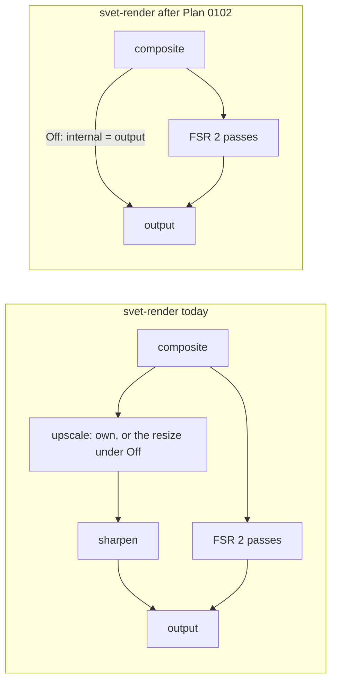

# 0102: Remove `own`, the engine's own upscaler: FSR 2 is the only one

> **Status:** done, closed 2026-11-25, v0.74.0: the fresh close review found no blocker and no major; its two findings (the shadow-wobble bar frozen from the removed upscaler, a dozen stale comments) were fixed in one pass (`c158260b`) and checked; ADR-0086 accepted with an Outcome. The gate 1358 of 1358 on lavapipe, loaded (section "The close review's rulings"). Before the close it read: implemented (dev, 2026-11-25) (approved by the owner, 2026-11-24: "remove"). Drafted 2026-11-24 with no interview; the guesses
> and the open questions are under "Risks & open questions", each with a recommended option.
> **Order:** small and alone in `crates/svet-render/src/frame/` and the fly-through's upscaler
> files; it runs when no lane edits `frame/encode.rs`, `frame/pipelines.rs` or
> `apps/flythrough/tests/gpu_fsr2.rs` (Plans 0099 and 0100 do not; Plan 0087, the rename, runs
> alone either before or after it).
> **Created:** 2026-11-24
> **Milestone:** M2 (the upscaler's decision) in [`docs/roadmap.md`](../../roadmap.md); cross-cutting
> **Related ADRs:** [ADR-0086](../../adrs/0086-fsr-2-is-the-only-upscaler-the-upscaler-of-our-own-is-removed.md)
> (proposed with this plan; at acceptance it supersedes
> [ADR-0024](../../adrs/0024-own-temporal-upscaler-on-the-hit-buffer.md) and the "stays opt-in"
> clause of [ADR-0034](../../adrs/0034-fsr-2-ported-to-wgsl-as-the-default-upscaler-candidate.md)),
> [ADR-0055](../../adrs/0055-render-settings-are-one-struct-with-an-apply-class-per-field-and-profiles-are-named-values.md)

## TL;DR

We delete the upscaler of our own (ADR-0024, Plan 0030): its two passes, its two shaders, its
history targets, its tuning fields, the jitter and sharpness settings that exist only for it,
the fly-through's `own` mode, its tests and its golden. FSR 2 is then the engine's only
upscaler, and a frame without FSR 2 renders at its output size. The recommendation is to
remove, not to keep it as a setting: it is not a cheap arm (see "Why this arm is not cheap to
keep"). The first thing the owner sees is `flythrough --upscaler own` refused with a line that
says so, and `F10` cycling two modes.

## Context & problem

FSR 2 at 1.5 has been the default since Plan 0055 (2026-11-03) and every profile's upscaler
since Plan 0069 (`RenderSettings::profile`: Floor, Portable, Performance and High all read
`UpscalerChoice::Fsr2`). The owner parked the removal on 2026-11-10 and confirmed it on
2026-11-11 (Plan 0069's answer 2: Portable uses FSR 2 at 720p output, and the removal goes
ahead after Plan 0069). The plans index has listed it as owed since (Sequence, step 6).

The owner's standing rule since 2026-11-12 is that an unpicked arm that costs nothing when off
stays a render setting. So this plan has to show that `own` is not such an arm, or recommend
keeping it.

**What `own` is in the tree at `193cae15`:**

- `crates/svet-render`: `UpscalerKind::Own(Upscaler)` and `UpscalerChoice::Own`; the `Upscaler`
  tuning struct (`own.alpha`, `own.alpha_moving`, `own.change_rel`, `own.change_abs`,
  `own.change_frames`); `RenderSettings::jitter` and `RenderSettings::sharpness`, which only
  `own` reads (FSR 2 jitters by its own sequence and sharpens by `fsr2.sharpness`); the passes
  `upscale` and `sharpen` (rows of `PASSES` in `frame/pipelines.rs`, entries of
  `FRAME_PASSES` in `frame/encode.rs`); `shaders/upscale.wgsl` and `shaders/sharpen.wgsl`;
  `UpscaleState`'s tuning and sharpen buffers and history target (`frame/upscale.rs`);
  `Frame::set_jitter`, `set_sharpness`, `set_upscaler`, `upscaler`, `upscale_history`.
- **It is also the resize path.** `Frame::upscaling` is true whenever FSR 2 runs, the jitter is
  on, or the internal size differs from the output; with no FSR 2 the `upscale` pass does the
  resize, jittered or not. So "`Off` at unequal sizes" is `own` without its jitter.
- `apps/flythrough`: `--upscaler off|own|fsr2`, `--jitter on|off` (which selects `own`), the
  `F10` cycle off, own, fsr2 (`hud/upscaler.rs`), the banner's words, `cli/settings.rs`'s map.
- Tests and goldens: the list is under Phase 3.
- Docs: `docs/flythrough.md`, `README.md`, `docs/nfr/02-frame-budget.md`'s frame ledger.

**What still depends on it:** no profile, no default, no other pass. The Portable path is FSR 2
from 853 x 480 to 1280 x 720. FSR 2's own composite (`composite_hdr`), its jitter sequence
(`jitter_at`, shared) and its RCAS do not use `own`'s passes.

### Why this arm is not cheap to keep

- **It is a second output path, not a branch.** Two more compute passes with their layouts and
  bind groups, a history target and two uniform buffers per frame object, a separate jitter
  flag and a separate sharpening setting. Every plan that touches the composite, the exposure,
  the output targets or the frame's inventory has to keep both paths right
  (`a_frame_after_the_second_builds_no_bind_group` cycles three upscalers; the `frame_bytes_*`
  inventories exist per path).
- **It is the baseline of FSR 2's bars.** Three gate tests of `gpu_fsr2` hold FSR 2 to "no
  worse than ours". The house rule since Plan 0098 is that a comparison bar proves its baseline
  is clean or measures the picture directly; nobody has judged `own`'s picture since Plan 0055,
  and under ADR-0082's calm defaults it has never been looked at.
- **It costs the gate.** In Plan 0098's merge gate (2153 s, loaded,
  `~/Work/vxe-live-archive/plan-0098/merge-gate.log`) the `gpu_upscale` binary's gate tests
  sum to 53.6 s and `upscaled_golden_sharpens_within_the_neighbourhood` reads 14.6 s. About
  39 to 45 s of that goes with the removal (arithmetic from that log; the four `frame_bytes_*`
  inventories, 23.2 s, are re-pointed, not deleted). Beside it, every test that builds a
  `Frame` compiles the `upscale` and `sharpen` pipelines on lavapipe; that cost is unread and
  Phase 1 reads it.
- **It costs lines:** `upscale.wgsl` and `sharpen.wgsl`, most of `frame/upscale.rs`,
  `apps/flythrough/tests/gpu_upscale.rs`, and arms in the files Phase 3 lists
  (`node scripts/loc.mjs` before and after is the reading).
- **Nobody picks it.** The owner made FSR 2 the default for clarity (Plan 0055) and kept it at
  Plans 0056 and 0061; the one priority is a stable image, and two temporal upscalers are two
  images to judge at every window.

### What is lost

- **The cheaper upscaler on the slow adapter.** At the owner's window `own` read 0.93 to 1.3 ms
  against FSR 2's 2.9 on the RTX, and 6 to 7 ms less on the Radeon (the static review,
  2026-11-10). At Portable on the RADV RENOIR FSR 2 reads 4.06 to 4.08 ms
  (`docs/nfr/02-frame-budget.md`, "The render profiles") against the 3.0 ms line for upscale,
  tone map and post in `docs/nfr.md` section 2; `own` at Portable's sizes is unread, and
  Phase 1 reads it so the loss is a number in ADR-0086 before anything is deleted. The owner
  answered this on 2026-11-11 (Portable takes FSR 2).
- **A temporal upscaler that is ours to change.** FSR 2 is a port of AMD's algorithm. The code
  stays in git history; the plan tags the last commit that has it.
- **A resize without FSR 2.** After this plan a frame with no FSR 2 renders at its output size.

## Decision

Remove `own` whole, and with it the settings that exist only for it. `UpscalerChoice` is
`Off | Fsr2`. Under `Off` the frame's internal size is its output size: `RenderSettings::scale`
applies as 1 and reads back as 1, documented on the field.

We rejected **keeping it as a setting** because it is not cheap when off (above). We rejected
**keeping its pass as a plain resize for `Off`** because that keeps both shaders' slot, the
history-free half of the pass and its tests for a combination no profile uses; a bilinear
resize can come back as its own small pass if a consumer asks. We rejected **keeping it for
the slow adapter alone** because the owner picked FSR 2 for Portable and a per-adapter
upscaler is two pictures to keep stable. ADR-0086 carries these.

## Architecture diagram



## Implementation phases

Each phase ships as its own commit. Every phase carries exactly one `**Owner skill:**`.
No phase needs a window: the default picture does not change, and Phase 2 proves that with
the goldens.

### Phase 1: The census and three readings, nothing deleted
- **Owner skill:** dev
- **What:** The list of what goes and what is re-pointed, read from the source, and the three
  figures the decision rests on, written to `docs/plans/logs/0102.md`.
- **Files touched:** `docs/plans/logs/0102.md` only.
- **Done when:** the readings log holds
  (1) the census: every hit of `rg -n 'Own\b|set_jitter|set_sharpness|set_upscaler\b|upscale_history|UPSCALE_WGSL|SHARPEN_WGSL|"upscale"|"sharpen"' crates apps`
  that is the upscaler's (not `EntityLight::Own`, not `Group::Own`), each marked delete,
  re-point (to what) or keep, and every test or rig that builds a `Frame` at unequal sizes
  with no FSR 2, by name;
  (2) the loss: the upscale stage's GPU time under `own` and under FSR 2 at Portable's sizes
  (853 x 480 to 1280 x 720) on the RADV RENOIR and the RTX 3080 Laptop, headless, the frame
  line's median of 30 timed frames, exclusive perf lock, load stated;
  (3) the gain per frame: `pipeline_times` for the `upscale` and `sharpen` rows on lavapipe
  and on the RTX, cold;
  (4) `node scripts/loc.mjs`'s totals line and the gate's per-binary sums for `gpu_upscale`
  and `gpu_golden` from the newest quiet gate log (`node scripts/test-times.mjs`), as the
  base. **No stop rule:** the figures inform ADR-0086's Negative list; the owner's go on this
  plan is the decision (question 1).

### Phase 2: `own` leaves `svet-render`
- **Owner skill:** dev
- **What:** The library has one upscaler. The variants, the tuning, the jitter and sharpness
  settings, the two passes, the two shaders and the history target are gone; `Off` renders at
  the output size.
- **Files touched:** `crates/svet-render/src/fsr2/settings.rs`, `settings.rs` (the fields, the
  class table, the setter table, the profile doc table), `frame/upscale.rs`,
  `frame/pipelines.rs`, `frame/encode.rs`, `frame/apply.rs`, `frame/compose.rs`,
  `frame/targets.rs`, `frame/mod.rs`, `lib.rs`; `shaders/upscale.wgsl` and
  `shaders/sharpen.wgsl` deleted; `crates/svet-render/tests/gpu_frame.rs`; the callers in
  `apps/flythrough` changed only as far as they must to compile (Phase 3 finishes them).
- **Done when:**
  - `rg 'UpscalerKind::Own|UpscalerChoice::Own|struct Upscaler\b' crates` finds nothing, and
    `shaders/upscale.wgsl` and `shaders/sharpen.wgsl` do not exist.
  - Plan 0069's settings gate (the `pub fn set_*` test and the class table test in
    `settings.rs`) passes with `jitter`, `sharpness` and `own.*` gone from every table: no
    orphan setter, no field without a class. CPU, under 1 s.
  - A CPU test, `off_renders_at_the_output_size`: a `RenderSettings` with `upscaler: Off` and
    `scale` 1.5 applied to a frame reads back `scale` 1, and `Frame::internal_size()` equals
    the output. Under 1 s (it needs no device if the clamp lives in the settings; if it needs
    one it is a `gpu_frame` test at about 3 s on lavapipe).
  - `FRAME_PASSES` holds neither `"upscale"` nor `"sharpen"`, and
    `compute_pipelines_created()` after `Frame::new` is two lower than at the plan's base
    (the base's figure from Phase 1). In `gpu_frame`, about 3 s on lavapipe.
  - `gpu_frame::a_frame_after_the_second_builds_no_bind_group` cycles `Off` and FSR 2 and
    still reads zero bind groups built after the second frame.
  - **The default picture is untouched:** every golden under `apps/flythrough/tests/golden/`
    except `upscaled.png` matches with no re-bless (`gpu_golden`, the binary's usual time),
    and `frame_bytes` under FSR 2 at 1280 x 720 from 853 x 480 is the base's figure less the
    removed history target and buffers, the difference worked out in the readings log from
    the targets' formats, not asserted as "smaller".

### Phase 3: The fly-through, the tests and the golden
- **Owner skill:** dev
- **What:** The testbed has two upscaler modes and says so; the tests that defended `own` are
  deleted or re-pointed; FSR 2's comparison bars stand on their own.
- **Files touched:** `apps/flythrough/src/cli/flags.rs`, `cli/mod.rs`, `cli/settings.rs`,
  `cli/tests.rs`, `hud/upscaler.rs`, `hud/modes.rs`; `apps/flythrough/tests/gpu_upscale.rs`,
  `gpu_fsr2.rs`, `gpu_golden.rs`, `gpu_entities.rs`, `gpu_entities/reading.rs`,
  `gpu_wobble.rs`, `gpu_dynamic_lights.rs`, `support/rigs.rs`, `support/settle/mod.rs`;
  `apps/flythrough/tests/golden/upscaled.png` deleted; `apps/tester` if its settings name the
  mode (Phase 1's census says).
- **Done when:**
  - `flythrough --upscaler own` exits non-zero before a device is asked for, with a line that
    names the removal and the two values left; `--jitter on` is refused the same way. CPU
    tests in `cli/tests.rs`, under 1 s each. `--upscaler off|fsr2` parse as before, and
    `the_start_look_and_upscaler_are_the_owners_picks` still reads FSR 2 at 1.5.
  - `F10` cycles off and fsr2; `the_upscaler_banner_names_each_mode_it_cycles_through` reads
    exactly those two banners (the mode shows in the window, as the testbed rule asks).
  - **Deleted with the pass** (`gpu_upscale.rs`, the claims are `own`'s):
    `the_jitter_resolves_sub_pixel_coverage_along_the_pillars_edge`,
    `a_still_camera_upscales_nearer_the_supersampled_render_than_the_bilinear_blit`,
    `a_carve_in_view_leaves_no_ghost_in_its_box`,
    `a_sideways_step_keeps_history_and_a_material_change_rejects_it`,
    `jitter_adds_little_flicker_on_a_still_vein`, `temporal_age_under_the_jitter`,
    `the_upscaler_keeps_stripe_edges_sharp_still_and_panning`,
    `a_sweeping_headlamp_and_a_lamp_step_keep_pace_with_plan_0024s_frame`,
    `the_upscaler_follows_an_exposure_step`, and the three hand-run readings in its
    `reading` module; in `gpu_golden.rs`
    `upscaled_golden_sharpens_within_the_neighbourhood` and the `upscaled.png` arm of
    `the_moved_upscaled_goldens`. For each, the readings log names the `gpu_fsr2` test that
    defends the same claim for FSR 2, or says the claim dies with the pass.
  - **Re-pointed:** `frame_bytes_add_the_histories_and_the_output_target`,
    `frame_bytes_hold_the_store_and_no_emissive_history`,
    `frame_bytes_hold_the_visibility_pair` and `frame_bytes_hold_the_direct_pair` assert the
    same inventories on a frame at equal sizes (or under FSR 2 where they need an output
    target), each figure worked out in the test from the formats; they move to the binary
    that fits (`gpu_fsr2` or `gpu_frame`) and `gpu_upscale.rs` is deleted if nothing is left.
    `at_scale_one_and_a_half_the_hit_pass_runs_on_256_by_144_and_the_blit_fills_384_by_216`
    becomes FSR 2's (the hit pass runs on 256 x 144 and the output is 384 x 216) or is
    dropped if `gpu_fsr2` already asserts it. Each re-pointed test under 10 s on lavapipe;
    the first read 12.1 s in the loaded log, so it is cut to one frame object or takes the
    soak mark by a quiet reading.
  - **Restated as absolute bars:** `fsr2_at_scale_1_keeps_stripe_edges_sharp_at_arms_length`,
    `fsr2_adds_little_flicker_on_a_still_vein` and
    `fsr2_at_scale_1_5_moves_shadows_no_more_than_ours_on_a_still_camera` no longer render
    `own`; each asserts FSR 2's figure against a constant, which is `own`'s last reading on
    lavapipe at the plan's base times the margin the test used, the reading and the
    arithmetic in a comment beside the constant. A bar FSR 2 passes only because `own` was
    worse is named in the readings log, not hidden.
  - **Arms removed** where a rig or reading offered `own`: `gpu_entities::trail_rule`,
    `gpu_wobble`'s `frame_for`, `gpu_dynamic_lights`'
    `reading_a_shadow_edge_after_a_disocclusion`, `gpu_entities/reading.rs`'
    `the_grain_on_walking_walkers`, `support/rigs.rs`, `support/settle/mod.rs`'s tag.
  - `rg -i '\bown\b' apps/flythrough/src/hud/upscaler.rs apps/flythrough/src/cli` finds no
    upscaler mode, and `node scripts/check-test-tiers.mjs` and `check-file-size.mjs` exit 0.

### Phase 4: Docs, the ledger, the gate's time
- **Owner skill:** dev
- **What:** The documents stop naming `own`, and the saving is a reading.
- **Files touched:** `docs/flythrough.md`, `README.md`, `docs/nfr/02-frame-budget.md`,
  `docs/nfr.md` section 7 (the reading), `docs/plans/logs/0102.md`.
- **Done when:**
  - `docs/flythrough.md` and `README.md` list `--upscaler off|fsr2`, no `--jitter`, and the
    `F10` row with two modes; `flythrough --help` (the source) agrees with both.
  - The frame ledger in `docs/nfr/02-frame-budget.md` carries a dated note at its head: its
    2026-10-31 scenario tables were read under `own`, which no longer exists; the tables are
    kept as history and the profiles' rows are the live figures. (A rewrite of the ledger is
    the backlog's "Budget lines" entry, not this plan's.)
  - **The gate's time saved is measured:** a quiet gate of the plan's base and of its tip,
    back to back under the perf lock, `node scripts/test-times.mjs` on both; the readings log
    and `docs/nfr.md` section 7 record the whole wall and the sums for `gpu_upscale`,
    `gpu_golden`, `gpu_fsr2` and `gpu_frame`, with the load. The expectation from the loaded
    log is 39 to 45 s of deleted tests plus the two pipelines a frame; a saving under 30 s
    is disclosed, not a failure.
  - `node scripts/loc.mjs` at the tip against Phase 1's base, in the readings log.
  - The tag `archive/own-upscaler` points at the plan's base commit (the last tree with
    `own`), created by `dev` and named in the readings log; pushing it is the owner's call.

The close (architect) accepts ADR-0086, marks ADR-0024 superseded in the index, writes the
`CHANGELOG.md` entry naming the removed API under a minor bump (a breaking change to
`RenderSettings` and `Frame`), fixes `CLAUDE.md`'s `svet-render` line ("FSR 2 and our
upscaler") in the harness repo, and turns the backlog entry into its pointer line.

## Data shapes

```rust
// illustrative
pub enum UpscalerChoice { Off, Fsr2 }
pub enum UpscalerKind { Off, Fsr2(Fsr2Settings) }
// RenderSettings loses: jitter, sharpness, own. Under Off, scale applies as 1.
```

**Profile rows:** no field is added. `upscaler` keeps its `Settle` class and every profile's
value (FSR 2). `jitter` (`Settle`), `sharpness` (`Live`) and `own.*` (`Live`) leave the class
table and the setter table.

## Budgets

- `docs/nfr.md` section 2, **upscale (FSR 2), tone map, post, 3.0 ms**: not moved. Phase 1
  records what `own` would have read at Portable on the RENOIR, where FSR 2 is over the line
  at 4.06 to 4.08 ms.
- Section 3, **frame memory**: FSR 2's inventory falls by `own`'s history target and buffers
  if they are allocated beside FSR 2 today (Phase 1 says; Phase 2 works the figure out).
- Section 7, **the gate tier's wall time** and **time to first frame**: the tests deleted and
  two pipelines fewer per frame object; measured in Phase 4, on the dev reference on
  lavapipe, quiet.

## Risks & open questions

- **Determinism, threading:** none touched. **GPU features:** none added.
- **A hidden user of the resize.** A test rig or the tester app may build a frame at unequal
  sizes with no FSR 2. Phase 1's census finds them before Phase 2 breaks them.
- **The clamp surprises a consumer** who sets `Off` with a scale. The field's doc says it, the
  read-back shows it, and `off_renders_at_the_output_size` holds it.
- **Other lanes.** Plan 0100 edits the light pass and `gpu_outdoor`; Plan 0099 the bake queue.
  Neither edits the upscaler's files. Plan 0098 left `frame/encode.rs` under its cap
  (1160 of 1200); this plan shrinks it.

**Answered 2026-11-24 (owner):** question 1, remove `own` (option a). Questions 2 and 3 go
by the recommended options unless he says otherwise.

**Open owner questions**, each with the recommended option first:

1. **Remove `own`, knowing it is the cheaper upscaler on the Radeon?** (a) Remove
   (recommended: the owner's answers of 2026-11-10 and 2026-11-11 stand, no profile uses it,
   and it is not a cheap arm). (b) Keep it as a setting and close the backlog entry; then
   this plan shrinks to restating FSR 2's three comparison bars.
2. **`Off` at unequal sizes:** (a) `Off` renders at the output size (recommended; nothing to
   maintain). (b) Keep a plain bilinear resize pass, about 30 lines of WGSL, as the cheapest
   possible arm for a consumer's slow adapter.
3. **The flags:** (a) `--upscaler own` and `--jitter` are refused with a line naming the
   removal (recommended; a tester's old command line fails loudly). (b) They are unknown
   flags like any other.

## What this plan does NOT do

- It does not change FSR 2, its settings, its jitter sequence or any profile's values.
- It does not rewrite the frame ledger or move the upscale line (the backlog's "Budget lines
  over with no owner").
- It does not add a resize pass, a second upscaler or a per-adapter upscaler choice.
- It does not touch the Radeon's walk speed (the backlog's "The slow adapter's walk-speed
  spike").

## The close review's rulings (amendment, 2026-11-25, architect)

The fresh close review read `eae4884f` with main merged in (`daba1202`). No blocker and no
major: the removal is whole, the gate log reconciles (16 gate tests gone, 11 arrived, 1363 to
1358; 10 ignored tests gone, 1 arrived, 242 to 233), the goldens match with no re-bless, and
the refusals, the banner and the settings gate assert what the phases claim. Two findings go
back to `dev` as one fix pass; the plan closes after it. The rulings on the disclosed
deviations:

1. **The light-change thresholds as constants: accepted.** `CHANGE_REL` 0.1, `CHANGE_ABS`
   0.01 and `CHANGE_FRAMES` 24 are `Upscaler::default()`'s values at the base, and at the
   base no profile, no flag and no key set `own.*` to anything else (`RenderSettings::profile`
   and `cli/settings.rs` both passed the default), so every profile renders as before. The
   16-byte uniform matches `LightChange` in `fsr2/input.wgsl` field for field and
   `layout_tests.rs` mirrors it. ADR-0055's rule is about a mechanism a plan adds; none is
   added, and three tuning values nobody set are not an arm in the sense of the owner's rule
   of 2026-11-12. What is lost is recorded in ADR-0086's Outcome at the close: FSR 2's
   light-change test is no longer tunable at run time; if a consumer needs it, the values
   return as `fsr2.*` fields.
2. **`Off` through `RenderSettings::clamped`: accepted.** Every path was read
   (`apply_settings`, `set_upscaler_kind`, `set_sizes`, `set_resolution`, `with_sizes`): what
   `Frame::settings()` reads back is what renders, in every state. The one thing a consumer
   can trip on is documented on the field and held by two gate tests
   (`gpu_frame::off_renders_at_the_output_size`, `gpu_settings`' `assert_classes`): settings
   asking for `Off` with a scale other than 1 never read back equal to what was asked. The
   internal size a frame was built with is kept for FSR 2 and is not a setting.
3. **A constant frozen from the removed arm is not a bar (review finding 1).** This plan's
   Phase 3 asked for it ("`own`'s last reading times the margin"), so `dev` built what was
   written; the plan was wrong against the house rule (a comparison bar proves its baseline
   is clean, or the test measures the picture directly) and against ADR-0086's own "FSR 2's
   bars stand on absolute figures". The test's reference arm settles it: with no upscaler
   the same picture reads 0.000/255 over the whole image and at the lamp-shadow boundary, so
   `own`'s 1.765 and 8.200 were wobble of its own, and FSR 2 passing under them proves
   nothing (at scale 1 it reads over `own`: 1.346 against 0.847, 5.098 against 3.863). The
   claim the test makes after the fix pass, on lavapipe:
   - the frame with no upscaler is still: its wobble is at most 0.001/255 over the whole
     image and at the boundary (it reads 0.000 and 0.000), so every level FSR 2 reads is the
     upscaler's;
   - FSR 2 at scale 1.5 holds the picture the owner accepted at Plan 0098's windows: at most
     its own reading plus 10 %, 1.419 x 1.1 = 1.561/255 over the whole image and 4.512 x 1.1
     = 4.963/255 at the boundary. The readings are FSR 2's at `be97152a` and again at
     `eae4884f` (the review's run, identical to three places: lavapipe renders the same
     bytes); the 10 % is for CI's other LLVM, not for noise;
   - scale 1 (1.346 and 5.098) stays a printed reading with no bar beside it.
   This is a regression bar and says so. It does not claim that 4.5 levels at a still shadow
   edge is good; that is the backlog's (a still-camera shadow edge under FSR 2's jitter
   against ADR-0076's rule that nothing moves at rest), routed at the close.
   `fsr2_adds_little_flicker_on_a_still_vein` keeps its figures, 0.40/255 and 1.15 %, as
   absolute bars: its baseline read 0.0001 and 0.0000, so the margin was the whole bar
   already. Both lose the constants and the words that name the removed upscaler.
   `fsr2_at_scale_1_keeps_stripe_edges_sharp_at_arms_length` asserts against N and R, which
   are frames with no upscaler, and stands as it is.
4. **The coverage lost: none that was FSR 2's.** The output-target growth that
   `frame_bytes_add_the_histories_and_the_output_target` held is asserted to the byte by the
   gate's `gpu_fsr2::frame_bytes_under_fsr2_add_fsr2s_inventory_and_the_output_target`. The soak
   test `a_still_camera_under_our_upscaler_...` asserted `own`'s distance alone; FSR 2's was
   a printed line before and is a hand-run reading now. `hud::stats`' deleted upscale-row
   test is covered by `the_upscale_row_sums_fsr2s_passes`.
5. **Phase 2's commit carrying most of Phase 3, and the files outside the lists: accepted as
   disclosed.** A tree that builds at every commit forced it; both logs say so.
6. **Stale comments (review finding 2).** The phases' greps looked for identifiers, not for
   prose, and about a dozen comments still describe the removed passes or point at
   `upscale.wgsl`. The fix pass sweeps them.

### What the dev does (one fix pass, one commit)

- `apps/flythrough/tests/gpu_fsr2.rs`: the shadow-wobble test asserts ruling 3's three
  claims and is renamed for what it claims; `OWN_*` and `STILL_VEIN_*` go; the still-vein
  test asserts 0.40/255 and 1.15 % as its own figures. Each constant's doc states the
  reading, the adapter and the commit. Run both under the perf lock on lavapipe
  (`--run-ignored only`, the two by name; about 35 s) and put the four readings in the
  readings log.
- The comment sweep, no behaviour change: `shaders/fsr2/input.wgsl` (the lines above
  `struct LightChange`, `STILL_PX` and `light_changed`), `shaders/edits.wgsl` line 2,
  `shaders/common.wgsl` (`output_size`), `frame/mod.rs` (`Frame::target`'s doc),
  `fsr2/prepare.rs` (`FrameInputs`' doc), `camera.rs` (`jitter`'s doc), `layout_tests.rs`
  (the `Sharpen` arm and its comment, if no shader struct of that name is left),
  `tests/gpu_frame.rs` (the pipeline count's doc: the count and why, no "before");
  `apps/flythrough/src/hud/upscaler.rs` (`set_sharpen`'s doc), `hud/stats.rs`
  (`UPSCALE_LINE_MS`'s doc), `tests/support/settle/runs.rs` (`JITTER_PHASES`). Then
  `rg -n -i 'upscale\.wgsl|sharpen\.wgsl|upscale pass|sharpen pass|our upscaler|UpTuning|UpscaleUniform|JITTER_PHASES' crates apps`
  finds only the refusal's words and FSR 2's own `jitter_phases`.
- Gates: build, `node scripts/test-changed.mjs --profile quick`, `--clippy`, fmt, the naga
  and layout tests of `svet-render` (in the quick tier), `check-comment-hygiene`. No gate
  re-run: no gate test's code changes.

### The close (2026-11-25, architect)

The fix pass `c158260b` does what rulings 3 and 6 ask: the shadow-wobble test asserts the
clean reference and FSR 2's own figures with 10 %, the still-vein test its absolute figures,
and the review's `rg` finds only FSR 2's `jitter_phases`. Build, clippy, fmt and the scripts
were run again on it; the two soak tests' pass is the dev's log (`live/fixpass-soak.log`),
with the same figures the review read. Three things the fix pass left alone:

- `SEED_STRIDE`'s doc in `apps/flythrough/tests/support/settle/runs.rs` ("a multiple of the
  jitter's 16 phases") is true of the removed upscaler's sequence alone: under FSR 2 at 1.5
  the sequence has 18 phases and 2^20 is not a multiple of 18. Whether the settle rig's seeds
  must share their jitter offsets is the rig's question, routed to the backlog.
- The words "former upscaler" in `gpu_look_field.rs` and `svet-render`'s `gpu_frame.rs`
  stand: each is a step in the derivation of a pinned byte count from a figure read under
  that upscaler, and the derivation needs the name.
- The `WANDER_*` doc ("blocks of `WANDER_BLOCK` frames") stands.

Routed to the backlog: the still shadow edge under FSR 2's jitter (with Plan 0100's
terraces), the quiet re-read of the gate's saving, the settle rig's seed stride.

## Implementation log

> Written by `dev`: one row per phase as its commit lands, then the close block. **The phases
> above are the contract. This section records what happened.** Observations, never conclusions:
> no pass list, no self-assessment. Deviations and unmet done-whens are **always** disclosed.
> Keep it shorter than `## Implementation phases`. Readings, gate counts, attempts, sweeps and
> resume notes go to the plan's readings log, `docs/plans/logs/0102.md`, and this section links
> it once it exists.

Readings: [`logs/0102.md`](../logs/0102.md).

| phase | owner | state | commit |
|---|---|---|---|
| 1: The census and three readings | dev | done; readings loaded (three lanes) | `47fb7d1f` |
| 2: `own` leaves `svet-render` | dev | done; carries the fly-through callers, tests and CLI refusals the compiler forced (see Notes) | `00b815d1` |
| 3: The fly-through, the tests and the golden | dev | done; its code landed in `00b815d1`, this commit deletes `upscaled.png`; the shadow bar is renamed | `860c0ae6` |
| 4: Docs, the ledger, the gate's time | dev | done; the gate saves 26.0 s (under the 30 s expected), both runs loaded | `ec97f77b` |
| fix pass: the review's findings 1 and 2 | dev | done; the shadow-wobble and still-vein bars restated as ruled, both pass on lavapipe (loaded); the comment sweep | this commit |

### Notes

- Questions 2 and 3 took the recommended options: `Off` renders at the output size
  (`RenderSettings::clamped`; the frame keeps the asked internal size for FSR 2), and
  `--upscaler own` and `--jitter` are refused with a line naming Plan 0102 and ADR-0086.
- Not in the plan: FSR 2's input pass read its light-change thresholds from `own`'s tuning
  buffer and the encode its older light list by `Upscaler::change_frames`. They became frame
  constants at the same values (`CHANGE_REL`, `CHANGE_ABS`, `CHANGE_FRAMES`) in a 16-byte
  uniform; the `own.*` rows go, so they are no longer a live setting.
- Phase 2's commit carries the fly-through's source, examples and tests as far as the removed
  API forced, which is most of Phase 3's code (the CLI refusals, the re-pointed and restated
  tests, `gpu_upscale.rs`'s deletion); files outside both phases' lists: `run/*.rs`,
  `hud/stats.rs`, `run/menu_tests.rs`, the examples, `gpu_settings.rs`, `gpu_look_field.rs`,
  `gpu_settle.rs`, `fsr2/input.wgsl`, `layout_tests.rs`.
- `fsr2_at_scale_1_5_moves_shadows_no_more_than_ours_on_a_still_camera` is renamed
  `..._than_the_fixed_bar_...`; FSR 2 passes its scale-1.5 bar only against `own`'s figure
  (1.419 against 1.765, 4.512 against 8.200). The backlog's two CI-failing soak tests: the
  `gpu_upscale` one is deleted, the `gpu_fsr2` one lost its `own` assertion and is a reading.
- The four inventory tests and the scale-1.5 sizes test moved to `svet-render`'s `gpu_frame`
  (`gpu_fsr2.rs` sits at 1961 of 2000 lines); `frame_bytes_add_the_histories_...` is not kept,
  its output-target growth asserted by FSR 2's re-pointed inventory test.
- The gate saves 26.0 s (894.3 to 868.3 s), under the 30 s expected; both runs loaded with
  three lanes open, 2 test threads.

### Close triggers

_(Facts for the architect. No recommendations, and no suggested version bump.)_

- **What shipped:** a removal (the engine's own upscaler, its passes, shaders, settings and
  tests); FSR 2 is the only upscaler.
- **Public API changed:** `svet-render`: `UpscalerChoice::Own`, `UpscalerKind::Own`,
  `Upscaler`, `RenderSettings::{jitter, sharpness, own}`, `Frame::{set_jitter, jitter,
  set_sharpness, sharpness, set_upscaler, upscaler, upscale_history}`, `UPSCALE_WGSL`,
  `SHARPEN_WGSL`, `internals::JITTER_PHASES` removed; `UpscalerChoice::kind` takes the FSR 2
  settings alone; `RenderSettings::clamped` and `internals::{CHANGE_REL, CHANGE_ABS}` added;
  `FRAME_PASSES` 24 to 22 entries; `fsr2/input.wgsl` binding 5 is `LightChange` (16 B);
  under `Off` a frame renders at its output size. Fly-through: `--upscaler own` and `--jitter`
  refused, `F10` cycles off and fsr2; examples `strip`, `hero`, `clip`, `settle` refuse their
  `own` flags.
- **Budget readings:** `docs/nfr.md` section 7, the gate at the base `be97152a` 894.3 s and at
  the tip `860c0ae6` 868.3 s (1363 and 1358 tests, lavapipe, 2 threads, loaded); section 3,
  FSR 2's frame at Portable 389 727 008 B at both (RTX 3080 Laptop); section 2, Phase 1's
  Portable upscale readings (RTX `own` 0.380 against FSR 2 0.640 ms, RENOIR 1.790 against
  4.077 ms, loaded). Pipelines per new frame 15 to 13 (lavapipe).
- **Gate at the tip:** `cargo nextest run --workspace --profile gate --test-threads 2` 1358
  run, 1358 passed, 233 skipped, exit 0; `test-changed --profile gate --sole --since main` no
  sole test in reach, exit 0; `cargo test --doc --workspace` 10 passed; `cargo clippy
  --workspace --all-targets -- -D warnings` 0; `cargo fmt --all --check` 0; `cargo deny check`
  0; doc, tier, size, hygiene, index-row and plan-size scripts 0.
- **Outstanding `human` phases:** none. The tag `archive/own-upscaler` (`be97152a`) is local.

## Followups

- If FSR 2's light-change test needs tuning at run time: `CHANGE_REL`, `CHANGE_ABS` and
  `CHANGE_FRAMES` return as `fsr2.*` fields of `RenderSettings` (ADR-0086's Outcome).
- If a consumer asks for a resize without FSR 2: a bilinear pass as its own small plan.
