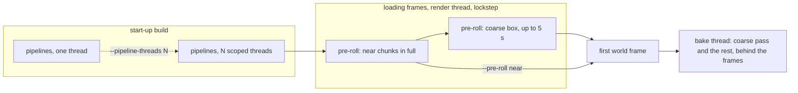

# 0108: The start-up readings: a shorter pre-roll, and the cold pipelines split

> **Status:** done (closed 2026-11-27, v0.82.0): clean in a fresh review session, no blocker and no major. `--pre-roll full|near|off` and `--pipeline-threads N` built and read; on the owner's pick a window over a streamed source starts on `near` (the forest's first frame at 1.2 to 1.9 s where it read 6.3 to 9.0), a bounded scene and every headless run keep `full`; the start-up pipelines build on 4 threads on 16 or more logical CPUs, else 2 (a cold start 37 s where it read 59 on the RTX, 12 s where 17 on the RENOIR). What it left is in `docs/backlog.md`. Approved (owner, 2026-11-26: "go on both, all recommended, do not start until these lanes finish"; see "Amended 2026-11-26 (owner)"). Drafted from
> [the review of 2026-11-26](../../reviews/2026-11-26-work-off-the-render-thread.md) on the owner's
> "all recommended" (its question 2: the pre-roll reading now as a chore beside Plan 0093, the
> cold-pipeline split before the next tester archive), with no further interview; the guesses
> and the questions left are under "Risks & open questions". **Order:** Phases 1 and 2 may run
> now, beside Plan 0093 (the overlaps are under "Beside Plans 0093 and 0103"). Phase 3 runs
> before the next tester archive is cut and may wait until then. It is a chore of readings: a
> start-up plan follows only if the readings and the owner's eye say so.
> **Created:** 2026-11-26
> **Milestone:** cross-cutting: start-up, `docs/nfr.md` section 7 (M7's tooling in
> [`docs/roadmap.md`](../../roadmap.md) is the nearest home)
> **Related ADRs:** [ADR-0059](../../adrs/0059-loading-runs-as-time-sliced-steps-on-the-apps-frame-loop-behind-an-engine-loading-frame.md)
> (the loading stages and the steppable pre-roll),
> [ADR-0083](../../adrs/0083-the-live-bake-queue-runs-on-a-bake-thread-the-render-thread-applies-its-write-lists-and-issues-its-submits.md)
> (the bake thread; the pre-roll stays lockstep),
> [ADR-0076](../../adrs/0076-light-stability-rules-world-history-per-source-a-fade-per-transition-and-a-ratcheted-pop-counter.md)
> (what a surface shows before its record lands, and that a landing fades),
> [ADR-0087](../../adrs/0087-the-renderers-pipeline-cache-is-the-drivers-through-wgpu-as-bytes-the-consumer-keeps.md)
> (proposed, Plan 0103's: the cache beside the split). No new ADR: nothing is decided here,
> two things are read.

## TL;DR

Every start waits 5.7 to 7 s for the light pre-roll before the first world frame, and a
first-ever start waits another 36 s (RTX) or 12 s (RENOIR) for pipelines. Both were measured
before the bake thread existed, or have never been split. This chore takes two readings.
**One:** a setting, `--pre-roll full|near|off`, ends the pre-roll at the near chunks and lets
the bake thread finish the rest behind the first frame; headless runs read how much sooner
the first frame comes and what it shows, and then the owner looks at the start in a window
and says whether a darker or popping first picture is acceptable for the seconds saved (3 to
5 s is a guess until read). **Two:** a cold start with the pipelines built on 1, 2 and 4
threads says whether the drivers compile in parallel at all. The defaults change only on the
owner's pick and only where the readings pay.

## Context & problem

- **The pre-roll** ([Plan 0103's log](../logs/0103.md), loaded, indicative): with warm pipelines
  the first world frame comes at 6.5 to 9.5 s on the RTX 3080 Laptop and 6.8 to 7.1 s on the
  RENOIR, 5.7 to 7 s of it the pre-roll's two stages, against the 3 s proposal of
  `docs/nfr.md` section 7. The pre-roll runs in lockstep on the render thread behind the
  loading frames: first the chunks within `--near` (2) of the camera's chunk are baked in
  full, then a coarse pass runs for up to 5 s of work time (`COARSE_PRE_ROLL_MS`) over the
  chunks mirrored at that moment. So the coarse box is at most 5 s of the 5.7 to 7.
- **What changed:** with the bake thread on, every in-view chunk of the forest has some
  light about 8 s after the first frame, at an 8.3 ms frame
  ([Plan 0099's log](../logs/0099.md), RTX host). The coarse pass no longer has to hold the
  first frame to be affordable. Whether the first picture holds without it is the owner's
  first rule (a stable image; no waiting for light, but no unlit first picture either), and
  only his eye decides it. The pop counter that would count it (Plan 0090) is not built.
- **No flag shortens the pre-roll alone today.** `--near` and `--coarse` also change the
  live queue after the first frame; `--pre-roll-drain` lengthens the bake after the first
  frame and holds the camera, the opposite. So the reading needs one small setting.
- **The cold pipelines** (the same log): the pipeline span reads 35.5 to 36.7 s cold on the
  RTX and 11.7 to 12.4 s on the RENOIR; the first world frame about 46 s and 20 s. The
  start-up build is already off the render thread, as one thread creating pipelines in turn.
  `wgpu`'s device is shared across threads, so the build can be split; whether the NVIDIA and
  RADV compilers then run in parallel is **unread**, and the gain is a guess between nothing
  and the thread count. A default start builds no default-off arm (the log's finding); an
  arm picked live compiles on the render thread at its first use (`absorb`'s cold start read
  70 s at Plan 0094's window).

It touches `docs/nfr.md` section 7 (time to first frame, a proposal of 3 s) and nothing
else. The consumer's side is `project-context.md`'s start of a run: a first start that takes
most of a minute is what a tester sees first.

## Decision

Read before deciding. The chore adds two settings whose defaults are today's behaviour, takes
the readings, shows the owner the start, and writes down what was picked. It builds no
background pipeline mechanism and no cache. We rejected **shortening the pre-roll by
default now** (a darker first picture is the owner's call, and unread); and **a start-up plan
drafted now** (its mechanism depends on both readings).

## Architecture diagram



## Implementation phases

Each phase ships as its own commit, one phase a dev brief. No test here passes by a clock:
every time is a printed reading. No scene is changed for a reading. Each hold of the perf
lock is projected from its first arm; one projected past 20 minutes is split. The gate tier
is the most any step runs.

### Phase 1: `--pre-roll full|near|off`, and what the first frames show (a reading)
- **Owner skill:** dev
- **What:** A fly-through setting, default `full` (today's behaviour, byte for byte):
  `near` ends the pre-roll when the near chunks hold their light (the coarse box at 0 ms;
  the coarse pass then runs in the live queue behind the first frame, on the bake thread
  where it is on); `off` skips the near chunks too (a reading's arm: the darkest start
  there is). The engine's `PreRoll` already takes the box and the near list, so the setting
  is the fly-through's. **Its mode shows in the window:** the banner's queue row and the
  HUD's queue row read `pre-roll full`, `pre-roll near` or `pre-roll off`, beside
  `bake thread on|off`. The first world frame prints, once, the in-view chunks still
  waiting (blank and coarse, the `bake queue view:` line's counts) as `first frame light:`.
- **Files touched:** `apps/flythrough/src/cli/outdoor.rs` (the flag, beside
  `--pre-roll-drain`), `cli/mod.rs`, `cli/parse.rs`, `cli/tests/outdoor.rs`,
  `run/loading.rs`, `run/queue.rs`, `run/hud_feed.rs` (the row), `docs/flythrough.md` (one
  row), `crates/svet-render/tests/gpu_loading.rs`, `docs/plans/logs/0108.md` (new).
- **Done when:**
  - The CLI test asserts the three values, the default, a refused fourth value, and the
    three row texts. `--pre-roll near` with `--pre-roll-drain` is refused with a message
    (the two pull opposite ways).
  - `a_pre_roll_boxed_at_zero_ends_at_the_near_chunks` (`gpu_loading`, lavapipe, expected
    under 10 s: a guess, read in the phase): a `PreRoll` with `box_ms` 0 is `Done` no later
    than the step after the near chunks' moment, with every near chunk settled and
    `coarse_chunks` 0; with an empty near list and `box_ms` 0 it ends at its first step. Counts and states only; the pre-roll reads the work time it is passed, not
    a clock.
  - A headless run with the default prints the same `pre-roll:` summary line fields as
    before the phase (the default is unchanged), and the fly-through's default golden
    (`gpu_golden`, by name) is byte-identical.
  - **The readings**, in the log, release, pipelines warm, `--bake-thread on`, on the RTX
    3080 Laptop (Floor) and the RENOIR (`--adapter RENOIR --profile portable --render
    1280x720`), on two scenes: the forest (`--source outdoor --spawn forest`) and the
    showcase's hall (`--source showcase --shot hall`, lit only by emitters, where an
    unbaked surface is darkest). Per adapter, scene and arm (`full` named the before,
    `near`, `off`): (1) three starts of `--headless --frames 3`: the time to the first
    world frame (`first frame after`), the pre-roll stages' ms (`load_stages`), and the
    `first frame light:` counts; (2) the first picture as stills (`--still`, one run a
    still): frame 0 for every arm, and for `full` and `near` the frames nearest 1, 2 and
    5 s after the first frame, picked from the arm's own frame time in (1), with the wall
    time each still came from printed beside it (a reading; headless frames are not paced
    as a window's are, so the times are indicative and Phase 2 is the judge). One sheet per
    adapter and scene: arms in rows, times in columns. If Plan 0093's `--still-at` is on
    main when this phase starts, one run an arm writes its stills with it; this plan adds no
    still flag of its own.
  - **Stop:** `near` brings the first world frame less than 2.0 s sooner than `full` on
    both adapters and both scenes. Then the pre-roll half ends here with the figures
    recorded, Phase 2 is skipped, and the backlog's entry says so. (The coarse box is at
    most 5.0 s of work time, so the most `near` can save is about 5 s plus the loading
    frames' overhead around it.)
  - About 72 starts of 10 s or less: two holds of the exclusive perf lock, one an adapter,
    each projected from its first arm. Quick tier over `flythrough`; `gpu_loading` and
    `gpu_golden` by name.

### Phase 2: The owner looks at the start
- **Owner skill:** human
- **What:** Windowed starts of the forest and the hall on the RTX, the owner moving as he
  likes from the first frame (no camera hold: no `--pre-roll-drain`, nothing that locks the
  view), stdout visible. First `--pre-roll full`, named on screen and by the orchestrator as
  the before; then `near`; `off` only if he asks. Phase 1's sheets are shown first, so the
  window opens on what the headless runs already say. The orchestrator pings when the
  binary and the sheets are ready.
- **Files touched:** `docs/plans/logs/0108.md` (the owner's words, dated).
- **Done when:** the owner says one of: `near` is the start's default in a window; `full`
  stays; or something between (a shorter coarse box, in seconds: then the architect amends
  the setting to take it and Phase 1's readings are repeated for that value only). His eye
  decides; the seconds saved are Phase 1's figures, not this draft's guess.

### Phase 3: The cold pipelines on 1, 2 and 4 threads (a reading, before the next tester archive)
- **Owner skill:** dev
- **What:** A start-up setting, `--pipeline-threads N` (1 to 8, default 1: today's
  behaviour): the start-up build creates the non-lazy pipelines on `N` scoped threads
  (`std::thread::scope` over the pass table; no pool, no dependency), each pipeline still
  built once. The `start-up:` lines print `pipelines on N threads` and the per-pass times as
  today. Cold starts are taken with the drivers' caches pointed at an emptied scratch
  directory (`__GL_SHADER_DISK_CACHE_PATH` and `MESA_SHADER_CACHE_DIR`, as Plan 0103's log
  did); the owner's real caches are never read or touched.
- **Files touched:** `crates/svet-render/src/frame/pipelines.rs` (the build loop),
  the entity and bake pipelines' build entry the start-up thread calls,
  `apps/flythrough/src/run/mod.rs` (`build_gfx`), `run/loading.rs`, `cli/` (the flag and its
  test), `docs/flythrough.md` (one row), `docs/plans/logs/0108.md`.
- **Done when:**
  - The CLI test asserts the flag's range and default and the `start-up:` text for 1 and 4.
    `the_passes_built_on_four_threads_are_the_passes_built_on_one` (`gpu_frame`, lavapipe,
    expected under 10 s: a guess; lavapipe compiles slowly, so over the line it is born
    `#[ignore = "soak"]` and named so): a frame built with 4 threads and one built with 1
    render the same first frame of a fixed scene byte for byte, and every non-lazy pass
    reports built in both. The default golden is byte-identical.
  - **The readings**, in the log, release, `--headless --source outdoor --frames 3`, each
    start cold on a fresh scratch cache: `N` = 1, 2, 4 on the RTX and on the RENOIR, two
    starts each (12 starts: about 46 s each on the RTX and 20 s on the RENOIR on record, so
    about 6.5 minutes), the pipeline span and the per-pass times; one start at `N` = 2 under
    `taskset -c 0-7` on each adapter (the eight-CPU stand-in: world generation runs on its
    own threads at the same time, and the floor has no idle core); and, RTX only, the
    start with a default-off arm picked (`--leaf-shadow absorb`) at `N` = 1 and 4, cold
    (two starts, about 70 s each on record): the arms stage's time. The log says, from the
    per-pass times, whether the passes' own times grow as `N` grows (a driver that
    serialises its compiler shows the same span and longer passes).
  - **The line:** `N` = 4 cuts the cold pipeline span by under 25 % against `N` = 1 on
    both adapters: the drivers do not compile in parallel enough to pay; the setting stays
    at 1 and the reading is recorded. Otherwise Phase 4 sets the default (below). On the
    stand-in, a start at `N` = 2 that reaches its first world frame later than `N` = 1 by
    more than 10 % is reported, and the default then stays 1 until the architect amends
    (a default that follows the logical CPU count).
  - About 11 minutes of starts in one hold of the exclusive perf lock, projected from the
    first. Quick tier over the changed crates; `gpu_frame` by name.

### Phase 4: The picks written down
- **Owner skill:** dev
- **What:** The defaults set to what Phase 2 and Phase 3 picked, and the lines. If the owner
  picked `near`: it is the default **in a window**, and `full` stays the default under
  `--headless` (owner question 1), so every golden, every reading on record and Plan 0093's
  shots start as they do today. If Phase 3's line was met: `--pipeline-threads` defaults to
  2 (the listing pool's count on 8 logical CPUs: the listers are idle while the start-up
  builds, so the floor's sum holds), or to 4 where the logical CPUs are 16 or more and
  Phase 3 read 4 faster than 2; else it stays 1. When Plan 0107's thread plan exists the
  default reads it.
- **Files touched:** `apps/flythrough/src/cli/`, `run/loading.rs`, `docs/flythrough.md`,
  `docs/nfr.md` section 7 and `docs/nfr/07-startup-and-build.md` (the time to the first
  frame warm and cold on both adapters, with machine and commit; the 3 s proposal kept,
  re-set or left a proposal, with the reading that says which).
- **Done when:** the CLI tests assert the defaults (a window's and `--headless`'s) and the
  banner rows; a headless default start prints `pre-roll full`; the default golden is
  byte-identical; section 7 holds the readings. The gate tier passes at the tip under the
  perf lock, with clippy, fmt and `cargo deny`. With no pick changing a default, the phase
  is the nfr lines alone.

## Beside Plans 0093 and 0103

- **Plan 0093** (the README's shots; approved, its lane open) edits the fly-through's still
  path and CLI: `apps/flythrough/src/cli/parse.rs`, `cli/still.rs`, `cli/outdoor.rs`,
  `run/still.rs`, `run/frame.rs`, `run/mod.rs`, `docs/flythrough.md`. This chore edits
  `cli/outdoor.rs` (one flag beside `--pre-roll-drain`), `cli/mod.rs`, `cli/parse.rs` (one
  default), `run/loading.rs`, `run/queue.rs`, `run/hud_feed.rs`, and later `run/mod.rs`
  (`build_gfx`). The overlaps are textual: the flag table, `cli/parse.rs`'s defaults,
  `docs/flythrough.md`'s rows, the changelog. Whichever merges second merges main first. No
  behaviour overlaps: this chore adds no still flag and does not touch the still's
  read-back; Plan 0093's shots run headless, where the pre-roll's default stays `full`.
- **Plan 0103** (the pipeline cache; a draft, parked) edits the same pipeline builders
  (`gpu_util.rs`, the frame's, overlay's, loading frame's and presenter's constructors, the
  fly-through's start-up). The two are beside each other, not instead: a cache warms a
  second start where the driver's own cache fails, and does nothing for a first start; the
  split shortens a first start and is irrelevant once anything is warm. They do not run at
  the same time (the same files). Phase 3 lands first, since Plan 0103 is parked; if Plan
  0103 is picked up, it takes the split as it finds it and passes its one cache handle to
  every build thread (whether `wgpu::PipelineCache` may be shared across threads is to be
  checked there, not assumed here), and its Phase 4 re-reads the time to the first frame on
  top of this chore's figures.

## Data shapes

```rust
// illustrative: the fly-through's settings, not the engine's
enum PreRollMode { Full, Near, Off }   // --pre-roll, default Full
// Near: PreRollConfig { box_ms: 0.0, .. }; Off: also near: vec![]
// --pipeline-threads N: 1..=8, default 1
```

## Budgets

| Figure (`docs/nfr.md`) | Expected | How the close reads it |
|---|---|---|
| Section 7: time to the first frame, 3 s (a proposal); 6.5 to 9.5 s warm on record | with `near`, sooner by up to about 5 s: a guess | Phase 1, three starts an arm, both adapters, the perf lock, load stated |
| Section 7: the cold first start, 46 s (RTX) and 20 s (RENOIR) on record; no line | with the split, between no change and a cut by the thread count: a guess | Phase 3, cold on a scratch cache, both adapters |
| Section 2: the frame while the view waits (8.3 ms on the RTX with the thread on) | unchanged; with `near` the wait starts at the first frame instead of behind the bar | Phase 1's runs print the frames' wall p50 for the first 5 s |
| VRAM, RAM | unchanged | not read; nothing is allocated |

## Risks & open questions

- **The picture.** A first frame that is dark past the near chunks, or that pops as the
  coarse pass lands, breaks the owner's first rule. That is why the default does not move
  without Phase 2, and why `full` is named the before.
- **The headless stills are not the window.** Headless frames run unpaced, so the bake
  thread shares the CPU with a busier render thread and lands on a different schedule. The
  stills are indicative; the owner's window is the judge.
- **Threading.** The pre-roll stays lockstep (ADR-0083); `near` only ends it sooner. The
  build's threads are scoped and end with the build; they write nothing the image reads
  (each fills a `OnceLock` once). No new long-lived thread, so the floor's thread sum does
  not change; during the build they compete with world generation, which is Phase 3's
  stand-in reading.
- **Determinism.** With `near` and the bake thread on, what the first frames show is not
  reproducible run to run (as every frame's landing already is with the thread). Tests and
  headless runs keep `full` and lockstep.
- **Drivers.** Whether a driver compiles in parallel is exactly what is unread; RADV and
  NVIDIA may differ, and the reading keeps them apart. Nothing branches on the backend: one
  default from the thread plan, or 1.
- **Owner question 1 (where `near` becomes the default, if he picks it).** (a)
  **Recommended:** in a window only; `--headless` keeps `full`, as `--bake-thread` does, so
  goldens, readings and the README's shots do not move. (b) Everywhere, with every golden
  that starts from the pre-roll re-blessed.
- **Owner question 2 (the tester build).** (a) **Recommended:** the tester's scenes take
  the same default as the fly-through's window after Phase 2. (b) The tester keeps `full`
  until testers have seen one archive with `near` behind a menu entry.
- **Owner question 3 (when Phase 3 runs).** (a) **Recommended:** right after Phase 2, in
  the same lane, so the next tester archive already has the figure. (b) Only when the
  archive is being cut.

## What this plan does NOT do

- **No default-off arm built behind the first world frame**, with the old pipeline drawing
  meanwhile. Phase 3 sizes the stall; the mechanism is a start-up plan's, if the owner asks.
- **No pipeline cache** (Plan 0103, parked).
- **No change to the pre-roll's near stage, the coarse pass's samples or the queue's
  order.** One box is switched; the queue behind the first frame is the one that runs today.
- **No census-driven pruning of which pipelines a default start builds.** The per-pass
  times of Phase 3 are the census; acting on it is the start-up plan's.
- **Nothing for the scene switch's join on the render thread** (the backlog's entry; picked
  up with a start-up plan).
- **No Windows run.** The owner checks Windows once in a while, not per plan.

## Amended 2026-11-26 (owner)

The owner: "go on both, all recommended, do not start until these lanes finish".

- **The go stands.** The lane does not start until the lanes open on 2026-11-26 have
  finished (Plans 0101, 0105, 0093 and 0106); this replaces "Phases 1 and 2 can run now
  beside Plan 0093".
- **Question 1:** if he picks `near` at Phase 2 it becomes the default in a window only;
  `--headless` keeps `full`, so no golden changes.
- **Question 2:** the tester build takes the same default as the fly-through's window after
  Phase 2.
- **Question 3:** Phase 3 runs right after Phase 2, in the same lane.

## Amended 2026-11-26 (architect)

From [Plan 0106](0106-no-gate-test-passes-by-a-clock-the-red-dig-test-stepped-by-count-the-sweep-and-a-gate-script.md)'s Ruling 1, a note on Phase 1's readings and one instruction; no phase changes.

- **A pre-roll's counts are a reading of the machine.** The box and the cap read the summed wall time of the steps, and a lockstep step reads a bake read-back at whichever step it has mapped by, so two runs of `--pre-roll full` on one tree can differ in steps, chunks baked and samples, and so can the in-view chunks waiting at the first frame. Phase 1's readings state medians of their runs with the spread, and no line of this plan compares two runs' pre-roll counts for equality.
- **`--pre-roll-stepped`** (Plan 0106 Phase 7, headless only: a device wait before each pre-roll step, no box, no cap) lands before this lane starts. Phase 1 keeps it working beside `--pre-roll`: `near` and `off` still end the pre-roll where they say, and the stepped flag then adds only its device wait. The CLI test names the pairs.

## Amended 2026-11-26 (architect, Plan 0106's Ruling 5)

A note on Phase 1's readings; no phase changes.

- **A streamed start's pre-roll waits on a 30-step recheck today** ([Plan 0106](0106-no-gate-test-passes-by-a-clock-the-red-dig-test-stepped-by-count-the-sweep-and-a-gate-script.md), Ruling 5): a near chunk found blocked at its first opening is opened 30 steps on however soon it is ready, and 60 or 90 on when that check lands in an upload backlog. [Plan 0109](0109-a-blocked-chunk-is-checked-again-when-its-blocker-clears-the-start-on-a-streamed-world.md) Phase 1 removes the wait. Phase 1's readings on a streamed source therefore state, per start, the `pre-roll:` line's steps and the `bake queue:` line's `waiting reach`, and whether their tree holds Plan 0109 Phase 1. Read on a tree without it, a start's seconds are the old rule's and are read again once it lands; the recommendation is to start this lane's streamed readings after it.
- **What a window start pays for that wait is unmeasured** (Plan 0106 derives about 5 s on the RTX host from headless loaded runs). Phase 1's window-default starts are where it is measured: steps, ms a step, and the step at which the last near chunk was opened.

## Amended 2026-11-27 (architect, Phase 1's rows; the joint sitting)

Phase 1 came back (`e6721462`). Read for this: its section of `docs/plans/logs/0108.md`, the four sheets (`live/p1-sheet-{rtx,renoir}-{forest,hall}.png` in the lane's worktree, untracked), `PreRoll::decide` (`crates/svet-render/src/bake/pre_roll.rs`), the banner's queue row (`run/hud_feed.rs`), and [Plan 0109](0109-a-blocked-chunk-is-checked-again-when-its-blocker-clears-the-start-on-a-streamed-world.md)'s Phases 4a and 3b in `docs/plans/logs/0109.md`. Nothing was run. Every figure is the logs': release, pipelines warm, the bake thread on, the host loaded; Phase 1's are medians of three, Phase 4a's one run each.

### Ruling 1: the six deviations

1. **`coarse_chunks` 72, not 0: accepted, the Done-when restated.** The draft misread the field: `PreRollSummary::coarse_chunks` is the coarse pass's cover (the full chunks mirrored at the near chunks' moment), not what the pass did. The claim is that the box ends the pre-roll before the coarse pass holds the frame, and the test's `boxed` with `steps == near step + 1` defends it. Phase 1's second Done-when reads: "`Done` at the step after the near chunks' moment, `boxed`, every near chunk held for the start, `coarse_chunks` the mirrored count".
2. **An empty near list ends at step 2, not 1: accepted, the Done-when restated.** `decide` boxes on `work_ms - near_ms > box_ms`, and an empty list's near moment is step 1, so the step after it is step 2: the same rule as the clause above, which the draft contradicted by its own arithmetic. One step is 34 to 61 ms on the RTX in `off`'s rows; no change to `pre_roll.rs` is owed for it.
3. **`run/mod.rs` and `run/tests.rs`: accepted.** Both follow from the phase's own lines (a run that ends before the census still has to print `first frame light:`; the HUD row's literal gained the mode).
4. **`--frames 8`, not 3: accepted.** Three frames end before the first opening after the pre-roll, so the line the phase asked for would not print. The hall's counts from the stills' runs are accepted as that line's reading.
5. **`load_stages` not read: accepted.** `--report` needs a path; the `bake queue:` line's work times are the two stages, and `first frame after` is the figure Phase 4 writes to `docs/nfr/07-startup-and-build.md`. Phase 4 names those two lines, not `load_stages`.
6. **The test at 8.2 to 8.5 s on lavapipe: it stays in the gate, and gains a CPU twin (a fix brief, below).** Both readings are under the 10 s line, loaded; the margin is thin. `decide` is a function of its arguments, so the same claim costs nothing on the CPU. With the twin in place, a reading over the line at the tip marks the GPU test `#[ignore = "soak"]` without the gate losing the claim; without one it stays.

**Fix brief (dev, rides Phase 4's commit; `crates/svet-render/src/bake/pre_roll.rs`, its test module only):** `a_zero_box_ends_the_pre_roll_the_step_after_the_near_moment`, CPU, under 1 s: `decide` with `box_ms` 0, a near list of 2 and a cover of 4 not passed is `Near` until the list settles, `Coarse` on that step, and `Done` on the next with `boxed`, `coarse_chunks` 4 and `steps` the near step plus 1; with an empty near list it is `Done` at step 2 with `near_baked` 0. Broken by hand once (`>` to `>=` turns it red).

### Ruling 2: which arm may become a default

The owner's standing rules bind any change of the start: a stable image first; no waiting for light, with a stable approximation while it bakes; no held camera in a window; a window opens on his word. What Phase 1's stills show under the shorter arms (black unlit patches at frame 0 in the hall under `near`; a black region for about 2 s on the RENOIR; a frame 0 there much brighter than the frame a second later; dark chunk-sized squares under `off`) are stability matters. **They are his to see and judge. Nothing here answers them.**

| arm | first frame (RTX forest / hall; RENOIR forest / hall), ms | standing |
|---|---|---|
| `--pre-roll full` (the defaults; Plan 0109's W1) | 6430 / 1646; 6639 / 3505 | the before; stays unless he picks otherwise |
| `--pre-roll near` | 1445 / 1287; 1560 / 2092 | **candidate** |
| `--near 0 --coarse 0` (Plan 0109's W3) | 927 to 1074 / 616 to 642; unread on the RENOIR | **candidate, with a caveat he is told**: it also turns the coarse pass off for the whole run, and the coarse pass is the approximation shown while the full light bakes |
| `--column-wait on` (Plan 0109's W2) | 22078 (forest unread; the default spawn, one run) | **reference, launched only if he asks**: 15 s more than the before for the same words at frame 0 at both spawns read |
| `--pre-roll off` | 766 / 628; 838 / 891 | **reference, the sheet only** (the plan's own "a reading's arm"); launched only if he asks |

What the sheets cannot say, and the window is the first reading of: the forest's sheet shows no difference between `full` and `near` from 1 s on, but its pose looks 10 degrees down at a slope, where almost everything in view is inside the near shell; the horizon is not in it. The forest's frame 0 is near-white in every arm headless; whether a window shows that is unread, and it is not an arm's doing.

### Ruling 3: one sitting for this plan's Phase 2 and Plan 0109's Phase 4

**Phase 2 as amended** (it replaces Phase 2's What; its Owner skill and Files touched stand, and the verdicts are also written to `docs/plans/logs/0109.md`). Six counted launches on Linux, opened only on the owner's word, the terminal beside the window. No launch passes `--pre-roll-drain` or `--settled-start`; nothing holds the camera; the bake thread is on (the window's default, and the banner's queue row says so).

- **The binary:** a release build of `e6721462`, copied to `live/bin/p2/flythrough` in the plan-0108 lane's worktree before the sitting (the lane's tree moves under Phase 3; if it has moved, build that commit in a detached scratch worktree, memory-capped, outside the lock). It holds both plans' code: `plan-0108` is stacked on `plan-0109` at `7384c862`, and Plan 0109's two later commits (`7384c862`, `327ece91`: Phases 4a and 3b) change `docs/` only, so no merge is needed. It lacks main's v0.79.1 (Plan 0093: stills and README, nothing seen here) and this plan's Phase 3. The runner's header says both.
- **Before he is called (the orchestrator):** the four sheets open; the runner rehearsed (`REHEARSE=`), which also warms the RTX's pipelines for both sources; one headless `--frames 3` start with launch 6's flags to warm the RENOIR, and proof that a window opens on it (if it does not, launch 6 is dropped, he is told, and the RENOIR sheet stands for it). The mode text of every launch names its arm: launches 2, 4 and 6 read `pre-roll near`; launch 3 reads `near 0` and `coarse 0` in the queue row. A launch whose mode text does not is a finding, not something to talk around.
- **Launch 0, not counted:** launch 1's line, closed as soon as the world shows. A new binary's first window pays the cold pipelines. In every later launch the `loading:` line's `building the pipelines` reads hundreds of ms; one that reads seconds is cold and is repeated.

| # | launch (`live/bin/p2/flythrough` and) | arm | what he does | expect (headless, RTX unless said) |
|---|---|---|---|---|
| 1 | `--source outdoor --spawn forest --hud` | **the before**: the defaults, `pre-roll full` | at the first frame turn once all the way round, slowly (about 10 s); then walk forward 20 s | first frame about 6.4 s |
| 2 | `--source outdoor --spawn forest --pre-roll near --hud` | `near` | the same | about 1.4 s |
| 3 | `--source outdoor --spawn forest --near 0 --coarse 0 --hud` | the camera's chunk only; **no coarse pass in this run** | the same | about 0.9 s |
| 4 | `--source showcase --shot hall --pre-roll near --hud` | `near`, where an unbaked surface is black | stand 5 s watching the pillars and the back wall, then walk to the back wall | about 1.3 s (the before here is 1.6 s, the sheet's top row) |
| 5 | `--source outdoor --spawn inside --hud` plus the flags of whichever of 2 or 3 he leans to (`--pre-roll near`, or `--near 0 --coarse 0`); the plain line if he leans to the before | his leaning arm in the tunnel | stand 5 s facing out, walk out of the mouth, turn and look back in | the before reads 6.5 s here (Phase 4a); `near` and the camera's chunk are unread at this spawn |
| 6 | `--adapter RENOIR --profile portable --source showcase --shot hall --pre-roll near --hud` | `near` on the slow adapter: the worst case on the sheets | as 4 | about 2.1 s (the before 3.5 s); the sheet shows a black region over the back for about 2 s |

Launch 6 belongs in the sitting. The tester build takes the window's default (his answer of 2026-11-26), testers run slow adapters, and a still cannot show how a 2 s black region or a bright first frame reads in motion; the sheet alone would be answering for him. The forest on the RENOIR is not launched: its sheet shows the forest's arms alike, as on the RTX.

Not launched unless he asks, each a line the runner offers at the end: **7**, `--source outdoor --spawn forest --column-wait on --hud` (about 22 s to the first frame); **8**, `--pre-roll off` on either scene; **9**, the hall's before (`--source showcase --shot hall --hud`); the default spawn facing the cave mouth (`--source outdoor --hud` with any arm), which the forest stands for here.

**The terminal lines he is pointed at, each launch:** `loading: the longest step of each stage` (pipelines warm), the two `pre-roll:` lines, `first frame after N ms`, and `first frame light:` (the chunks in view still waiting). In the window: the banner's queue row.

**The questions, in ready words** (asked after the launch named; a stability answer is his alone):

- **After 3, the forest:** "Which start do you take outdoors: (a) today's, about 6 s; (b) `near`, about 1.5 s, the surroundings' light landing in view; (c) the camera's chunk only, under 1 s, with no coarse light while the rest bakes; or (d) between: today's with a shorter wait, say how many seconds?"
- **After 1, once:** "Did the first frame flash white before the picture settled?" (seen in every arm headless; if he sees it in the before it is no arm's fault and goes to `docs/backlog.md` with the still).
- **After 4 and 6, the hall:** "Under `near` the hall opens with black patches (RTX: gone within a second; the slow adapter: a black region for about 2 s) for a start 0.4 s and 1.4 s sooner. (a) acceptable; (b) not acceptable in a bounded scene: the shorter start only where the world is streamed; (c) not acceptable anywhere."
- **After 5, the tunnel:** "Does the tunnel change your answer for outdoors?"
- **At the end:** "Do you want final light before the first frame at the cost of about 15 s more (launch 7)? Yes shows it; no closes that arm."

**Done when** (Phase 2's, restated): the owner's words on each question are in both plans' logs, dated, with the launch each was said at and any still he asked for; and they name one row of Ruling 4's table.

### Ruling 4: what each answer starts

The forest answer and the hall answer combine into one row. Each row is launchable as written; none needs a further ruling.

| he says | this plan | Plan 0109 |
|---|---|---|
| (a) today's stays, hall (c) | **Phase 4** is the nfr lines and the fix brief alone; the setting stays, default `full` | W1: no Phase 5; 6a, 6b |
| (b) `near`, hall (a) | **Phase 4** as written: `near` the default in a window, `full` under `--headless`, the tester's scenes the same | W1: no Phase 5; 6a, 6b |
| (b) `near`, hall (b) | **Phase 4, restated here:** in a window the default is `near` where the source is streamed (`cave`, `outdoor`) and `full` where it is bounded (`level`, `showcase`); `--headless` keeps `full`; the CLI test asserts the four sources' defaults and the banner rows | W1: no Phase 5; 6a, 6b |
| (d) between, N seconds | **Phase 2b (dev), then Phase 4:** `--pre-roll` also takes a number of seconds, 0.5 to 5 (the coarse box; `full` is 5, `near` 0; the row reads `pre-roll N s`), CLI test for the range and the row; Phase 1's starts repeated for N only on both adapters and the forest (three starts, a still at frame 0 and 1 s). Phase 4 then sets N as the window's default, by the hall answer as in the two rows above. No second sitting unless he asks: he named the number | W1: no Phase 5; 6a, 6b |
| (c) the camera's chunk only | **Phase 4** is the nfr lines and the fix brief; `--pre-roll` stays `full` (with `--coarse 0` there is no coarse stage for it to box, so it is inert there) | **Phase 5, W3 form** (its "Amended 2026-11-27, third") |
| yes to launch 7, and he picks it | Phase 4 as its row above says for his `--pre-roll` answer | **Phase 5, W2 form** (the same section) |

**Where two picks meet:**

- **`near` with W3's settings.** `--near 0 --coarse 0` already ends the pre-roll at its one chunk, so adding `--pre-roll near` changes nothing; a pick of (c) is W3 alone. The combination that is not on the table as launched is **the camera's chunk only with the coarse pass kept** (`--near 0 --pre-roll near`, `--coarse` left at 256): it would start about as soon as W3 and keep the approximation. It is unread and unseen. If he asks for it (in words such as "(c), but keep the coarse light"), it is **not shipped from this sitting**: Phase 2b reads it first (Phase 1's starts and frame 0 and 1 s stills for that line, both adapters, both scenes, and the in-view wait after the first frame from the `bake queue view:` line), then a second look of two launches (forest and hall), then Phase 4.
- **`near` with W2** (`--column-wait on --pre-roll near`): unread; `near` can save the 5 s box of W2's 22 s. One start of it is read in Plan 0109's Phase 5 before both defaults ship together.
- **Any default that moves** states, in Phase 4's nfr lines, the in-view wait after the first frame beside the time to it, on both adapters (the `bake queue view:` line, headless, the thread on): `docs/backlog.md`'s note that a second saved before the first frame may cost more after it is answered by that figure, as a reading; his eye was the gate.

### Ruling 5: Phase 3b's remainder and the notes' first step

Neither this plan's nor Plan 0109's nor Plan 0107's: a `docs/backlog.md` entry, "The mirror's notes for the bake's shadow: a whole read on the render thread", written with this amendment. This plan reads seconds to the first frame in release, where one 140 ms step (dev profile, lavapipe host) is inside the spread; Plan 0109 says it does not fix the step's cost; Plan 0107 moves the slot image's packing, not the notes. The entry names Plan 0107 Phase 1's re-read as where the notes are first timed in release and in motion.

### What proceeds now

Phase 3 runs on (it does not wait for the sitting and the sitting does not wait for it). The orchestrator builds the binary, rehearses, warms, and pings the owner; the window opens on his word. After his answers: this plan's Phase 2b or Phase 4 by Ruling 4's row, and Plan 0109's Phase 5 or 6a by the same row.

**Recorded, the recommended option taken** (none a stability question): the six deviations (Ruling 1); `off` and `--column-wait on` shown only on ask; one launch on the RENOIR; the bounded-scene and between answers pre-written. **Left to the owner:** every question of Ruling 3.

## Implementation log

> Written by `dev`: one row per phase as its commit lands, then the close block. **The phases
> above are the contract. This section records what happened.** Observations, never conclusions:
> no pass list, no self-assessment. Deviations and unmet done-whens are **always** disclosed.
> Keep it shorter than `## Implementation phases`. Readings, gate counts, attempts, sweeps and
> resume notes go to the plan's readings log, `docs/plans/logs/0108.md` (started from
> `templates/readings-log.md`), and this section links it once it exists.

Readings: [`logs/0108.md`](../logs/0108.md).

| phase | owner | state | commit |
|---|---|---|---|
| 1: `--pre-roll`, and what the first frames show | dev | done; stop not met (forest: `near` about 5 s sooner on both adapters) | e6721462 |
| 2: the owner looks at the start (skipped if 1 stops) | human | done 2026-11-27 (session 8, joint with Plan 0109 Phase 4): outdoors "near", the hall "b"; Ruling 4's row (b) `near`, hall (b) ([log](../logs/0108.md)) | no commit (his words land with Phase 4) |
| 3: the cold pipelines on 1, 2 and 4 threads | dev | done, before Phase 2; line not met (N = 4 cuts the cold span 43 % RTX, 38 % RENOIR); stand-in N = 2 sooner | 984477bf |
| 4: the picks written down | dev | done: `--pre-roll` unset is `near` in a window over `cave` and `outdoor`, `full` over a bounded source, under `--headless` and with `--pre-roll-drain`; `--pipeline-threads` unset 4 on 16+ logical CPUs, else 2; the fix brief's CPU twin; nfr section 7 lines | 85f36761 |

### Notes

_(Deviations from the plan, with the commit, stated without justification. Done-whens not
satisfiable as stated, and what was done instead. Followups noticed and not acted on. One line
each. Empty is fine.)_

- Phase 1: `a_pre_roll_boxed_at_zero_ends_at_the_near_chunks` asserts `coarse_chunks` 72 (the full chunks mirrored at the near chunks' moment: `PreRollSummary::coarse_chunks` counts the coarse pass's cover), not 0 as written; with an empty near list the pre-roll ends at its second step, not its first (the box ends it at the step after the near chunks' moment, here step 1). `pre_roll.rs` was not changed.
- Phase 1: files beyond the list: `run/mod.rs` (the `first frame light: not read` line at the run's end), `run/tests.rs` (the HUD queue row's literal gains `pre-roll full`).
- Phase 1: the starts ran `--frames 8`, not 3: `first frame light:` is the census of the first opening after the pre-roll, which the bake thread reached at frame 1 to 4 on the forest and 18 to 43 on the hall; the hall's counts come from the stills' runs.
- Phase 1: `load_stages` (run.json) not read: `--report` needs `--path` or `--queue-rule-reading`; the pre-roll's stage ms are the `bake queue:` line's work times.
- Phase 1: stills in two passes; the sheets show the second, whose frame counts come from the first pass's own rate (the first landed at 0.74 to 0.81, 1.5 and 3.7 s on the RTX). The sheets are untracked under `live/`.
- Phase 3: run before Phase 2 (the owner asleep; Phase 3 reads nothing of Phase 2's).
- Phase 3: `gpu_frame`'s test builds the frame's start-up set only, not the entity set (with it, 11.9 s on lavapipe); it asserts 12 listed pipelines of the 13 a frame creates (the exposure pass's is built beside the table).
- Phase 3: files beyond the list: `frame/marcher.rs` (one hit pipeline a job), `frame/mod.rs` (`Frame::with_build_threads`, `build_threads`, `pipeline_build_times`). The exposure, sky, FSR 2 and bake pipelines are not split.
- Phase 3: the line reads `pipelines on 1 thread` at 1. One more start an adapter than written: `N` = 1 under `taskset -c 0-7`, beside the stand-in's `N` = 2.
- Phase 4: files beyond the list: `cli/tests/outdoor.rs`, `run/hud_feed.rs`, `run/mod.rs`, `crates/svet-render/src/bake/pre_roll.rs` (the fix brief), Plan 0109's log and row.
- Phase 4: `--pre-roll-drain` in a window over a streamed source resolves the default to `full` (not named by the restated phase).
- Phase 4: the in-view wait read once an arm, not three; the RENOIR's cave did not land in its run in either arm. The gate tier at the tip not run.

### Close triggers

_(Facts for the architect. No recommendations, and no suggested version bump.)_

- **What shipped:** the fly-through's `--pre-roll full|near|off` with its default by run (`near` in a window over `cave` and `outdoor`; `full` over a bounded source, under `--headless` and with `--pre-roll-drain`), the mode in the banner's and the HUD's queue rows, the `first frame light:` line; `--pipeline-threads N` (1 to 8; unset 4 on 16 or more logical CPUs, else 2) and the `start-up:` lines; the engine's start-up build over scoped threads.
- **Public API changed (`svet-render`, added, none removed):** `Frame::with_build_threads`, `Frame::build_threads`, `Frame::pipeline_build_times`; `Frame::with_sizes` is the first at 1.
- **Budget readings** (`docs/nfr.md` section 7 and `docs/nfr/07-startup-and-build.md`; dev host, RTX 3080 Laptop and RENOIR, release, every one loaded): the first frame warm by arm, headless (`85f36761`'s tree) and in the owner's window (`e6721462`); the in-view wait after it; the cold start on 1, 2 and 4 threads (`984477bf`'s tree). The 3 s stays a proposal. VRAM and RAM not read (nothing is allocated).
- **Gate at the tip:** not run by `dev`; the stack's one gate run is the close review's, below.
- **Outstanding `human` phases:** none.

## Close review (architect, 2026-11-27, a fresh session)

Clean: no blocker, no major. Read: the plan's diff (`apps/flythrough/src/cli/{mod,outdoor,loading,parse}.rs`, `run/loading.rs`, `run/loading/pre_roll.rs` as the split `c5647bb9` left it, `run/hud_feed.rs`, `crates/svet-render/src/frame/{pipelines,marcher,mod}.rs`, `bake/pre_roll.rs`), every test the plan names, `docs/flythrough.md`'s two rows and the help text, the nfr lines.

- **The tests defend their done-whens.** The two CLI tests assert the three values, a refused fourth, the refusal with `--pre-roll-drain`, the banner row's text per mode, the box and cap per mode with and without `--pre-roll-stepped`, and the default for the four sources in a window and headless with each given value winning. `a_pre_roll_boxed_at_zero_ends_at_the_near_chunks` asserts `steps` the near step plus 1, `boxed`, every near chunk `bake_held_for_start`, and the cover of 72, as Ruling 1 restated; its CPU twin pins the whole summary and the empty list's step 2. `the_passes_built_on_four_threads_are_the_passes_built_on_one` asserts 13 pipelines a creation by the process's count, the same 12 labels once each, and a first frame equal byte for byte and not blank. The thread default is asserted at 1, 2, 8, 12, 15, 16 and 32 logical CPUs.
- **Phase 1's stop was read the right way round.** The stop ends the pre-roll half only if `near` is under 2.0 s sooner on both adapters and both scenes; the forest reads about 5 s sooner on both, so the stop did not apply and Phase 2 ran. Phase 3's line likewise (43 % and 38 %, over 25 %).
- **Phase 4's gate at the tip** is the stack's one run, by Plan 0109's reviewer, on the tree `c879115c`, which holds every code commit of this plan (nothing under `crates`, `apps` or `scripts` changed after it): 1491 passed of 1491, 1310.7 s, loaded. Run here on the closing tree: clippy, fmt, `cargo deny`, the script tests (45) and hook tests (88), every `scripts/check-*.mjs` and the self-tests, exit 0; the plan's seven tests by name under the exclusive perf lock (load1 7.4): the five CPU tests 0.006 to 0.007 s, the `gpu_frame` test 10.0 s, the `gpu_loading` test 10.6 s; and one debug start, `--headless --adapter RTX --source outdoor --spawn forest --pre-roll near --frames 8`, which printed `pre-roll near` in the queue row, `ended by its 0 s box` and ran out clean (the path the split moved).
- **Accepted as built, each a line of the backlog's "Plan 0108's leftovers":** the two GPU tests at the 10 s line (Ruling 1's sixth point pre-wrote the soak mark for the one with a CPU twin); no gate test starts the fly-through itself under `near`; the window's `full` start 2.5 s behind the headless figure, not attributed; the default over `--source cave`, which the owner's sitting did not show (the outdoor tunnel stood for an enclosed streamed view); the thread default reads the logical CPU count until Plan 0107's thread plan exists; the in-view wait read once an arm.
- **Docs.** `docs/flythrough.md` and `--help` name both defaults; the window names the pre-roll mode in force (banner and HUD queue rows); the thread count in force is the `start-up:` lines' (stdout), which is what Phase 3 asked. `dist/README-TESTER.txt` names neither, and nothing in it is made untrue.

## Followups

- `docs/backlog.md`: "Plan 0108's leftovers"; "The cold first start" and "The light pre-roll holds the first frame" keep what a start-up plan would take.
